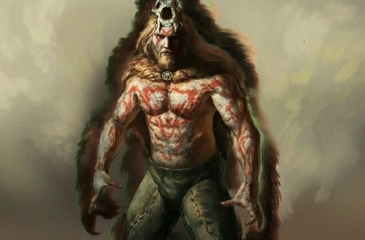

title: Агвид
parent: ankety
order: 110
icon: bi-person
group: Персонажи игроков
image: photo/ankety/agvid/knopka.jpg
vk: 54933252
art: photo/ankety/agvid/art-1.jpg
layout: anketa

**Владелец персонажа** — [Денис Орков](https://vk.com/kozredgofasta)

**Имя** — Агвид

**Возраст** — 55 лет (50 лет в форме духа, 5 лет в человеческом обличье);

**Раса** — Элафак

## Внешность

Есть такое название мужской фигуры — перевёрнутый треугольник — когда фигура утончается к талии. Фигуру Агвида можно назвать прямоугольником и выглядит она довольно массивно. Рост его порядком двух метров, а вес — около ста килограмм. Он не может похвастаться красиво играющей мускулатурой, все его мышцы будто выдолблены в нём и выглядят недвижимо.
Лицо Агвида покрывает светлая борода, а до плеч опускаются такие же светлые волосы, которые он завязывает в косичку и, иногда, моет. Глаза у Агвида бледно-голубые, чуть ли не серые.
Рост его порядком 190 сантиметров, а вес — 95 килограмм.

## Характер

Как личность Агвид взращивался среди военных и, что немаловажно, во время войны. Братские узы неродных людей, готовность пожертвовать собой за некую «родину», смелость, отвага и прочее окружали новорожденного элафака. Агвид же всё это впитывал в себя, как губка, повторяя за другими, пусть и не понимая почему. Из его уст часто можно услышать стандартные «солдафонские» фразы и речи, как будто он настоящий патриот неизвестной ему родины, про которую никогда не спрашивал. Часто он ведёт себя прямолинейно и предельно честно, даже когда это может быть неуместно. Быть верным данной когда-либо клятве или сдержать своё обещание для него — само собой разумеющееся, о чем даже не нужно задумываться.

В разговоре он часто теряет нить, отвлекаясь на то, что взбредёт ему в голову или попадётся на глаза. Говорить может много и без передышки, так же как и наоборот. Всё зависит от... Агвида. Часто путает слова, ошибается с их значением, а также совершенно не улавливает настроение в воздухе, отчего до него всегда доходит последним. Это не касается каких-то смертельных опасностей, когда в дело вступают его животные инстинкты. О, инстинкты в его поведении изредка превалируют над прочим.

Какое-то время он путешествовал с одной особой, которая с горем пополам научила Агвида грамоте и счёту, благодаря чему он научился различать самые базовые вещи: указатели, надписи крупными буквами и вывески. А также считать до десяти, где после этого значения у него идёт «чуть-чуть много», «много» и «очень много».
Научился у своей спутницы Агвид не только грамоте, но и социальному взаимодействию. И если до этого элафак не мог различить очевидные намерения человека перед ним, теперь он может понять, чего от него хотят люди, не прибегая к прямым просьбам. Но он всё ещё довольно наивен и ведётся на разные уловки: иногда ведомый интересом, иногда смелостью, а иногда и глупостью.

## История

Как известно, элафаки рождаются в момент чьей-то смерти, получая контроль над телом, наполняя его жизнью снова. Безымянный дух овладел телом погибшего в короткой стычке солдата где-то в северных лесах. Тогда шла очередная безымянная война за очередную бессмысленную цель: поруганная честь, нерешенные многолетние споры, конфликт за ресурсы и землю — для разумных рас всегда найдётся повод для войны.
Рана от меча на его груди затянулась, стеклянный взгляд мертвеца наполнился жизнью, и он поднялся, обнаружив себя сидящим в окрашенном кровью и истоптанном снегу, среди трупов других солдат.

Вскоре на поле битвы вернулись бывшие товарищи солдата, чтобы забрать павших и найти выживших. Их удивлению, а после и радости не было предела, когда они обнаружили своего друга целым и невредимым. Обнимая и похлопывая по плечам, его отвели в лагерь, где дух и узнал имя того, кто владел телом до него. Агвид.
— Богами клянусь, сам видел, как его мечом полоснули!
— Ну значит показалось или Агвид везунчик.
— Боги любят, точно говорю!
Агвид сидел напротив костра, вокруг него оживленно общались солдаты, которые и не подозревали о том, что тот Агвид, кем бы он ни был, действительно умер. Сам элафак ещё мало что понимал, а потому всё время молчал, слонялся по лагерю и никого из бывших друзей не узнавал. Остальные не придавали такой резкой смене в поведении особого внимания, ведь во время войны случалось и не такое, особенно после пережитой битвы. Потому Агвида держали подальше от битв, пока он не придёт в норму.

Шли месяцы. За это время элафак полностью освоился и привык к новому себе, став называть себя Агвидом. Больше он не слонялся бесцельно в округе и не молчал, смотря на остальных рыбьим взглядом. Он стал более активным и разговорчивым, начав приносить пользу лагерю, помогая тут и там, попутно практикуясь сражаться. Сам элафак успел проникнуться колоритом своего окружения: весельем и добродушием вперемешку с мрачными темами разговоров, шуток и ситуации в целом. Многие из солдат, воевавших уже не первый год, свыклись со смертью, воспринимая её, как что-то обыденное, над чем можно пошутить и от души посмеяться. Такое бесстрашие оказало на Агвида сильное впечатление, несомненно, нашедшее место в его формировавшемся характере.

Но какая же война без поражений? Ранним утром на лагерь напал враг. Агвид так и не понял, против кого сражаются все эти люди и зачем. Казалось, даже сами солдаты тоже уже давно перестали понимать хоть что-то. Почти всех перебили, осталась лишь горстка выживших, которые смогли сбежать. В их числе был и Агвид. Не видя смысла в том, чтобы продолжать сражаться, оставшиеся солдаты решили дезертировать. Вряд ли их жалкую шайку кто-то хватится. Кто-то ушел один, кто-то объединился. Агвид же выбрал одинокий путь.

На этом пути он повстречал множество интересных существ: враждебных и миролюбивых, отстраненных и разговорчивых, разумных и не очень. Он доставил письмо умирающего отца сыну и поучаствовал в драке в таверне со спустившимися с гор охотниками. Оказался жертвой старушки, оказавшейся ведьмой, и одолел её одним ударом. Помог убить мантикору, случайно оказавшись в горах и встретив охотника на монстров. Встретил другого элафака, овладевшего телом женщины, и оказался связан с ней древними кандалами гномов. Вместе с ней он помог отразить атаку тёмных сил на город Тармун. И только после этого они смогли избавиться от оков. Решив, что на этом их пути расходятся, элафаки пошли своей дорогой, но Агвид оставил волшебные кандалы себе, как напоминание о своей спутнице.

Возможно, уже при рождении или в заслугу за все добрые дела на Агвида упала божественная длань. Негласно, без его ведома его нарекли избранным, и про это он узнал лишь спустя пару месяцев после защиты Тармуна. Сама Итишия избрала его. Про свою избранность Агвид узнал у странствующего монаха, который почувствовал в элафаке божественное присутствие. Тогда Агвид решил узнать больше о том, кем он теперь является и что ему с этим делать.

## Избранный

Избранный Итишии.

## Подконтрольные элементы и типы магии

Элементы: земля, свет, вода Типы магии: магия земли, магия жизни.

## Способ активирования заклинаний

Чтение вслух

## Способности

### Доспех

- Заклинание, позволяющее создать из ближайшего материала (земля, камень и пр.) массивный доспех, больше похожий на голема. Размер и вес доспеха могут разниться, но они не превышают 2,70 метров и 1000 килограмм.
- Доспех полностью покрывает собой тело и действует, как активный экзоскелет, увеличивающий физические показатели владельца кроме скорости движений, работая и подпитываясь магией. Поэтому во время существования доспеха невозможно творить другие заклинания. Доспех можно быстро покинуть и так же вернуться в случае чего. Доспех создается на протяжении 1 минуты.
- Длительность: 5 минут (+1 минута с использованием духа-покровителя). После чего доспех рассыпается.
- Перезарядка: 5 часов.

### Заживление

- Заклинание, требующее воду. Очищая жидкость, заклинание наполняет её целебными свойствами, исцеляя легкие ранения за 2 минуты, средние за 5 и тяжелые за 10 минут (желательно сделать это сразу). При наложении оказывает обезболивающий эффект (не самый сильный, но всё-таки).
- Длительность: мгновенно. Перезарядка: 5 минут.

### Бросок

- Заклинание, позволяющее использовать землю _(предварительно сжатую для большей твёрдости)_ или камень в качестве метательных снарядов. Скорость такого снаряда схожа со скоростью стрелы _(которая может быть снижена из-за веса снаряда или наоборот повышена)_.
- Длительность: мгновенно. Перезарядка: разнится от веса снаряда _(5-30 секунд, где 30 — особо тяжелый снаряд)_.

### Защитная пластина

- Заклинание, использующее землю или камень для создания защитной пластины размерами с грудь человека.
- Пластина парит вокруг персонажа и самостоятельно подставляется под удар оружия, после чего взрывается осколками наружу, атакуя врага и нанося ему многочисленные раны. Сразу может быть 3 пластины вокруг персонажа.
- Длительность: до разрушения. Перезарядка: 15 секунд.

### Великое землетрясение

- Сильное заклинание, разрывающее под ногами как камень, так и землю (будь то чистая полянка или стены крепости). Характеры разрушений схожи с бойницами на стенах крепостей, когда куски породы хаотично изменяют свою высоту в радиусе 10 метров. Может быть выбрано как одно направление, так и весь круг. Для сотворения необходимо 5 секунд, после чего будет происходить постепенное разрушение, исходящее от персонажа.
- Длительность: навсегда. Перезарядка: день.

### Заземление

- Заклинание, позволяющее «утонуть» в породе и передвигаться под её поверхностью, как если бы персонаж был кротом, но со скоростью плаванья в воде. По окончании подземного путешествия персонажа на высокой скорости «выплёвывает» наружу.
- Длительность: 1 минута. Перезарядка: 30 секунд.
## Физические параметры

- Агвид сильный воин, не обделенный должной реакцией и скоростью. Его стиль боя сбалансирован и универсален, в бою использует магию. Очень мощные мышцы ног и крепкие кости.
- Элафак умеет обращаться с тяжелым одноручным оружием (топоры, булавы и т. д.).
- Вынослив, может сохранять скорость бега на долгом протяжении времени.
- Агвид обладает знаниями о выживании в диких местах: создание временного жилья, простых инструментов и прочее.
- Хорошо ориентируется на местности, обладает хорошей топографической памятью.

## Прочие особенности

В основе элафака лежит медведь. Конечности его пусть и остались по строению человеческими, но покрылись плотной бурой шерстью, стали больше и толще, а также обзавелись действительно звериными когтями. Шерсть находится на привычных для волос местах, однако покрывает их плотнее: верхнюю и нижнюю части торса, спину, предплечья и ноги ближе к ступням, на пальцах которых также острые когти. И конечно же клыки, как и подобает медвежьим: не самые острые, но массивные и крепкие.
