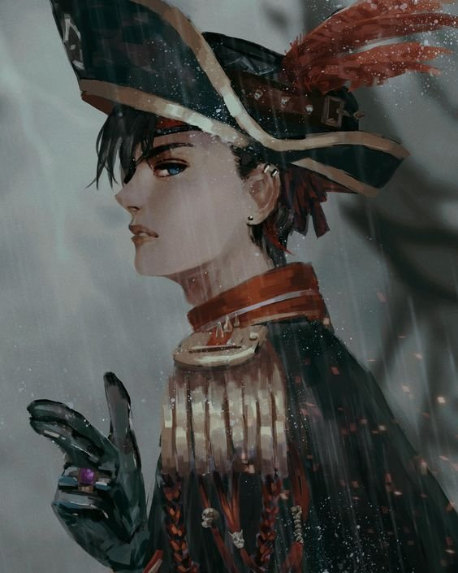
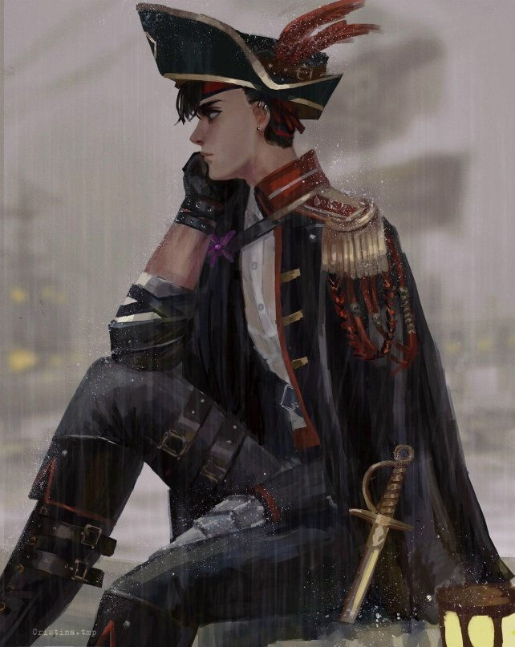

title: Ария Коллимор
parent: ankety
order: 60
icon: bi-person
group: Персонажи игроков
image: photo/ankety/ariya-kollimor/knopka.jpg
vk: 55307891
art: photo/ankety/ariya-kollimor/art-1.jpg
layout: anketa

**Владелец персонажа** — [Владимир Мытарин](https://vk.com/alpha_re)

**Имя** — Ария Коллимор; Блик

**Возраст** — 24 года

**Раса** — Человек, граальд

## Внешность

Рост: 187 см. Вес: 67 кг.
Ввиду отсутствия правого глаза, постоянно носит черную повязку. Чуть ниже правого плеча расположился цветок Ирис, который он нашёл у первого убитого им эльфа вместе с перстнем аметистового цвета. Кроме того, он никогда не снимает чёрные перчатки, так как имеет множественные шрамы и порезы, которых он стыдится. Имеет несколько серёжек на левом и правом ухе

## Характер

В сердце Арии Коллимора, обычного выходца из небольшой деревушки на окраинах Нордфолла, сокрыты противоречия и тайны, создающие волнующий лабиринт его характера.
Одной из немаловажных черт его характера является доброта, которая словно пламенный свет пронизывает его душу. Он всегда готов поделиться своей щедростью и распространить тепло и благословение среди тех, кто его окружает. Однако, под этим светлым слоем покоится зияющая бездна эгоизма и нетерпимость по отношению к другим расам, которая время от времени подстерегает его решения и действия.
Кроме того, Ария является честным и смелым юношей, данные черты характера ведут его в вихрь приключений и вызовов.
Среди противоречий этого лабиринта, мы видим спокойствие, умиротворение, что смягчает бурные внутренние страсти. Это море гармонии, в котором Ария находит укрытие и вдохновение. Он способен сохранять хладнокровие и ясность мысли в сложных ситуациях, привнося в них долю рассудительности и решительности.
Неразрывно связанное с его характером стремление к наживе — темная тень, мрачное затаённое пятно. Он может подчинять свои решения и действия собственным интересам и стремлению к личной выгоде.
Фобии: Рассвет, арахнофобия, боязнь потери свободы

## История

История Арии Коллимора начинается в маленькой деревушке на окраине Нордфолла. Родители Арии были простыми рыбаками, которые усердно трудились, чтобы прокормить свою семью. Уже с ранних лет маленький Ария ощутил свободу и притяжение моря, которое окружало его родную деревушку.
С самого детства Ария был проникнут духом приключений и неуемной жаждой исследования. Он мечтал о далеких странах, неизведанных островах и неограниченной свободе, которую море могло предложить. Каждый день мальчик слушал рассказы старых моряков, которые оживляли его воображение и рождали мечты о жизни на волнующихся пучинах.
Он старался, насколько это было возможно, обучиться искусству навигации, владению холодным оружием, а также навыкам пиратского ремесла.
Одним судьбоносным утром, когда первые лучи солнца проникали сквозь покрытые дымкой облака, Ария услышал пронзительный звон единственного колокола, который на тот момент был в деревне, возвещая о нападении разбойников. Это была банда, которая уже долгие годы терроризировала окрестности Нордфола и состояла из смеси различных рас.
К вечеру, когда от деревни осталось лишь пепелище, а в воздухе стоял могильный смрад, Ария вылез из подвала своего дома и, весь в ссадинах, направился в ближайший портовый город, где напросился в команду одного торгового судна и в возрасте 14 лет стал «Пороховой обезьяной», в чьи обязанности входила вся черновая работа.
Спустя два года данный корабль был взят на абордаж, а большая часть команды вырезана, сам же юноша чудом избежал смерти и встал под флаг «Весёлого Роджера», где медленно, но верно, начал обучаться премудростям пиратского дела и восходить по карьерной лестнице. Во время своих странствий с пиратами Ария потерял глаз, характер его ожесточился, в нём начали проявляться эгоистичные черты, жажда наживы, а детские мечты ушли на второй план.
В возрасте 24 лет он дослужился до Боцмана и именно в этом году, уже не молодой и плохо видящий капитан корабля по имени Эдвард Митчел навёл корабль на рифы, и он потерпел крушение недалеко от берегов города Гримм, самого же юношу выбросило на песчаный берег под палящим солнцем.

## Подконтрольные элементы и типы магии

Элементы: огонь, воздух; Типы магии: магия воздуха, магия огня

## Способ активирования заклинаний

Прочтение вслух

## Способности

### Ветряной щит

- Созывает ветер, чтобы создать защитный щит из сильного воздушного потока размером 1м x 1 м, способного отразить атаки или смягчить их силу в зависимости от силы оппонента и его оружия. Может отразить удар железным оружием, но с оружием из другого металла возникают проблемы.
- Длительность действия: 1,5 минуты.
- Перезарядка способности: 20 мин.

### Воздушный поток

- Создаёт клубы воздушного потока в количестве 2 шт., которые летят к цели со скоростью примерно 20 м/c, нанося урон по небольшой площади размером 30 см x 30 см. Способны оставить вмятины и поломать ребра, если броня состоит из железа, остальные виды материала только царапает.
- Длительность действия: 1 минута.
- Перезарядка способности: 1 ч.

### Огненный шар

- Создает небольшую сферу пылающего огня размером 40 см x 40 см, которая может быть брошена в цель и летит со скоростью 10 м/c, нанося урон и вызывая ожоги, способна вызвать сильные раны при соприкосновении с кожей, а также способна с легкостью прожечь броню из соответствующего материала.
- Перезарядка способности: 1 ч.
## Физические параметры

Ловкий пират Ария Коллимор впечатляет своей непревзойденной гибкостью и мастерством движений. Каждое его движение исполнено легкости и точности, словно он воплощает элегантность и свободу самого ветра. С его гибкостью и подвижностью он легко преодолевает препятствия, выполняет сложные акробатические трюки и словно плавает в воздухе. Ни один уголок пиратского корабля не остается непокоренным перед его прыжками и перепрыгиваниями, а кожаные тросы и мачты становятся для него лишь дополнительными элементами гимнастической площадки.
Скорость — это его вторая природная черта. Его рефлексы работают мгновенно, позволяя ему молниеносно реагировать на изменяющуюся обстановку. Будь то неожиданный налет врагов или неожиданное поворотное сражение, Ария Коллимор как тень мелькнет перед глазами своих преследователей, оставляя их далеко позади. Скорость его передвижения не имеет равных среди пиратов, и его способность маневрировать с такой легкостью и быстротой становится его непреодолимым преимуществом на море.
Хотя сила не является главной чертой Арии, но всё же её достаточно, чтобы справиться с физическими вызовами, с которыми он сталкивается на своём пути. Он может поднимать тяжести до 35 кг и справляется с физическими требованиями пиратской жизни. Его мышцы относительно крепки и готовы к боевым действиям, что делает его сильным противником и надежным товарищем.
Но, пожалуй, самым впечатляющим атрибутом Арии является его выносливость. Он способен продолжать бороться и двигаться вперед даже после долгих часов напряженной активности. Его выносливость и стойкость позволяют ему преодолевать физические и эмоциональные границы.

## Прочие особенности

Имеет не ярко выраженный загар. Хорошо управляется с различными видами холодного оружия, начиная от кинжалов и заканчивая рапирами. Несмотря на свою ловкость, может быть довольно неуклюжим и спотыкаться на ровном месте, ввиду чего часто покрыт ссадинами и ушибами.

