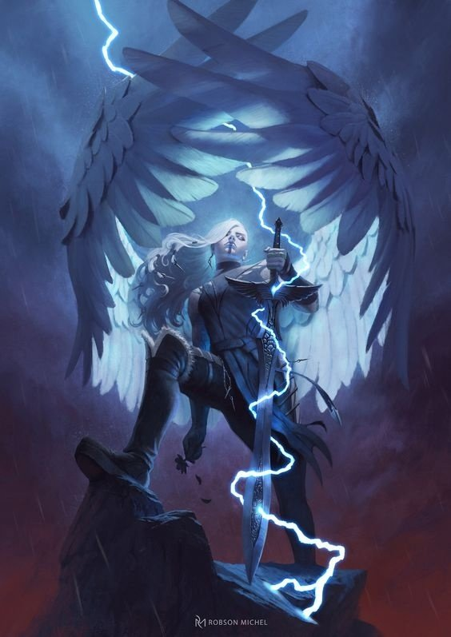
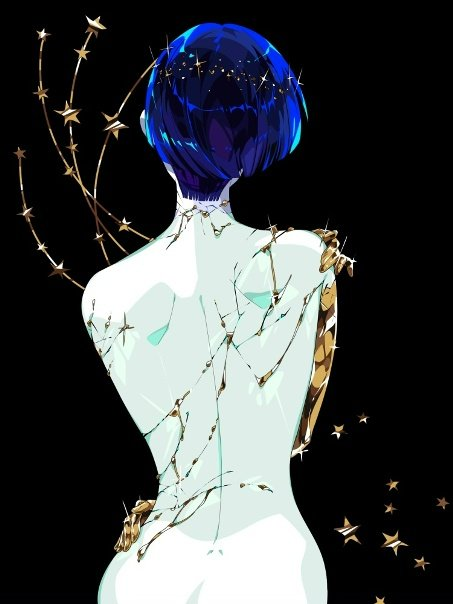
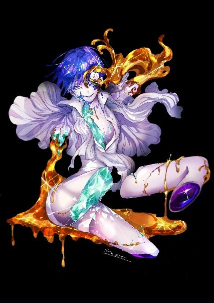
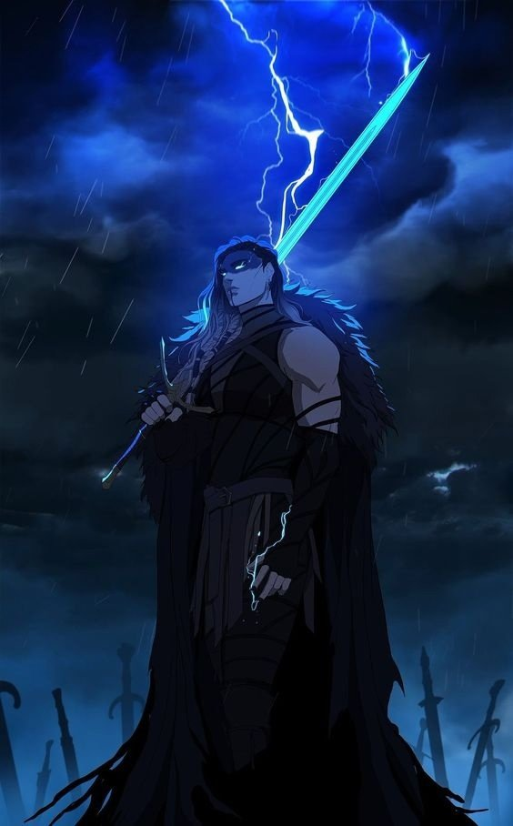

title: Айлирэнн
parent: ankety
order: 50
icon: bi-person
group: Персонажи игроков
image: photo/ankety/aylirenn/knopka.jpg
vk: 55285297 55285299
art: photo/ankety/aylirenn/art-1.jpg
layout: anketa

**Владелец персонажа** — [Вайесс Заргред](https://vk.com/confusion_of_the_abyss)

**Имя** — Айлирэнн. Прозвища: Айли, Рэнн, Святая безбожница, Еретик, Многоликий дух

**Возраст** — 290 лет

**Раса** — Элафак, берёт начало от грифона

## Внешность

Айлирэнн высокого роста _(2,1 метра, вес — 150 кг)_, широкие плечи сильно контрастируют с меньшими бёдрами, но вместе с этим видна талия. Грудь у Рэнн первого размера и аккуратная. Голова формы овала с островатым подбородком и заметными скулами, губы немного пухловаты, а глаза выразительные с пышными ресницами. Радужка глаза чёрного цвета, а брови тонкие. Волосы у Рэнн пышные, чуть длиннее плеч и чёрного цвета, поседевшие на кончиках. Кожа у Айли немного бледновата и груба на ощупь. Уши у Айли немного островатые, из-за чего они напоминают таковые у эльфов, но только отчасти. Один висок выбрит, а часть волос она заплетает в небольшие косы, вплетая своеобразные украшения синего цвета. Её лик чаще всего украшен боевой раскраской тёмно-синего цвета, таким же красителем она красит губы, но не полностью, оставляя только тонкую линию. Само телосложение у неё отлично сложено и сильно заметен рельеф мышц. Руки у неё заметно накачанные, а пальцы на них длинные и аккуратные с заметными острыми ногтями. Всё её тело усеяно шрамами от небольших до заметных рубленых и крупных, даже имеются следы от парочки ожогов. На спине между лопатками находится рабское клеймо, буквально выжженное на её плоти. За спиной выделяются сине-белые крылья, а ниже копчика находится львиный хвост, как таковой есть у грифонов.
Облик Айлирэнн как духа ощутимо отличается. Рост остаётся прежним, но в целом телосложение стройное и заметно тощеватое, кожа же мягкая и бледная, почти сравнимая с фарфором. Волосы короткие, не достающие до плеч, а их цвет меняется на тёмно-лазурный, при этом местами они выглядят прозрачными, а на свету они отдают слабым блеском подобно драгоценным камням. Острые черты лица сглаживаются, а ушки и вовсе похожи на людские. Крылья и хвост вовсе исчезают. Радужка одного глаза выцветает, а другого становится тёмно-лазурного цвета. Руки по плечи словно сделаны из сплава золота и платины с аккуратными тонкими и длинными пальцами. Когда на теле появляются трещины, из них начинает сочиться густая жидкость, напоминающая цветом тот же сплав. Губы выглядят более тонкими. Когда тело начинает ломаться сильнее, оно ломается не как живой организм, а как минерал, из-за чего нутро выглядит как сочетание лазурита, фосфофиллита и сплава. Ноги же, ломаясь, вовсе напоминают помесь агата и лазурита.

## История

Безродное дитя бежало вглубь леса, бежало куда глаза глядят, спасаясь бегством. Кем было то дитя? Не более чем вещь, которую приютил деспот-эльф, что высокомерно делал с ней всё, что придёт ему в голову. Не раз и не два он издевался над ней, несколько раз даже надругался. Сломленная и отчаявшаяся, она решила бежать и вот она бежит вперёд, а в блеклых глазах блеснула искра надежды. Свист стрел становился всё ближе и ближе. Дитя и не подозревало, что оно — дичь для охотника-эльфа. Первая стрела настигла дитя, пронзая её плечо. Юная девчушка полетела кубарем вниз в овраг. Тщетно пытаясь встать на ноги, она пыталась бежать, но её настигла вторая стрела, пронзив ногу.
Юное тело содрогалось от боли, а надежда гасла в её глазах и вот она просто сдалась, смирилась и просто ждала. Последняя стрела пришлась прямо в голову, освобождая измученную девчушку от оков плоти, тело же брошено на съедение диким тварям. Правда последнего не случилось. В бездыханное тело вселился дух, искажая и изменяя хладное тело. Не один час прошёл с начала изменений, и вот родилось совершенно иное существо. На спине красовались мощные кроваво-красные крылья, на руках и ногах были чёрные острые когти. Долгое время она ступала ногами по земле, изучая всё вокруг. Краткие видения и воспоминания прошлого владельца тела появлялись в её разуме, перемешивая всё в единую кашу, из-за чего реальность с бредом ей было почти невозможно отличить. В таком состоянии она блуждала несколько месяцев, кидаясь подобно зверю на всё, что оказывалось рядом. Она старалась обуздать природную магию, и хоть и с заметным трудом, но у неё получилось. Правда насмотреться она успела всякого от вариантов собственной смерти со сжиганием на костре или отрубанием головы, до вечных унижений и презрения со стороны остроухих, которые испытывал прошлый владелец сего тела.
Уже в более вменяемом состоянии дух был обнаружен работорговцами и ими же схвачен, отчасти из-за того, что его застали врасплох. Ему сломали крылья, дабы тот не мог улететь, шансов на спасение практически не было. Попытки увидеть будущее ни к чему не приводили, она видела только отчаяние и боль, участь игрушки или послушной куклы и более ничего. Вынужденный подчиняться элафак был вывезен за пределы Бранна и довольно быстро продан. Новый владелец дал духу имя — Айлирэнн. Её учили языкам, этикету и танцам, в сущности, всему, что сделало бы её красивым украшением. Айли попросту мирилась со своей золотой клеткой, полной роскоши, попутно она искала возможность сбежать, терпя побои, унижения и изнасилования. Год или два, а может и десять минуло с начала такой жизни, Айли банально потеряла счёт времени, продолжая ждать возможности для побега и мести, попутно всматриваясь в будущее и налаживая взаимоотношения с остальными рабами. И вот Рэнн узрела в видениях грядущего шанс на побег, шанс обрести желаемую свободу. Это событие чётко отпечаталось в памяти духа. В ходе интриг, направленных против их хозяина, рабы подняли бунт — все приготовления не прошли напрасно, но и жертв было множество, как среди рабов, так и стражи. Многие были схвачены, кто-то был искалечен и убит, а сама Айлирэнн сбежала в творившемся хаосе. Она длительное время скиталась, смотря на мир вне своей клетки. Рэнн видела, как одни живут на грани нищеты, отдавая всё, что у них есть, дабы хоть как-то прокормиться, как другие живут в богатстве и достатке, желая получать всё больше богатств. Айли видела, как религиозные лидеры злоупотребляли своим положением, весь мир казался ей мерзким и извращённым местом, где один может надругаться над другим, если у второго нет материальных богатств. Она видела, как отчаянно порой другие молят своих богов о помощи, просят совета, силы или богатств и как их боги чаще всего безмолвно игнорируют простой люд. Наблюдение за гнилым нутром мира только подкрепляло её ненависть к устоявшемуся порядку.
Павших товарищей она не забыла, без устали обучаясь и изучая магию. Однажды загнанная в угол работорговцами в глубоких лесах за пределами Бранна, Рэнн была спасена ведьмой-отшельницей. Айли сразу попыталась навязаться к ней в ученицы, но получила отказ. Будучи достаточно упёртой, она всё-таки уломала ведьму взять её в ученицы, рассказывая о своих мыслях, переживаниях и размышлениях. Во многом именно из-за этого ведьма и согласилась.
Обучалась у неё Рэнн не столь долго, отчасти из-за целеустремлённости самой девы, которая без продыху погружалась в глубины тёмной магии. Желание излечить сломанные крылья, что когда-то были хрупки, побудило деву изучить уже магию крови. Постепенно ученица сравнилась по знаниям со своей наставницей, начав уже собственный путь в познании магии. Начав погружаться в алхимию, она искала способы сделать собственное тело сильнее, ведь она была слишком слабой, а тело хрупким. Изыскание привело к успеху, но далеко не сразу. Множество бессонных ночей ушло на познание и совершенствование метода, что избрала Рэнн, чтобы стать сильнее физически. Осознавая слабость других, она желала даровать им силу, но то было не так уж и просто, ведь порой физической силы было недостаточно. Всё больше углубляясь в тёмные знания и погружаясь в изучение таинства душ, она создала заклинание, цель которого — даровать силу слабым телом, но сильным духом. Первым обладателем стигмата стала наставница Рэнн, которая сразу ощутила различия и влияние стигмата на душу и разум, рассказывая о них самой Айли, и та стала искать решение, меняя и искажая заклинание, пока оно не было завершено.
Ведьма не желала вмешиваться в месть Рэнн, но Рэнн смогла уговорить её хотя бы помочь освободить рабов. Кровавым маршем они прошлись по территории поместья бывшего хозяина Айли. Они убивали охрану и гостей, не трогая лишь прислугу и рабов. Бывший мучитель Айли был оставлен напоследок, а сама она направилась в подвал и темницы, освобождая всех по пути. Большинство тех из них, кого знала Рэнн, погибли, а те, что выжили, были искалечены и сломлены духом, больше походя на животных. К удивлению девы они её узнали, а сама Айли не растерялась, сразу начав вещать о свободе. Не меньшую роль в этой пьесе сыграл ещё живой хозяин рабов, те, взяв окровавленные клинки из рук мёртвой охраны, быстро расправились с мучителем. Забрав всё ценное и полезное, они отправились в путь. Всего их было 25 душ, каждому из них Айлирэнн даровала стигмат тьмы, научив их использовать новую силу. Их путь был долог и тернист, порой они теряли товарищей, порой находили новых. То, что они устроили в поместье богатого аристократа, не осталось незамеченным — на них открыли охоту, но сдаваться без боя они не желали. Постепенно они были вынуждены всё чаще браться за клинки, а сама Айли уже начала задумываться над тем, чтобы сформировать анклав.
Видя будущее, она искала людей с сокрытым потенциалом, подбирала стариков, бедняков и паломников и тёмных магов, разочарованных в своей вере. Она давала им надежду, оказываясь всегда в необходимый момент и спасая из самых казалось бы безвыходных ситуаций. Численность их объединения росла, они освобождали рабов, даруя всем силу стигмата. Постепенно вокруг Айлирэнн начала формироваться религия. К каждому в анклаве она относилась, как к своим детям, нещадно мстя за каждого убитого. Постепенно Айлирэнн осознавала ценность информации, тогда они стали обучать шпионов, которые внедрялись везде, где только могли: от гильдий до целых государств, некоторые же и вовсе были отправлены на поиски орихалка и арконора.
Постепенно Айлирэнн приняла решение создать организацию, ведь численность ранее мелкой группы только росла и несмотря на всю её любовь к спонтанным решениям, Рэнн искренне старалась заботиться обо всех, из-за чего она стала продумывать чёткую иерархию, кто чем и для чего занимается. Тогда они и назвались «Анклавом Пустоты», постепенно сформировалась чёткая структура, при этом им не была важна расовая принадлежность и узы, которые постепенно формировались между каждым членом анклава. Айлирэнн не боялась высказывать свою ненависть по отношению к большинству божеств, открыто презирая тех, кто принуждает принимать своё вероисповедание силой, из-за чего она была прозвана «Святой безбожницей», что помогает беднякам, сиротам и калекам, ничего не требуя взамен, даруя силу всем желающим. Истинные же цели Айлирэнн искусно скрывались за красивыми словами о приходе нового божества, которое спасёт их всех, даруя землю обетованную. Хотя и лжи здесь вовсе не было, ведь она изучала божеств, вглядываясь в души последователей разных божеств и наблюдая за тем, что с ними происходит, когда те умирают.
Эти знания побуждали её развиваться и эволюционировать, как дух. Стремление изменить устоявшийся порядок вещей подстёгивало её расти как личность. Стремление защитить тех, кто ей дорог, вынуждало её браться за клинок вновь и вновь. Анклав при этом только набирал силу, расширяя свою сферу влияния. Общепринятым был тот факт, что у них не было собственных вооружённых отрядов, из-за чего королевство, на территории которого располагался анклав, попыталось принудить их силой работать на них, но привело это к целой кровавой гражданской войне. Сам же анклав вышел из этого противостояния победителем, а шпионы уже покидали территорию того государства, пробираясь даже на территорию Бранна.
В итоге Айлирэнн принимает решение направить анклав пустоты в Бранн уже масштабно. Причины для подобного было всего две: расцвет культов Кхелы и распространение скверны. К их прибытию в Бранн сеть убежищ уже была подготовлена шпионами, что были отправлены туда много лет назад. Они активно наращивали влияние, продавая информацию. Они брали под своё крыло бордели, трактиры и мелкие деревушки, что были не в состоянии удержаться на плаву. Информация о новых торговых путях, что на море, что на земле, расположение бандитских шаек и патрулей эльфов, казалось ничего не уходит из взора Анклава Пустоты и это же главный их источник дохода. Сами же они далеко не раз давали бой скверне, порой даже помогая разобраться с последствиями подобной напасти. Сама же Айлирэнн начала активно путешествовать по Бранну, не забывая про дела гильдии.

## Подконтрольные элементы и типы магии

Элементы: Тьма, Вода, Земля; Типы магии: Магия Крови; Магия Тьмы.

## Способ активирования заклинаний

Мысленное представление глифа

## Способности

### Поглощение крови

- Используя магию крови, Айлирэнн притягивает свежую пролитую кровь и поглощает её, исцеляя свои раны, при этом чем опаснее рана, тем больше крови необходимо для исцеления. Ключевая особенность этого заклинания далеко не в исцелении, полностью иссушая жертву, Айли навсегда увеличивает свой объём маны, но для этого подойдёт не каждая кровь, а только тех, у кого имеется магический потенциал, а сам объём увеличивается на 1/3 от запаса маны жертвы.

### Кровавое усиление

- С помощью магии крови Рэнн увеличивает температуру своего тела, частоту пульса и количество красных кровяных телец искусственно увеличивая объём мышц, насыщая их кровью, тем самым повышая свои физические способности ценой повышенной нагрузки на тело, заклинание действует в течение 5 минут, а перезарядка занимает 5 минут, которая начинается с момента окончания действия заклинания.

### Кровавое озеро

- Айли призывает бесформенный сгусток крови под собой в виде обычного круга радиусом в 250 метров и толщиной 20 сантиметров. Сам по себе сгусток крови не опасен, он не может быть использован для способностей «Пожирание сути» и «Кровавое усиление». При этом сама Рэнн способна свободно управлять этим сгустком, придавая сгустку простые формы и кристаллизуя его, сжимая и направляя. Это заклинание отлично подходит, как для защиты, так и для нападения. Кровь после призыва не исчезает, но для придания ей форм Рэнн расходует магическую энергию. Также этой кровью вампир жажду утолить не сможет. Перезарядка заклинания занимает около 20 минут.

### Теневой рывок

- Используя магию тьмы, Рэнн за 2 секунды перемещается на расстояние в 80 метров и получает 50% к силе удара в ближнем бою, при этом оставляя за собой теневой шлейф, исчезающий в течение секунды. После окончания перемещения маг получает 100% скорости передвижения на 5 секунд.

### Залп тьмы

- Рэнн создаёт 3 сгустка тьмы размером с 65-67 см в диаметре, каждый из сгустков может быть разделён на 15 тонких игл длиной в 15 сантиметров, или на 5 снарядов размером с копьё. Любой из снарядов может пробить цель насквозь, если та не находится в доспехе или не использует защитную магию, при этом эффективную защиту среди магии предоставляет магия света. При попадании в доспехи снаряды наносят ударный урон, сравнимый с ударом орка, а вот при попадании в магическую защиту, та будет поглощаться снарядами и исчезать вместе с ними. Сами снаряды автоматически наводятся на цель, выбранную Айли, максимум целей, на которые она способна навести снаряды, — 10, при этом если противников меньше, то большее число снарядов будет направлено на одну цель, если целей больше 10, то будут поражаться ближайшие противники. Когда снаряды заканчиваются, 1 большой сгусток исчезает, после чего остаётся ещё 5, когда все они исчезнут создать новые можно только через 20 минут.

### Стигматы тьмы

- Сложное заклинание магии тьмы и причина особенной ненависти Аола к Айлирэнн. Это заклинание создано самой Рэнн и не может использоваться в бою, это скорее ритуал, дающий силу тьмы тому, кто ею не обладает и усиливает её в тех, кто её использует. В ходе ритуала Рэнн окутывает руки тьмой до такой степени, что они становятся неосязаемыми, после чего она пускает руки внутрь существа, касаясь его души с помощью тьмы и вычерчивая на ней символ. После завершения ритуала существо получает возможность использовать магию тьмы, но меченых существ нельзя назвать магами тьмы, им недоступны сложные заклинания, но вместе с этим и не нужны глифы для использования тьмы. Также важен и тот факт, что стигмат, оставленный на душе, постепенно просачивается вглубь души, всячески искажая и извращая своего носителя, если тот потакает тьме, что постепенно может привести к уничтожению его души, но при этом сдерживая стигмат его обладатель не способен использовать его полный потенциал. Души после уничтожения уже не попадают в царство божества, в которое веровал обладатель стигмата. По факту даже существо, обделённое маной, способно использовать стигмат тьмы в полной мере, но с некоторыми оговорками. Если обладатель стигмата маной не обладает, то стигмат вместо маны поглощает жизненную энергию прямо из души обладателя, что постепенно сокращает его жизнь, при злоупотреблении приводит к смерти, но душа меченого также не попадает в чертоги божеств, а устремляется к Рэнн и поглощается ей. Сами души не делают её сильнее и не увеличивают объём маны, поглощение душ провоцирует её возвышение, как духа, искажая собственную природу и суть. Стигматы по своей сути схожи с природной магией и без должной практики скорее убьют своего обладателя. Самый эффективный способ подавлять стигмат — это возносить молитвы Рэнн, иные же способы не слишком эффективны, но, обладая достаточно сильной волей, владелец метки может подавлять её и без этого.
- Если же существо обладает магией тьмы, то на него также может быть наложен стигмат, но в таком случае его заклинания магии тьмы просто усиливаются ценой большего расхода маны на них и с теми же оговорками. В случае если личность, на которую был поставлен стигмат, не обладает магией тьмы, то он работает так же, как и на тех, кто маной обделён, но вместо жизненной энергии забирая магическую, а при переусердствовании и жизненную. При этом способности, даруемые стигматом, индивидуальны для каждого существа и во многом зависит от его личности и характера. Максимум стигмат способен даровать только три способности магии тьмы, при этом не один год может уйти на овладение стигматом, но подобное индивидуально.
## Физические параметры

С физическими способностями Айлирэнн всё не слишком однозначно. За её спиной находятся два массивных крыла, размах которых составляет 2,3 метра. Сами по себе крылья гибкие и не менее прочные, способны по прочности потягаться с прочностью костей гномов с той разницей, что её кости легче. Единственным взмахом она может подняться в воздух на 3 метра. Вместе с этим сами её кости существенно легче, используя восходящие потоки воздуха она способна подниматься на высоту 9 километров над уровнем моря. Скорость её полёта достаточно высока, чтобы потягаться с грифоном. Когти на руках и ногах остры и намертво впиваются в чужую плоть. При этом самими руками стоя на земле она способна поднять всего 80 килограмм, но в полёте она способна нести 150 килограмм используя силу собственных крыльев. Её взгляд способен фокусироваться на двух разных точках, а дальность её видимости составляет 3 км. Слух и нюх у Рэнн немного лучше, чем у человека, но не более. Век по факту у Айли две пары, первые обычные и ничем не отличаются от человеческих, а вот вторые прозрачные и защищают её зрение от пыли и встречного ветра, когда она поднимается высоко в небо, расположены они под обычными веками. Выносливостью она может посоперничать с гномом, но только посоперничать. Высокая плотность и гибкость мышц позволяет ей потягаться в физической силе со своим биологическим родичем в лице грифона.

- Айли опытный фехтовальщик и способна посоперничать с мастерами клинка опытнее неё самой, но это лишь благодаря использованию грязных трюков и разных уловок. Специализируется как фехтовальщик на бое полуторными мечами со щитом, двуручными клинками и копьём, которое она может комбинировать как со щитом, так и без.
- Айлирэнн отлично разбирается в магии, даже той, которой полноценно не владеет, но лишь в теории. Не меньше её познания в кузнечном деле, но также на уровне теории, сама выковать клинок она не сможет. Когда же дело касается артефактологии, Рэнн обладает не только теоретическими познаниями, но и практическим опытом, совмещая знания о кузнечном ремесле и магии, которыми она охотно делится с тем, кому доверяет. Не меньше она знает о металлах, в том числе и о тех, про которые только ходят легенды.

## Прочие особенности

Крылья Айлирэнн достаточно гибкие, поэтому она часто выгибает их, формируя подобие плаща, который закрывает почти всё её тело за исключением головы.
Айли обладает природной магией, которая проявляется в виде видений. Рэнн не один год тренировалась, чтобы подчинить эту силу себе. Ныне она способна заглянуть в будущее на год вперёд, правда, очень многое зависит от того, чьё именно будущее или прошлое она смотрит и далеко не всегда её далёкие видения точны, порой они и вовсе отличаются от реальности, если сама Айли начинает вмешиваться в видения. При этом она способна заглянуть на краткий промежуток времени в будущее. В прошлое же существа она может заглянуть гораздо дальше. При этом чем короче по длительности взгляд в будущее или прошлое, тем меньше концентрации ей необходимо.
За свою жизнь она потеряла далеко не одно существо, что было клеймлено стигматом тьмы. Это оказало существенное влияние на неё и её развитие.
В отличие от большинства элафаков, её оболочка духа-покровителя исказилась до такой степени, что стала чем-то иным, из-за этого она не только слилась со своей оболочкой, но и перестала получать ману за счёт духа-покровителя. Вместо призыва духа её тело покрывается духовной оболочкой и поглощается внутренней тьмой самой Айли, сама духовная оболочка приобретает человекоподобные черты. При этом духовная оболочка сама по себе не завершена, из-за чего она разрушается и искажается подобно скорлупе яйца. Из трещин вытекает нечто напоминающее жидкий сплав из золота и платины. Руки же выглядят так, словно сделаны из этого сплава. По сути эта жидкость не является этим сплавом, а сама Рэнн способна им управлять, придавая самые разнообразные формы, и менять его плотность, увеличивая прочность. Главным преимуществом же является то, что силы она может черпать из веры, души клеймённые стигматом начинают резонировать словно в единой молитве, тем самым подпитывая эту форму Рэнн. Стоит отметить, что обычным оружием в этой форме её не ранить. Исключением является зачарованное оружие и то, что изготовлено из адамантита, орихалка и арконора. Также она уязвима к магии, ещё больший урон оказывает магия света. В этой форме Айли не способна летать. Физические способности многократно возрастают, превосходя даже гномов, а латы же она может ломать, так же, как человек рвёт лист бумаги, но вместе с этим магию крови она использовать не может по причине отсутствия крови. При этом существует ещё один не меньший нюанс, а именно её тело разрушается в зависимости от нагрузки из-за незавершённости духовного тела. При этом все души убитых поглощаются ей сразу. Кроме того, она не способна постоянно использовать эту форму и принимает её в крайнем случае, ибо полное уничтожение тела убьёт Айли. Духовное тело она способна использовать только минуту, но оно может быть увеличено путём поглощения душ, но массовое поглощение всех подряд будет приводить к эволюции и возможной утере физических способностей, приобретая совершенно иные. Использовав эту форму, принять её вновь она сможет только через 3 дня.
