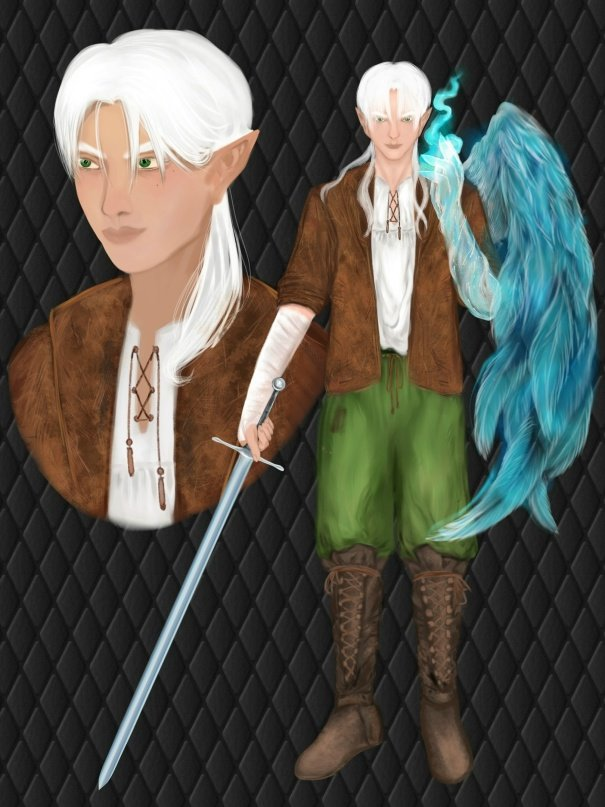

title: Элвен
parent: ankety
order: 30
icon: bi-person
group: Персонажи игроков
image: photo/ankety/elven/knopka.jpg
vk: 55341201
art: photo/ankety/elven/art-1.jpg
layout: anketa

**Владелец персонажа** — [Кирилл Кузнецов](https://vk.com/elvenarmavel)

**Имя** — Элвен Армавель, «Улыбающийся мечник».

**Возраст** — 23 года

**Раса** — Натаирец

## Внешность

Рост 183 см, вес 81 кг.

## Характер

Лицемер. Имеет свойство скрывать истинные намерения и эмоции либо за постоянной ухмылкой, либо за безразличной физиономией. По натуре язвительный, дотошный, добродушный, но ушлый. Временами наружу выскальзывает жестокая сторона его личности, но до сих пор он никого не убил.

## История

Элвен родился в деревне к юго-западу от Морской Розы. С детства увлекался книгами, особенно про героев древности, что повлияло на его личность. Природная любознательность позволила ему развиваться разносторонне, но со временем его аппетит притупился, и школяром он не стал. Ему предписывали будущее сильного мага, особенно учитывая родимые пятна на его руке. Эти предсказания не оправдались.
Армавель испробовал себя в нескольких профессиях, успеха не достиг. К юности он овладел мечом и всё чаще поглядывал на манящий горизонт, вспоминая о замечательных историях. Раз уж здесь для него не нашлось цели, значит, она где-то там, далеко.
В семнадцать лет Элвен отправился на север, в Сердце Леса. Месяц общения с мудрецами позволил многое узнать о лесе и его истории, но не более. Самое ценное, что эльф смог унести, — опавшая ветвь Сердца Леса. Она более не испускала магию, но листья были ничуть не увядшими. Армавель без раздумий умыкнул её с собой и использовал в качестве дорожного посоха.
С тех пор прошёл год. Элвен брался за любую работу, где бы ни оказался. Ему пришлось побывать в разных группах и столкнуться с разными трудностями. Самой главной проблемой были мечи. Они ломались с незавидной частотой, что вынудило Элвена вернуться домой, в Натаир.
Прославленные в военном деле и искусстве изготовления оружия эльфы смогли изготовить из ветви бокуто и ножны, что развязывало Армавелю руки, но вынудило обучаться новому стилю фехтования. За два года он освоил иай и открыл в себе талант к магии воздуха. Во время одной стычки Элвен лишился левой руки. Это заставило его переставить приоритеты и продолжить совершенствовать навыки.

## Подконтрольные элементы и типы магии

Элементы: воздух; Типы магии: магия воздуха

## Способ активирования заклинаний

Произношение вслух.

## Способности

### Борей

- Узконаправленный сгусток ветра, отталкивающий или притягивающий цель. Чем выше масса цели и расстояние до неё, тем менее эффективно заклинание. К тому же подвижные цели могут избежать попадания. Ограничения по перезарядке нет. Сила может варьироваться в зависимости от природного ветра.

### Зефир

- Поток ветра, незначительно увеличивающий мобильность _(высота прыжка, скорость движения)_ и скорость оружия. Работает как пружина. Минус заклинания в работе по вектору. При постоянном использовании сжигает ману.

### Нотус

- Замена потерянной конечности искусственной, сотканной из тумана. Потоки воздуха постоянно циркулируют, захватывая частицы песка, воды и образуя руку. Поддержание постоянной формы требует концентрации и больших затрат магической энергии, так что заклинание держится недолго.

### Эвр

- Способность, обеспечивающая натиск или контроль. После каждого удара происходит ещё один удар воздушным клинком с задержкой. Одновременно можно удерживать до трёх движений, высвобождая их в нужный момент. Постоянно сжигает ману.
## Физические параметры

Развитость тела проявляется скорее в ловкости и выносливости, нежели в силе.
В бою полагается на провокации и изматывание. Холодным оружием метит в уязвимые точки рук и ног, чтобы обезвредить противника. Деревянным мечом наносит удары по голове, предплечьям и стопам. Не вступает в открытую конфронтацию без необходимости и до последнего уклоняется.

## Прочие особенности

Калека. Обладает лёгким шагом. Прозопомант. Говорит на двух языках. Увлекается кулинарией и травничеством.
