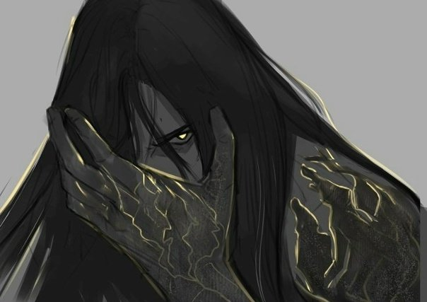
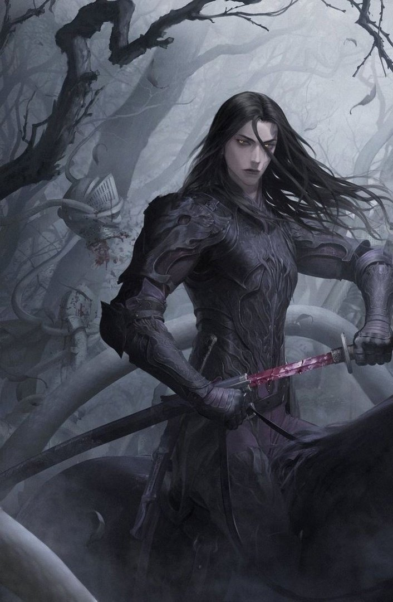

title: Генсиль
parent: ankety
order: 70
icon: bi-person
group: Персонажи игроков
image: photo/ankety/gensil/knopka.jpg
vk: 55275522
art: photo/ankety/gensil/art-1.jpg
layout: anketa

**Владелец персонажа** — [Pomidop Red](https://vk.com/pomidop_original)

**Имя** — Генсиль Лойархифт _(Первое имя, скрывает)_. Генс Харфорт _(Нынешнее имя, которым называется)_

**Возраст** — 144 года

**Раса** — Эльф Бранна _(Тщательно скрывает. Обрезал уши. Сменил цвет волос)_

## Внешность

Рост: 1.89. Вес: 90 кг
Волосы: Черные
Глаза: Желтые

## Характер

> Я сыт по горло гнилью и ложью, растущими под знаменем гордости за свой народ.

_Генсиль Лойархифт_

Обижен и обозлен на других эльфов Бранна, из-за чего тщательно скрывает свою к ним принадлежность. Черств, жесток, однако в то же время не собирается вызверяться на окружающих во вред своей репутации. Искренне верит, что именно репутация строит будущее состояние. Тщательно ищет влияние и силу ради мести. Не чурается дружбы или товарищества, однако очень недоверчив.

## История

Генсиль родился в достаточно обеспеченной семье эльфийских землевладельцев. Он жил, как и все эльфы, воспитанный традициями, взращенный в ненависти к врагам своего народа и в любви к сородичам. До тридцати лет он и вовсе не видел ничего дальше родительских земель, считая, что мир жесток и беден. Искренняя любовь родителей позволяла не заботиться ни о чем, пока в его семье не родился более талантливый младший брат... Там, где Генсиль проявлял таланты к магии, Ройгель уже овладевал первой стихией. Там, где Генсиль учился этикету и обычаям, его брат уже собирал окружающих своими рассуждениями о мире вокруг. И это было неудивительно. Взращенный в тепличных условиях, Генс попросту не мог ничем ответить родственнику-вундеркинду.
Родительская опека и любовь резко ушли из его рук, оставив с носом. О наследовании титула, землях и всём, что ему пророчили с детства, не могло быть и речи, и это изъедало его изнутри.
Тем не менее, он трепетно желал получить уважение отца, а потому стал обучаться искусству войны.
Стоило ли говорить, что это было ужасной идеей?
Генсиль отправился отстаивать границы лесов и воевать с дриадами, воодушевленно неся бремя солдата.
Искренне он отдавался тренировкам и войне, яростно нападая на врага, как и его товарищи, но с каждым годом он понимал, что окружающая действительность... иная...
Эльфы оказались не теми белыми и пушистыми существами. Его собственные сородичи частенько творили такое, что Генсиль был готов резать уже их, не представляя такого в своей картине мироздания. Он ломался. Ломался с каждым годом, глядя на зверства собственного народа. Бережно вносимые в голову мальчика истины о праведности их рождения сначала трещали, а после и вовсе рухнули. Теперь он видел лишь жестоких самовлюбленных ублюдков, что, следуя традициям, плевали на тех, кто был ниже, будучи готовыми отдавать своих друзей и подчиненных в жертву грядущему светлому будущему.
Предали, отдав в жертву, и его. Его товарищи, в которых он был так сильно уверен...
Одно из отступлений ознаменовалось тем, что Генс остался отбивать отряд. Он думал, что его товарищам и вправду нужна помощь, но оказалось, что его просто бросили в качестве наживки, чтобы успеть отвлечь врага и больнее ударить в другую точку... Израненное одинокое тело непонимающего эльфа по реке уплыло куда-то в земли людей, где несколько разбойничьих шаек уже делили добычу с его мертвых товарищей у границ леса...
Хлебнув горя и попав в плен к людям, Генсиль жил одной лишь ненавистью. Он ненавидел ложь, которую ему впихивали вместо завтраков с самого рождения. Каждый день он все больше осознавал свою роль. Его выращивали, будто скот,, рассказывая сказки о величии их народа, хотя по сути засевшие в лесах эльфы были обиженными на мир ублюдками, о чём ему с особым удовольствием рассказывали как другие пленники, так и его тюремщики. Уж кого там только не было, и кто только не хотел высказаться "Ушастому солдафону" о его сородичах.
С каждым днем Генс становился все менее живым и верящим в добро юношей, но все более мрачным и тихим мужчиной.
В один из дней он освободился благодаря своей магии и бежал.
В глубине души он надеялся, что родные по крайней мере примут его. Он верил, что семья даже для его сородичей значит много. Однако его попросту не узнали. Не узнали, или не захотели узнавать... Позор семьи, попавший в плен к людям. Он запомнил улыбку своего брата, когда уходил от стен родных земель.
О, да. Он запомнил эту улыбку. И он затолкает ее очень далеко в зад паршивца.
Генс отрекся от эльфийского народа. Отрекся от традиций и даже от имени. Он обрезал уши в знак собственного перерождения, и чтобы не иметь проблем с людьми. Ровный срез можно было бы выдать за следы пыток... После, он изменил цвет волос. Черная едкая краска и немного магии жизни от самых умелых дельцов подпольного мира взамен на украденные деньги.
Теперь он был слабо похож на эльфа. Скорее высокий мрачный мужчина.
Единственное, что очень хорошо умел делать Генс, — нести смерть. Но только это не позволит ему осуществить месть. Холодную, злобную месть всем своим сородичам и своим родным. Он станет достаточно влиятельным и сильным, чтобы собственноручно сжечь мерзкий лес с его мерзкими обитателями и их мерзкими замашками "возвышающими" их над всем миром...

## Подконтрольные элементы и типы магии

Элементы: земля, молния, тьма; Типы магии: магия металла, магия разума

## Способ активирования заклинаний

Произношение вслух

## Способности

### Кузнечная магия

- Используя достаточное количество металла, персонаж создает предмет, меняя форму, плотность, гибкость и прочие атрибуты материального состояния изделия в пределах, доступных для конкретного типа металла при термической и/или иной обработке. Нельзя манипулировать единовременно участком металла, большим по площади, нежели тело самого Генсиля на момент манипуляции.
- Касательный способ применения.
- 10 секунд. — 10 минут концентрации на применение. В зависимости от сложности итоговой заготовки, а также от гибкости и поддатливости металла.
- 5—150 минут отката. В зависимости от сложности итоговой заготовки, а также от гибкости и поддатливости металла.
- Затраты маны на производство также сильно зависят от сложности. На несколько высокоточных заготовок, например три-четыре максимального качества одноручных клинка, придется потратить весь день суммарно, восстанавливая концентрацию, с другой стороны, если площадь меньше, то точность куда больше, так что на такое же количество даже стальных колец уйдет времени раза в два больше.

### Магнетический контроль

- Позволяет контролировать металлические объекты в воздухе при помощи свиста.

Скорость предметов не может превышать скорость брошенного персонажем камня. Скорость самых крупных — пешая скорость персонажа.

- Контроль предметов до двух часов без перерыва. _Перерыв = Время контроля/2_
- Вес не больше веса персонажа
- Не работает на использующиеся или экипированные предметы
- Свистом отдаются команды, либо осуществляется прямой контроль: _Ты; Туда; За мной; Будь здесь_

### Клинок-защитник

- Позволяет придать мечу свойство "Защитник". Меч начинает парить вокруг персонажа, помогая ему в битве и отводя удары врага. Меч не атакует врагов, а лишь прикрывает хозяина от ударов. Клинок "видит", как и простой человек. Способен среагировать на выстрел, однако второй подряд, увы, уже пропустит.
- Сила ударов клинка превышает силу простого человека в 1.5 раза.
- Откат 10 минут
- Время действия до 7 минут

### Клинок-убийца

- Позволяет придать мечу свойство "Убийца". Меч начинает парить вокруг персонажа, помогая ему в битве и атакуя противника, с которым тот сражается. Клинок подстраивается под действия владельца и может как отвлечь, так и добить зазевавшегося оппонента.
- Сила ударов клинка превышает силу ударов простого человека в 1.5 раза.
- Откат 10 минут
- Время действия до 7 минут

### Стальное тело

- Работает, только если персонаж носит на себе комплект брони из металла.
- Броня перестает мешать движениям персонажа и больше не мешает своим весом.
- Сила, скорость, ловкость и прочие физические параметры персонажа повышаются в два раза в сравнении с его параметрами без брони.
- Если персонаж не успевает отреагировать на удар, броня может самостоятельно рвануть его вверх/в сторону/прикрыться, чтобы отразить атаку. Реакция брони примерно в два раза превышает реакцию персонажа. Броня "видит атаки" всей своей поверхностью.
- Откат 30 минут
- Время действия до 30 минут

### Ошейник зверолова

- Используя наработки в магии металла, и собственные изыскания в магии разума, Генс изобрел схему ошейника, способного полностью подчинить себе разум неразумного зверя. Из недостатков, — этот ошейник требует для своего создания такие материалы как золото и серебро, пусть и в небольших количествах, а также не может в будущем быть снят со зверя без серьезных травм для оного. Из достоинств же, полное подчинение зверя воле хозяина.
- Управление производится посредством голосовых команд или посредством свиста, подобно применению остальных заклинаний Генса.
- Ошейник пассивно влияет не только на действия зверя, но и на его эмоции. Держит его в спокойном состоянии при надобности или вводит в дикую ярость.
## Улучшения способностей

### Ошейники вожаков

- Генс научился ковать особые ошейники, связанные с простыми. Каждый такой ошейник может контролировать два простых, но только при условии одинакового вида существ.
- Вожаки получают команды от Генса, подчиненные же вожаков получают команды от них, что может уменьшать эффективность сложных указаний, пусть и увеличивает количество подконтрольных зверей.
- Количество подконтрольных ошейников вожаков всегда равно количеству подконтрольных ошейников/2 с округлением в меньшую сторону.
## Физические параметры

Благодаря тому, что не один год являлся солдатом, Генс подвижен, крепок телом и гибок. Он является опытным мечником, который практически на интуитивном уровне способен управляться со своим оружием.
Физическая сила Генса, само собой, не ровня какому-нибудь орку, но и задрипанный аристократишка явно не может встать вровень с ним. Высокий благодаря эльфийской крови, он обладает подтянутым телосложением и мышечным рельефом, который не перестает поддерживать в форме частыми тренировками с мечом. Его можно описать не как силача, но как ловкача с уклоном в прямое столкновение. Весьма развита реакция. Пожалуй, среди всех его физических параметров, она столбом стоит выше всех остальных, являясь естественным талантом Генса. Если средний человек способен поймать стрелу при большой удаче и долгих тренировках, то Генс может делать это на спор.

## Прочие особенности

Срезанные уши

