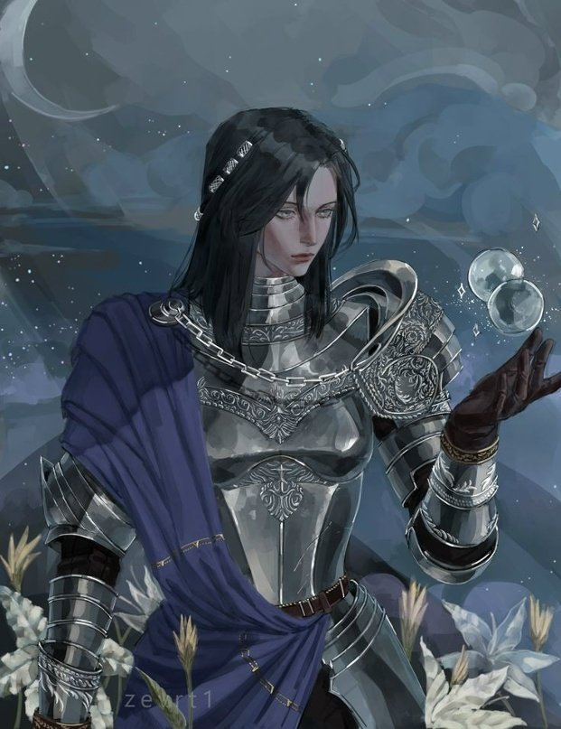

title: Малдис
parent: ankety
order: 90
icon: bi-person
group: Персонажи игроков
image: photo/ankety/maldis/knopka.jpg
vk: 55352961
art: photo/ankety/maldis/art-1.jpg
layout: anketa

**Владелец персонажа** — [Николай Шахов](https://vk.com/id266021164)

**Имя** — Малдис Канталия

**Возраст** — 28 лет

**Раса** — Человек, Граальд

## Внешность

## Характер

Старается следовать законам и правилам, но часто ставит справедливость _(в своем понимании)_ выше закона. Дворянка, обладает всеми сопутствующими умениями, печется о репутации своего рода. В большинстве случаев старается помогать окружающим. Ревностно почитает и крайне предана императрице Арайе Брей, а потому не потерпит неуважительных высказываний в ее сторону. Малдис колеблется в дальнейших целях в жизни между карьерой специалиста-мага в магическом институте и военной службой Корвасу.

## История

Был договор между Корвасом и одним из магических институтов, согласно которому одаренных магией отпрысков знати отправляли учиться магии, с тем чтобы по завершении обучения те вернулись на родину и отслужили определенное время на благо империи. Целью обучения боевых магов было хоть немного увеличить количество специалистов-заклинателей на службе империи. Малдис была одной из таких. Хоть ее и научили всем основным премудростям, которые должна уметь аристократка, большую часть времени она провела в стенах магического института, вдали от дома. Малдис лишь пару лет назад вернулась на родину, где ее сделали офицером.

Авантюристы ненадежны, жадны и не слишком эффективны. Вспомогательные сотни — это те же авантюристы, только получающие регулярное жалование и питание, а также они могут рассчитывать на выдачу снаряжения и какую-никакую помощь лекарей. Обратной стороной медали является то, что вспомогательные войска не могут сами выбирать себе задания и не могут отказаться от заданий, которые выдает им начальство, а конкретно лично Малдис. Кроме того, они вынуждены следовать воинскому кодексу и нести наказания за его нарушение, поскольку формально являются не горсткой авантюристов, а частью армии Корваса.

Однако редко во вспомогательных войсках можно встретить представителей экзотических рас с даром магии. Большая часть состава — это заключенные, штрафники из других родов войск или просто сельские парни, желающие сменить плуг на копье и жизнь авантюристов. В мирное время вспомогательные войска занимаются противостоянием с чудовищами, выслеживанием бандитов, культистов и всех прочих угроз, на которых регулярные войска не слишком хотят тратить собственные ресурсы.

Часто в задачи Малдис входят поиск артефактов или ликвидация угроз особо опасных монстров или преступников. Также она обладает властью выполнять функции военного офицера, согласно своему званию. В институте магии она развивала магию пространства и ветра. Формально она не закончила обучения и хотела бы продолжить его, поскольку ее редкий тип магии интересен и магам, но также ее беспокоит и безопасность жителей Корваса.

## Подконтрольные элементы и типы магии

Элементы: ветер, земля, свет; Типы магии: пространство и ветер.

## Способ активирования заклинаний

Мысленное представление глифов

## Способности

### Телекинез

- _(основное и любимое заклинание)_ оперируя магией подпространства, Малдис может силой мысли поднимать и манипулировать объектами на расстоянии до 50 метров, как будто они находятся в ее руке. Для поднятия объекта и манипуляций с ним нужна свободная рука. В случае повреждения обеих рук заклинание не может быть использовано.
- Максимальный вес поднятия одной рукой соответствует 40 кг.
- Суммарно за день Малдис может использовать телекинез не более получаса.
- Целью телекинеза не могут быть объекты, которые Малдис не видит или являются живым организмом _(или сплавом из нескольких металлов, чем больше веществ и примесей в материале, тем хуже работает телекинез)_. Однако выбить оружие из рук или толкнуть в доспех врага на расстоянии она вполне способна.

### Скачек

- Малдис может переместиться на расстояние до 100 метров в точку, которую видит.
- Всего у Малдис пять зарядов, для восстановления каждого из которых нужно не меньше часа.
- При перемещении гасится гравитация, и таким образом можно спастись от падения с большой высоты.

### Карманное подпространство

- Малдис может создать “пространственный карман”, который способен вместить до 200 кг веса. Однако в подпространство не могут быть помещены живые существа. Кроме того, подпространству нужна привязка к существующему в реальном мире объекту _(кольцу, палочке, ножнам, сумке и т. д.)_. В случае уничтожения объекта все содержимое подпространства немедленно появится в месте уничтожения.
- Малдис не может создать более одного подпространства и пользоваться им может только она. Из подпространства предмет может появляться либо в руке, либо рядом с привязанным объектом. Это заклинание помогает ей сэкономить на повозках с фуражом.

### Ветряная сфера

- К выбранному объекту привязывается ветряная сфера радиусом в пять метров.
- Существует в течение получаса, может начать закручиваться, создавая ветряной поток. Но чем сильнее закручивается сфера, тем меньше времени она существует _(предельные возможности — сильный отталкивающий поток ветра, существует 5 мин, защищает от стрел или клинков, но не от достаточно крупных объектов или особо пробивных заклинаний)_.
- Сфера снабжает воздухом всех находящихся в ее пределах и уничтожается при уничтожении объекта привязки или по истечении времени. Непроницаема для воздуха извне ее пределов, а потому делает глухими тех, кто находится внутри сферы. В течение дня можно дважды применить сферу.

### Призыв элементаля

- Малдис тратит минуту, призывая элементаля ветра. Для его создания необходимо магически сплести ядро, вокруг которого рождается элементаль. Элементаль представляет собой прозрачного гуманоида размером с орка, вместо нижней части которого _(от пояса до ступней)_ крутится вихрь ветра. Оружие, попавшее в тело элементаля, будет двигаться медленнее, стремясь вытолкнуться наружу и не причиняя урон порождению ветра _(сам элементаль способен восстанавливать частицы своего тела, если их снесли чем-то мощным. Однако выстрел из арбалета или достаточно мощный удар даже железным оружием может пробиться сквозь его плоть и повредить ядро, что находится на месте сердца. При повреждении ядра элементаль мгновенно рассеивается — основная сложность в том, чтобы попасть по ядру размером с кулак)_.
- Элементаль атакует конусом ветра с каждой из рук, будто нанося удар кулаком, что вблизи ощущается как удар двумя молотами и с расстоянием теряет силу, полностью рассеиваясь на расстоянии 30 метров. Также элементаль способен парить на расстоянии до 30 метров над землей, перенося до сотни кг веса. Элементаль живёт в течение часа, и повторный призыв возможен через 8 часов.

### Удар сквозь пространство

- Раз в день Малдис может нанести удар клинком, рукой, ногой или любой другой частью тела — проходящей сквозь пространство на расстояние до 50 сантиметров. Визуально кажется, что в точке применения заклинания её клинок исчезает и появляется на некотором расстоянии. Заклинание действует до 6 секунд, после чего необходимо успеть убрать "перенесенную" часть тела или оружия назад.
## Физические параметры

Малдис обучена ношению тяжелой брони и владеет копьем и мечом на достаточном уровне, чтобы обучать знающих базовые основы солдат более продвинутым навыкам. Однако сама по себе не является мастером и навряд ли прошла бы отбор в условную гвардию. Хоть латы и меч создают видимость воина, основная ее сила — это магические способности, поскольку она в первую очередь — боевой маг. В остальном здоровая девушка, способная выдерживать будни солдатской жизни и влияние собственных способностей на организм. За исключением вышесказанного Малдис — обычная девушка, не обладающая сверхсилой, феноменальной реакцией или несгибаемой волей. Она обладает всем спектром человеческих страхов, и ей есть что терять, хоть военная подготовка и позволяет их преодолевать. Поэтому перед боем ей желательно дать немного времени, чтобы настроиться на схватку.

Как и все граальды, она хрупка _(в сравнении с другими расами)_ и обладает всеми сопутствующими уязвимостями, а ее магические навыки можно законтрить, даже не обладая магией, нанеся достаточный урон конечностям. С другой стороны, она настолько хорошо умеет пользоваться своими способностями, что при минимальном прикрытии способна удивить как врагов, так и союзников.

## Прочие особенности

Офицер армии Корваса, временно исполняющая обязанности командира вспомогательных войск, имеет начальника в лице придворного мага Императрицы. Может получать золото от начальства на нужды войск, но не может использовать их для собственного усиления, т. к. отчитывается за каждый златник. Может вербовать во вспомогательные войска других персонажей при их желании.
