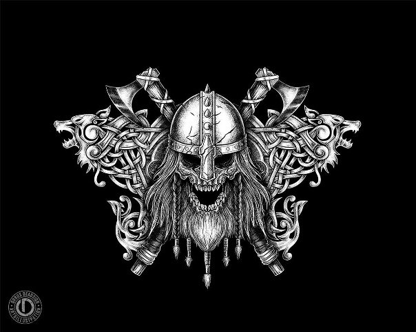

title: Оскар
parent: ankety
order: 120
icon: bi-person
group: Персонажи игроков
image: photo/ankety/oskar/knopka.jpg
vk: 55353325
art: photo/ankety/oskar/art-1.jpg
layout: anketa

**Владелец персонажа** — [Илья Кравченко](https://vk.com/id651334387)

**Имя** — Оскар Раш | Капитан Белый Лебедь

**Возраст** — 27 лет

**Раса** — Полуэльф Натаира / Гном

## Внешность

Оскар низок ростом, но широк в плечах и крепок телом, как всякий хороший пират. С рождения его кожа очень бледная, так что в шутку или всерьёз его можно назвать Снежным Эльфом. Волосы тёмные и густые, стрижётся, в основном сбривая виски и оставляя хвост. На утончённом молодом лице, поперёк подведённого тушью правого глаза идёт изогнутый шрам от кнута. Носит широкие круглые тонкие серьги светлого золотистого оттенка, гравированные перстни с чёрными камнями, цепь на шее и увесистый браслет на правой руке, а его тело покрыто чёрными татуировками, контрастирующими с тоном кожи. На спине у него наколот череп с завязанной в косу пышной гномьей бородой на фоне скрещенных боевых топоров, а на груди и животе огромный трёхпарусный корабль с лебедем на носу, заключенный в красивой детализированной рамочке со встающим над ней солнцем и пролетающими по бокам от него ласточками. Шею обвивает пунктирная линия, берущая начало от кадыка, идущая через ключицу и завершающаяся жирным крестиком на плече, рядом с которым нарисована монетка. На обратной стороне левой ладони набито колесо Асиры, а на правой — ласточка. На всё левое предплечье якорь, сзади на шее — штурвал.

## Характер

Оскара, как и его чешуйчатого наставника, легко охарактеризовать словом "змей". Он изворотливый, беспринципный и хладнокровный, привык вообще игнорировать общепринятые нормы, если они хоть как-то расходятся с тем, чего он хочет. Он любит манипулировать окружающими и получать от этого максимальную выгоду. При этом нельзя сказать, что Оскар действует нахально: ему знакомо слово "страх", он крайне осторожен и никогда не рискует понапрасну. Считает, что предчувствует, когда не стоит уповать на свою удачу, а когда, напротив, нужно дать ей шанс привести тебя к успеху. Он с простой философией смотрит на мир: те, кто не может распоряжаться своей судьбой, или те, кто боится её испытать, так или иначе к успеху не придут, а потому не грех пройтись по их головам. При этом не отличается жестокостью и не наслаждается чужой слабостью.

## История

Среди мореплавателей севера ходит немало слухов о легендарном пиратском фрегате "Белый Лебедь", буйствовавшем в стычках с работорговцами Ишткара и судами гномов. И среди этих слухов самые громкие ходят о том, что Белый Лебедь ныне отправился на дно, а самые редкие — о личности погибшего капитана. Кто-то говорит, что он был родом с севера, а значит, он — сквоель. Другие же ссылаются на свидетельства тех немногих, кто побывал на палубе фрегата и выбрался оттуда живьём. Говорят, что капитанскую шляпу на "Белом Лебеде" носил некий остроухий молокосос со шрамом на лице, и что о нём много знает старый Сарсазра, однорукий кровожадный ящер-работорговец из Ишткара.
Эльф был уроженцем безызвестной глухой деревушки на севере, сыном в семье учёных магов-исследователей, рыскавших в древних промёрзших руинах. В один злополучный день малец с компанией друзей отправился без ведома старших в дальний поход на лодке, и произошло невероятное: сама Асира подмигнула им, раскрыв за одним из скалистых рифов потаённое древнее святилище. Совсем малые и несерьёзные, юные первооткрыватели громко ликовали и остались в святилище на ночь, взяв с чаши одиннадцать гравированных золотых монет, по одной на каждого. Перед сном они поклялись на крови, что с этого начнётся их судьба великих мореплавателей, охотников за сокровищами, но, к несчастью, судьба их оборвалась слишком быстро.
Десятеро маленьких северян больше никогда не видели рассвета, а одиннадцатый был единственным, кто по счастливой случайности потерял свою монетку и от горя не мог уснуть. Пока он обшаривал на маленьком острове каждый куст, услышавшие гомон недорослей пираты Белого Лебедя, северного расхитителя гробниц, добрались до юнцов в ночной тени и за блеск золота всех перерезали, а самого мелкого, да ещё и без монетки, решили взять в плен.
Ту ночь Оскар запомнил на всю жизнь. Его посадили в одну клетку с потерявшим руку Сарсазрой, опытным головорезом с востока, перерезавшим, по его словам, глоток больше, чем чешуек у него на шкуре. За время плавания в рабстве у пиратов старый ящер проникся к мальчику сочувствием и пообещал, что когда-нибудь им вместе точно удастся выбраться.
Оскар быстро креп характером и умом, а с таким наставником, как Сарсазра, пусть даже и одноруким, ещё и обзаводился уймой полезных знаний. Пираты Белого Лебедя не могли относиться к смышлёному юнцу иначе, кроме как снисходительно, ведь он, будучи рабом, умудрился находить свой подход даже к бездушному Тому Уиччу, капитану судна.
Было лишь вопросом времени, когда кинжал Оскара вонзится убийцам его друзей в спины. И когда ответ на этот вопрос был найден, Оскар, будучи разительно взрослее, сам встал за штурвал, а "Белый Лебедь" полностью поменял команду, и Сарсазра долгое время оставался на борту первым помощником.
Десять древних монет в руках капитана стали загадкой всей его жизни. На них были выгравированы тайны, подсказки, путь к сокровищам, без которых компания мёртвых мореплавателей поклялась не возвращаться в родную деревню. Все последующие годы, как убеждал себя "Белый Лебедь", он посвятил расшифровке подсказок, поиску информации, исследованию древних руин и борьбе за связанные с загадкой реликвии. Он проплыл много морей, исходил вдоль и поперёк не один остров, и когда ему казалось, что Асира почти привела его к долгожданной цели, его поиск встрял. Ему не хватало одиннадцатой монеты. Той самой, которую он потерял.
Белый Лебедь отыскал остров, ставший кладбищем его друзей. Он обыскал его полностью. Скрипя душой, проверил маленькие скелеты своих старых друзей на случай, если его монетку забрал кто-то из них. Утопил не одного раба, посланного плавать на дно рядом с островом и искать монету, если вдруг она утонула. Но всё было тщетно. Белый Лебедь начал искать сокровища без последней подсказки, и спокойствия на море от этого совсем не прибавилось.
Абордажам, потопленным судам, перерезанным глоткам и захваченным рабам не было числа. Время шло, ставки росли, лилась кровь и множились враги знаменитого "Белого Лебедя", пока в один день их не стало больше, чем друзей. В последней своей морской баталии "Белый Лебедь" потерял всех союзников и разбился о скалистый берег безымянного острова близ южных берегов Дарлика. В небеса устремились певшие шанти хором души моряков, а вместе с ними и осколки разбившейся вдребезги мечты...
Однако есть в умах старых пиратов версия, которую однорукий Сарсазра рьяно отрицает, что, мол, капитан вовсе не погиб. Что его корабль разбился, но не затонул, а прибился к берегу и был захвачен. И что капитана несомненно казнили бы, распяли бы на том самом белоснежном лебеде на форштевне, если бы только в числе его захватчиков не было самого Сарсазры. Говорят, ящер убедил остальных пиратов пощадить эльфа как бы на потеху, оставить капитана без корабля. К тому же "Белый Лебедь" давно ему нравился, и он хотел его выкупить. Один из пиратов посмеялся, что теперь этому "Лебедю" — грош цена, и тогда, согласившись, Сарсазра предложил Оскару выкупить разбитый корабль всего за одну золотую монету. Монету, которую когда-то давно он выкрал из кармана пленившего его пирата и спрятал в незажившем обрубке своей руки, на случай, если пригодится. И, несмотря на унижение — ведь известно, что любому капитану без своего корабля дорога только в одну сторону: на тот свет — бывший капитан "Белого Лебедя" на сделку согласился. Забрал монету и под звонкий хохот своих врагов захромал прочь. И больше его никто не видел.

## Избранный

Избранный Асиры

## Запас маны

Сил Оскара хватает в среднем на 4 повторения заклинания средней затратности. Он полностью восстановит свои силы в течение 3.5 часов.

## Подконтрольные элементы и типы магии

Элементы: воздух, вода; Типы магии: Льда и Холода.

## Способ активирования заклинаний

Произношение вслух

## Способности

### Сплэш

- Заклятие артефакта клинка, применяемое по живой цели только при нанесении рубящих ударов заточенной стороной клинка. Под звук удара волны дублирует природу механического повреждения на всех стоящих позади цели живых существ в интервале 110°-го угла за точкой соприкосновения. Длина действия волны: 6 метров. Не срабатывает при нанесении уколов или режущих ударов клинком, а также не оказывает воздействие на живых существ, габариты которых меньше средней собаки и которые находятся на значительно разнящейся высоте относительно уровня моря.
- Срабатывает раз в десять секунд при пробуждении клинка. Клинок остаётся пробуждённым в течение трёх минут, после чего перезаряжается час.

### Гололедица

- Покрывает любую указанную горизонтальную поверхность толстым слоем льда. Под ногами самого заклинателя лёд резко бугрится и создаёт заострённые неровности, чтобы исключить скольжение. Общая максимальная площадь поражения заклинания: 70м². При температуре выше -1° лёд тает только по прошествии 40 секунд. В случае, если ноги противника не отрывались от твёрдой поверхности при работе заклинания, лёд начинает медленно нарастать на его конечностях и обездвиживать их. Затраты маны зависят от площади поражения, при максимальной _(70м²)_ они очень высокие.
- Восстанавливается 30 минут.

### Арканный блок

- Одноразовое оборонительное заклинание, которое пассивно оберегает владельца от магического вмешательства. * При срабатывании выпускает защитную ледяную сферу, которая на 2 секунды полностью защищает от любых магических эффектов, расходуя малые затраты маны владельца, а затем на минуту уходит в перезарядку. Это заклинание предоставляется сферой, инкрустированной в кольцо на указательном пальце правой руки Оскара.
- Блок срабатывает даже на безвредную магию, поэтому его следует отключать при необходимости _(лечащие заклинания союзников)_. Без кольца со сферой Оскар не умеет применять арканный блок.

### Порыв

- Выбрасывает вперёд на 4 метра широкую волну холодного воздуха с блестящим люминесцентным снегом, который надолго оседает на задетых поверхностях, морозит кожу и помогает обнаружить противника в условиях ограниченной видимости. Прилипший снег тяжело отскрести до тех пор, пока он сам не растает, при этом он ослабляет мышцы и может вызвать судорогу. Волшебный снег начинает таять спустя 7 минут. Затраты маны низкие.
- Восстанавливается 10 минут.
## Физические параметры

Получив свободу после успешного мятежа на корабле, будучи уже состоявшимся головорезом, Оскар на этом не остановился: он стал продолжать практиковать магию родного дома, взяв к себе в команду толкового криоманта. А с тех пор, как ему в руки в одном из странствий попался легендарный зачарованный абордажный палаш, он не проиграл ни одной рукопашной. Оскар — эксперт в области абордажных стычек, битв в условиях ограниченного пространства и "грязного фехтования". Хочешь жить — умей вертеться, и этот эльф вертится в бою, как бешеный зверь с саблей вместо когтей. Короткое клинковое однолезвийное оружие, максимально близкие дистанции и грэпплинг с кинжалами — вот его конёк. К тому же Оскар — от природы ловкий малый, отменно лазает по канатам, взлетает на мачты, изящно крутит ножами, фокусы показывает, в боях финтует и даже в картах мухлюет как дьявол.

## Прочие особенности

Исконно эльфийский портрет и форма ушей при массивном гномьем сложении и невысоком росте. Непохож на первый взгляд на капитана или хотя бы на грозного противника, а оттого часто сталкивается с излишней агрессией или необходимостью себя проявить, если носит зимнюю одежду, под которой сложно оценить массу. Всему виной низкий рост и несколько "детские" черты лица, присущие многим эльфам. Окружающие могут не сразу воспринимать его всерьёз.
Чувствует себя совершенно небоеспособным, будучи облачённым в латный доспех или хотя бы кирасу. Отказывается носить увесистую экипировку даже тогда, когда того требуют обстоятельства. Дело в том, что однажды Оскар чуть не ушёл на дно кормить рыб, упав с трапа в доспехе. К счастью, успел вовремя порезать лямки и всплыть.
Голос резко контрастирует с наружностью: глубоко вибрирующий мощный прокуренный баритон с медовой тягучестью и циничным шипящим оттенком безбожника.
Несмотря на низкий рост, лучше справляется с оппонентами повыше.
