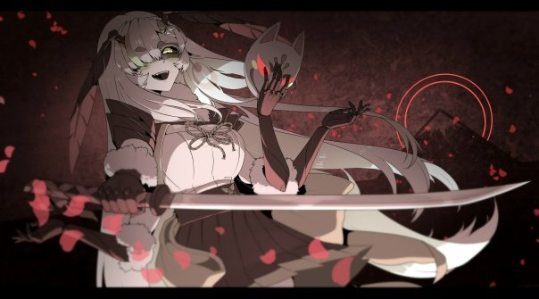
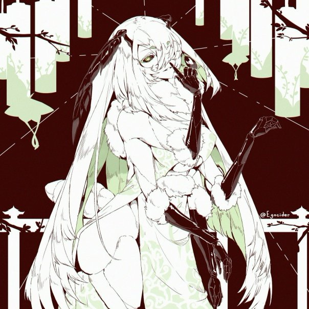
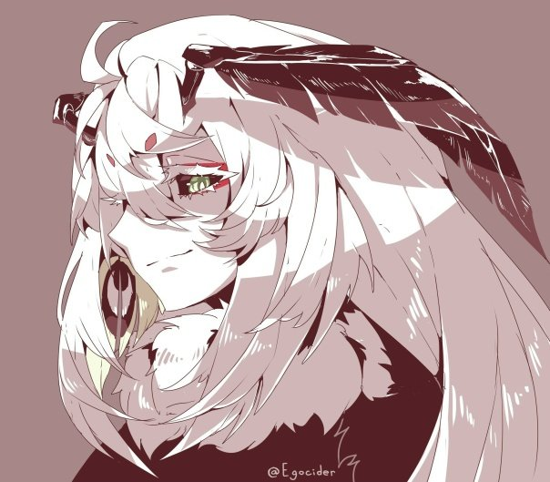
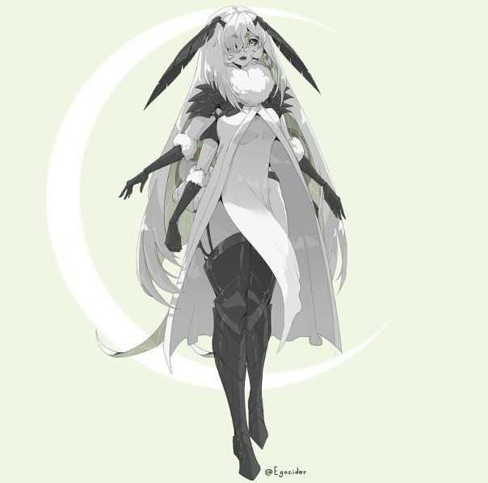

title: Рурения
parent: ankety
order: 40
icon: bi-person
group: Персонажи игроков
image: photo/ankety/rureniya/knopka.jpg
vk: 55258312 55317099 55317097 55258315
art: photo/ankety/rureniya/art-2.jpg
layout: anketa

**Владелец персонажа** — [Вайесс Заргред](https://vk.com/confusion_of_the_abyss)

**Имя** — Рурения | Рури, Жрица Зелиатриос

**Возраст** — 531 год

**Раса** — Насекомоподобное

## Внешность

У Рурении высокий рост в 198 см, вес же составляет 90 кг. Также у неё островатые и на удивление миловидные черты лица. Тонкие губы и аккуратный носик. Склера её глаз чёрная, а радужка глаза бледно-изумрудного цвета. Сам её взгляд выразительный, в нём можно чётко читать эмоции, не обращая внимания на её усики. Ресницы белоснежные. Плечи заметно шире бёдер. У Рури тонкая практически осиная талия. Ягодицы в форме перевёрнутого сердца. Руки же, наоборот, заметно подкачанные, а пальцы тонкие и длинные. Заметно большая грудь примерно третьего размера. За спиной находятся полупрозрачные бледно-зелёные крылья, частично напоминающие крылья мотылька. Первое, что бросается в глаза, — это чёрного цвета усики на голове. За исключением рук, стоп и голеней, весь остальной хитин белоснежный. Волосы у неё длиной по пояс, на её лик часто падает пара локонов, волосы белые с наружной стороны, а с внутренней стороны бледно-салатового цвета с чёрными узорами. На ощупь этот хитин мягкий и почти неотличим от человеческой кожи, но на руках, стопах и голенях он заметно грубый и жёсткий, чёрного цвета. Как правило, Рури скрывает свою внешность, закрывая бинтами любой открытый участок кожи, поверх надевая плащ с капюшоном, а на лике как правило носит маску.

## Характер

Рурения довольно своеобразная личность. Большую часть времени и в окружении незнакомых личностей она бодра, активна и не менее болтлива, проявляя дружелюбие и любопытство. На первый взгляд она притягивает окружающих к себе, но сама не стремится открываться перед другими, а всяких привязанностей Рури и вовсе избегает. Связано последнее с её юношеским гештальтом, ведь она искренне боится привязываться к другим, считая, что в конечном счёте слишком слаба, чтобы суметь их защитить. После потери Алланы в её душе образовалась глубокая пустота, которую она пыталась заполнить всем, чем только могла. Боль от потери приёмной матери для неё является по сути мотиватором. Именно эта боль побуждает Рури двигаться вперёд и развиваться. Не имея возможности заполнить свою «пустоту», она чувствовала только эту боль и, как следствие, страдала, не имея возможности даже чувствовать радость от своего развития. Подобное смешение эмоций привело Рури к жажде силы и совершенства.

> Нет, ничего важнее силы. Чтобы получить силу, я откажусь от личности, откажусь от желаний, откажусь от будущего, превратив их в пепел. Всё ради силы.

**Рурения**

За этой фразой скрывается её страх сблизиться с кем-либо и потерять его из-за собственной слабости. При этом мерилом силы не выступает какой-либо архимаг, воин или другая известная личность. Это самое мерило она определяет сама. Во многом такой взгляд на силу продиктован её комплексом неполноценности, который на практике невозможно разглядеть на фоне выстроенного ей самой «фасада» личности. Рури вполне осознаёт социально приемлемые нормы в обществе, но далеко не всегда придерживается их.

>
Сравнение себя с другими ведёт к слабости и мешает росту, приводя развитие к стагнации.

**Рурения**

Рури считает себя слабой, несмотря на весь свой рост и развитие в течение долгих лет. Не меньше в Рурении и эгоизма, побуждающего её желать ещё большей силы, особенно на фоне всего остального. Эгоизм и хищная натура Рури побуждают её желать большего. Не менее важным аспектом личности сей особы является поклонение Зелиатриос. В её понимании только когда она перестанет чувствовать пустоту внутри себя, то тогда её развитие достигнет предела. Боль в её случае выступает мотиватором к развитию, и ни в коем случае нельзя забывать её и отрицать. Каждый болезненный момент в прошлом должен быть проработан и переосмыслен, вне зависимости от того, сколько это приносит ей страданий, извлекая из этого жизненные уроки, дабы не повторять тех же ошибок. Рурении свойственна жестокость, при этом её нельзя сравнивать с человеческой жестокостью, ведь в случае Рури жестокость носит дикий и первородный характер, как у животных. Она способна на самые аморальные и бесчеловечные поступки, а пожирание другого разумного существа в её восприятии не более чем мелочь. Хотя последнее больше связано с эльфами Натаира, культурой которых она порядком прониклась. Правда их мировоззрения она не придерживается вовсе, но однозначно уважает каждый из их столпов. Поклонение Зелиатриос привело к развитию в Рури садизма, который подкреплялся её природной жестокостью. Самобичевание в поклонении Зелиатриос способствовало развитию в ней мазохизма. Даже несмотря на то, что ныне Зелиатриос не одарила её ничем, всё же Рури благодарна своей покровительнице за истины, которые та невольно открыла. Рурения полностью предана Зелиатриос, исполняя её волю и наслаждаясь каждым мгновением исполнения своих обязанностей как её жрица.
В ранние годы своей жизни Рурении не было свойственно милосердие, любой первым напавший на неё воспринимался ею как добыча, жизнь которой не важна, и даже если тот и сдавался, то его не ждало ничего лучше, чем смерть. Ей было абсолютно плевать на причины нападения, даже если это было банальное недопонимание на поприще расовой дискриминации, да и как правило она даже не пыталась понять других. Все изменилось после вступления в коллегию бардов клинка и последующего вступления уже в коллегию знаний. Эта черта её характера порядком смягчилась и куда чаще проявляется, когда дело доходит до боя. Не меньшую роль в жизни и личности Рури играет искусство. Рури считает, что порой музыка и слог могут передать куда более чёткие и яркие эмоции, чем просто слова. Именно через неё можно поведать другим как собственные ощущения, так и передать чужой опыт через мифы и легенды. Источником её вдохновения может быть кто и что угодно — от величественного зверя до самой её покровительницы и всего того, что она приносит. Рурения — личность разносторонняя, несмотря на свою одержимость силой. Язвить для неё вполне в порядке вещей, а в бою так она и вовсе будет всячески провоцировать своего оппонента. Правда, вот бой с безмозглой нежитью кажется ей чертовски скучным. Рури не прочь выпить, да и в целом ей не чужды и плотские желания. Как правило, на агрессию Рури отвечает такой же агрессией, да и в целом Рури редко пытается решить конфликт миром, особенно если всё с самого начала шло к потасовке. Рури — персона далеко не глупая, да и наивности в ней нет вовсе. Правда она имеет склонность подыгрывать другим, когда дело касается наивности, но в таком случае и надёжности от неё ждать не стоит. Она часто вводит других в заблуждение своим поведением, как правило скрывая свои интеллект и образованность, хотя по факту она свободно говорит на всеобщем и эльфийском языках. Во многом её знания и интеллект часто оказываются в тандеме с её язвительностью. Самой Рурении абсолютно плевать, что о ней думают окружающие, да и когда она начинает язвить, она не думает о чувствах других.

## История

Рурения вылупилась из кокона в одном из лесов на континенте за пределами Бранна, посреди поля брани, что уже стихла. Там смешались кровь людей и эльфов, плоть уже начала гнить и разлагаться, а насекомые-падальщики жадно впивались в тухлое мясо.
Остатки плоти, личинки и другие насекомые формировались в подобие кокона, магия же довершила всё остальное. Так родилась Рури, тогда ещё не имевшая имени. Она имела черты, напоминающие людей и эльфов, и одновременно столь сильно отличалась от них. Кто-то из людей мог бы даже назвать её привлекательной, а кто-то бы в ужасе отвернулся, видя в ней лишь жуткое подобие человека, извращённое магией. Юное создание перемещалось по полю брани, вынужденное сражаться за свою жизнь с такими же падальщиками, как и она сама. Вырастая и становясь сильнее, она осознала, что теперь она может охотиться на других падальщиков. С каждым убитым возрастал её азарт, и постепенно он подвигал её нападать на существ сильнее неё. И так бы росла она диким зверем, если бы не одна судьбоносная встреча. Это произошло во время очередной охоты. Ещё юная Рури охотилась на чёрных волков. Высоко с деревьев она наблюдала за своей жертвой, высматривая других представителей сего вида. Она понимала, что секундное промедление будет стоить ей жизни. Из оружия у неё не было ничего дельного, разве что случайно найденная кость Медведя Калехада. Под деревом, где засела Рури, была приманка в виде мелкой дичи, которой не хватило бы Рурении, чтобы насытиться. Несмотря на то, что волк клюнул на приманку, Рури чувствовала, что что-то не так. Все инстинкты кричали об опасности. Слушать она их не стала, со всей скорости и дури пикируя на свою добычу. Метила Рурения в голову, чтобы сразу разбить череп добычи. И вот черепушка волка оказалась раздробленной на части. Сила удара была столь велика, что и импровизированное оружие треснуло в месте удара. Чего Рури не ожидала, так это то, что её инстинкты не врали. Бросив взгляд в сторону, она поняла, что волк не был один, и прямо сейчас её окружала волчья стая из 10 особей. Рури резко схватила тушу поверженного волка и сделала мощный прыжок, сразу используя крылья и поднимаясь на дерево. Рурения начала жадно впиваться в добычу. Времени не было, чтобы полностью съесть добычу, а потому она обглодала лапы и вырвала кости, которые стали очередным импровизированным оружием. Рури начала быстро отступать, перемещаясь по высоким деревьям, волки же преследовали её. Она быстро размышляла о том, как выкрутиться из той ситуации и вдруг к ней в голову пришёл план. Отчасти безрассудный и даже глупый, но, не имея выбора, она стала двигаться в сторону логова лесных лауков, которое ещё сутки назад она обходила стороной. Лесные же лауки сразу напали на стаю волков, а сама Рури в этот момент начала перемещаться обратно, чтобы забрать останки тела её добычи. Но обнаружила она на месте не только обглоданные остатки. Рури увидела коали, что представилась именем «Аллана». Увы, но Рури ничего не понимала, ведь языка она попросту не знала, но всё же из природного любопытства она последовала за коали. Время шло, а Рури росла и продолжала развиваться, обучаясь языку у коали. Те годы жизни сей особы нельзя было назвать насыщенными событиями. Обычная повседневная жизнь, но самым главным был тот факт, что она обрела своё имя. И всё же в те годы она пыталась контактировать с людьми, но чаще всего люди или в панике кричали и пытались от неё убежать, или хватались за вилы, пытаясь убить что саму Рури, что Аллану. Это оставляло на её психике неизгладимый шрам, который только укреплялся с годами. Следующее ключевое событие в жизни Рури случилось, только когда ей стукнуло 18 лет. Она столкнулась с группой алькарцев, что были атакованы диким зверьём и, к сожалению, проигрывали ему. Рури упросила Аллану вмешаться и просто помочь. Рури же была вооружена клинком, поднятым с очередного трупа какого-то бедолаги, что пал в лесу, да и из одежды у неё были какие-то лохмотья. Аллана же поддерживала атакующую Рури своей магией. Эффект неожиданности также помог застать зверьё врасплох. Стычка закончилась быстро, а сама Рури уже засыпала вопросами выживших алькарцев, пока коали лечила раненых.
Любопытству Рурении не было предела, а сами алькарцы предложили ей отправиться с ними в качестве стражей их небольшого каравана. Сама же Аллана искренне не желала покидать леса, но порядком привязавшись к Рури, всё же последовала за ней. Аллана хоть и была вынуждена скрывать собственную внешность за кучей рваной ткани и маской, но всё же она продолжала следовать за Рури. Сама же Рурения с искренним любопытством «заваливала» эльфов тоннами вопросов. Мир за пределами леса всё сильнее и сильнее интересовал Рури, но вместе с этим она с чужих слов понимала, как относятся к существам вроде неё, но до последнего она не верила. Сопровождение каравана с остроухими закончилось примерно через несколько недель с периодическими стычками, то с бандитами, то с дикими животными. Всё это продолжало подогревать интерес Рури к цивилизации и культуре. Вместе с караваном Рури оказалась в столице государства Алькар. Увиденный город поражал и удивлял что саму Рурению, что Аллану, конечно, попытки полностью познать чужую культуру выходили весьма неудачно, а сама Рури чувствовала неприязнь окружающих. И всё же это не умерило пыл девушки, а сама она решила податься в наёмники.

> Многие говорят, что без денег можно многого добиться. Правда, мало кто говорит, что пути достижения целей и сами цели ограничены, без этих самых денег.

**Недолгий спутник Рури, эльф Алькара**

Это изречение и послужило причиной, почему Рури вообще избрала подобную стезю. Первое время она выполняла лишь мелкие заказы совместно с Алланой. В целом дела шли в гору, хотя о богатом заработке и речи быть не могло. Скопив достаточно денег, Рури планировала продолжить своё странствие в компании Алланы. К тому времени она уже успела осознать, что если в крупных городах к ней самой испытывают неприязнь, то в мелких деревнях куда чаще её пытаются просто убить или отправить на костёр, а потому она стала скрывать свою внешность за кучей ткани, маской и плащом, так же, как это делала Аллана. Ещё одно судьбоносное событие в жизни Рурении произошло именно в это время. Вымотавшись после очередного заказа, они остановились в мелкой деревне. Выбор был невелик, и потому местом для отдыха был небольшой хлев, в котором хранилось сухое сено. Сбросив маскировку, Рури легла спать, а Аллана осталась на страже, как вдруг единственный вход и одновременно выход был закрыт тяжёлым бревном. Довольно быстро почувствовался запах гари, а ссохшееся здание начало охватывать яростное пламя. Деревенское дитя подсмотрело, как Рури сбрасывала с себя маскировку, и, испугавшись, побежало рассказывать родителям. Деревенские жители, боясь за свою жизнь, решили не поднимать шумиху, а просто убить «чудовищ». Двери они наглухо забаррикадировали, а хлев подожгли. Придя в себя, Рури стала пытаться пробиться через двери вместе с Алланой, которая быстро начала обдумывать иные варианты спасения, но не придумала ничего лучше, чем пробить брешь в крыше с помощью остатков магии, а Рурения бы выскользнула наружу, сразу бросившись открывать проход с другой стороны. План Аллана озвучила быстро, а Рури, не зная, что делать, схватила клинок и стала расширять брешь, взмыв к ней с помощью своих крыльев. Выбравшись наружу, девушка перепугала весь народ, который тотчас схватился за вилы. Саму же Рури не волновали эти люди, она сразу попыталась разбросать в стороны всё, что мешало, чтобы открыть дверь в сарай и вытащить Аллану, к которой всё ближе подбиралось пламя. Довольно быстро жители деревни пересилили свой страх, набросившись на истощённую Рури, дабы помешать ей. Сама девушка пыталась отбиться, с трудом оттесняя их в стороны и сразу пытаясь разгрести дверь. Пламя уже начало охватывать и саму Аллану, которая издала истошный крик, побуждая Рури спешить и меньше отвлекаться на мешающих людей.
Она упустила момент, как вдруг в одну из её рук вонзился острый мясницкий нож, что пробил хитин и вошёл в плоть. И всё же она пыталась спасти Аллану, чувствуя, как её покидают силы. «Спасайся одна», — изнывая от боли, крикнула Аллана. Увы, но это было слишком тяжело для Рури, и потому она не бросала попытки вытащить свою приёмную мать из бушующего пламени. В какой-то момент отчаяние и ярость взяли верх. Тогда Рури, охваченная подобными эмоциями, стала только отбиваться. Аллана продолжала кричать, чтобы та остановилась, но Рури уже была охвачена гневом, убивая сельчан одного за другим, не щадя никого. Ни женщин, ни детей, ни стариков. Когда Рурения наконец пришла в себя, остатки здания уже догорали, а сама девушка чувствовала только скорбь, которая впоследствии переросла в пустоту. Глубоко же в её разуме укоренилось чувство вины. Она чувствовала себя слабой и считала, что в смерти Алланы виновата только она, именно из-за её слабости погибла та, кто была ей дорога. Подобные выводы приносили ей только боль, что превосходила физическую боль. Тогда на Рури обратили взор силы, которые лежали за гранью её понимания. Глубоко в её разуме раздался ужасающий скрежет, чем-то напоминающий движение лапок гигантского паука, а после донёсся сладкий, немного скрипучий голос.

> Твоя боль так сладка. Стань моей. И я дам тебе то, чего ты так желаешь. Сила взамен на твою боль и боль других.

**Зелиатриос**

Предложение было заманчивым, и Рури согласилась, мало осознавая саму суть сделки. Долгое время чужой голос в голове не давал о себе знать. Рурения скиталась, долго не задерживаясь на одном месте, познавая магию, боевые искусства, и всё равно, каких бы результатов она ни достигала, удовлетворение так и не приходило. Пустота же в её душе только усиливалась. По мелочи девушка продолжала подрабатывать в наёмниках. Рури не задерживалась где-то на долгое время, постоянно скитаясь. Девушка без остановки продолжала свои тренировки, до тех пор, пока боль не отдавалась в костях, а хитин на теле не начинал трещать. Не один год ушёл только на то, чтобы закалить тело и всё же Рурения не останавливала своё развитие и поиск силы. Она соглашалась на самую гнусную и порой грязную работу. Не меньше она и посвящала свою жизнь служению своей покровительнице, надеясь заполучить желанную силу, и вот вновь знакомый голос донёсся в разуме девы. Зелиатриос жаждала увидеть, как жрец Эоги будет страдать, утопая в боли и агонии. Выловив необходимого жреца, которого указала её покровительница, Рури с особым изыском пытала свою жертву. Дева пыталась стереть грань в сознании жертвы между болью и наслаждением, погружая того во всё большее отчаяние и агонию, вырывая его ногти, перерезая сухожилия и медленно срезая его плоть. Рурения не гнушалась и использовать разные сильные снадобья и зелья, чтобы поддерживать жизнь в жреце, заставляя того молиться Зелиатриос, дабы получить наконец-то смерть. У самой же девушки были иные планы. Она искалечила жреца так, что мало какая магия вообще будет способна его исцелить и даже лишила его сладостных удовольствий его богини, превратив всю его жизнь в бесконечные муки и агонию. Годы шли, а голос Зелиатриос всё чаще возникал в её разуме, требуя всё больше и больше подношений и каждое из них становилось всё сложнее и сложнее, но Рурения была слишком упёртой, чтобы отступать. Подобные деяния существенно сказывались на личности девы, которая только искажалась и даже начала наслаждаться каждой пыткой. Рурению раздирали противоречия. Ей не нравилось вредить другим, подвергая их пыткам, но сам процесс доставлял ей удовольствие. Всё усугублялось тем, что ей и некому было выразить собственные эмоции, да и в принципе она ожесточилась и с трудом могла вообще говорить о собственных чувствах, предпочитая игнорировать их. В попытках совладать с собственными эмоциями, дева начала пытаться изучать искусство, ища способ, как ей было бы проще выражать их.
Рури смогла найти себя в написании стихов, конечно, первое время её слог был неуклюж и местами слишком запутан, но этого оказалось достаточно, чтобы поступить в коллегию мечей, одной из множества коллегий бардов, расположенных на разных континентах. Там она оттачивала свой слог, дабы тот был остр, словно клинок. Не меньше она посвящала себя фехтованию, которым так славятся барды коллегии мечей. Время продолжало идти, а остальным всё же приходилось признавать успехи Рурении. Впоследствии, закончив своё обучение в коллегии мечей, она не стала клинком в какой-либо труппе, продолжая своё обучение, но уже вступив в коллегию знаний, что вышло существенно проще, чем вступление в коллегию мечей. Атмосфера, окружение и даже сам континент в коллегии знаний существенно отличался. Барды коллегии знаний собирают крупицы знаний по всему свету. Им не важно, какого рода знания, будь то научные труды или крестьянские побасенки. Больше всего удивляло Рури в бардах коллегии знаний несколько иное качество. Ведь лояльность таких бардов покоится на стремлении к красоте и правде, а не на верности монархам или приверженности знати. Только от барда коллегии знаний вы услышите горькую правду, даже если вернее было бы просто промолчать. Жизнь барда коллегии знаний Рури нравилась куда больше, нежели жизнь барда клинка. Если вторые во многом промышляют тёмными делишками, скрываясь за труппой других бардов, или становятся авантюристами, то первые нередко делятся друг с другом знаниями и нередко посещают фестивали и общественные собрания, где могут выявлять растратчиков, разоблачать лжецов или выставлять на посмешище самоуверенных политиков. В сущности, этим и занималась Рури совместно со своими коллегами. Продолжая путешествовать, наконец Рурения решила скитаться уже на территории Бранна.

## Подконтрольные элементы и типы магии

Элементы: свет, тьма, молния; Типы магии: магия контроля, магия ускорения

## Способ активирования заклинаний

Мысленное представление глифа

## Способности

### Высвобождение ауры

- заклинание магии контроля, основанное на исследованиях живых существ, обладающих магией. Главным источником вдохновения послужили боевые искусства. Суть заклинания заключается в следующем: Рури создаёт ауру из чистой магической энергии, она окружает ею тело и рассеивает её вокруг себя на 10 метров. Такая аура на первый взгляд способна защитить заклинателя в лучшем случае от очень слабых заклинаний. По своей сути эта аура является бронёй и клинком. Это заклинание раскрывается только в руках опытного мага, способного отлично управлять магической энергией, быстро концентрироваться на одном и быстро «переключать» своё внимание на другое. Концентрируясь на плотности ауры, её можно уменьшить вплоть до 1 миллиметра. В таком состоянии аура способна защитить Рури от средних по мощности магических атак из-за её высокой плотности, так и от сильных физических ударов, подобно броне. При этом в месте удара, аура становится менее прочной, открывая брешь, которая быстро затягивается ценой уменьшения общей прочности сжатой ауры. В качестве «клинка» аура используется с помощью сжатия и утончения в разных местах. Например, если Рури хочет атаковать с помощью ауры, то она сосредотачивает ауру в руке, удлиняя её в области ладони, создавая импровизированный клинок для атаки. При этом в таком случае она может оставить ауру только на руке, или оставив только её тонкий остаток по всему телу. В первом случае полученный клинок будет существенно мощнее, чем во втором. Истончаться аура будет и при атаке. Тип урона зависит от того, в какой позиции находится рука. Например, если пальцы сжаты в кулак, то урон будет как у дробящего оружия. Если пальцы разжаты и она держит ладонь открытой, то урон будет режущим. Сторонний наблюдатель может определить это по форме принятой ауры. Во втором случае аура будет походить на клинок, а в первом на моргенштерн без шипов. Рури способна поддерживать ауру в течение часа при условии, что она будет постоянно в рассеянном состоянии. В сжатом же состоянии и при активном состоянии аура действует только в течение 15 минут, но сама аура может быть уничтожена и раньше, если Рури сама будет слишком часто атаковать, или будет находиться под градом атак _(физических или магических)_.
- Примечание по ауре: существует также ещё ряд нюансов и особенностей в этом заклинании, которые Рури ещё не осознала:
- Аура может быть усилена двумя способами: Эмоциональным способом или через сознательное усиление. В первом случае это происходит подсознательно, например: «Заклинатель будет испытывать гнев и злобу по отношению к оппоненту, то в таком случае течение ауры будет меняться и усиливаться поражающие качества ауры, но вот защита будет абсолютно никакой», соответственно, страх, смятение и неуверенность также будут оказывать влияние на заклинание, уменьшая его пользу. Второй способ — через сознательное усиление — заключается в следующем: он основан на первом способе и может нести огромный риск для заклинателя. При этом заклинатель ставит перед собой некие условия, которые фиксируют определённое эмоциональное состояние. В дальнейшем при выполнении этих условий, аура автоматически приобретает нужные свойства. Чем сильнее налагаемые ограничения, тем сильнее будет эффект. Например, если осознанно поставить правило вроде «я буду использовать эту способность только по вторникам» и следовать ему, то эта аура при выполнении условия станет сильнее. Теоретически, чем строже ограничение, тем больше эффект. Если ограничение имеет большое значение для данной конкретной личности, то это тоже плюс. К тому же, аура может усилиться, если назначить «наказание» за невыполнение правила _(в духе «я умру, если нарушу правило»)_.
- Продвинутый способ использования ауры — это способность испускать ауру и использовать её для выполнения определённой функции. В таком случае определённая функция, реализуемая через ауру, будет индивидуальной и у каждого пользователя этого заклинания она будет уникальной. Изучив свои наклонности, заклинатель может выработать собственный подход к использованию ауры, отражающий его личность. При этом условно можно разделить типы функций, реализуемых через ауру на 6 типов. Пять строгих и ещё один, к которому принадлежат все, что не вошли в первые пять: Усиление _(характерна для прямолинейных и наивных личностей)_, Трансформация _(характерна для переменчивых личностей, что любят приврать)_, Манипуляция _(характерная для хладнокровных людей и тех, что стараются продумывать каждый свой шаг, не теряя головы)_, Материализация _(характерна для недоверчивых и нервозных личностей)_ и последний тип Специализация _(характерна для амбициозных и независимых личностей)_.
- Усиление — наиболее сбалансированная категория, позволяющая заклинателю с одинаковым успехом атаковать и защищаться, а также оставаться сильным, используя лишь примитивное использование ауры от заклинания.
- Трансформация — позволяет заклинателю наделять свою ауру особыми свойствами _(например свойствами резины)_.
- Выделение — такой тип ауры позволяет испускать её из тела. Обычно при излучении ауры она быстро слабеет, теряя связь с заклинателем, но пользователи «выделения» способны поддерживать мощность ауры, отделённой от тела, долгое время.
- Манипуляция — это способность управлять объектами на расстоянии с использованием проводников, в которых аура запечатывается.
- Материализация — это способность создавать объекты из ауры.
- Специализация — единого описания этого типа ауры просто не существует, каждый случай уникален.

### Наполнение маной

- Используя магию контроля, Рури может наполнять своё оружие или просто руки магической энергией, чтобы увеличить поражающую способность оружия или собственных кулаков. При этом в случае непосредственных ударов ладонью, большую часть маны она сгущает на кончиках пальцев, увеличивая плотность маны, за счёт чего повышается пробивная способность. Благодаря такому трюку Рурения вполне может пробить доспех из стали. Когда она наполняет клинковое оружие, то она ману сгущает на острие клинка или его режущей грани. В случае ударно-дробящего оружия пробивная способность оружия не увеличивается, а возникает магическая волна при ударе, направленная непосредственно в тело противника. Если у цели нет защиты вроде доспехов и атакует Рури руками, то она может наносить точные удары по кровеносной системе. Это нарушает поток магической энергии в теле оппонента, не позволяя колдовать в течение минуты. При этом должно быть нанесено минимум 5 ударов, если ударов было больше 5, то каждые следующие пять ударов будут увеличивать время, которое цель не сможет использовать магию. Правда подобный трюк не работает на опытных магов, способных в должной мере управляться со своей маной.

### Разрушение чар

- Используя магию контроля, Рури может дестабилизировать чары, наложенные на противника или саму себя, тем самым разрушая их эффект. Этот трюк может быть использован как с холодным оружием, так и с голыми руками. При этом это касается не только положительных, но и негативных эффектов. Для опытного мага подобный трюк не будет создавать огромное количество проблем, ведь по сути, заклинание Рури накладывается на один её удар холодным оружием или на одно касание. Сама же Рури может использовать это заклинание и на себе через простое прикосновение к собственному телу. Подобный трюк не работает с дистанционными атакующими заклинаниями.

### Вспышка

- Продвинутое заклинание магии ускорения, с помощью которого Рури может ускорять перемещение собственного тела или скорость собственных ударов. С помощью этого заклинания Рури лишь слабо ускоряет указанные выше параметры, но используя его многократно. При этом максимально она может ускорить или собственный удар, или перемещение в 4 раза на одно действие, но в таком случае повторно заклинание может быть использовано только после 5 минут. Рури в принципе обладает отличной реакцией, а с годами тренировок она хоть и с трудом может реагировать на окружение во время такого ускорения, но вот сменить направление уже сложно: например, сделав рывок, она рискует просто вписаться в ближайшее дерево или камень со всеми вытекающими из этого последствиями.

### Обратная тяга

- Продвинутое заклинание магии ускорения. Суть этого заклинания проста. С его помощью Рури может мгновенно менять траекторию любого своего движения, это касается также ударов кулаками или взмахов холодным оружием. Как правило, это заклинание она использует, чтобы изменить уже заданную траекторию движения или удара. Заклинание расходует малое количество маны и может использоваться многократно.

### В одном ритме…

- Взяв инструмент в руки, Рури начинает играть мелодию, представляя глиф, дабы чётко ощутить присутствие всех союзников поблизости. Используя свою уникальную анатомию, она начинает представлять другой дополнительный глиф, благодаря чему она может передать эффект одного из своих заклинаний на одного или всех союзников поблизости. Это касается следующих заклинаний — «Наполнение маной», «Разрушение чар», «Вспышка», «Обратная тяга». При этом эффект должен быть наложен в радиусе 500 метров вокруг самой Рури. Чтобы эффект не исчез раньше времени, Рури должна продолжать играть на инструменте, а сам союзник должен находиться в радиусе 500 метров. Также она не может выборочно наложить разные заклинания. Например, если она выбирает наложить заклинание «Вспышка», а союзников двое, то она не сможет наложить «Вспышку» на одного и «Наполнение маной» на другого. Также если способность не может использоваться многократно, то кулдаун будет сохраняться за тем, на кого наложено заклинание _(время указано выше)_. При этом мана расходуется за каждое наложенное заклинание и за продолжение эффекта. Пока наложен один эффект, не может быть наложен другой, соответственно, если все союзники не использовали эффект, следующий не может быть наложен.
## Физические параметры

- Рурения обладает повышенной физической силой, которой достаточно, чтобы посоперничать с орком за счёт высокой плотности мышц и иного строения мышечных волокон. Из-за этих особенностей куда более чётко у неё выделяется ловкость, способная соперничать с гоблинами. Пружинообразные мышечные волокна позволяют ей развивать солидную скорость бега: конечно, галла она не догонит, но преследовать его сможет, в чём также помогут крылья. На них она может полноценно летать и планировать, но о дальних перелётах и речи идти не может. В бою она часто использует крылья, чтобы маневрировать, совершая мощные взмахи. Скорость её полёта 50 км/ч, в пикировании — 100 км/ч. Правда длительное время на полной скорости она летать не способна. В высоту она может подняться на уровень мелких птиц, для более высоких полётов у неё не хватает выносливости. Всего у Рури четыре руки при этом среди них нет ведущей, ибо с рождения она амбидекстра, что связано со строением её мозга _(анатомия в особенностях)_.
- Регенеративные способности и метаболизм выше, чем у человека, но далеки от уровня гоблинов. При этом если гоблины, обладая большей регенерацией, чем Рури, живут сравнительно недолго, то Рури не стареет вовсе и следовательно смерть от старости ей не светит, но это при условии наличия еды, воды и воздуха. Потерянные конечности она может заменить, сбросив хитин и отрастив новый. В таком случае возвращённая конечность не будет иметь дополнительной кости и будет двигаться только за счёт экзоскелета, что делает эту руку слабее, как в хвате, так и ударах. Постепенно такая рука возвращается к изначальному состоянию, но это не происходит мгновенно и только при условии активного поедания мяса. При этом потерянный глаз или орган она не способна восстановить. Имеет иммунитет к слабым ядам, сильные же хоть и оказывают влияние, но вот убить не способны, так как постепенно её организм вырабатывает иммунитет к конкретной отраве.
- Искусство экзекуции — являясь жрицей Зелиатриос, Рури намеренно изучала анатомию и физиологию разумных существ, дабы лучше понимать, какие пытки будут эффективнее на персоне одной расы и неэффективны на персоне другой расы. Она живёт достаточно долго, чтобы успеть на практике изучить анатомию большинства разумных существ, но всё же у неё есть пробелы, которые касаются понимания устройства старших дриад и матриархов, а также вампиров-носферату и высших вампиров. Подобные знания абсолютно неприменимы по отношению к элафакам и сородичам самой Рури из-за уникальности каждой особи. Также она знает множество самых разнообразных пыток от грубой порки до очень тонких и изощрённых вроде пытки каплей.
- Рури, обладая высоким магическим потенциалом, тем не менее является не более чем среднестатистическим опытным магом, потенциал которой не является раскрытым полностью по той причине, что магию она познала существенно позднее и в целом практиковала её по возможности, отдавая предпочтение физическим способностям.
- Рурения вполне может зваться мастером боевых искусств, дабы закалить своё тело — это первое, что она стала изучать. В рукопашном бою она использует своё тело и все его преимущества, дополняя это уловками и самыми разными трюками, вплоть до использования подручных предметов.
- Стремление Рури к совершенству и силе не знает предела и меры. Рурения далеко не один год практиковалась во владении холодным оружием и может считаться мастером клинка, и её практика продолжалась даже после вступления в коллегию бардов мечей. На текущий момент она владеет следующим оружием на уровне мастера — одноручное и полуторное клинковое оружие и ударно-дробящее оружие. Как правило, в течение боя Рури далеко не раз может сменить оружие, используя нижнюю пару рук. Как правило, её способ фехтования сочетает в себе элементы акробатики, артистического и дуэльного фехтования и классического боевого.
- Рури обладает практическими знаниями выживания в дикой природе. Являясь выходцем из коллегии бардов меча, умеет жонглировать клинками и вполне способна на такой трюк, как шпагоглотание, а закончив своё обучение в коллегии бардов знаний, обладает большим набором информации о различных сказках, легендах и магии, правда последнее касается исключительно мифов и подвигов архимагов. Отлично играет на скрипке и обучена разнообразным танцам и песням. Если её внешность можно назвать своеобразной, то голос соответствует опытной диве, что умеет играть голос столь искусно, что может переходить от сопрано до контральто, выбирая тембр согласно тематике песни, периодами останавливаясь на промежуточных тонах вроде меццо-сопрано.

## Прочие особенности

- Глас Зелиатриос — Рури, являясь одной из жриц богини боли и одновременно благословлённой ею, слышит голос своей богини. И хотя сама девушка может в молитве обращаться к своей покровительнице, далеко не факт, что та ответит, а сама Зелиатриос может нашёптывать ей свои указания, когда сама пожелает. Рури не решает, когда, как и при каких условиях Зелиатриос начинает говорить. Как правило, просьбы её покровительницы заключаются в том, что ей нужно отловить нужную цель и провести пытку этой самой цели. Методы пытки и средства всегда остаются на усмотрение Рури. Если Рури не может по определённым причинам провести пытки или выловить цель, то она прибегает к самобичеванию и пыткам самой себя, дабы загладить в глазах покровительницы свою неудачу.
- Скелет: У Рурении обычный скелет, схожий с человеческим, с тем исключением, что у неё четыре руки. Сам скелет состоит из кальция с высоким содержанием углерода. Это делает его несколько прочнее, чем у людей, — он сравним со скелетом гномов.
- Мышцы: Мышечные волокна Рури не прямые, как у большинства разумных существ. Они больше похожи на сжатые пружины, обвитые вокруг костей и обладающие высокой плотностью. Благодаря такому устройству её мышцы сокращаются эффективнее, чем у большинства существ, это позволяет Рури совершать неожиданные быстрые атаки или движения, когда её мышцы на первый взгляд находятся в состоянии покоя. С точки зрения физической силы она близка по силе к орку, но в прямом силовом противостоянии орк будет выглядеть куда предпочтительнее. Челюсть у Рурении развита до такой степени, что если она укусит кого-то, то вырваться из такой хватки очень сложно.
- Кожа: Как таковой кожи она не имеет, её заменяет экзоскелет из хитина, как у большинства насекомых, на ощупь его невозможно отличить от кожи, что обеспечивает её гибкость, но не прочность. Хитин на руках и ногах отличается от такового на всём теле куда большим содержанием углерода из-за чего они чёрного цвета и обладают большей прочностью, выдерживая слабые удары стальным оружием. Прочность хитина с возрастом увеличивается, правда с той оговоркой, что в её организме будут разнообразные металлы, которые будут браться за основу хитина. Кроме того, не выйдет просто так взять и начать пожирать адамантит, это должно происходить постепенно, сначала железо, потом сталь и так далее. Также стоит отметить и тот факт, что её хитин всё равно не будет равен, например, стальной броне. Также металл она должна употреблять в порошкообразной форме, а смена хитина занимает 24 часа. Количество любого порошка металла равно 50 кг, кроме того, постоянно требуется поглощать мясную пищу. Сам же металлический песок должен поглощаться постепенно в малых количествах, по 5 килограмм в сутки и не больше, иначе организм остро отреагирует на перенасыщение и будет возникать интоксикация и слабость в теле на ближайшие сутки.
- Дополнительные органы: На голове расположены усики на хрящевых суставах, в моменты эмоциональных потрясений они приподнимаются или опускаются — это зависит от эмоций. При смущении и вовсе закрывают глаза, опускаясь. Прочностью они не славятся и являются частью экзоскелета. При смене хитина отрастают по новой. Сами усики испускают феромоны без запаха, если их кто-то вдохнул, с чужим организмом ничего не происходит, на выдохе же остаточные феромоны покидают чужой организм и улавливаются усиками, давая Рури понять эмоции того, кто вдохнул. Оказавшись среди большого количества людей, получаемая информация столь разнообразна и хаотичная, что ничего дельного из неё понять она не сможет. На открытых пространствах и в проветриваемых помещениях, феромоны будут сдуваться ветром или сквозняком из-за чего никакого эффекта не будет вовсе. Там же, где у человека расположены гланды, у Рури ядовитые железы. Правда, ядом как таковым это не назвать. По факту яд не наносит никакого урона и даже недомогания не будет. Этот яд провоцирует выброс эстрогена, андрогена, серотонина, окситоцина, эндорфина и дофамина из-за чего жертва испытывает удовольствие, как никогда в своей жизни, сексуальное возбуждение по отношению к самой Рури. Сам яд попадает в чужой организм, когда сама Рурения кусает кого-либо и распространяется в течение минуты. Работает с большинством представителей рас, исключением будут вампиры, точнее, яд действует и на них, но распространяется крайне медленно из-за их замедленного кровообращения. С теми же, у кого регенерация выше человеческой, яд работает в точности наоборот. Яд распространяется по организму быстрее, но и эффект проходит быстрее. Также он не работает с гоблинами. По сути этот яд можно сравнить с наркотиком, который после окончания действия оставляет жертву ментально опустошённой, а мотивация исчезает, фактически провоцируя симптомы депрессии из-за чего чаще всего появляется тяга вновь ощутить то же самое, хотя это зависит от жертвы и её анатомических и психологических особенностей. Склера глаз у Рури чёрная, а сами глазные яблоки устроены таким образом, что область её зрения несколько шире, а видит она несколько дальше. На стопах ног и руках имеются микроприсоски — это позволяет Рури без проблем перемещаться по любым поверхностям. Вместе с этим на них располагаются микроканалы, которые выделяют липко-жирное вещество, которое обеспечивает удержание Рури на поверхности, при этом не стесняя её движения. Вещество выделяется по желанию самой Рурении, то есть если нет необходимости перемещаться, например, по потолку, то вещество не выделяется.
- Мозг: Особенно примечателен мозг Рурении, он хоть и имеет сходство с человеческим, но в своём устройстве в несколько раз сложнее. Из-за этого она может управляться со своими четырьмя руками так, словно каждая из них ведущая. Также обрабатывает информацию её мозг не линейно, как у большинства, а параллельно, что позволяет ей думать и делать сразу два дела, также обучаясь несколько быстрее, чем человек. Проблемой это становится, когда информация не связана между собой. Например, читать книгу и сражаться клинком одновременно она не сможет.
- Сердечно-сосудистая система: схожа с человеческой с той разницей, что её сердце имеет не четыре камеры, а восемь. Если её сердце оказывается частично задето, дополнительные камеры начинают замещать повреждённые части. Само сердце бьётся в два раза чаще, чем у человека, обеспечивая куда более быструю доставку питательных веществ к мышцам, органам и мозгу, позволяя им функционировать многократно быстрее. Кровь же её насыщена магией до такой степени, что если испить её, то можно восстановить запас маны. Правда, это зависит от количества выпитого, разумеется, с ней самой это не работает. Кровь у Рури тёмно-синего цвета.
- Половые органы и размножение: У Рури имеются первичные и вторичные половые признаки, сравнимые с человеческими женскими, но зачать ребёнка она не сможет вовсе, но ощущения от их стимуляции такие же, как у женщин.
- Пищеварительная система: Желудок сей особы способен переварить без последствий даже сырое мясо. Хоть она и способна переварить тухлую пищу, организм это не насыщает совсем. Временно это позволяет обмануть организм, когда отсутствует другая еда, также это замедляет её регенерацию. У Рурении быстрый метаболизм, который и обеспечивает её иммунитет к слабым ядам и вырабатывающийся иммунитет к сильным, но из-за этого ей требуется гораздо больше еды для нормальной работы организма, а когда она оказывается отравлена сильным ядом, то еды требуется ещё больше, а вести хоть какую-то деятельность она будет просто не в состоянии.
- Крылья на её спине такие же хрупкие, как и усики, и они являются частью экзоскелета. С их помощью Рури может планировать, летать на высоких скоростях и зависать в воздухе, но о многочасовых полётах и речи идти не может. Всё же это довольно утомительно. Как правило, крылья она использует для быстрых рывков или обманных финтов.

