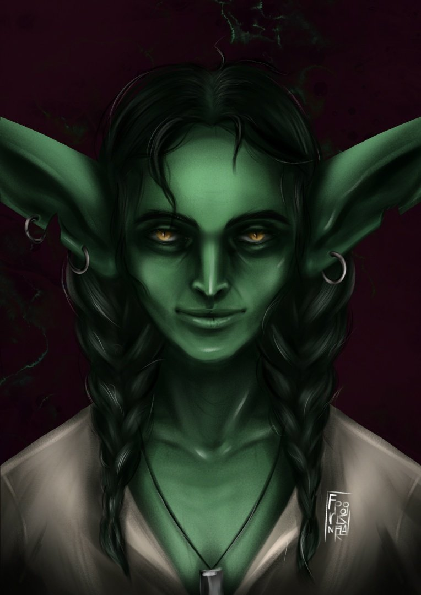
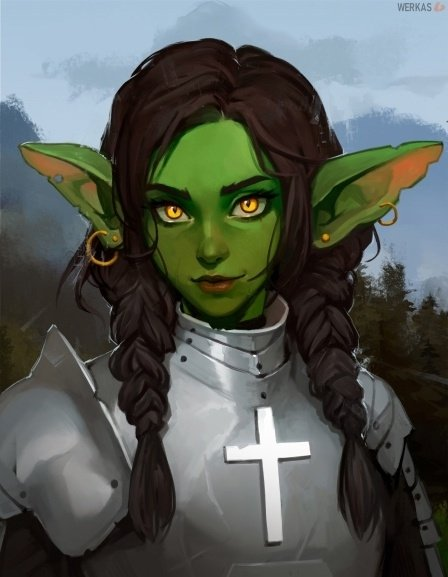
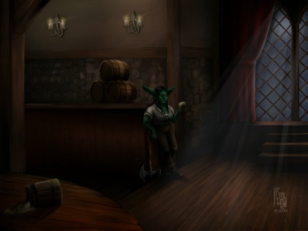

title: Скалл
parent: ankety
order: 20
icon: bi-person
group: Персонажи игроков
image: photo/ankety/skall/knopka.jpg
vk: 55249101
art: photo/ankety/skall/art-1.jpg
layout: anketa

**Владелец персонажа** — [ソフィア ソフィア](https://vk.com/only_marmeladka)

**Имя** — Скалл

**Возраст** — 17 лет

**Раса** — Гоблин

## Внешность

Рост 123 см, вес 45 кг. Скалл имеет светлую зелёную кожу. Большие жёлтые глаза с вертикальными зрачками, тёмные волосы до поясницы. Острые длинные уши местами порваны, имеют кольца в виде украшений. Довольно пухленькая лицом для гоблинов.

## Характер

В сравнении с другими гоблинами Скалл — воплощение доброты, особенно если ей кто-то весьма мил. Девушка ведома своими целями и ценностями рыцаря, коим себя считает. Она вполне осознаёт, что гоблины не самое приятное, что есть для людей, поэтому весьма терпима, если к ней относятся предвзято по этому поводу. Более того, это больше служит мотиватором и поводом показать то, что рыцарь, пусть и гоблин, призван защищать и помогать, неся лишь свет.
Скалл очень легко заводит друзей, предрасположенных к этой самой дружбе. На деле у неё не так много друзей, многие из которых остались позади в её путешествиях. Друг — предмет обожания Скалл, личность, ради которой она безвозмездно хоть отдаст последние деньги. Да, она весьма наивна и легко ведётся на поводу у тех, кого считает другом. При этом она также весьма назойлива всё на той же почве дружбы, и избавиться от неё нелегко. Но ничьё терпение не вечно. Череда предательств от тех, кому помогала, использование тебя мнимыми "друзьями". Всё это оставляет отпечаток, и вера в людей у Скалл давно несколько пошатнулась.
Гоблинша не очень осведомлена в политике и всех подобных вещах. Ей и не очень это интересно, из-за чего она не причисляет себя к какой-либо из сторон.
Больше знакома девушка с религией людей, что для неё довольно сложная тема. Она не считает, что обращена к кому-то из богов и хотела бы таковой и оставаться, но в последнее время сама не понимает, верит ли во что-то или нет.
Что касается её рыцарского существа — она терпеть не может унижения слабых и убийство невинных. Убить кого-то, кто этого не заслуживал — самый большой страх девушки. Даже бандитов или опасных существ она убивает неохотно, часто старается найти иные способы в противовес насилию. Внутри неё постоянно живёт вера, что любой может стать лучше, в конце концов, такие идеи внушал ей её отец. Помогать всем, часто безвозмездно, — тоже учение её отца.
От гоблина тоже многое осталось всё же, несмотря на воспитание. Скалл местами глуповата, часто слишком прямолинейна и любит спрашивать неуместные вещи, не видя в этом что-то плохое.

## История

История гоблина, как ни удивительно, начинается в гоблинском племени. Место, где для всех детей нет определения "мама" и "папа". Никто даже не помнил, где чей ребёнок, поэтому все дети были общие, а вся община — одна большая семья. Конечно, жизнь была не сладкой. В их ближайших лесах было мало дичи, реки скромны на рыбу, а соседнее племя постоянно совершало нападки, явно становясь сильнее. Спасла лишь кража караванов людей, одиноких купцов. Но вспомнить это время как что-то плохое Скалл не может, да и помнит она, если честно, совсем мало.
Как понятно, провести всю жизнь так не было суждено. Племя вымирало на глазах от нехватки еды, нападок более сильного противника и начатых людьми облав на паразитов, что порой их грабили. Как было сказано, Скалл плохо помнит всё это. После очередного набега другого племени, почти все были убиты. Выжила лишь Скалл и ещё несколько гоблинов, но им явно было отведено совсем немного времени. Везение, что на их разбитое племя наткнулся странствующий рыцарь, подобравший уцелевшую девочку из-за своей слишком большой доброты.
Его звали Грэгор. Девочка, на удивление, быстро привыкла к человеку. Помимо простого проживания, она стала хоть чему-то учиться, как в хозяйстве, так и в грамоте, и конечно боевых техниках. Своего рода она стала оруженосцем, что везде верно шастал за рыцарем. Такая жизнь не была скучной, так как Грэгор никогда не засиживался на месте. Даже смерть встретила его лишь в дороге. Старый рыцарь угасал на глазах. Забывчивость, слабость, перетекающая уже в беспомощность, из-за которой он не мог сам за собой ухаживать. Но даже так он не собирался оставаться на месте и бросать дорогу. Душа смелого рыцаря покинула мир ночью, тихо и неожиданно для Скалл.
Следующие недели после смерти Грэгора Скалл просто выпала из мира, пытаясь смириться с потерей и понять, что ей делать дальше. От человека, заменившего семью, у неё остался медальон с крестом на цепи и немного сбережений. Гоблинша решила продолжать рыцарское дело своего наставника, по сути став самопровозглашённым рыцарем.

## Подконтрольные элементы и типы магии

Элементы: воздух, молния, свет; Типы магии: Ускорения и Тела.

## Способ активирования заклинаний

Произношение вслух

## Способности

### Общее ускорение

- В этом заклинании Скалл использует только магию ускорения. Её тело в целом, и даже секира, становятся немного быстрее на десяток секунд, что позволяет быстро нырнуть в сторону, или достать врага.
- Может использовать многократно.

### Ускорение определённого предмета

- Использует в основном только для усиления размаха секиры. Можно использовать также и на иных живых существ, но работает хуже и более неточно, так как не задействуется магия тела.
- Может использовать многократно.

### Направленное ускорение

- Комбинация магии тела и ускорения. Скалл может заставить определённую часть тела двигаться намного быстрее, например руку при замахе. Длится также десяток секунд.
- Может использовать многократно.

### Повышение пределов

- Усиливает собственное тело во многих аспектах. Так, увеличиваются её выносливость (после заклинания она не чувствует усталости), сила и некоторые чувства, типа слуха.
- Длится около 3-х минут, перезарядка 10 минут.

### Рывок

- Максимальная комбинация магии тела и ускорения. Скалл совершает очень быстрый рывок или прыжок, который на грани возможности заметить даже вампирам. Однако она не может сменить направление своего рывка после, а также это чревато врезанием во что-то.
- Перезарядка 3 минуты.
## Физические параметры

- Скалл отлично орудует своей секирой, несмотря на её размеры. А также мечом и может на среднем уровне стрелять из лука.
- Скалл достаточно вынослива и сильна для других гоблинов. Это позволяет ей очень просто двигаться в своих доспехах без особых ограничений.
- Всё остальное, в виде ловкости и регенерации, а также прочее, присущее гоблинам.

