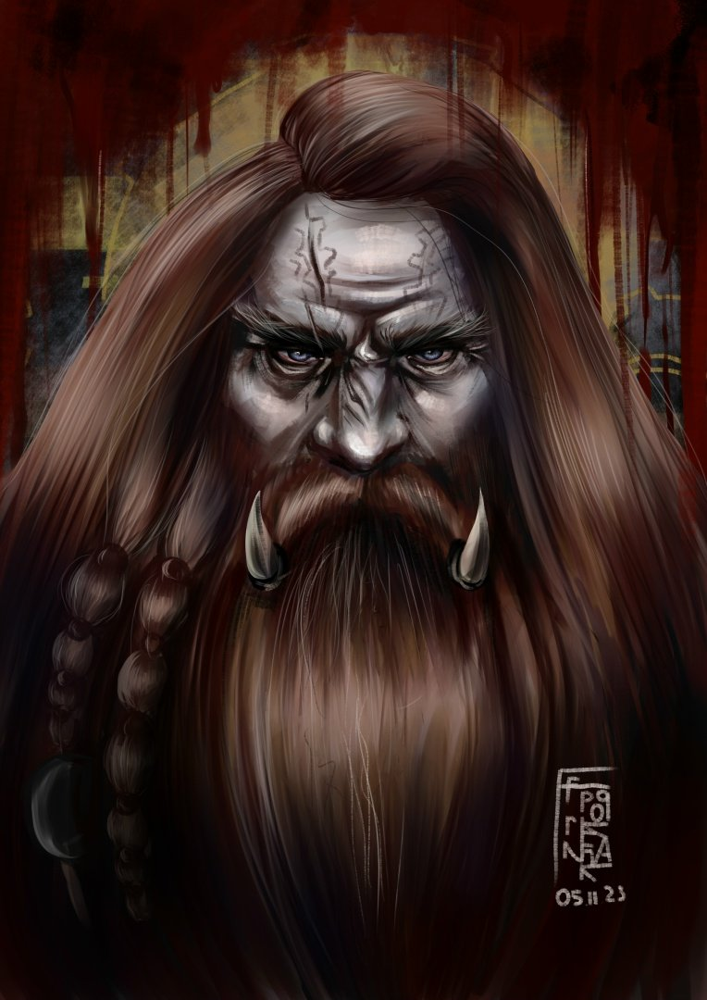
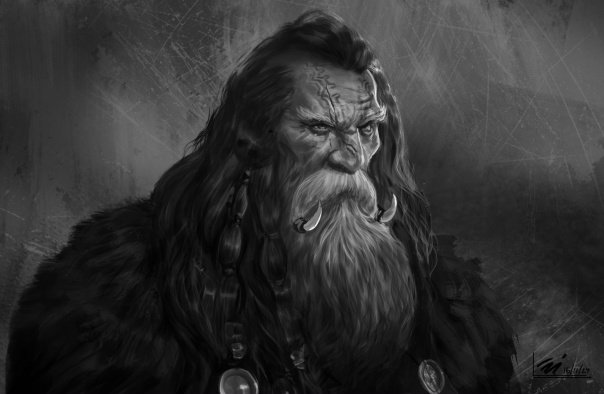

title: Йоргрим
parent: ankety
order: 80
icon: bi-person
group: Персонажи игроков
image: photo/ankety/yorgrim/knopka.jpg
vk: 55281708
art: photo/ankety/yorgrim/art-1.jpg
layout: anketa

**Владелец персонажа** — [Адриан Д'арк](https://vk.com/adrianchikys)

**Имя** — Йоргрим Меднобород

**Возраст** — 165 лет

**Раса** — Гном

## Внешность

Крупный и крепко сложенный, не имеющий ни единой капли лишнего жира, гном представляет собой подобие небольшой скалы. Хмурые темно-голубые глаза, густые, седые от времени брови и рыжие с проседью волосы. Борода пышная, густая, дополненная обилием вплетенных в нее бус и оберегов, сделанных как из дерева, так и из металлов, по большей части серебра. Венчают эту картину два медвежьих клыка, вплетенные по обеим сторонам. Кожа грубая, сероватого оттенка, словно каменная. Нос прямой. На лице вытатуированы символы его клана, обозначающие принадлежность к родовой ветви. Более того, точно такие же символы имеются на его спине и торсе. Рост его 154 сантиметра, вес 97 кг. Ручища громадные — можно даже предположить, что он такими без проблем стальную кружку сомнет. Порой его, как и любого гнома, сопровождает запах перегара — дыхнёт — упадёшь. Зубы жёлтые, давно не чищенные — всё же, гигиена в средние века более чем хромает. Одежду предпочитает практичную — рубаха, штаны, сапоги, да перчатки. В более холодные регионы без той же тёплой шубы предпочитает не соваться, так как не раз видел околевших от холода путников. Походка быстрая, тяжёлая — складывается впечатление, что он делает это нарочно, привлекая к себе как можно больше внимания. Голос громкий, с хрипотцой — на замечания говорить потише, отвечает, что это и без того тихо. На просьбу перейти на шёпот чаще всего отвечает апперкотом.

## Характер

Йоргрим — гном серьёзный и прямолинейный — в целом, самый типичный представитель своей расы — не отличающийся хитростью и, по мнению многих, не способный на подлость. Храбрый, плюющий на предрассудки, он всегда готов бороться за правое дело. Подлость не презирает — всё же, считает это одним из множества методов выживания, однако всем, в коих может различить подобные черты, не доверяет. Грубоват, несдержан в выпивке, имеет явные солдафонские задатки, а потому предпочитает командовать. Терпеть не может, когда его не слушаются. Как и любой другой гном, любит и ценит свою работу. Не скуп — может бросить пару монет бедняку или нищему, дабы тот хоть сегодня поел хлеба и попил воды — каждому, как он сам говорит, по потребностям.
Верует в Предков, считая, что длань их хранит весь Гномий народ от бед. Как религиозный символ он использует щит — тарч. Каждый успешно отражённый им удар считает не иначе, чем благосклонностью бога, а каждое разбитое ударом щита лицо — достойным подношением заступникам своей расы.
К власти и её склокам относится нейтрально — пока она не лезет в его жизнь слишком сильно, чувствует себя более чем хорошо. К тому же в силу профессии, часто сотрудничает с магистратом, который и платит ему за выполненную работу.

## История

«Рождённый в Гольме голода не боится». Гномья мудрость, передававшаяся из поколения в поколение, от отца к сыну, и впрямь была правдой. Будучи ребёнком в обычной семье Гномов, живущих и работающих в шахтах, он мог заверить, что ни разу не видел нищих или голодающих собратьев на улицах или в проулках — соседская взаимопомощь, добрые, семейные отношения, в которых равен практически каждый — именно это видел он, ещё будучи совсем молодым — слушая рассказы бабушек и дедушек о былых временах, он всегда поражался, насколько интересной, захватывающей и одновременно опасной может быть жизнь шахтёра — слышал он и об изумрудах, да алмазах, величиной с кулак — на этих словах старцы обычно поднимали свои руки, словно показывая, насколько громадными и, что вероятно, красивыми, были их находки. Рассказывали о рудах, о тоннелях, да о проблемах в них — то камень вниз пойдёт, то дрянь какая-то повылазит — и бог пойми откуда она там бралась. Вояки, благо, были тут как тут — топорами да молотами кости молотили, ровным строем шли, ряды врагов к стене прижимая, да на части оных разбивая. Сами шахтёры им помогали — кирками да лопатами гадов били, да потом ещё и хоронили — чтоб лишний раз, твари такие, не беспокоили. Отец Йоргрима, воин бывалый и опытный, слова эти подтверждал — сам не раз и не два в шахтах дрался. Да и в караванах тоже. Припоминал он, как отбивались от налётчиков да мародеров всяких, на тракте ждавших — интересно было — жуть. Гномы — они народ такой. Грубоватый, подраться да выпить любят — драки у них и вовсе развлечение частое. Их наш герой ой как любил, да и что греха таить, по сей день любит — на кулаках, на палках, на лопатах — что под руку попадётся, одним словом. В некоторых драках побеждал — в некоторых — нет. Но то дело наживное. Учили его и грамоте, и письму — а какого гнома в наше-то время не учат? Лет этак в семь отправили его в подмастерья — к шахтёрам — всех туда отправляли сначала — учить надо молодняк уму да разуму — как тоннели правильно рыть, как работать долотом, киркой, да лопатой — ведь на этом строилась жизнь любого гнома в клане Краха — от этой самой работы зависело всё — благополучие семьи, её боеспособность, её сытость — одним словом — работаешь — пользу приносишь. Не работаешь — заставят. Заставлять не пришлось. Сначала Йоря наблюдал и запоминал, затем и вовсе повторял — лет этак тридцать пробыл он в шахтах, да ещё и пяток на геологию потратил — как руды отличить, как камни драгоценные наиболее целыми достать, да оценить их. Одним словом, трудился он, как не в себя. В сорок два года взял он себе вторую работу — пошёл подмастерьем в кузню — какой же он гном? В стране великой живёт? Живёт. Серебро да иные металлы добывает? Добывает. А ковать — не куёт.
Вот и начал ковать. Как форму металлу придавать, как травить его, да закаливать. Мечи научился делать, топоры, молоты. Выходили поначалу сносно, а затем и вовсе хорошими получаться стали. Кузнец его и кольчугу плести научил, и детали для доспехов делать — почти двадцать лет на дело это ему более чем хватило — уж поверьте, за срок такой умельцем в своём деле станешь точно — скуёшь если не произведение искусства, то просто добротный предмет. Разумеется, за годы эти он не только как проклятый работал, но и бухал — печень не угробил — здоровье-то у него крепкое, гномье. Пить научился — разом. Талант, как говорится, не пропьешь. Вот он и не пропил. До сих пор. В 64 забрали на службу — служил он в горных патрулях. Весьма исправно. Приказы слушал, команды исполнял. Владеть оружием неплохо научился — молот, клевец, арбалет да щит добротный — дробилка в одной руке, а щит в другой — попробуй подойти — по бочине — цап. И поминай как звали. Одним словом, воспитали настоящего такого вояку — и стрелять умеет издали, и вблизи драться. Бился он, уж поверьте, часто — первый раз какого-то налётчика забил — тот всё своим мечом по щиту бил — думал, что пробьёт, а гном лишь хмыкнул, да как щитом по мечу ударит — меч в сторону, а шестопёр в бедро врубается — след глубокий оставляет. А возвратным движением — рубец прям в бочину, чтоб окончательно и бесповоротно не встал.
И таких вот залётных, возомнивших о себе, много было. Обучали гномов и по картам ориентироваться, и как в тех или иных ситуациях действовать — ну а что поделать? Жизнь такая. Тяжёлая, полная врагов внешних...
Шли годы — нравилось Йоргриму ворогов бить — да и кому, спрашивается, не нравилось? Так и остался служить — за навыки свои, нарощенные честным трудом, десятником стал. Потом и вовсе пятидесятником. Ходил с хирдом небольшим, караваны охранял — то нападение какое отобьет, то в безопасности всё сохранит. Ходил долго — опыта понабрался — во. Много в каких городах бывал, много с кем общался — знакомств завёл — тьма-тьмущая, что уж там. И с охотниками на медведя ходил, и с алкашами — в запой. Одним словом, замечательна твоя жизнь, когда тебе государство за службу исправную монетой звонкой платит. И всё бы ничего — так бы и служил дальше, не случись беда — шли, значит, с караваном через гряду — Йоргрим сразу заприметил — место нехорошее, для засады пригодное, да только сказал ему караванщик — похуй, пляшем. Ну вот и пошли. И прав оказался вояка — засада была — встречали воинов бывалых стрелами, луками, мечами калёными. Бились — как могли. Последнее, что Йоря помнил — удар со спины по головёшке его. Очнулся — а нет каравана — лишь солдатня его убитая, да израненная. Не одного собрата в тот день он захоронил. Грех на себя тяжкий взял. И клятву предкам дал — мол, пока обидчикам за честь свою, да честь братьев и сестёр своих не отомстит — назад, в клан родной, ему дороги нет. Клевец, доспех, да щит его не украли — оно ворью зачем? Не по росту от слова совсем. А мешочек с серебром и златом, в бороде на чёрный день спрятанный, так и не нашли. Вот и ходит он по белу свету, в лицо одно — люд лихой бьёт, да информацию об обидчиках узнаёт. С его слов, цитирую "Найду этих пидорасов — убью".

## Физические параметры

Йоргрим является бывалым воякой, прошедшим не одну и даже не две боевые кампании, за счёт чего навыки его в истреблении врагов крайне велики. Отдавая предпочтение дробящему оружию и щитам, он точно знает, где и как использовать свой "инструмент", дабы победить любого, кто додумается встать на его пути. Его стиль боя предполагает использование щита, однако никто не говорил, что щит обязательно должен держаться в руке — разновидность его, под названием Тарч, крайне хорошо крепится к предплечью ремнями, за счёт чего не занимает второй конечности, что позволяет гному использовать как двуручное, так и одноручное оружие, в зависимости от ситуации. Ко всему прочему, будучи достаточно опытным ближником, он нивелирует слабость клинча наличием перчаток — цестусов на обеих руках. Для подробности распишу то, чем он вообще владеет.
Гномья выносливость и сила уже давно вошли в легенды и не обошли стороной нашего Йорю, гордящегося и превозносящего эту особенность своей расы. Был даже случай, когда голыми руками он заборол целого медведя — отпечаток от этой "дружеской" потасовки до сих пор остался на его лице, придавая ему брутальный вид.
Марш — солдат должен уметь перемещаться, да так, чтобы привалов было минимум. В случае с Йоргримом так и есть — гномья выносливость и многолетняя выучка сделали из него хорошего приключенца, способного передвигаться на достаточно большие расстояния, не совершая длительных остановок.
Рукопашный бой — Он опытный боец и борец, что дрался как в драках трактирных, так и на поле боя — в его арсенале имеются не только стандартные удары, но и грязные приёмы, которые он без зазрения совести может пустить в ход.
Владение оружием: дробящее — Подразделяется на двуручное и одноручное, хотя больше любит второй вариант, поскольку он даёт лучшую защиту и большую возможность для комбинаторики со щитами. В общем и целом, владеет на уровне ветерана и тем, и другим.
Владение оружием: Арбалет — зарядить оружие болтом, навести и выстрелить — ничего трудного.
Владение оружием: Нож — ничем не примечательный навык владения — максимум гнома — приставить его к глотке или кольнуть. Для него это, скорее, инструмент для разделки и свежевания, нежели оружие.
Владение дополнительным снаряжением: Щит — Для него это не только средство защиты, это ещё и оружие — в некотором роде, часть его религии, которым можно хорошенько огреть противника. Защитные стойки, стойки для ударов и финты — мало кто захотел бы стоять с чем-то подобным раз-на-раз.

## Прочие особенности

Быстрое выхватывание — вместо траты стандартного действия (вместо движения или удара) имеет возможность достать какой-либо из доступных предметов свободным, я бы сказал, молниеносным и отточенным движением.
Амбидекстрия — одинаково хорошее владение левой и правой рукой, что весьма полезно при той же комбинаторике.
"Для друзей просто Йоря" — за годы странствий завёл немало друзей и знакомых во множестве городов, а потому может рассчитывать на тёплый приём в них. (Персонажи по желанию могут знать данного вояку)
Магистратский — В каждом крупном городе найдётся непыльная работка, за которую неплохо платят, однако Йоргрим, при желании, может договориться на более пыльную с более весомой оплатой.

