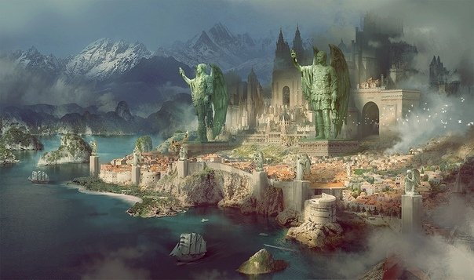
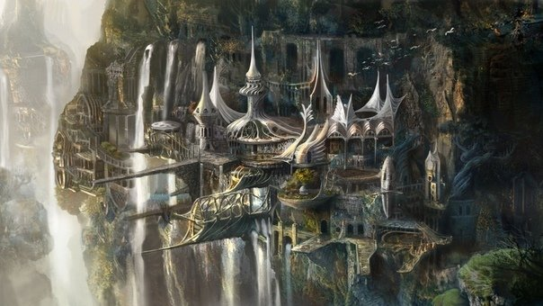

title: Джа'Файл
parent: lokacii
order: 170
icon: bi-geo-alt
group: Территория Великой Империи ящеров
image: photo/vk/533473434_457251416.jpg
vk: 54854040
art: photo/lokacii-web/dzha-fayl.webp
layout: location

## История города

Джа'Файл — самый старый город в Великой Империи, который и является её столицей. Изначально город, как и Сердце Империи, принадлежал людям. Позже, когда к правлению в Империи людей перешёл Урий, люди стали переносить все силы в другие земли, не заботясь об охране границ. Тогда ящеры и смогли захватить Джа'Файл. Империя людей не стала даже предпринимать попытки отбить город, а государство Майр'Эль переименовалось в Великую Империю. На тот момент в городе проживало большое количество людей, которые остались нетронутыми, и по сей день их родственники хорошо себя чувствуют в городе. Город поделён на две части: верхнюю и нижнюю. Низинная часть основана на скоплении мелких озёр, а также на протекающей там реке, которая даёт выход к морю и способствует судоходству. Также в нижней части есть две весьма большие статуи человека, построенные, когда город ещё принадлежал людям. Император Эрийний олицетворён в этих статуях. Именно при нём люди проживали свои лучшие годы, за что его и обессмертили таким образом.

Верхняя часть города представляет из себя замок, построенный на горе, цепь также построенных домов и различных лавок и таверн. Жизнь в верхнем городе — это огромная роскошь, однако много кто из простых людей и ящеров ходит туда лишь посидеть в своих любимых тавернах и скоротать вечер.

## Климатические и географические условия

Город находится в кольце, образуемом горами, и обладает достаточно приятным климатом. Горы не пропускают морозные воздушные массы с западной части материка и выступают как защитные стены. Также город частично построен на цепи озёр и рек. Лето тёплое и не особо щедрое на осадки, как и весна. Зима и осень сильными морозами не выделяются, что позволяет не перемерзать озёрам с реками и иметь постоянный доступ к морю.

## Население

Население города представлено двумя основными расами: ящеролюдьми и людьми. Численность населения достаточно высока, однако Сердце Империи опережает Джа'Файл по этому показателю. Основной пласт населения: обычные рабочие в нижней части города, небольшое количество торговцев и ремесленников с кузнецами.

## Основные функции города

Джа'Файл — столица Великой Империи Ящеров, являющаяся как экономическим, так и политическим, культурным и научным центром. В городе также ведётся добыча металлов в больших размерах, что привлекает большое количество рабочих рук. Школ в городе насчитывается 7 штук, а институтов 3, последние все платные, а школы являются бесплатными. Также имеются и различные школы магии: Школа познания искрящегося металла (металла, магнетизма, электромантии), Школа познания искусства призыва, Школа познания мастерства укрощения, Школа исследования мировых законов (времени, пространства, гравитации).

## Заведения и прочие важные постройки

- Таверна "Раненый вепрь"
- Таверна "Эрийний"
- Таверна "Дракон лунного острова"
