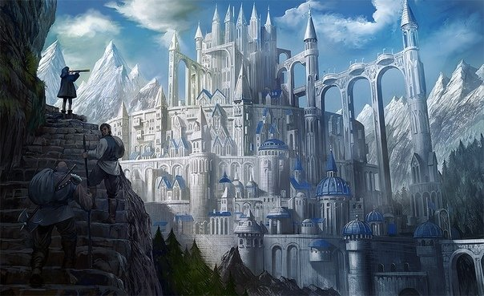
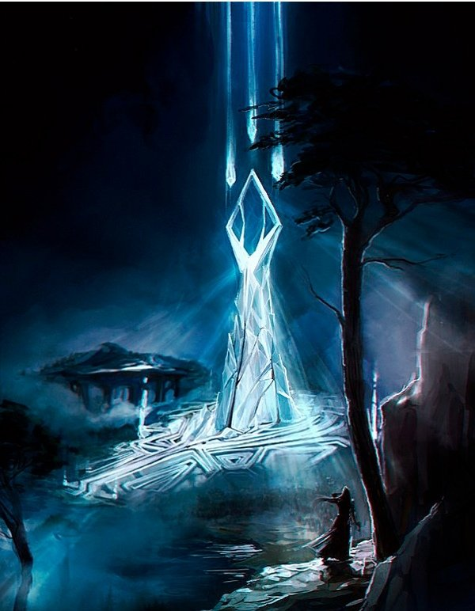
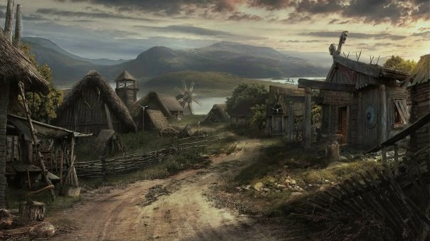
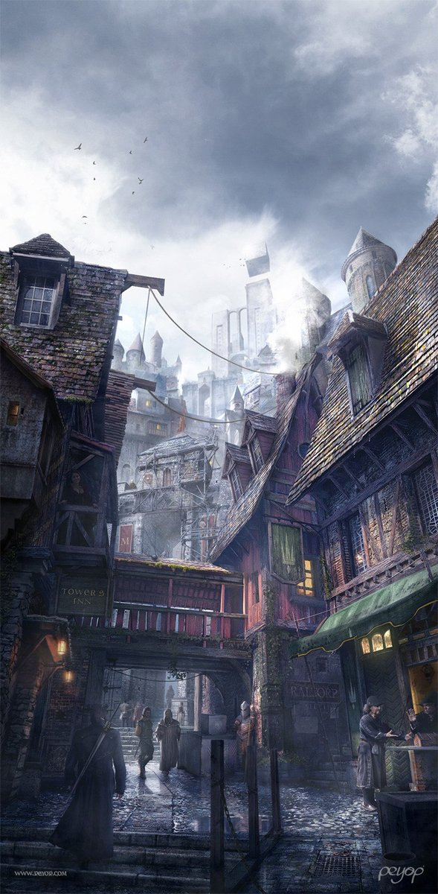
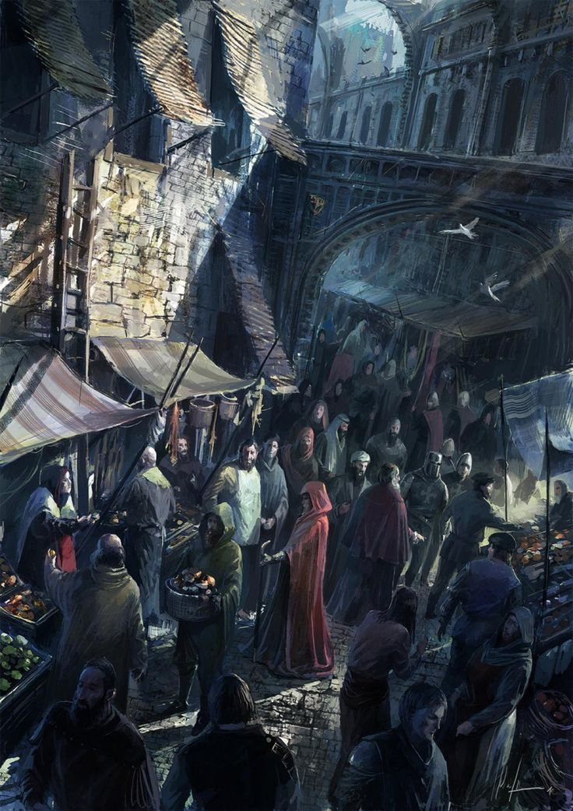

title: Джой
parent: lokacii
order: 100
icon: bi-geo-alt
group: Территория Империи людей
image: photo/vk/533473434_457251409.jpg
vk: 54852226
art: photo/lokacii-web/dzhoy.webp
layout: location

## История города

Джой — это один из самых старых городов в империи, который является в данный момент столицей. Создаваться стал ещё до падения Громула, как один из самых первых городов людей на западной части материка. Из пары домишек и частокола поселение быстро росло как город. Изначально Джой существовал как крупный город, центр управления западными землями. Но во время начавшихся волнений с ящерами совет Громула переместился в Джой, негласно сделав его столицей вместо Джа`Файла. После захвата действующего совета Громула одним из самых влиятельных людей Джоя — Эрийнием, тот объявил Джой столицей новой империи Корваса. Вследствие этого город стал расти ещё быстрее пущего, обзаводясь такими знаменитыми зданиями, как величественный Императорский дворец в глубине города, среди гор, а также парящей в воздухе башней Белых Последователей Малайи. По сей день Джой остаётся столицей Корваса и его самым крупным городом.

## Джой и "застенье"

Джой раскинулся в долине, окружённой горами. В связи с этим город имеет стены лишь с юга, где и расположены основные ворота в Джой. Остальные стороны защищены природой. В глубине гор возвышается императорский замок, от которого кольцами идут остальные улицы. Сам замок — владение сугубо властей, и помимо Императора там проживают лишь все необходимые слуги и важные придворные. Первые улицы рядом с замком являются местом проживания самой знатной аристократии. Дорогие поместья тут обнесены металлическими заборами, а у каждого из таких зданий стоит личная охрана. Улицы тут наиболее пустые, даже несколько безлюдны. А сам квартал называют золотым. Ярусами к югу качество жизни и условия для неё начинают уменьшаться. Центром города является большая торговая площадь. Множество лавок и заведений, что выстроились кругом у площади, сменяются сценами и трибунами, где толпятся зеваки, слушающие новости или беззаботно смотрящие на актёров с музыкантами. Скучные фасады зданий обычного люда разбавляются редкими поместьями тех, кому не досталось места в золотом квартале, а также академиями, институтами и большими или не очень лавками.
У стен города проживают наиболее бедные горожане, ютящиеся в больших многоэтажных зданиях, где делят семьями этажи и комнатки.

Одна из самых видных достопримечательностей города — Башня Белых Последователей Малайи. Величественное здание на парящем острове, к которому почти ни у кого нет доступа. Она видна с любого уголка города, изредка озаряя тот таинственными вспышками света от кристалла, расположенного в верхушке башни.

За стенами также не прекращается житейская суета, так как там расположился целый район тех, кому места в городе не нашлось. Что-то вроде деревушки, что зовётся застеньем, где проживает наиболее бедный люд. Кто-то приезжал в надежде стать городским кузнецом, кто-то искал лёгкой и лучшей жизни в городе, но по итогу все они теперь ютятся в трущобах за стенами столицы.

## Климатические и географические условия

Город находится в окружении гор, что является основным фактором, влияющим на климат местности. Это не делает его климат сильно суровым, так как он, наоборот, защищается горами от ветров, а для задержания осадков они не слишком высокие, что предотвращает засухи. Рядом с городом протекает река, на которой и основано застенье города. Люди смогли там обустроить мельницы, огороды и прочее для развития сельского хозяйства рядом со стенами города. Зимы всё же здесь холодные и часто многоснежные, что сильно ухудшает жизнь жителей застенья, так как леса для добычи дров рядом нет и приходится их ещё до зимы закупать, или просить магов огня, что обогревают практически все здания в городе (есть целая должность для таких магов), создать в печи магическое пламя, не требующее дров месяцами, однако это дорого. Лето не очень тёплое и в среднем температура держится у 15-20 градусов с умеренными дождями. Весна и осень холодные и изредка сопровождаются проливными дождями. От вод океана город расположен далеко и, соответственно, не имеет к нему какого-либо выхода.

## Население

Нетрудно догадаться, что среди населения преобладают люди, однако пристанище в столице людей себе смогли найти немногочисленные представители следующих рас: гоблины, редкие городские дриады, гномы и даже эльфы. Также ходят слухи о том, что в городе скрывается среди народа несколько семей вампиров. Столица населена людьми всех классов и сословий, так что тут можно увидеть как зажиточных аристократов с личной охраной, так и калек, что попрошайничают среди улиц. Имеют место быть и представители криминального мира, хоть с ними и борются. Почти всегда это одиночные индивиды, не представляющие из себя что-то крупнее воров или убийц. Крупные банды обычно быстро распадаются, или разбиваются армией города.

Джой находится в одноимённых землях Джоя, которые управляются лично императором. В отличие от всех остальных земель тут наблюдается наиболее высокое качество жизни. В землях Джоя больше крупных деревень, образованного населения и его большее количество, с более равномерным распределением по всей территории.

Конечно же, для большого населения столицы нужна постоянная охрана, которая тут представлена разными типами. Основой правопорядка являются обычные стражники, вооружённые мечом и легко защищённые. Они производят основной дозор на практически всех крупных улочках города, а также изредка выбираются патрулями в застенье. Также они являются основной силой подавления разных потасовок и т. п.
Защитой города от "грязной" магии являются постоянно патрулирующие отряды охотников Аола, которых хоть и сильно меньше, чем обычных стражей, однако их постоянное прочёсывание улиц, а не застой на одном месте, делает это отставание в численности незначительным. И наконец защитой замка Императора и всего его двора занимается специальное подразделение личных телохранителей императора, которые также помимо охраны замка повсеместно встречаются в золотом районе.

## Основные функции города

Джой носит статус столицы Империи, являясь при этом политическим и административным центром страны, где крутятся основные интриги и где люди первыми испытывают на себе новые законы императора. Также Джой является местом для важных гостей императора, а если точнее, то таковым является замок города.
Помимо этого Джой — кладовая знаний, основное место процветания науки и культурный центр. В городе есть 3 школы для детей из разных слоёв населения, где их обучают азам наук, письму и умению читать, однако все они платные. Также в Джое есть 3 школы магии: школа света, объединяющая в себе два направления: школу изничтожающего света и школу созидающего света, школа жизни, школа изучения магических символов (рун, формул, чертежей, символов, петроглифов). Имеется крупная алхимическая лаборатория в замке, которая по совместительству и институт алхимии, однако это самое престижное место обучения, доступное очень малому количеству людей.

Из-за расположения в горной местности в Джое сильно развита горнодобывающая промышленность и обработка металлов с помощью магии, с дальнейшей поставкой кузнецам в различные уголки Империи. Маги обрабатывают огромное количество металлов, а работники шахт зарабатывают немалые деньги. Из основных добываемых металлов можно выделить: железо, серебро, золото и мелкие месторождения малоиспользуемых металлов. Также в Джое занимаются созданием сплавов стали.

И, наконец, Джой большой торговый центр, славящийся своим хоть и не самым большим, но богатым рынком. Сюда стремится большое количество ремесленников, кузнецов и торговцев. Джой крупное место сбыта различной продукции, так как развивающейся столице нужно её много и разной.

## Заведения и прочие важные постройки

- [Кузница "Стального графа"](vk:55303638)
- Сеть таверн "Медоноска"
- Бордель "Хромоножка"
- Бордель "Красный фонарь"
