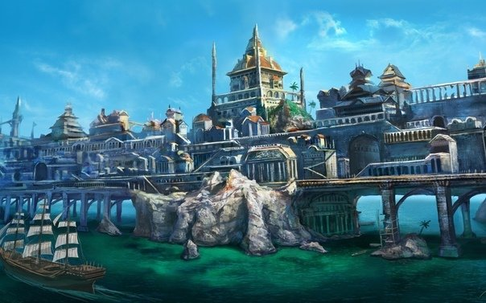
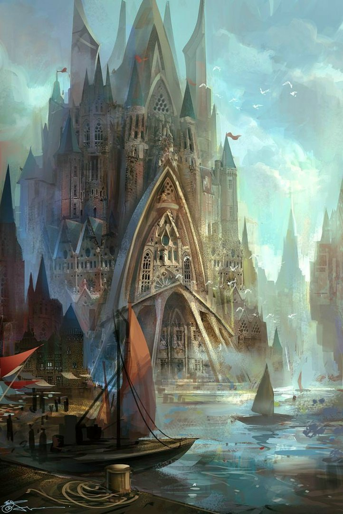

title: Фалассэ
parent: lokacii
order: 220
icon: bi-geo-alt
group: Территория Альянса эльфов
image: photo/vk/533473434_457251421.jpg
vk: 54854046

## История города

Фалассэ — самый молодой из основных крупных городов Альянса. Эльфы, уже сформированные в нечто единое и более развитые, в последнюю очередь добрались до своих морских границ. Уже столкнувшись с дриадами, освоив западные части леса и начав отстраивать Каэльмор _(а после обнаружив на западе окончание лесов)_, они двинулись осваивать северные части леса от Каэльмора. Место небольшого морского залива стало отличным, чтобы основать портовый город. Отстройка начиналась с освоения лесной части, где расположились дома рабочих, земледельцев и прочие места первой необходимости. Из-за этого сейчас лесная часть города более густо застроена и заселена.
Портовая часть отстраивалась уже с обязательной помощью магии. Протянуть стену зданий по морским хребтам вручную было бы крайне тяжело, если не невозможно. Каменная линия верфей и различных домов с заведениями является отличительной чертой Фалассэ. Позже, с развитием флота, Фалассэ стал одним из основных торговых городов Альянса, связываясь морскими путями с прочими эльфийскими государствами.

## Лес и вода

Как уже говорилось, город поделён на две части. В лесу расположились жилища, небольшие обрабатываемые поля на почвах, свободных от леса, а также торговые площади и прочее, что присуще любому крупному городу. Интереснее же водная часть. Цепочка каменных строений, держащихся на единой платформе над водой, полностью протянута через весь небольшой морской залив. Тут расположены все верфи и доки с причалами. Также, так сказать, не отходя от кассы, тут часто торгуют иноземные гости. Фалассэ один из немногих городов, куда могут заплыть не только эльфы. Встречаются тут представители почти любой расы, но дальше города их не пропускают.
Морской город из-за этого в особом положении, требующем большей охраны — на всякий случай.
Стеной между лесной и водной частью города стоит красивый и масштабный комплекс зданий, несущий название "Торгово-дипломатический центр Альянса". Внешне он похож на часть замка, построенного прямо на прибрежной части залива. Этот центр окружён небольшими доками и причалом для лодок и мелких кораблей. Служит же он для принятия представителей иных эльфийских государств. Тут заключаются все торговые соглашения, а порой и иные дипломатические, связанные именно с морским пространством, и, например, взаимно открытыми морскими границами. Помимо прочего здесь располагаются всякие учреждения для получения грамот и документов, нужных торговцам и т. д. Любой приплывший извне торговец, не являющийся эльфом, обязан получить в центре грамоту о допуске в лесную часть города, дабы попасть на основные рынки. Иначе же придётся довольствоваться торговлей прямо в портах.

## Климатические и географические условия

Фалассэ обладает двойственным климатом, так как его часть расположена в лесу, что поддерживает уникальные условия. Ближе к берегу становится куда прохладнее, нередки осадки в виде дождя, а зимой даже снега. Однако морские воды тут никогда не замерзают. Из-за близости к морю дожди также порой настигают и лесную часть города. Сам порт города расположен на каменистом заливе, вгрызающемся внутрь материка. Воды здесь богаты рыбой, моллюсками и даже весьма съедобными и вкусными водорослями. Вне залива есть очень редкие рифы, среди которых можно найти моллюсков с жемчугом. Небольшими партиями Альянс развивает ловлю жемчуга, и задумывается даже о способах разведения моллюсков с ним. В залив впадает довольно крупная река, одноименного с городом названия. Она тянется от самого леса, нитью соединяя все части города.

## Население

Хоть большую часть населения всё так же занимают всевозможные эльфы, тут помимо них уже можно встретить практически кого угодно. Торговцы из далёких государств частые гости, желающие набить кошель рунгами. Сами жильцы города представлены ремесленниками, мастерами кораблестроения, строителями и прочими рукоделами и торговцами. Фалассэ вбирает в себя самое большое разнообразие в этом плане. Тут есть место и земледельцам с садоводами, ведь часть почвы, что освобождена от леса, весьма плодородна и позволяет выращивать уникальные культуры. Также в морском городе располагается регулярная часть армии, как следящая за порядком, так и готовая в нужный момент подняться на палубы флота Альянса.

## Основные функции города

Фалассэ вобрал в себя много жизненно необходимых для государства функций. Самыми явными являются его торговая составляющая, а также кораблестроительная. Здесь сосредоточен основной флот Альянса, и, логично, расположены главные морские Академии, обучающие как мастеров кораблестроения, так и военных в статусе морских капитанов. Фалассэ — основное звено в связи с другими государствами, а торгово-дипломатический центр является основным местом принятия важных гостей. Также именно тут расположена крупнейшая на территории Альянса школа водной магии.

## Заведения и прочие важные постройки

- Бордель "Меч Эоги"
