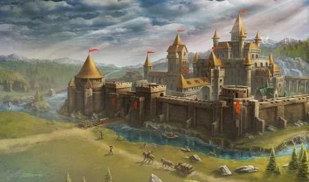

title: Форт Веры
parent: lokacii
order: 150
icon: bi-geo-alt
group: Территория Империи людей
image: photo/vk/533473434_457251414.jpg
vk: 54854038

## История форта

Форт Веры — совсем молодое поселение, созданное для защиты границы. Одновременно с этим форт является базой для ордена Веры. Здесь также располагается храм Итишии, которая является почитаемым божеством ордена Веры. Внешне форт представляет из себя обнесённый толстыми каменными стенами замок, с маленькими, незаметными домами самих жителей. Несмотря на то, что в основном в форте проживают лишь семьи членов ордена Веры, для людей форт успел стать ценным в культурном плане. Много посягательств на форт было у ящеров, которые не один раз осаждали поселение, раз за разом терпя неудачи.

## Климатические и географические условия

Форт находится на равнинной местности, не богатой никакими природными ресурсами, кроме дельты одной из рядом находящихся рек. Климат очень мягкий, почти всегда обеспечивающий местность необходимым количеством дождей и солнечного тепла, позволяя заниматься земледелием. Зима всегда малоснежна и не доставляет неудобств морозами. Даже в зимнее время тут занимаются выведением некоторых растений. Весна и лето очень тёплые, достаточно обеспечивающие землю влагой, из-за чего не случается засух. Осень практически незаметна как время года, и мало чем отличается от лета, разве что становится менее тепло.

## Население

Почти всё население форта — это семьи членов ордена Веры, которые являются насекомоподобными. Однако здесь проживают и некоторые люди, в основном торговцы и ремесленники. Жителей же тут совсем мало, что неудивительно. Часто в форте временно остаются торговцы, которые являются основными поставщиками необходимых товаров для жителей. Также в форт организуются поставки с едой и всем необходимым для жизни.

## Основные функции

Форт является важным местом для защиты границы Империи, и для предупреждения в случае резкого нападения ящеров. Также это база ордена Веры и важная культурная единица для Империи людей. Школы в городе точно не появятся из-за ненадобности.

## Заведения и прочие важные постройки

- Корчма "Клин"
