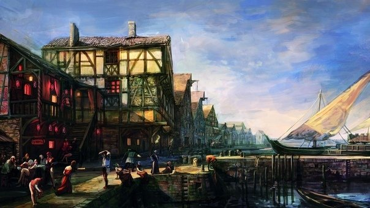
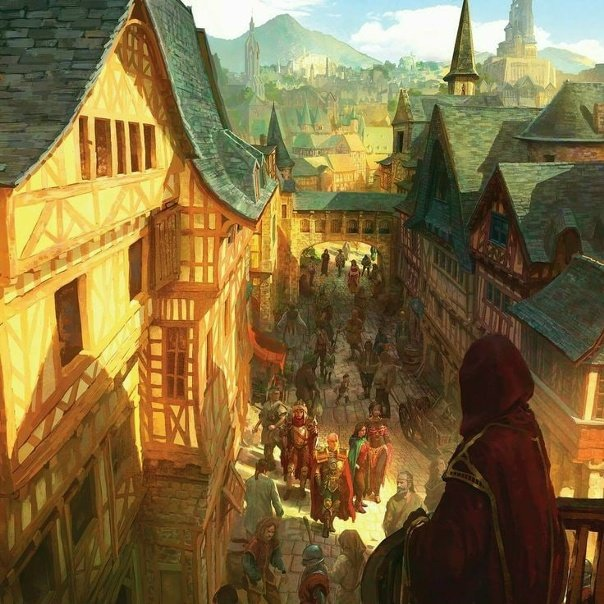

title: Гримм
parent: lokacii
order: 120
icon: bi-geo-alt
group: Территория Империи людей
image: photo/vk/533473434_457251411.jpg
vk: 54854034
art: photo/lokacii-web/grimm.webp
layout: location

## История города

Гримм — город, что строился ещё во времена Громула, как важный порт для торговли и связи с иными империями и государствами. Рабы, море, корабли и чистый воздух — всё это быстро стало ассоциироваться с Гриммом. Сразу здесь создавались мастерские кораблестроения, что поспособствовало созданию сильнейшего флота на материке. После создания кораблей и верфи, город стал расти огромными темпами, отсюда стали отправляться экспедиции для создания колоний за материком. Также именно мореходство развило ввоз и вывоз рабов в Гримм, и даже после запрета работорговли есть чёрные рынки с рабами, где каждый день десятки живых существ покупаются и продаются. Также торговля в городе стала развиваться всё теми же большими шагами, что сделало Гримм важнейшей торговой артерией страны.

## Климатические и географические условия

На климат города сильно влияет прибрежное положение и протекающее рядом тёплое течение, сводящее на нет холодную и снежную зиму. Зимой тут температура не опускается даже ниже нуля, из-за чего порт Гримма является незамерзающим. Среднегодовая температура 20 градусов тепла. Благодаря этому тут можно выращивать теплолюбивые фруктовые деревья и культуры. Рядом с городом есть небольшие леса, которые почти не используются людьми для добычи древесины из-за её малого количества. Порой наступают хаотичные сезоны дождей, приходящие с вод океана. Такой сезон может длиться от недели и больше, с редкими перерывами в пару дней.

## Население

В Гримме проживает достаточно большое количество разнообразных представителей рас. Чаще всего из не-людей тут встречаются алькарцы _(особенно девушки, особенно в борделях)_, гномы и гоблины. На судах приплывают торговцы из разных стран, а из Гольма, Граальдфада и стран востока вообще есть постояльцы, регулярно заплывающие в порты Корваса. Входит Гримм в южные земли Гримма, и заправляет тут всем Мирак Жемот Фрамет Агадайл.
Гримм дурно славится одной из самых больших преступностей. Тут разжились разные мелкие банды, часть из которых пираты, ушедшие промышлять на суше, чёрные работорговцы, вопреки закону как увозящие, так и привозящие живой ресурс. Отчасти из-за этого же тут большой процент бедняков. Некоторые смогли сбежать от рабовладельцев, кто-то стал жертвой бандитов, и все они теперь вынуждены сводить концы с концами. Благо, город предоставляет возможности для заработка. Всегда можно начать работать на складах, податься в экипаж какого-нибудь корабля, или, если природа наделила красивой внешностью и сделала вас женщиной — пойти работать в бордель.

## Основные функции города

Гримм является важным торговым городом Империи. Отсюда вывозится большое количество товаров в иные страны, и наоборот. Основным торговым партнёром Империи является Граальдфад, и Гримм — основное связующее звено этих двух государств. Также частые гости тут — гномы Гольма, торгующие уникальными ценными рудами _(а порой и очень уникальными, что не особо законно у гномов)_. С Граальдфадом торговля ведётся всевозможными товарами, от пушнины с лесов Бранна, до тканей и жемчужин с берегов Граальдфада.

В Гримме создаётся одна из важнейших частей армии Империи — флот. В городе есть школа по судостроению, где подготавливаются мастера Империи. Также тут много мастеров из Граальдфада. Порт города один из самых защищённых на материке, имея на месте постоянную флотилию.

## Заведения и прочие важные постройки

- Таверна "Устрица"
