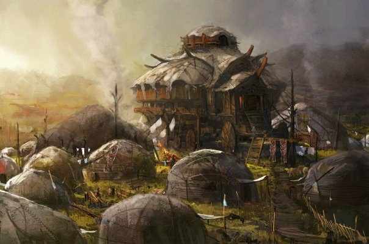

title: Гром'ха
parent: lokacii
order: 130
icon: bi-geo-alt
group: Территория Империи людей
image: photo/vk/533473434_457251412.jpg
vk: 54854035

## История Гром'Ха

Орки всегда жили разобщённо и мелкими группами, даже когда выживание их расы встало под угрозу на этом материке. Лишь Гром'Ха всегда был единственным крупным поселением орков. Династия вождей одна и та же уже много десятков лет, что стало причиной раскола группы Адского топора от Гром'Ха. Это уменьшило и без того малое количество орков в лагере. Приток орков с материка мал также и из-за того, что мало кто знает о существовании лагеря, который ведёт тихий образ жизни. С самого начала существования, Гром'Ха приходится уживаться с Империей людей, на территории которой находится лагерь. Орки не трогают проезжающие мимо караваны и отряды Империи, из-за угроз быть уничтоженными вовсе, однако если кто-то подойдёт близко к лагерю, они всё же не считают лишним убить пришедшего.

## Общее описание поселения и его деятельности

Внешне поселение представляет из себя обнесённые высоким частоколом палаты. Внутри не существует чётких улочек и ориентироваться новоприбывшим поначалу в целом сложно. Есть палаты с отдельными функциями, например, подобия таверн и даже небольшие кузницы. 3 жилых палаты стоят очень близко друг к другу, а в центре этих палат находится общий костёр, для приготовления пищи. В центре лагеря находится палата вождя, конечно же выделяющаяся на фоне остальных. Орки тут ведут тихий образ жизни, не конфликтуя с кем-либо. Все делятся на определённые группы, определяющие род деятельности орка: охотники, лекари, охранники, обслуживание в таверне и т. д. Общая численность населения мала, но раса бесстрашных воинов без сомнения окажет отпор любому вторгнувшемуся.

## Климатические и географические условия

Гром'Ха находится недалеко от гор, рядом с небольшим лесом. Погодные условия тут не суровые, но очень переменчивы. Лето может быть очень жарким, а может держаться постоянно прохладным, и так с каждым временем года. Лес рядом является источником древесины и еды. Также недалеко протекает река, являющаяся основным источником воды для орков.
