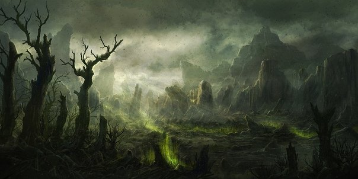
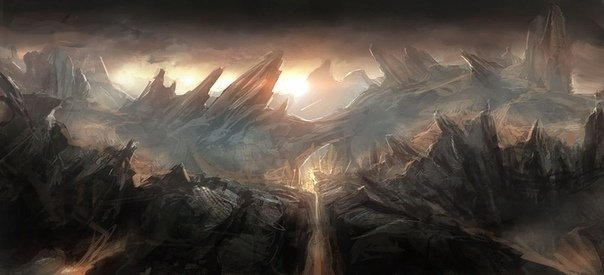

title: Хор
parent: lokacii
order: 250
icon: bi-geo-alt
group: Земли, поражённые скверной
image: photo/vk/533473434_457251424.jpg
vk: 54854051

Хор — первая павшая крепость, где и была обнаружена скверна. Недалеко от острова, где находится эта крепость, есть ещё один остров, на котором никого и никогда не было. Но позже именно с этого острова скверна всеми силами хлынула на крепость, в которой по несчастью оказался император Урий, погибший там со своими верными воинами. Два оставшихся государства отказываются верить в это, утверждая, что люди опять обуздали магию, неизученную до этого и пытались её опробовать, а на остров теперь просто свозят рабов. Никто не решается плыть к острову, ведь никто не возвращается оттуда.

