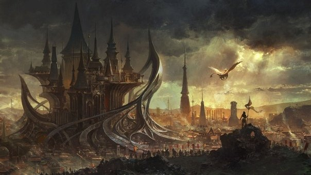

title: Каэльмор
parent: lokacii
order: 230
icon: bi-geo-alt
group: Территория Альянса эльфов
image: photo/vk/533473434_457251422.jpg
vk: 54854047
art: photo/lokacii-web/kaelmor.webp
layout: location

## История города

Каэльмор был вторым крупным городом, построенным в результате продвижения первых эльфов на запад лесов. Текущее его место для строительства было выбрано потому, что тут была практически полностью лысая местность посреди более редкого леса. Это позволяло застраиваться с более широким размахом, одновременно с этим и более компактно. Один же из первых королей перенёс сюда и столицу Альянса, которой изначально было Сердце леса. Вместе с общей застройкой стал возводиться крупный замок из металла. Сложнейшая эльфийская конструкция на данный момент, в которую ушло невероятное количество ресурсов. Кроме как магией, никак больше невозможно было такое возвести. Но даже с её помощью такая постройка растянулась более чем на 50 лет. Помимо замка, эта сердцевина города стала небольшим районом, в котором издавна обитают лишь самые высокие знатные дома. Так замок обрастал вокруг кучей зданий и улиц, становясь крупнейшим городом Альянса.

## Климатические и географические условия

Как и во всём эльфийском лесе, в городе отсутствуют такие времена года, как зима и весна, так как их влияние на климат просто не видно. Сама местность представляет из себя очень большую и бедную на растительность лесную опушку, довольно быстро застроенную. Окружающий же лес более редкий, в сравнении с любой другой его частью. Но не обделён живностью. Такой лес даже более благоприятен тем же оленям, которых эльфы, кстати, тут разводят. Чем дальше на запад, тем сильнее редеет лес, превращаясь уже в лесостепь, пока вовсе не переходит в неосвоенные западные равнины, неинтересные эльфам на данный момент.

## Население

Население Каэльмора наиболее контрастно между классами. Пока в центральном замке обитают сливки эльфийского общества, на краях города образуются настоящие трущобы и самые бедные районы, которых в других городах попросту нет. Сюда стекались абсолютно все эльфы, от крестьян до ремесленников и кузнецов. Поэтому и размах профессий у эльфов тут очень большой. Есть и земледельцы, и кузнецы, и учёные умы. Образование, к слову, относительно доступно именно в Каэльморе. Тут есть множество небольших школ, в которых обучение основам письма и счёта могут себе позволить даже самые небогатые семьи.

## Основные функции города

Каэльмор берёт на себя достаточно много функций, как и подобает развивающейся крупной столице. Здесь формируется основная эльфийская армия, проходят обучение более знатные эльфы во всевозможных военных училищах, формируя генеральское военное сословие. В связи с этим же именно тут располагаются крупнейшие кузни Альянса, а также и вольные кузнецы и ремесленники. Более того, на территории Каэльмора добывается и обрабатывается звёздный металл.
Естественно, город важный внутренний рынок Альянса, с богатыми торговыми площадями и рядами всевозможных лавок. Помимо прочего тут расположилось множество магических академий, и разных институтов, вбирающих в себя всевозможные сферы развития.

## Заведения и прочие важные постройки

- Таверна "Шмель"
