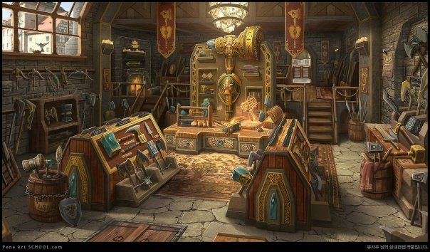

title: Кузница Стального Графа
parent: dzhoy
order: 10
icon: bi-hammer
summary: Кузнечная лавка в Джое
vk: 55303638

Кузница стального графа — престижная кузнечная лавка, расположенная в ремесленном квартале. Здесь выполняют как личные заказы с уникальным дизайном и из дорогих материалов, так и массовые запросы, потому как при предприятии содержится полноценный кузнечный цех со штатом в 10 неустающих рабочих големов.
Помимо прочего, саму лавку обслуживают ещё четыре такие необычные маго-машины. Големы принимают заказы, охраняют магазин и куют без перерыва под предводительством Генса Харфорта — самого "Стального Графа". Умелый маг-кузнец, гарантирующий "Гномье качество" изделий, нередко работает над заказами клиентов самостоятельно, не давая своему молоту остыть.
Множество заготовок и изделий стоит на витринах, а из подвала всегда пышет жаром круглосуточно работающий горн. Стальные рабочие не нуждаются в отдыхе и днями напролёт работают над заказами, так что предприятие гарантирует высокие скорость и качество работы!

_Автор и владелец:_ [_Pomidop Red_](https://vk.com/pomidop_original)
