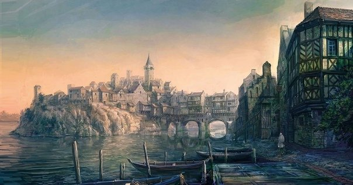

title: Майрл'Эль
parent: lokacii
order: 180
icon: bi-geo-alt
group: Территория Великой Империи ящеров
image: photo/vk/533473434_457251417.jpg
vk: 54854041

## История города

Майрл'Эль — начало становления Великой Империи. Изначально был небольшим портовым городком Империи людей, в котором процветала преступность и работорговля, которая по сей день себя чувствует так же. Преобладающим населением же были ящеролюди, добивающиеся независимости. Так как Император людей не желал создавать конфликтов внутри страны, спустя несколько десятков лет пришлось признать независимость Майрл'Эля. На сегодняшний день это всё ещё рассадник преступности и место обитания культа дома теней — самой опасной организации на землях Великого императора, которая промышляет работорговлей, занимается наёмными убийствами и диверсиями.

## Климатические и географические условия

Климат города умеренный, но всё же имеет уклоны в суровость. Порой зимой могут ударить очень сильные морозы, и порт города замерзает, по этой же причине судоходство здесь развито очень слабо. Летом и весной относительно тепло, иногда с резкими дождливыми сезонами. Вокруг города же лишь равнины, а из ценных природных богатств лишь соли, добываемые в солёных озёрах недалеко от города.

## Население

Население города небольшое и представлено в основном лишь ящеролюдьми. В город частенько заглядывают купцы, иногда приезжают из других стран по морю. Основой населения являются кузнецы и ремесленники. Представителей других рас крайне мало и встретить их — довольно редкое событие.

## Основные функции города

Со временем город утратил свой статус экономического центра и сейчас является лишь связующим звеном с государствами за пределами материка. Каких-либо школ магии, университетов и академий нет, а вот обычных школ целых 3, правда 2 из них платные. Институт и вовсе лишь один, и связан с судостроением.

## Заведения и прочие важные постройки

- Бордель "Шалфей"
