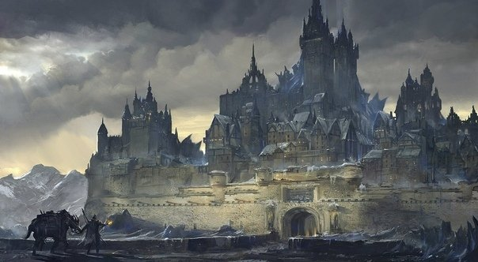
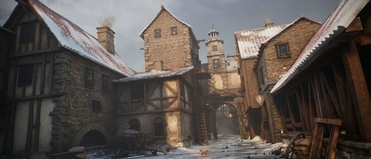

title: Нордфолл
parent: lokacii
order: 110
icon: bi-geo-alt
group: Территория Империи людей
image: photo/vk/533473434_457251410.jpg
vk: 54854029
art: photo/lokacii-web/nordfoll.webp
layout: location

## История города

Нордфолл — самый северный город Империи людей, находящийся в западной части материка. Изначально вместо города задумывалась крепость, о чём говорит крепость-замок в самом центре города, вокруг которого и началась застройка всего остального. Несмотря на суровый климат и пограничное положение рядом с околовраждебным государством, в город стягивались представители самых различных рас, и население медленно, но неуклонно росло. Это привлекало кузнецов, торговцев и прочих ремесленников, которые также стали осваиваться в новом городе. По мере расширения, кроме внутренних стен замка появилась ещё одна стена, сделавшая крепость городом. Постепенно поток населения стал уменьшаться, так как всё-таки мало кто желал уезжать жить в город с суровым климатом, где нельзя заняться личным хозяйством, а придётся работать в шахтах или промышлять ещё чем, не особо лёгким. В целом история города не блещет знаменательными событиями, ведь у молодого Нордфолла ещё всё впереди.

## Устройство города

Ядром города является крепость-замок, представляющая из себя самое защищённое сооружение Нордфолла. Замок способен вместить в себя почти половину населения города. Также он обладает катакомбами, ведущими к скрытому выходу из города. Внутри крепость является также домом для местной власти. Нордфолл входит в западные земли Нордфолла, которые находятся под управлением Догейр Меланжа Фрамет Нидуса.

Вокруг крепости раскинулся сам город, строение которого напоминает отдельные блоки зданий, соединённых меж собой улочками. Город выделяется компактностью, так что сами улочки тут весьма узкие во многих районах. Перед замком расположилась основная городская площадь с небольшим рынком и прочими прелестями крупного города в виде всевозможных заведений, самые крупные из которых находятся как раз у площади. Ещё одна особенность города — это большое количество кузниц и цехов.

## Климатические и географические условия

Нордфолл находится в уникальной полосе западного материка, попадая под влияние снежных гор Дрогх в небольшую полосу. Севернее климат резко различается из-за близости магического леса, а южнее весьма плавно становится не столь суровым. Это сильно сказывается на климате города и на деятельности людей. Лето проходит чаще всего со снегами, хоть и небольшими, температура опускается до -10 градусов, иногда переваливая к плюсу в особо тёплые дни. Из-за этого земля почти всегда промёрзшая и непригодна для земледелия. В осеннее и зимнее время наступают особо холодные дни, а дороги заметает частыми метелями. Севернее города, ближе к границе с эльфийскими лесами, где температура резко начинает отличаться, становится намного теплее и свободно протекает крупная река, вокруг которой имеются множественные деревеньки людей, уехавших из города. Чтобы связать Нордфолл с другими городами, пришлось прокладывать дороги в равнинах между горами. Небольшой кусочек лесов эльфов попадает во владения людей, где чаще всего случаются убийства лесорубов, живущих в деревнях у реки, а также прочие мелкие стычки. К городу прилегают заснеженные хвойные леса, потихоньку обрабатываемые людьми.

## Население

Нордфолл — самый малочисленный город, закрывающий собой список основных крупных городов Корваса. Суровые условия мало для кого подходят, а встречаются тут в основном люди. В основном приезжают сюда в целях работы. В молодом городе постоянно нужны рабочие руки для строительства, добычи металлов, лесоповала и прочей тяжёлой, но относительно хорошо оплачиваемой работы. Вторым пластом являются различные ремесленники и кузнецы, работающие на государство. Уровень жизни тут средний, если сравнивать с иными землями Корваса. Зато очень равномерный. Все живут без изысков, но уровень нищих и бездомных довольно мал, ведь таким выживать легче в городах южнее.

## Основные функции города

Как и изначально задумывалось, сейчас основная функция города — защита границы. В Нордфолле есть немаленький действующий гарнизон, способный сдерживать атаки противника. По мере развития города и разведывания окрестных областей в горах были найдены залежи необходимых руд, однако по сей день обрабатывается очень малая часть этих залежей, из-за труднодоступности и специфики погодных условий в горах.
Совместно со всем этим Нордфолл стал производящим городом из-за обилия живущих тут кузнецов и ремесленников. Товары из города развозят по всему Корвасу.

## Заведения и прочие важные постройки

- Корчма "Гуска" на подходах к городу
- Бордель "Принцесса"
- Таверна "Пьяный тролль"
