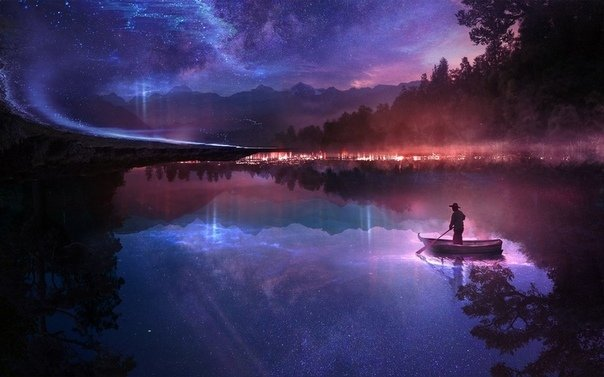

title: Озеро Калехада
parent: lokacii
order: 140
icon: bi-geo-alt
group: Территория Империи людей
image: photo/vk/533473434_457251413.jpg
vk: 54854037

## История места

Озеро Калехада считается жемчужиной Империи за свою красоту и разнообразие живущих тут уникальных организмов. Своё название озеро носит в честь великого мага воды — Калехада. Он по праву заслужил своё бессмертие в памяти людей таким образом. Когда озеру грозило высыхание, из-за которого могло погибнуть огромное количество уникальных животных, маг в течение нескольких недель поддерживал жизнь водоёма, полностью отдав все свои силы. На данный момент это прекрасное место для отдыха и проведения спокойного вечера. Также озеро входит в патрулирование Аолом, так что о безопасности беспокоиться не стоит.

