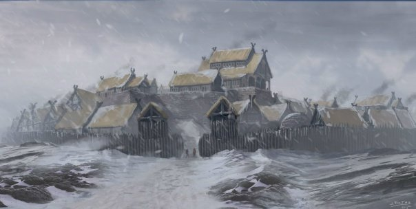
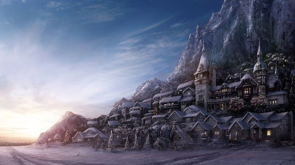

title: Посёлок Мултиров
parent: lokacii
order: 240
icon: bi-geo-alt
group: Территория Альянса эльфов
image: photo/vk/533473434_457251423.jpg
vk: 54854049

## История поселения

Мултиры были одной из основных рас, ставшей в своё время рабами людей. Они свозились на материк семьями, ещё во времена Громула, пока рабовладение не было признано незаконным. Но оставаться в людских землях мало кому хотелось. Мултиры освобождали из лап незаконных работорговцев своих собратьев и уходили на запад. Основным местом скопления кошек тогда был город Майр`Эль, так что на пути собравшейся общины встали окраины гор Дрогх. Это препятствием, на удивление, ни для кого не стало. Ищущие уединения и покоя, Мултиры пересекли горы и остановились в низменных частях с другой стороны, рядом с лесами эльфов. Это была граница между горами и началом леса, спокойная и суровая одновременно. Наличие небольшой общины даже осталось незамеченным. Они пользовались древесиной окраины лесов и медленно отстраивали небольшой посёлок в горах, где их бы точно никто не побеспокоил.

## Климатические и географические условия

Климат горной местности весьма суров, с преобладанием зимы почти круглый год. Снег никогда полностью не сходит с домов мултиров, летом лишь на пару месяцев обнажая холодные камни. В самый тёплый месяц температура может подняться до 3-5 градусов. Средняя же круглый год составляет -15—20 градусов. Мултиры переносят такие условия без особых сложностей. Ниже же, где начинаются леса, условия куда приятнее. Там куда теплее, можно охотиться и вырубать древесину. Мелкая живность помимо леса обитает и в самих горах, а ещё тут часто встречаются блуждающие тролли, одна из головных болей мултиров.

## Устройство мултирского общества

Местные мултиры представляют из себя нечто вроде большой семьи, где все друг друга знают и всегда готовы помочь. Тут нет изгоев, и ни одна семья никогда не останется голодающей, если в ней просто некому охотиться. Семья эта при этом довольно закрыта для чужаков, хотя сами мултиры гостеприимны. Они всегда готовы приютить на время заблудившихся или зашедших довольно далеко путешественников. Но принять кого-то чужого в свою семью не готовы.
Управляют же поселением старшие из самых крупных семей, совместно решая различные вопросы вроде того, что построить, куда группа пойдёт охотиться или что делать с очередным загулякой извне.

## Заведения и прочие важные постройки

- Корчма "Снежный тролль"
