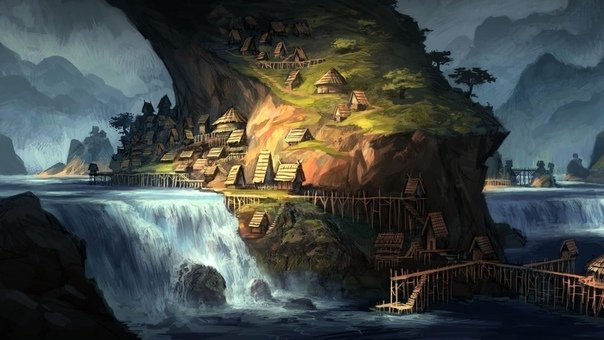
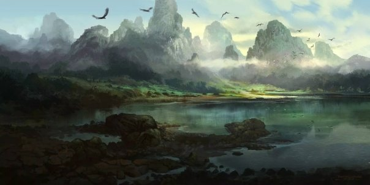
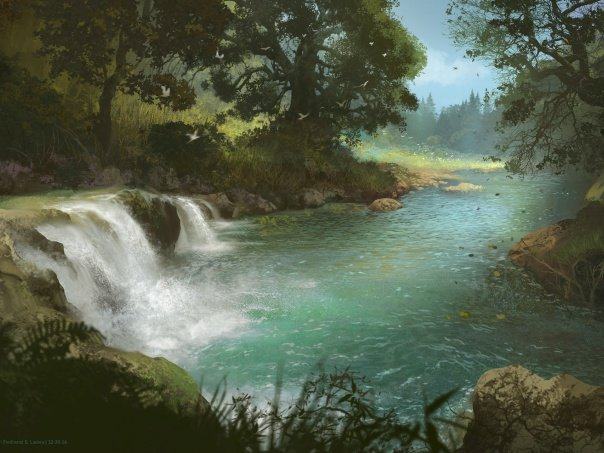
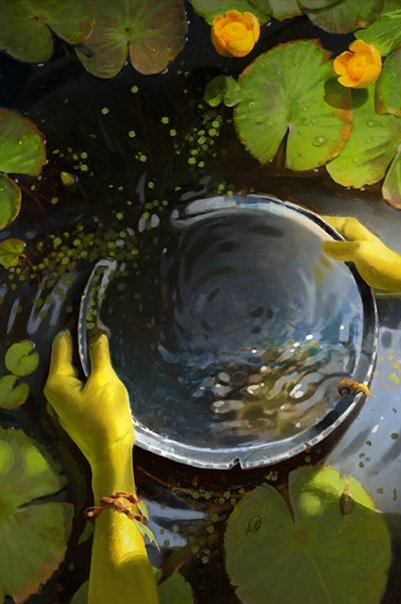
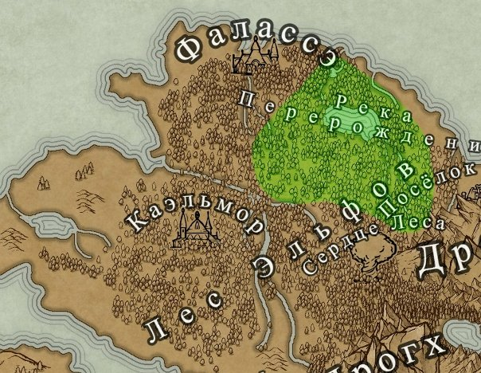
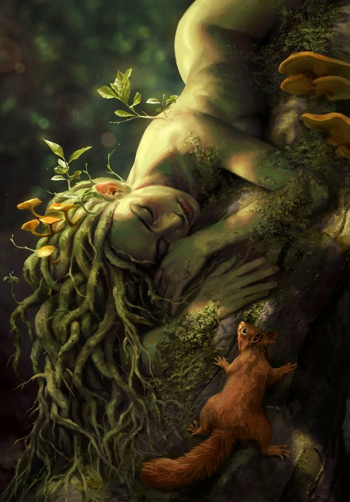

title: Река перерождения
parent: lokacii
order: 200
icon: bi-geo-alt
group: Территория Альянса эльфов
image: photo/vk/533473434_457251419.jpg
vk: 54854044

## История места

Река перерождения — исконное место пребывания дриад в лесах Бранна. Ни эльфы, ни кто-либо другой никогда не добирались до главного места скопления дриад — лесного озера. Эльфийские учёные считают, что сами дриады появились в этом месте чуть ли не одновременно с ним, или, по крайней мере, намного раньше самых первых эльфов Бранна. Достоверностью, конечно, какая-либо информация об этом месте не от дриад и не пахнет.

## Климатические и географические условия

Река перерождения в основе своей, вопреки названию, образована массивным лесным озером, которое наполнено магией. Как и по всему лесу, климат тут очень мягкий, выделяясь лишь такими временами года, как лето и осень. Зима тут вовсе не чувствуется, а весна имеет слишком короткий период, чтобы как-то выделиться. Озеро, которое одно из двух мест в лесу, выделяющееся сильным переполнением магией, весьма необычно видоизменило ландшафт вокруг. С лесом переплетаются высокие и причудливые холмы, как будто землю вытянули и заморозили. Один из таких массивных холмов, облепивший дерево, что находится над рекой, стал основным местом важных построек дриад. Довольно неприступное место, если кто-то даже и сможет приблизиться к обители нимф. Также дома дриад расположены и на окраинах озера, и немного вглубь южной части лесов. Именно окраины при этом наиболее густо населённые дриадами места, а не основной холм, так как они непрерывно воюют с эльфами, защищают свои границы и встречают на окраинах редких гостей, вроде элафаков.

Может показаться странным, что дриады, защищающие леса, использовали в постройках как раз древесину. Но за бедные деревья можно не переживать, ведь для всего этого использовалась магия. Здания на холме были сделаны Матриархами посредством видоизменения формы дерева, которое странным образом и покрыто холмом. По факту эти дома просто части дерева, очень искусно сделанные, не навредив самому растению. Остальные здания строятся похожим образом из массивных деревьев, которые становятся местами рождения дриад. Такие пропитанные магией стволы легко поддаются магии Матриархов.

Сама река, движущаяся на север к морю, представляет из себя довольно быструю холмисто-лесистую речку. Из-за рельефа, покорёженного магией, речка имеет частые перепады высоты, а сама вода из-за большой скорости и общих условий весьма чиста, практически прозрачна. Она богата различной живностью и в частности рыбой, как и озеро. Ведь всей рыбёшке никто не мешает существовать, кроме естественных хищников. А рыболовлей заниматься тут попросту некому. Как и охотой в округе. По этой причине территория лесов реки перерождения наиболее богата животными, а также более дикая.

Сами воды несут большую ценность для дриад, так как являются способом смены их оболочек при взрослении. Лесные реки и озёра, наполненные магией, с помощью последней и меняют тела дриад, когда наступает время для этого. Процесс этот отчасти контролируем и во многом зависит от личностных качеств самой дриады, но всё же несколько хаотичен.

## Дриадское общество

_(Стоит понимать, что про устройство общества дриад иные вообще почти ничего не знают)_

## Подконтрольная дриадам часть леса

Семья дриад Бранна, возможно, одна из старейших и наиболее развитых, так как находится у очень массивного места скопления маны — своего озера. Если многие дриады в иных местах доходят лишь до простейших жилищ, то бранновские с помощью магии смогли сделать привычные здания, не навредив природе. Их аккуратные домики, являющиеся частью леса, почти не меняют вид последнего. Само семейство насчитывает около 340-ка дриад, среди которых 4 Матриарха. Издавна ведущие войну с эльфами, они наиболее продвинуты в военном ремесле в отличие от других дриад. Они сформировали что-то вроде армии. Есть дриады-охранницы, которые группами зачищают от всех чужаков границы. В такую группу входит около 10 дриад-воительниц, во главе которых всегда более старая дриада, прошедшая минимум через 3 преображения. Совсем молодые, только родившиеся дриады, что даже не прошли хотя бы через 1 преображение, к таким делам вообще не допускаются. Желающие учиться ведению боя, но в отряды их берут только повзрослевшими. В остальном им выпадает довольно беззаботное существование, обременённое разве что служениями Фариде и мелкими обучениями бытовой жизни, в том числе и наставлениями от старших.

Более старые дриады имеют больший вес в семье. Они заведуют различными делами, например, проведением обрядов или заботой о животных. Некоторые дриады в этом возрасте становятся повёрнуты на близости именно с животными или растениями. Таких чудных называют они между собой хранительницами. Это одиночки, которые порой собираются в небольшие группы. Как часть защиты леса, они следят за какими-нибудь стадами галлов, или заботятся о старых деревьях или о тех, что готовы родить новую дриаду.

Сильнее всего в семье уважаемы Матриархи. Они могут рождать новых дриад, заведуют основными течениями жизни семьи и учат молодых дриад. Они могущественные существа, сильнее всего привязанные к своему родному месту.

Единственные дриады, которые этой семьёй презираются — изгои. Эти, уже похожие на людей или эльфов, дриады уже не имеют дороги домой, если покинули лес по собственному желанию. Если в иных семьях это ещё возможно, то бранновское семейство в этом плане более категорично.
