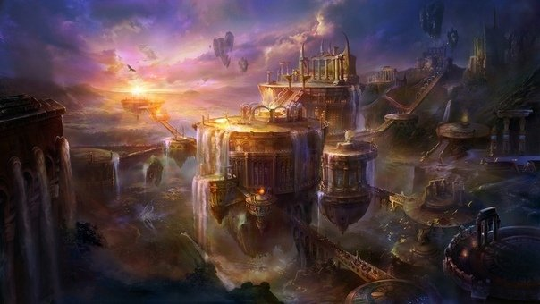
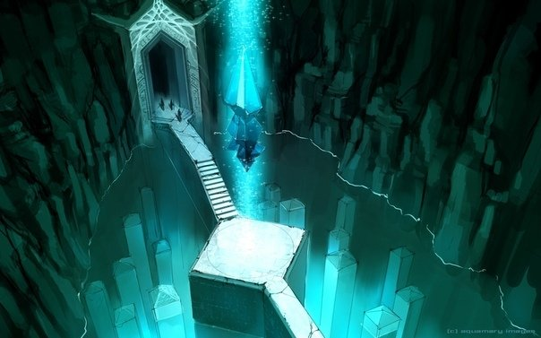
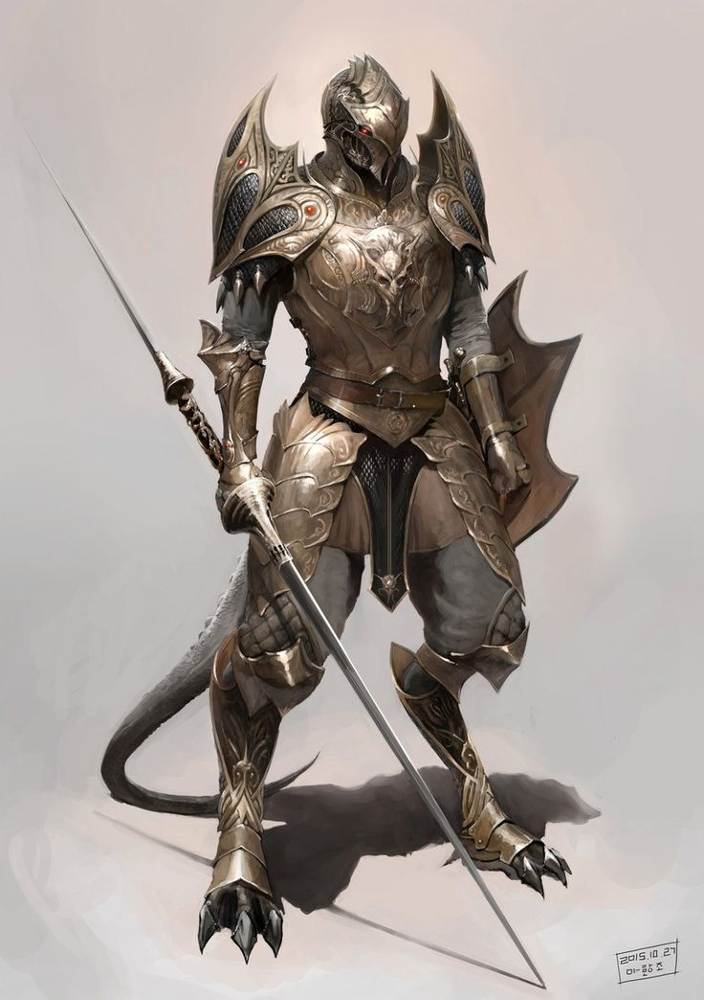

title: Сердце Империи
parent: lokacii
order: 160
icon: bi-geo-alt
group: Территория Великой Империи ящеров
image: photo/vk/533473434_457251415.jpg
vk: 54854039
art: photo/lokacii-web/serdce-imperii.webp
layout: location

## История города

Изначально, после раскола Громула, город принадлежал Империи людей и назывался Овдоль. Ещё в те времена город развивался огромными темпами, и даже мог бы стать столицей Империи людей, если бы после внезапной смерти Урия город не захватили ящеры. Именно после этого город стал называться Сердцем Империи. Несмотря на громкое название, город так и не получил звание столицы, а заслужил название благодаря тому, что является крупнейшим торговым центром на всём материке. Внешним видом город сразу говорит, что построен был с помощью магии.

Парящие в воздухе острова с бесконечными озёрами внутри, которые образуют целые водопады, обрушиваясь в реку. Всю жизнь этого города поддерживают специальные кристаллы внутри каждого острова, которые и придают все эти причудливые свойства. Естественно, эти кристаллы так сильно охраняются, что можно и не думать о возможности попасть в помещение с кристаллом.

## Климатические и географические условия

Оказаться нетронутым магией рядом с городом, созданным с её помощью, климат не смог. Он подозрительно идеален в каждое время года, даже скучен. Недалеко от города есть просто огромные запасы леса, которые конечно же не сравнятся с эльфийскими лесами, но стоят точно на втором месте по размерам. Южнее города протекает река, в которую, собственно, и сбрасывают воды эти подобия водопадов, стекающие с летающих островов.

## Население

В основном в городе проживают ящеры из богатых семей, ведь даже попрошайничать тут не позволит стража, и, скорее всего, за это вы ещё и попадёте в тюрьму, или будете работать на государство. Представителей других рас тут практически не проживает, разве что несколько единичных случаев, являющихся исключением из правил. Проживает ящеров же тут крайне большое количество, что неудивительно, ведь всегда все тянулись к более хорошим условиям проживания. Костяком города являются купцы, среди которых как раз и водятся представители других рас. Также городу с таким населением необходима и стража. Стражниками тут являются ящеры, которые даже защищают замок Императора в столице.

## Основные функции города

В первую очередь город является крупнейшей торговой, экономической артерией страны, о чём уже упоминалось. Также это политический и культурный центр. Школы и университеты не обошли город стороной: школ в городе 8, а университетов 5, при этом все они являются бесплатными. В городе располагаются академии и институты магии: Институт познания земляных элементов (геомантии), Институт познания водных элементов (гидромантии), Институт познания Молнии, Академия белоснежного клинка (криомантии).

## Заведения и прочие важные постройки

- Таверна "Ветер"
- Таверна "Клык и коготь"
- Бордель "Огонёк"
