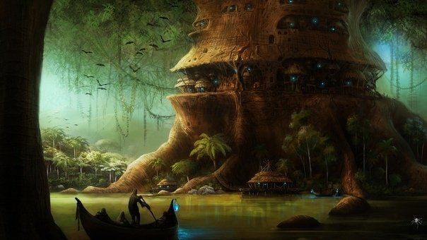
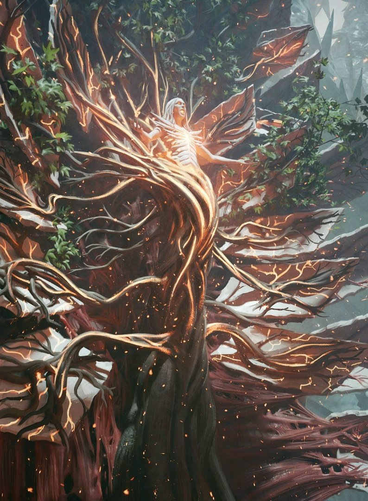
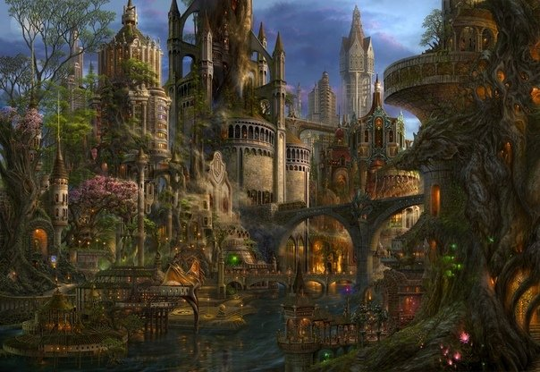

title: Сердце леса
parent: lokacii
order: 210
icon: bi-geo-alt
group: Территория Альянса эльфов
image: photo/vk/533473434_457251420.jpg
vk: 54854045
art: photo/lokacii-web/serdce-lesa.webp
layout: location

## История города

Громкими названиями эльфы разбрасываются не просто так, ведь тут издавна была найдена частичка чего-то большего, поддерживающего жизнь целого леса _(как считают сами эльфы и дриады)_. Само сердце леса представляет из себя самое большое дерево во всех лесах Бранна. Настолько большое, что видно его почти со всех ближайших чащ, и даже с ближайших гор. Великое древо стало местом расселения первых, возможно даже не особо развитых эльфов. Древние дома, выдолбленные прямо внутри древа, являются нынешним достоянием эльфийской расы Бранна _(хотя сейчас такое причинение вреда древу уже наказуемо)_, а проживать в таком "древесном" районе могут лишь достаточно зажиточные семьи. Дома в дереве и подле на нынешний момент вмещают больше 4000 эльфов! А строительство новых не наблюдается и запрещено.
По словам эльфийских учёных-историков, именно тут был контакт первых эльфов с драконами. Наиболее сильно пропитанная магией часть леса вполне могла служить за счёт этого местом разлома меж двух миров. Контакт с драконами считается началом отсчёта осознанного существования эльфов Бранна в едином государстве. Хотя свидетельства самых первых контактов ныне лишь легенды. Как факт зарегистрированы последние контакты с драконами в государственных библиотеках, куда мало у кого есть допуск. Естественно, кто-то кроме эльфов вообще об этих контактах не знает, а даже легенды для остальных не больше чем полностью выдуманные сказки.
После контакта с драконами вокруг Сердца леса разрасталось что-то, похожее на город. Воды вокруг самого древа были нетронуты, как и часть деревьев. Из-за этого дерево скрыто внутри городских пристроек, огороженное лесом и водой.
Всегда было место, куда эльфы не могли проникнуть. Проход вглубь древа, пещера под ним. Она была настолько наполнена магией, что долгое время просто не существовало магов, способных пройти внутрь и остаться в живых. Первые способные на это стали называться Хранительницами, которые и раскрыли тайну Великого древа. Оказалось, что в его основании было нечто... Сложно сказать, может, уникальная форма жизни, проявление самого леса или божественное явление. Для каждого это что-то своё. Для дриад, например, _(которые изначально, оказывается, знали о существовании этого сердца, даже не бывая там)_, это проявление Фариды. Для эльфов же по большей части это собирательный образ разных божеств, возможно самого Эн`л, который создан ими для поддержки жизни и магии в лесах. Доступ к Сердцу имеют только Хранительницы, которых на данный момент 4.
Само сердце способно давать видения в будущее и "общаться" с хранительницами.

## Устройство городских частей

Сам город растянут вокруг дерева, по сути образуя неоднородное кольцо. Это связано с особенностью расселения первых эльфов, бросавшихся во все части леса от древа, по итогу окружив то строениями. Множественные городские районы похожи на мини-городки, так как часто разорваны друг от друга пролесками и реками. Из-за этого такие районы больше походят на одинокие поселения. Очень часто мини-города растут вертикально, с преобладанием лестниц и различных платформ к большим зданиям, поделённых таким образом на разные уровни. Из-за этого с непривычки очень легко потеряться в Сердце леса в одном районе, не говоря о случаях, когда двигаться приходится между разными частями города. Районы в восточной части зачастую стоят на речушках, с помощью которых на лодках можно попасть в иной район, или к самому Древу, если плыть вглубь. В остальном же для попадания в другой район достаточно пересечь небольшие лесистые местности между ними. Центр города находится в самом Древе, хотя административные строения по большей части вне его.

## Климатические и географические условия

Как и во всём лесу эльфов, климат в Сердце леса очень мягкий, лишь с ярко выраженными летом и осенью, которые весьма тёплые. Само Древо прорастает прямо посреди мелкого озера, больше напоминающего полуболото, раскинувшееся вокруг мелкими речками. В такой влажной среде растительность достаточно густая, а в незаселённых и незастроенных областях у Сердца почти непроходимая. Вести какое-то хозяйство из-за этого тут тяжело, но местные выращивают культуры, которые изначально приспособились к таким условиям и без них.
К востоку от Сердца довольно близко расположились подножия гор Дрогх, на удивление, не влияющих как-либо на климат этой части леса. Он как будто изолирован от внешних условий, что могли бы повлиять на лес. Лишь восточные гущи, разрубающие цепь гор Дрогх, поддаются естественному влиянию всего извне. Там намного холоднее, а большая часть леса вовсе покрыта круглый год снегами. Ни эльфами, ни дриадами этот кусочек леса не обжит. Да и из-за дикости местности туда крайне тяжело проникнуть.

## Население

Сердце леса является местом проживания эльфов среднего и высокого достатка. Культурный и исторический центр эльфийской расы — это престижное место проживания. А существование земледельца или любого другого представителя более низких сословий здесь затруднено особенностями города. Много крестьян съезжается сюда для продажи своего добра. Город нуждается в поставках практически всего извне, поэтому является одним из основных и самых выгодных мест сбыта.
Также здесь сконцентрирована эльфийская молодёжь, чьи родители могут себе позволить более престижное обучение своих чад, чем в том же Каэльморе. Малой родиной Сердце леса является для многих благородных домов, плотно основавшихся в здешних местах. Помимо эльфов же встречается здесь кто-либо крайне редко. В любые города впускают лишь представителей иных эльфийских рас, а также тех, кто находится в Альянсе на особых основаниях и имеет право перемещаться по городам.

## Основные функции города

Сердце леса — это культурный, административный и исторический центр Альянса. Здесь почти нет никаких производств или земледелий. Из-за этого, как уже упоминалось, Сердце является одним из самых больших мест сбыта во всём Альянсе. Здесь очень часто встречаются рынки и разные лавки, особенно алхимические _(из-за того, что на территории Сердца растёт много уникальных трав)_. Иными словами, крутятся тут довольно большие деньги.
В городе расположено большое множество различных училищ, магических академий и прочих школ. Так что это и центр образования Альянса, являющийся сосредоточением светочей различных наук.
Город и сам по себе просто имеет большое влияние для эльфов из-за того самого Сердца леса. Именно из-за этого уникального явления тут образовался и разросся город. С этим же связано самое большое количество храмов и святынь различным богам. А из-за наполненности этих мест магией тут часто _(относительно)_ рождаются маги, что послужило причиной создания многих магических школ.

## Заведения и прочие важные постройки

- Таверна "Копьё и щит"
- Таверна "Обиталище кентавра"
- Таверна "Хромой Лаук"
