title: Альянс эльфов
parent: lokacii
order: 10
icon: bi-flag
group: Государства на территории Бранна
image: photo/vk/533473434_457251406.jpg
art: photo/lokacii-web/alyans-elfov.webp
layout: state

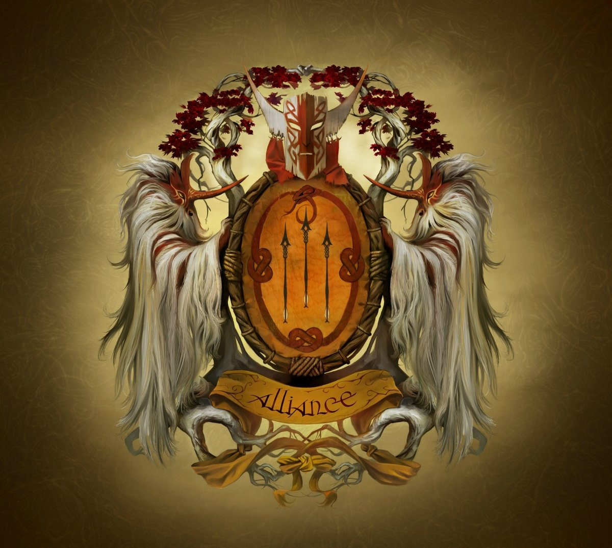

_Герб Альянса эльфов_

Эльфы — те, кто исконно населял леса Бранна, что и делают по сей день. Когда люди прибыли сюда, они уже давно отстроили свои города, спокойно существуя в густых лесах. Эльфы Бранна — это целый подвид эльфов, история которых тесно связана и с их государством, которое и названия не имеет, скромно называясь Эльфийским Альянсом.

## История

### Начало, противостояние с дриадами, разломы меж миров и драконы

Как уже упоминалось, эльфы были на материке Бранн с самого начала, никто не помнит и не видел их прибытия или иного появления. Они просто были с самого начала, и это принимается как данность. Наиболее тесными их соседями раньше были гномы и дриады, а последние остаются таковыми и по сей день. С гномами эльфы были в нейтральных отношениях. Их взгляды во многом совпадали, они не терпели друг к другу вражды или нетерпимости, однако к сотрудничеству вообще не спешили. Помимо этого, Бранн был населён и другими представителями возможных рас, но большинству из них сразу не было места в лесах. Эльфы выгоняли всех, если считали, что им не было места в лесу. И делали они это раньше, не применяя оружия. Исключениями были насекомоподобные и дикие кентавры с элафаками, гармонично сосуществующие друг с другом. Единственным исключением среди исключений были и будут дриады. Эти дети леса, как и эльфы, не мирились с кем-либо в лесах, которые тоже считали лишь своими. Нимфы всегда были настроены ещё более радикально, считая, что места тут нет и эльфам. А их существование рядом с рекой перерождения вовсе было чем-то омерзительным. Это была первая, можно сказать, война эльфов, которая немыслимо растянулась и до наших времён! Ни более многочисленные эльфы, ни более искусные и пользующиеся силой самого леса дриады никогда не могли склонить чашу весов на определённую сторону за всё время. Их противостояние особо жестокое, отношение друг к другу уже скорее всего никогда не будет хотя бы терпимым. Стрела срывается без лишних вопросов как в эльфа, так и в дриаду.
Ещё одними соседями, или, скорее, гостями были драконы и существа из иных миров. Давно на всей планете были разломы меж мирами, которые находились и в Бранне. Об этих временах известно ещё меньше, чем о появлении тут эльфов. Это было задолго даже до гномов, и единственные, кто что-то ещё может об этом знать, — дриады. Известно, что эти существа, а в частности драконы, внесли большой вклад в культуру эльфов. Они говорят на их языке, пользуются частью их знаний. Драконы считались и считаются эльфами мудрейшими из всех существ. Такое сотрудничество длилось до тех пор, пока драконы не исчезли, как и разрывы меж мирами. По воле ли богов, или ещё кого-то — неизвестно.

### Вторжение людей

До момента появления людей эльфам было в целом всё равно на существование заморских пришельцев. Они никогда не интересовались тем, кто, когда и сколь сильный может вторгнуться в Бранн. До этого же момента им было всё равно и на еле развивающихся ящеров. Однако полное их покорение людьми встревожило как эльфов, так и их соседей гномов. Сразу стало понятно — человеку не место в их лесах. Подтвердилось это лишний раз, когда людям потребовалась древесина для строительства городов. Первые же попытки освоить самые южные части их лесов оказались провальны. Эльфы никого не убили, но все лесопилки были уничтожены, людям явно дали понять, что им нечего тут делать. Что они вполне хорошо усвоили до определённого времени. Наступило затишье в общении с чужаками, не считая попыток их послов ставить различные условия. Эльфы боролись с дриадами, охраняли границы от появившихся любопытных глаз. Не особо беспокоило их и то, что со временем гномы стали готовиться к войне с людьми, о чём они знали заранее. Как и предвосхищали то, что гномы вместе с ящерами должны закономерно изгнать людей из Бранна. В конце концов, всё к этому шло, ведь они смогли отбить один город у людей, успешно защищая его от попыток вернуть назад. Ящеры договорились с гномами помочь им в войне, как только встанут хоть немного на ноги и соберут всех.

Победить у гномов, с уже Империей, выросшей из колонии в государство Корвас, не получилось. Во многом это было связано с малочисленностью, гномы были уверены, что выиграют и без эльфов, надеялись сами на себя и на ящеров. Когда последние их предали, а самих гномов загнали уже глубоко в их города под горами, просить помощи было поздно. Эльфы не ожидали почти полного стирания городов гномов. Они встревожились, о допуске людей в их края уже не шло и речи. В это время люди вновь пытались освоить южные части их земель, что вновь было пресечено, чудом не перерастая в войну. Отрезавшей себя от других империй стране Корвас, ставшей независимой, сначала нужно было оправиться от одной войны, встать на ноги, и им было не до очередных битв.

### 279 год от падения Громула, короткая Война с Урием

Прошло множество лет от событий, что происходили. Ситуация с людьми была шаткой, но всё время получалось обходиться без открытых войн. До прихода к власти в Корвасе Урия. Незадачливый Император твёрдо был уверен в том, что леса эльфов должны перейти людям. Попытавшись воспользоваться неожиданной массивной атакой своих воинов, он хотел прорвать рубежи и захватить один из крупных городов Каэльмор. Это был единственный город, о существовании которого пока точно знали люди. Но эльфы всё время были к этому готовы. Уже начавшие торговлю с эльфами на других материках, они сильно подтянулись в военном деле и технологиях, с трудом, но выбросив армии Урия из родных лесов. Но людской император был упрям, с потерями продолжая пытаться ворваться в леса. Погибло много как людей, так и эльфов. К счастью, война оказалась короткой благодаря тому, что и сам Урий погиб очень быстро, мало процарствовав. У людей в стране начался настоящий разгром, им вновь было не до войны, а эльфам было не до захвата территорий вне их лесов.

### Наше время

И эльфы, и дриады сделали леса недосягаемым ни для кого местом. Между собой они до сих пор воюют, но это переросло скорее в холодную войну. Стычки случаются лишь на рубежах территорий их лесов, когда кто-то вылезает слишком далеко, по ошибке или нет — неважно. Люди убиваются эльфами на месте, при подходе к границам. Иные чужаки находятся под вечным наблюдением в их лесах, некоторые обязаны рассказывать о своих намерениях, доказывать свою безопасность.

## Общее описание

### Расположение и города

Эльфийский Альянс занимает большую часть всего массива леса в Бранне. Его южные, западные, окологорные восточные и частично северные части. Даже глубокие чащи, куда сложно пройти им самим, считаются их территориями.
Всего выделяется 3 крупных города эльфов: [Фалассэ](falasse.html), [Каэльмор](kaelmor.html), и столица [Сердце леса](serdce-lesa.html).

### Тип правления

Монархия с элементами теократии. У эльфов правит король/королева, власть которым передаётся по крови с самого начала. Власть их во всяких вопросах во многом абсолютна, но больше влияние имеет культ хранительниц. Дев, что способны понимать и общаться с тем, что и хранят от чужаков эльфы — сердцем леса. Аномалия, неизвестное существо. Никто не знает, кто это. Эльфы же считают, что это проявление самих богов. Только хранительницы способны понимать сердце, они имеют весомый вклад в глобальных вопросах, так как знают, что делать для сохранения сердца леса, питающего магией весь лес, благодаря чему среди эльфов чаще всего появляются маги.

### Культура

Большой вклад в культуру эльфов внесли существа, существование которых для многих граничит с мифами — драконы. Эльфы пользуются их утончённым языком, считается, что и архитектура строилась во многом под влиянием драконов. 
Основными цветами Альянса являются бежевый, белый, оттенки красного и коричневого. Они проявляются в гербе, флагах и даже строении замков.
Архитектура же эльфов самая утончённая во всём Бранне. Пик этого — королевский замок в Каэльморе. Эльфы обожают сложные ветвистые конструкции, совмещение природы и сложных каменных и металлических конструкций. Всё отдаёт присущей им утончённостью, красотой и величием древних драконов, статуи которых также иногда встречаются в храмах или замке.

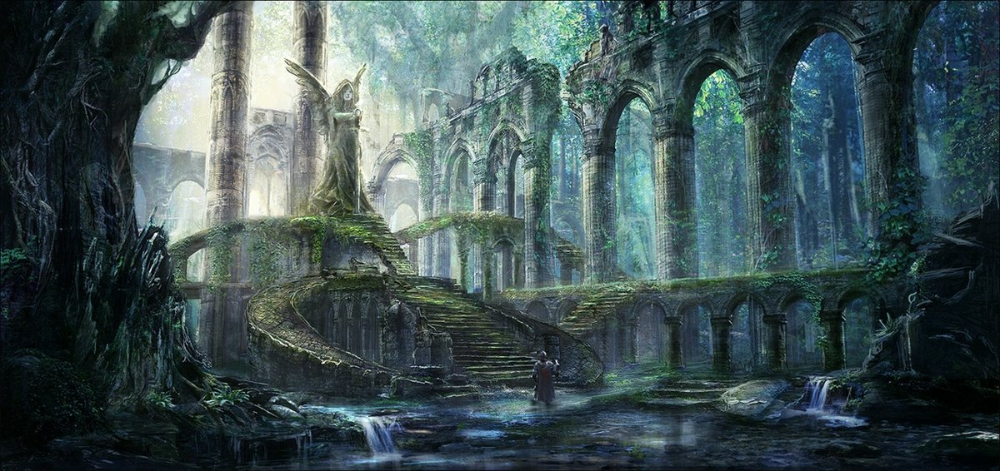

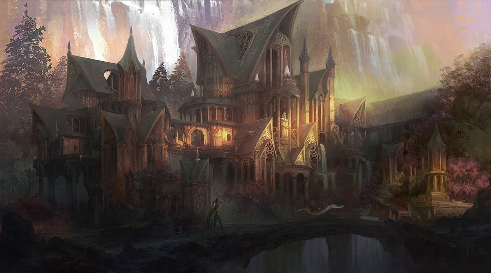

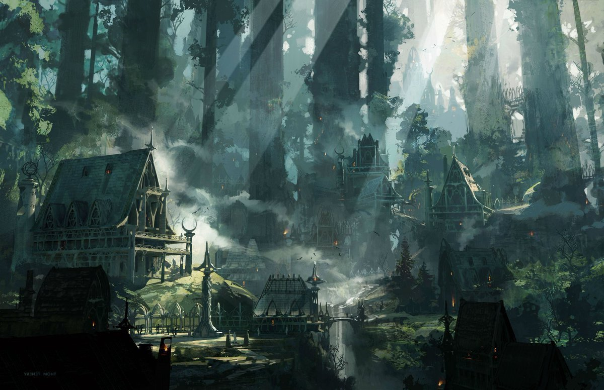

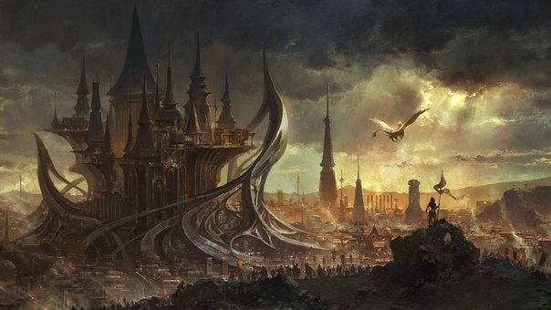

_Один из храмов эльфов_

Использовать в строительстве дерево эльфы стараются так, чтобы сразу возмещать его утрату лесу. Специально обученные маги мгновенно могут вернуть могучее дерево на место после спиливания. В основном же преобладает в постройках металл, имеющий причудливые формы благодаря магам металла, и белый камень.
Как уже можно понять, маги очень часто используются эльфами в бытовых вещах, в строительстве и прочем. Оно и неудивительно, ведь Сердце леса дарует большому количеству детей этот дар. Магия используется везде: от освещения городских улиц, до обработки металлов.

Архитектура эльфов тесно связана и с верой. Основные боги, которым поклоняются эльфы, это Лиаонос, Эн`л, Ор`Эл, Дуала, Кайяс, Малайя и Исти. 
В их честь возводятся храмы, имеется множество легенд и литературных произведений.

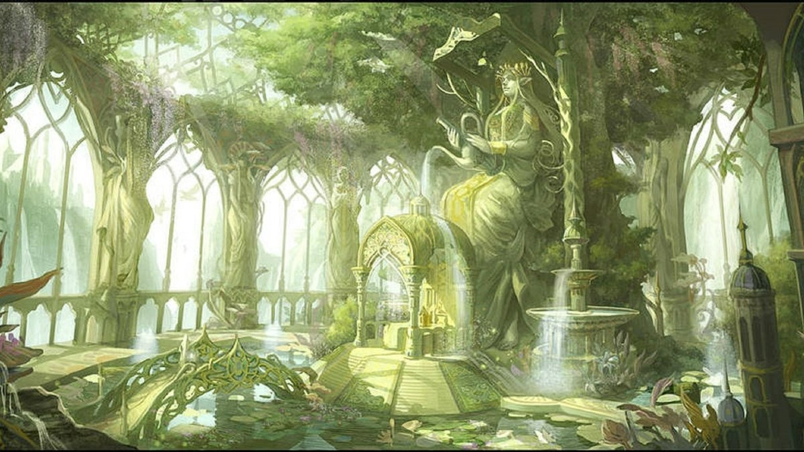

_Храм Лиаонос_

Эльфы очень критично относятся ко всем остальным расам, отчего кажутся достаточно высокомерными. И прослеживается это во всём их обществе. Каждый эльф будет искоса смотреть на любого, кого впустили в лес, не пристрелив с самого начала. Малая часть рас хотя бы просто не презирается эльфами. Поэтому торговлю они ведут за морем лишь с иными эльфами. 
Они верят в священность своего леса, а каждый прочий эту священность нарушает.

### Экономика

Альянс вполне самодостаточен, что позволяет ему вести экономику со столь небольшим количеством стран. На их территориях есть все необходимые ресурсы, они могут снабжать сами себя пищей, а маги в самых различных сферах всё это делают и в разы более простым. У них хорошо развито и кузнечество, и образование, в том числе магическое, и внутренняя торговля. Они используют собственную валюту, которая вполне хорошо держится и не обесценивается.

### Армия

Помимо основной, постоянной государственной армии у Альянса существует структура военных благородных домов. Основоположниками военных домов являются лучшие из командиров эльфийских армий. Возможность создать свой собственный благородный дом приписывает эльфа к высшим слоям аристократии, а также дарует возможность получить в своё управление земли Альянса, с пометкой о невозможности установления своих законов. Территории благородных домов всё ещё в первую очередь находятся под властью короля, а сами дома имеют привилегию осуществлять свои замыслы с согласия короля. Каждый благородный дом обязан отозваться в случае войны на призыв короля.

Главы благородных домов во время войны становятся командирами собственных армий. Выше их всё ещё остаётся главнокомандующий силами Альянса — военный советник короля. Сам король статус главнокомандующего не имеет, хоть и может задавать темп и направление войны.

Существующие военные благородные дома:

- Дом Лойархифт; Дом драконьих клинков

- Великий Дом Сентима

- Дом Дахейрис

- Старейший Дом Заалон

### Дом Лойархифт; Дом драконьих клинков (Автор — [Pomidop Red](https://vk.com/pomidop_original))

По древней легенде, первый глава и основатель этого дома, Габриахель Лойархифт, был невероятным мастером магии металла. Столь искусным, что древние драконы захотели испытать его мастерство собственным пламенем.
Два могучих и древних брата-дракона одновременно выдохнули горячее пламя на сырой металл, и только силами магии Габриахеля тот начал принимать форму, а не таять и испаряться.
В тот день был выкован клинок, что по праву мог зваться великим. По той же легенде, взамен на то, что Габриахель подарил этот меч правителю эльфов, он получил право основать свой дом. И с тех пор тот стоит незыблемо как один из самых старых и весьма уважаемых.
Семья Лойархифт имеет сильную кровь магов металла. Этот элемент идет с ними рука об руку, пробуждаясь практически в каждом наследнике. Впрочем, в нынешнее время текущий глава дома, Альдарис Лойархифт, куда больше ценит именно военное мастерство и силу, нежели кузнечное мастерство, так что его наследники не делают упор на развитие этой врожденной силы.
Этот дом в особенности славится своими прекрасными мечниками, коих в армии прозвали "Драконьи мечи" в честь старой легенды. Делая упор на ловкость, командную работу и мастерство владения мечом, эти воины способны стать опасным соперником в строю при поддержке братьев со щитами и копьями, но особенно они опасны именно в стычках один на один, или, не дай Эн`л, если вам придётся выйти против нескольких из них. Драконьи клинки — популярный выбор для найма в личную охрану или небольшие летучие отряды, благодаря их личному мастерству, скорости и выносливости. На данный момент основа Дома Лойархифт состоит из:

- **Глава дома:** Альдарис Лойархифт (Довольно старый эльф, делающий в бою упор на использование двух мечей и магию молний. Мастерский мечник, лично обучающий высший состав военной силы дома и собственных наследников. Прагматичен, уважает только эффективность и точность. После потери первого сына стал только суровее.)
- **Его жена:** Арфелия Лойархифт (Занимается в основном делами, связанными с воспитанием наследников и финансами дома. В прошлом и сама служила в армии, однако давно забросила это дело.)
- **Старший сын:** Генсиль Лойархифт (Сильный маг и искусный боец, в прошлом был солдатом, однако трагически погиб на границе эльфийской территории. Труп был утерян, и похоронить его не удалось, однако в доме все еще можно увидеть картины с его участием.)
- **Младший сын:** Ройгель Лойархифт (Вундеркинд с рождения, весьма умный и начитанный эльф, делающий упор в бою на один полуторный клинок и магию тьмы, вместо двух мечей и молний по примеру его отца. С самого рождения был окружен вниманием из-за нетривиальных талантов и способностей, что выразилось в итоге в завышенном самомнении, что, впрочем, не мешает ему быть таким же хорошим бойцом и магом. Солдат Дома Драконьих клинков, заведует личной гвардией Лойархифтов и стражей поместья.)
- **Младшая дочь:** Ахелла Лойархифт (По меркам эльфов еще совсем юная девушка, тем не менее, с ранних лет перехватившая воодушевление отца в вопросе военного дела. Очень нетривиальный боец, но слишком юна и неопытна, чтобы реализовать эти способности. Младший капитан драконьих клинков, обучается у более мудрого наставника, чтобы в итоге возглавить знаменитых мечников. В бою по примеру брата использует большой меч, вот только вместо полуторника полноценный двуручник, что не очень подходит хрупкой девушке. Впрочем, уже сейчас может показать, что любой, кто так думает, очень ошибается. Делает упор на магию молний.)

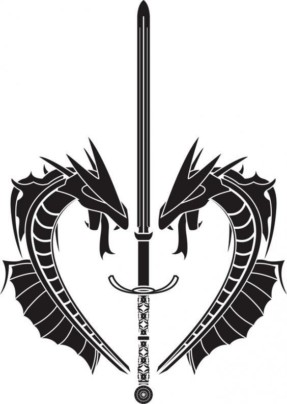

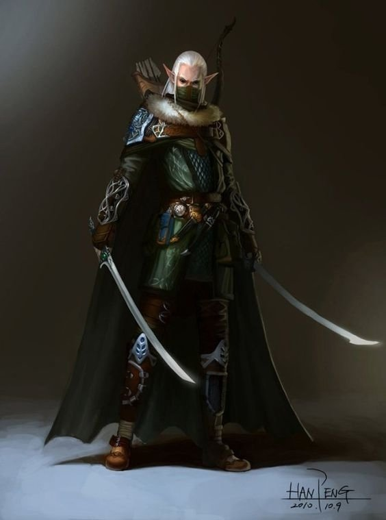

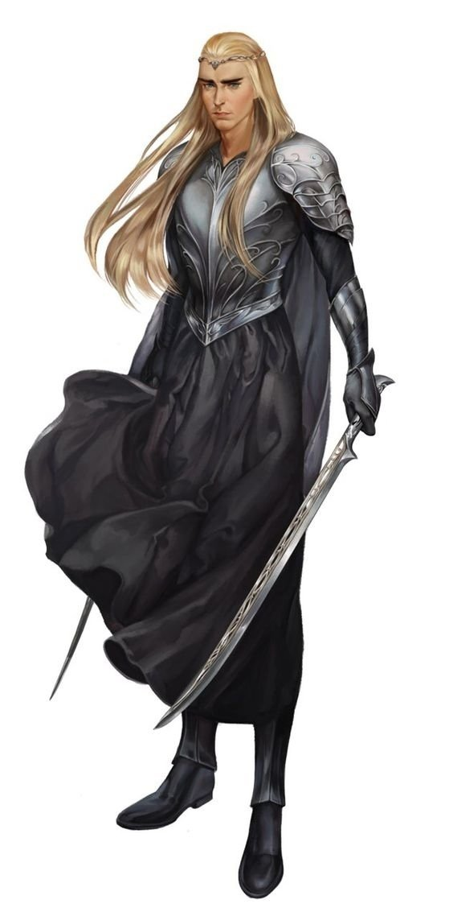

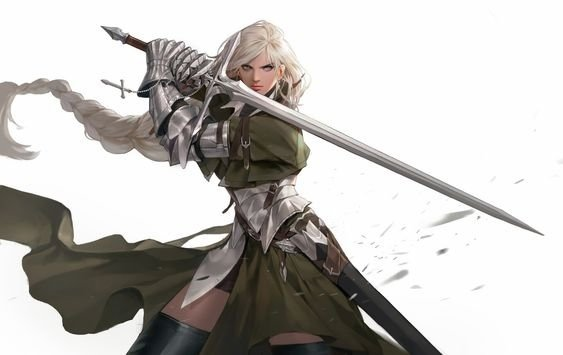

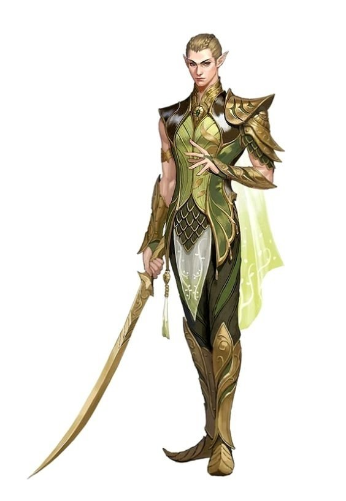

_Герб дома Лойархифт_

### Великий Дом Сентима (Автор — [Николай Шахов](https://vk.com/id266021164))

**История:**
Один из самых влиятельных и знаменитых эльфийских Домов, который поднялся во время войны с Урием. История про крестьянского юношу, потерявшего всю семью и ставшего одним из самых преданных и успешных полководцев Альянса, а после удостоенного чести основать собственный благородный Дом, до сих пор вдохновляет многих эльфов Бранна. Сентима буквально появились из вражды с людьми, а потому полны ненависти к своим южным соседям.

**Геральдика:**
Испускающий огонь феникс на черном фоне, символизирующий возрождение рода и обретение могущества. Девиз дома: “Пламя рождается из тьмы”

**Доктрина Дома:**
Сентима — сторонники тотальной войны и главные распространители идеи о превосходстве эльфов над прочими расами Наира. Такая пропаганда тянется еще со времен основателя их рода и со временем приобретает в эльфийском обществе все больше сторонников. Согласно их доктрине: лишь эльфы в силу своей долгожительности и близости к культуре драконов способны справедливо и мудро управлять прочими расами. В качестве аргумента, Сентима обращаются к истории народов Бранна, вспоминая все потрясения, которые те пережили (истребление гномов, рабство и войны ящеролюдов, расцвет и закат людей), и сравнивая с политической стабильностью эльфийского королевства.
Возможно, далеко не все эльфы действительно питают неприязнь к другим расам, но многолетними усилиями Сентима в эльфийском обществе стало слишком много тех, кто подвергся влиянию расизма. В особенности, среди молодого поколения. “Помните, дети леса, враги коварны, многочисленны и они повсюду. Они только ждут момента, чтобы уничтожить наши леса, истерзать наши тела и поработить наших жен. Ведь это их сокровенное желание. С врагом нельзя договориться. Единственное, что враг может понять — это сила…” — Из речи Сентима.

**Особенности Дома:**
Магия и интриги — эти два слова идеально описывают этот благородный Дом. С одной стороны, Сентима — это маги до мозга костей. Известно, что все их потомки (даже побочных ветвей) в той или иной степени владеют магией. Простолюдины, обладающие магическими способностями, всегда смогут найти свое место на землях этой семьи. К ним будут относиться лучше, чем к обычным крестьянам, и у них будет больше возможностей. И чем сильнее их талант, тем больше уважения и возможностей (вплоть до возможности тренироваться вместе). Такое отношение обусловлено основателем рода, который тоже был из обычной крестьянской семьи, но вознесся за счет магического таланта и личной харизмы. К бесталантным простолюдинам отношение знати будет надменно-презрительное, как и к прочим эльфийским расам. Сентима ценят магию и происхождение. Сами же дети этого благородного дома с малых лет оттачивают навыки магии. Повышенные требования и давление во время обучения призваны воспитать верных дому превосходных магов. И чем ближе родственник к патриарху, тем выше к нему требования. Говорят, что патриарх дома Сентима и его дочь обладают настолько сильными магическими способностями, что могут в одиночку противостоять даже группе магов.
Текущий глава дома является сыном и наследником основателя Дома Сентима. Основатель оставил немало сыновей и дочерей, имея собственный гарем из обладающих магическим талантом крестьянок. Это было сделано не столько из-за похоти, сколько для увеличения Дома (ведь изначально патриарх был единственным членом нового знатного рода), а также для увеличения боевого потенциала в виде нового поколения магов. Но официально он имел лишь одну жену и одного законного наследника, который сейчас и занимает роль главы Дома.
Его имя Велимар. Известно, что его дочь и официальная наследница Анталиана сейчас занимает пост временно командующей королевским флотом Альянса. Его сын Ландес был отправлен на службу короне, чтобы укрепить влияние рода и получить высокий пост, но по неизвестным причинам покинул службу и в гневе Велимар отрекся от него, более не признавая своим сыном.

**Тактика:**
Сентима предпочитают забрасывать врагов могущественными заклинаниями, при этом оставаясь на безопасной дистанции. Большая часть их войск по факту является пушечным мясом, цель которого не выжить и одолеть врага, а продержаться как можно больше времени. Сами же Сентима называют такие войска “Авангардом”, про себя ехидно добавляя “мясным”. В Авангард могут входить самые разные войска: это заключенные из других провинций, которым предложили освобождение за службу, наемники из-за моря, призванные големы и нежить, лесные монстры, разум которых подчинён магией, религиозные фанатики, что перед боем приняли наркотики, погружающие их в состояние неистовства.
Сентима используют множество уловок. Поскольку их провинция пограничная, даже крестьянский ребенок в той или иной степени умеет стрелять из лука. Огромное стрелковое ополчение с достаточно приличным навыком стрельбы в условиях дремучих лесов Бранна является отличным подспорьем для любой армии.
Наконец, главная сила Сентима — это маги. Сентима разделяют их на небольшие отряды, именуемые “хоры магов”. Работая синхронно, такой хор может легко подавить вражеских заклинателей (действующих как правило в одиночку), а после нанести армиям врага огромный урон, забрасывая мощными смертоносными заклинаниями, усиленными сразу несколькими магами.
Сами представители семьи Сентима обладают куда лучшей магической подготовкой, чем среднестатистические маги эльфов Бранна. Они являются офицерами и, как правило, каждый из них имеет небольшой отряд личных телохранителей (обычно из бывших копейщиков или натаирских наемников). Попасть в такие телохранители крайне непросто, их навыки должны быть отточены до совершенства десятилетиями практики. Сентима не скупится на лучшую из доступных броню и оружие для своих телохранителей, а также выдают каждому из них магические артефакты, если у тех нет магических способностей. По итогу, далеко не самый слабый маг с отрядом телохранителей может как управлять войсками в роли командира, так и самостоятельно скрытно пробираться в тыл врага, сея хаос казалось бы небольшим, но очень разносторонне подготовленным отрядом.

_Геральдика дома Сентима_

### Дом Дахейрис

**История:**
Сияющий дом Дахейрис образовался давно, ещё во времена драконов, являясь вторым по старшинству военным домом. Дахейрис — 1 из 2 домов. Два этих дома были созданы как знак союза королевских кровей. Дахейрис — самый лояльный к королевскому замку дом.

**Геральдика:**
Гербом дома является их собственная символика в окружении листвы, увенчанная латным шлемом.

**Устройство дома:**
Текущий глава дома — Тиреина Дахейрис, законная наследница военного дома, строго следующая пути лояльности королевской короне и идее индивидуальности эльфийского общества, с неприемлемостью кровосмешения расы с иными. В связи со своей лояльностью дом Дахейрис занимается и многими другими доверенными лично им делами. В частности, их рыцарей можно увидеть как охрану королевского замка, и, говорят, также они занимаются охраной самого Сердца Леса. 
Сам дом располагается частично на землях Каэльмора, уходя своими границами в западные части леса. Это одни из самых безопасных земель, поэтому тут обычные жители спокойно занимаются земледелием и прочими делами. Также дом Дахейрис активно занимается разработкой находящегося здесь в большом количестве звёздного металла. 
Все участники дома отбираются с юношеских лет, проходя специальные курсы тренировок. Всевозможные руководящие должности занимают родственники Дахейрис, но выбиться выше командиров отрядов могут и выделяющиеся в своей преданности дому эльфы.

**Военные силы:**
Дахейрис составляют основной авангард всех армий благородных домов. При своей немногочисленности, армия Дахейрис выделяется искусностью и силой. Тяжелые, нетипичные для эльфов солдаты способны долго и эффективно оборонять важнейшие города и точки, ценные для короны. Расчёты Дахейрис никогда нельзя увидеть в открытых битвах. Солдаты в сияющих доспехах обычно последний аргумент в битве и последнее, что видит человек в своей жизни.

В отличие от солдат Дахейрис, чаще всего в рядовых боях не за стратегические точки можно увидеть их магов. Каждый маг — отдельная боевая единица со своей охраной и задачами. Они действуют вне основных сил и единично могут встречаться в армиях иных домов как весомая поддержка. Ввиду своей малочисленности они выделяются повышенной силой в сравнении с рядовыми магами, способными в одиночку значительно повлиять на положение в бою.

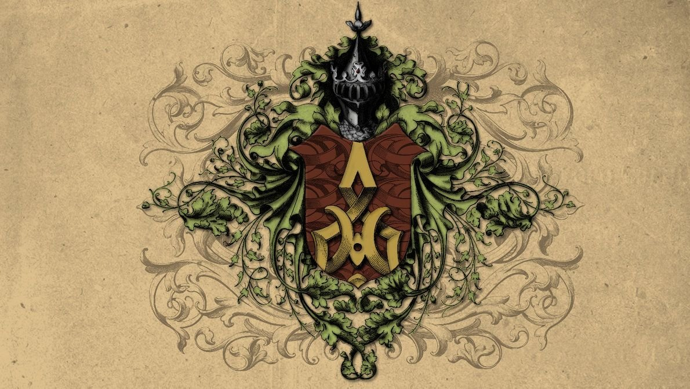

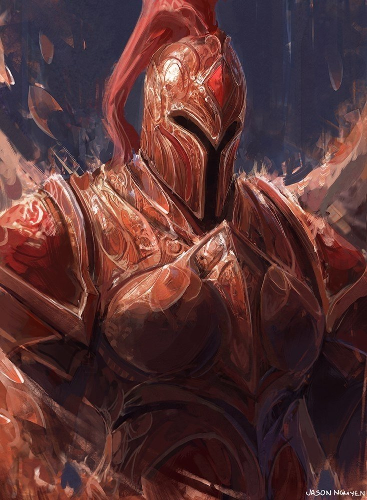

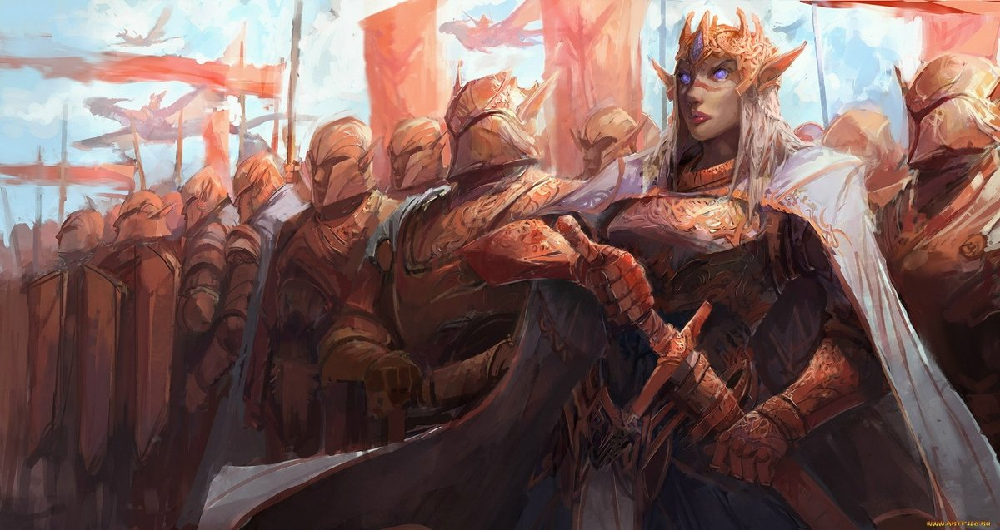

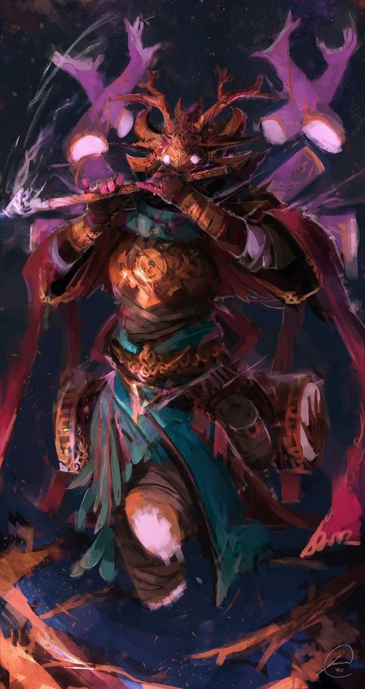

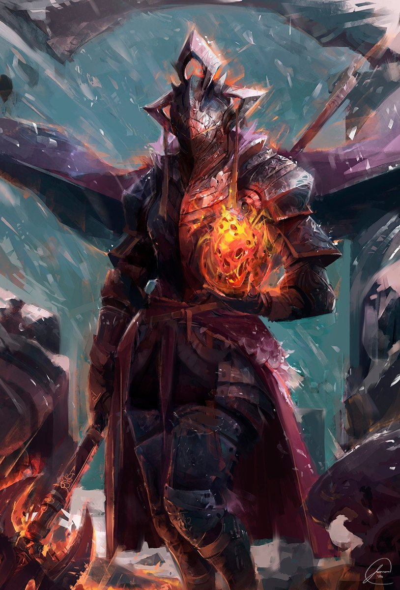

_Геральдика дома Дахейрис_

### Старейший Дом Заалон

**История:**
Дом Заалон считается старейшим. Его правители остаются эльфами с чистейшей кровью. Заалон наименее ярко выделяется среди иных домов, но является одним из самых весомых в политической жизни Альянса, участвуя во многих делах короля.

**Геральдика:**
Символом Заалона является фигура оленя со сложными, присущими знаку дома узорами.

**Устройство дома:**
Управляющая домом — Дирайя Заалон, почтенного возраста эльфийка (чего не скажешь по её внешним данным), возраст которой давно перевалил за сотню лет. Заалон занимает восточные земли Альянса, близ гор. Это один из домов, что не имеет чёткой структуры, и о внутренних делах и структуре дома что-либо вынюхать крайне сложно. Интриги же в стане врага — визитная карточка Заалон. Шпионы и ассасины старейшего дома пользуются большим спросом короны. Во время войны с Урием лунные ассасины дома вносили решающий вклад, устраняя генералов и совершая диверсии в лагерях солдат империи. 
Известно, что Дирайя весьма приближена к короне, а также весьма религиозна. Дом Заалон спонсирует постройку храмов и нередко в свои ряды набирает послушников храмов.

**Военные силы:**
Заалон не имеет постоянной армии, единственный из всех домов. Единственное исключение — расчёты лучников. Вместо этого при военных действиях дом обязуется предоставить своих агентов и ассасинов с мастерами меча. 
Основной вклад на поле боя вносят мастера ловушек ещё до начала боя. Ловушки Заалона выделяются искусностью и незаметностью. В доме обучаются специальные инженеры, как и содержатся пытливые умы, что обучались вне дома. В арсенале тихой войны не только обычные, но и магические ловушки, основанные на магии печати.
Лунные ассасины — элитные агенты, лучшие из прочих. Им поручаются специальные миссии по устранению генералов и политиков вражеских государств. Обычные же ассасины помимо прочего учатся диверсиям, находя и срывая поставки продовольствия, склады ресурсов.
Мастера меча же по большей части предоставляются Заалоном как сержанты и офицеры с тренерами для иных благородных домов. Это эльфы, посвятившие свою жизнь искусству клинка, и количество их настолько мало, что Заалон не пускает даже их напрямую на поле боя.

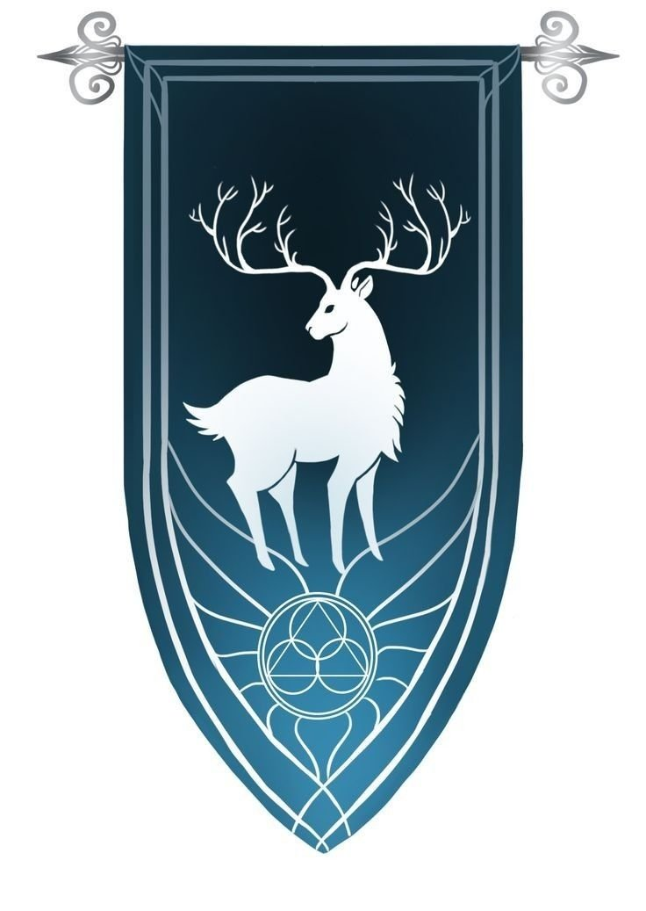

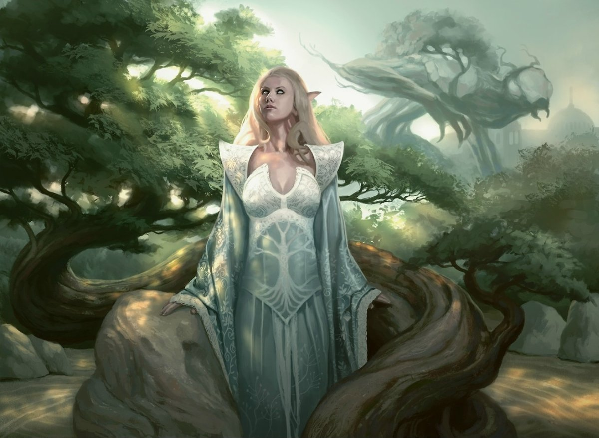

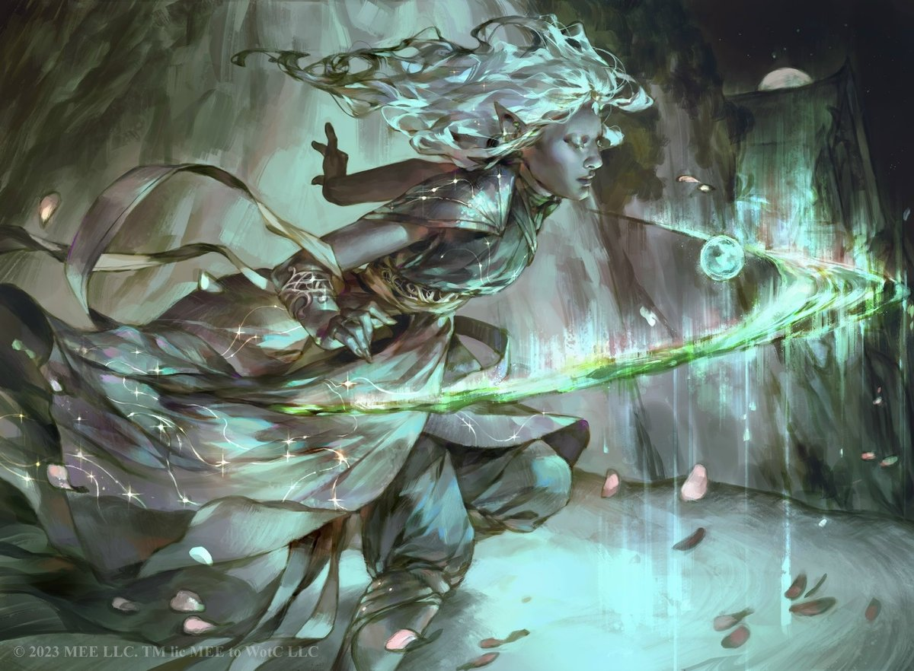

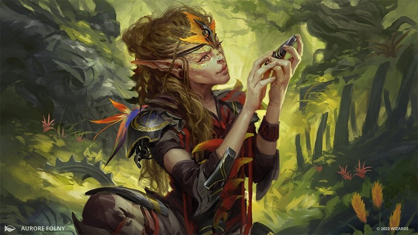

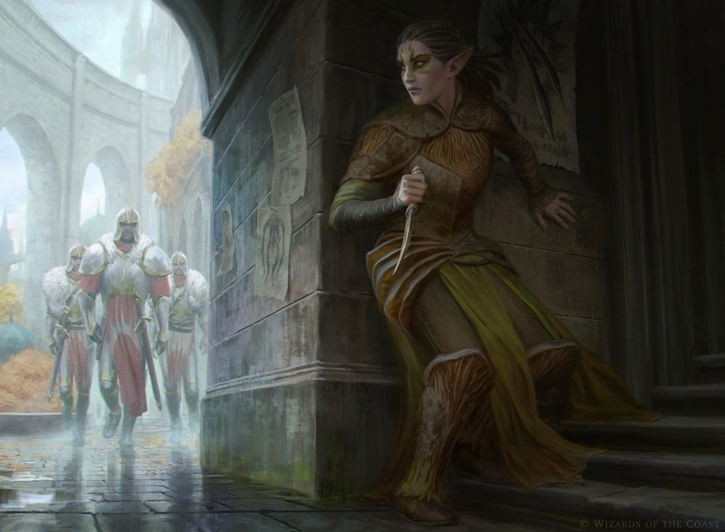

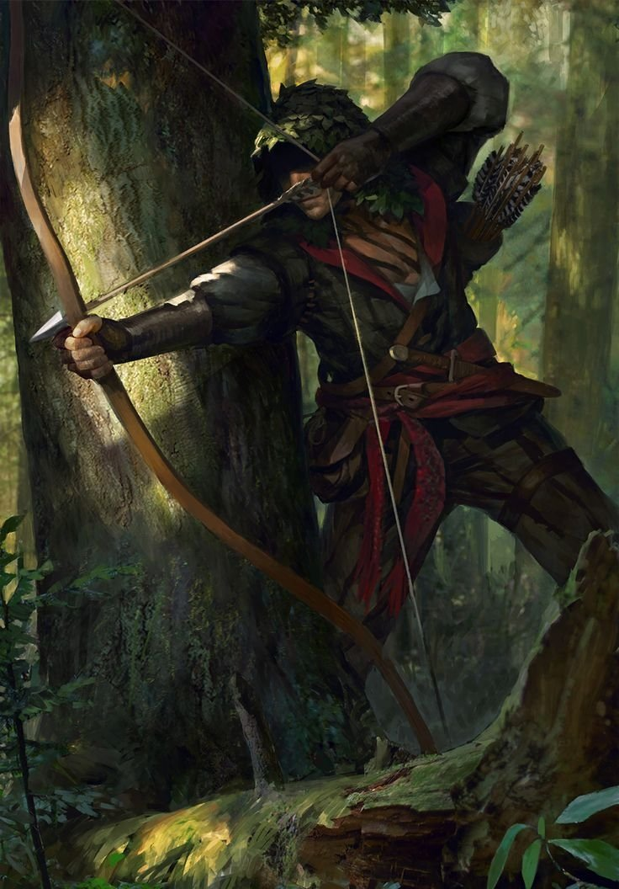

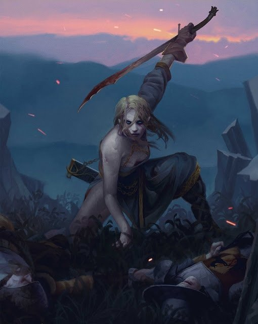

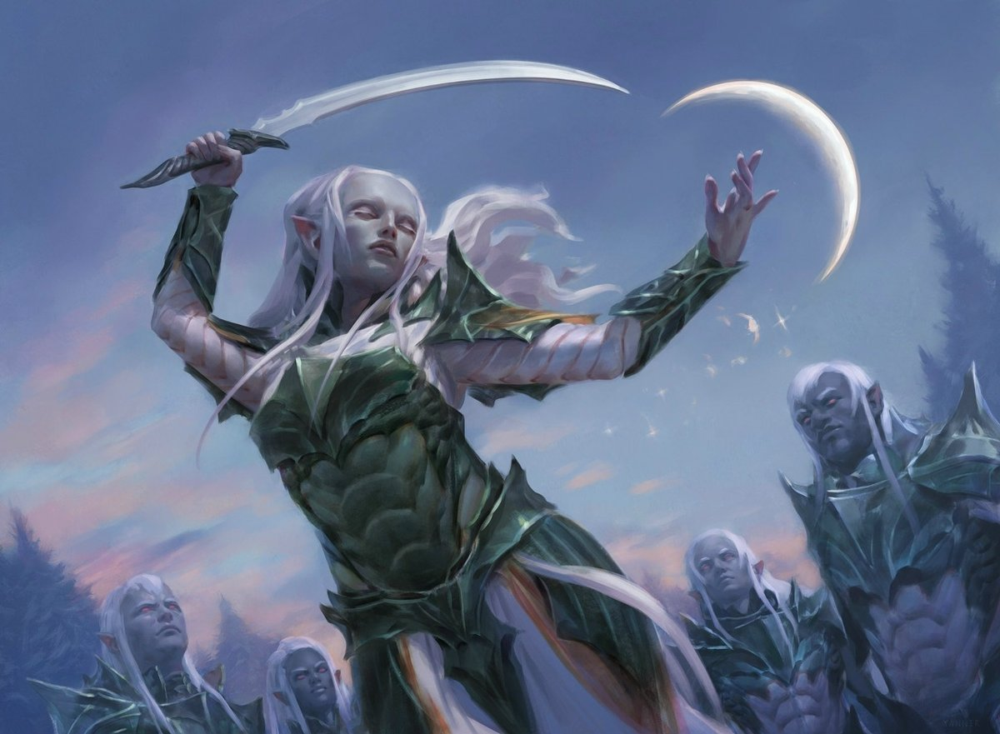

_Геральдика дома Заалон_

Помимо прочего, Альянс имеет и постоянные силы на случай первого реагирования. В них входят: следопыты, копейщики и маги.
Следопыты — главная разведка эльфийской армии. Небольшие отряды эльфов, обученных и стрельбе из лука, и ближнему бою, патрулируют леса даже в невоенное время и постоянно следят за сохранностью границ лесов.
Копейщики — боевые маги эльфов. Далеко не рядовые бойцы, использующиеся как сила реагирования при обнаружении каких-либо нарушителей. Работают в связке со следопытами, располагаясь в передовых аванпостах, что располагаются на пограничных деревнях и городах. 
Маги же — уникальная постоянная сила эльфов, распределённая по всей армии, что делает её гибкой и способной противодействовать любой силе.

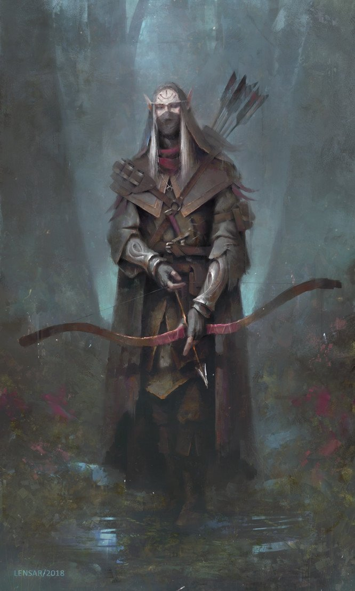

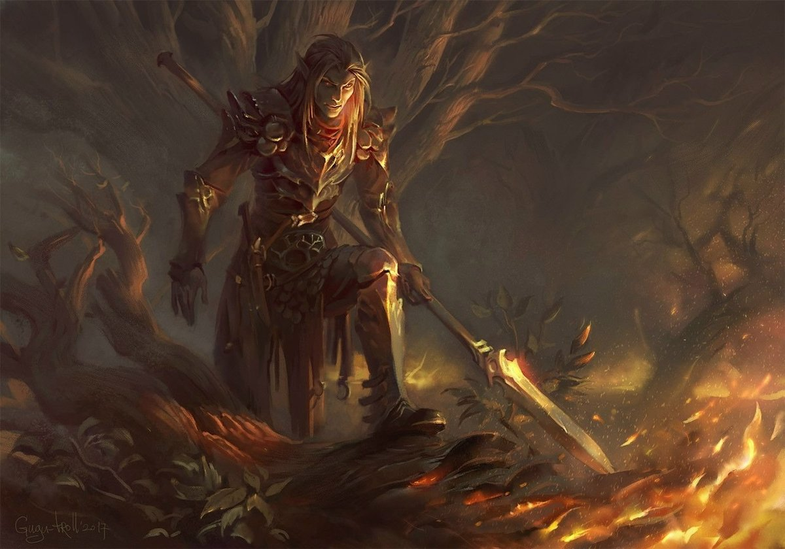

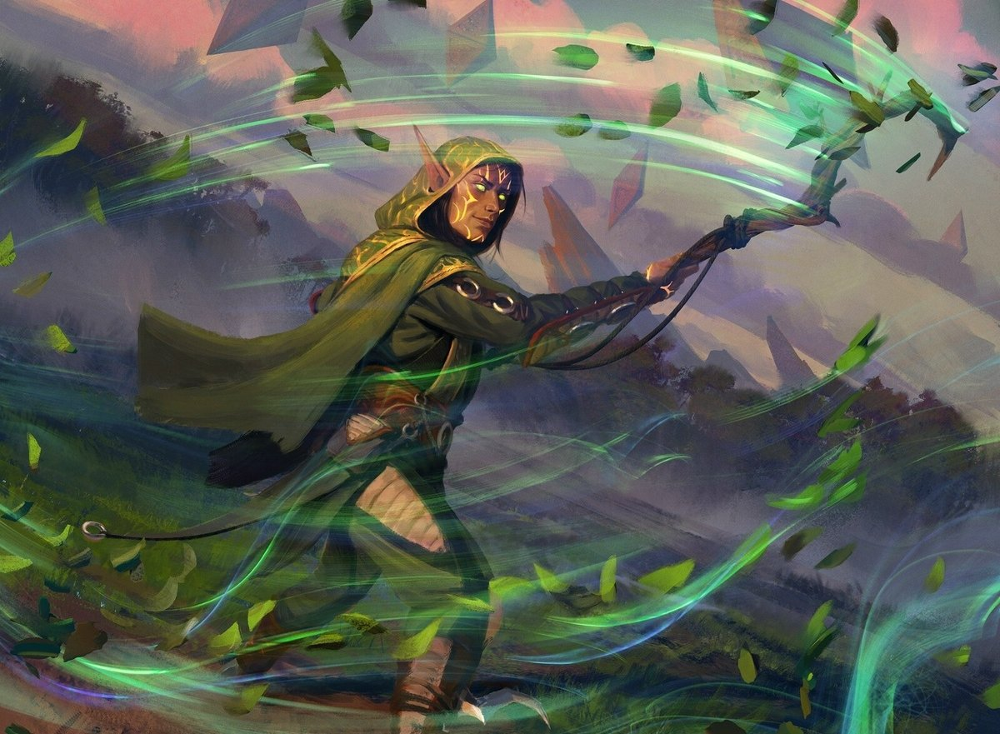

_Следопыт_
