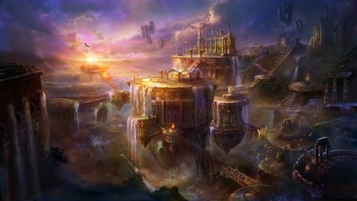
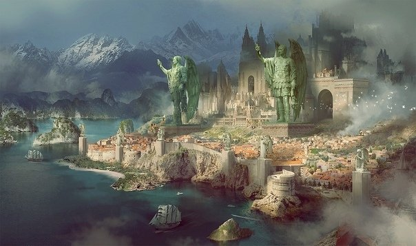
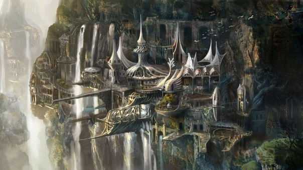
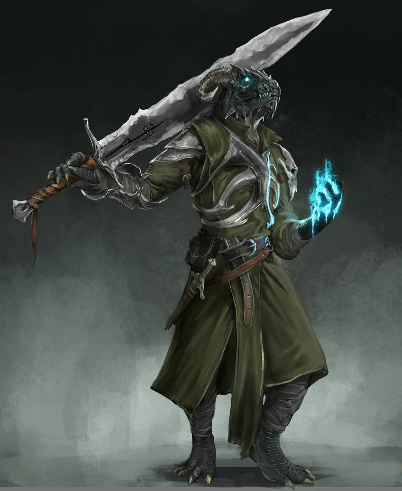

title: Великая Империя Ящеров
parent: lokacii
order: 12
icon: bi-flag
group: Государства на территории Бранна
image: photo/vk/533473434_457251408.jpg
art: photo/lokacii-web/velikaya-imperiya-yascherov.webp
layout: state

_символ Великой Империи_

Ящеры — одни из тех, кто был в Бранне изначально. Только в отличие от всех они были на очень малом этапе развития. Их совершенству же поспособствовали те, кто их и захватил.

## История

### Вторжение людей, разрушение мирной жизни

До вторжения первых людей ящеры вели очень скромный образ жизни в виде раздробленных племён по всей тёплой западной части Бранна. Они занимались лишь примитивной охотой, не думая о ведении хозяйства. Вторгшимся людям было несложно укротить все племена. Конечно, впервые в их истории большая часть племён попыталась объединиться, дабы противостоять людям. Но на стороне последних были технологии и более совершенное военное искусство. Ящерам пришлось сосуществовать с людьми, помогать им отстраивать города на месте их лачуг. Положение в обществе они занимали не особо высокое, были сильно ограничены во всевозможных правах. Да, часть их представителей даже были позже в совете, но они мало на что влияли. Зато за множество лет ящеры очень быстро стали приспосабливаться к новой жизни в городе, овладели навязанным языком. Люди буквально пнули их к развитию, минуя всякие промежуточные этапы. Этим же пинком они со временем породили в их сознании желание независимости. Практически каждый ящер, кроме тех, кто от людской власти получал выгоду и готов был пресмыкаться перед ними, желал собственного государства. Основа этой оппозиции рождалась в Майр'Эле.

### Мятеж и захват города, обретение независимости

Решающий день для зарождения Великой империи не был спонтанным. Всё было заготовлено заранее, все нужные люди были куплены также заранее. Большой вклад внесли гномы. Ящерам удалось связаться с ними и попросить о помощи, ведь взгляды на то, что чужаков надо усмирить, у них были схожи. Когда всё было готово, Майр'Эль в один день пропитался кровью. Большая часть вооружённых сил людей была убита, остальные вытеснены из города. Власть города также ждала участь их вооружённых солдат. Лишь один из власти выжил, потому что нужен был посол для объявления совету Громула, что город требует независимости. Такое, по сути, начало гражданской войны всколыхнуло весь Громул, который в этот момент пошёл трещинами. Пару лет Майр'Эль пытались отбить, но безуспешно. Всё быстро прекратилось, когда Громул объявил и о своей независимости перед заморской Империей, став Корвасом. Взявший власть Эрийний благосклонно отнёсся к ящерам, признав их независимость, ведь готовиться нужно было к иному — войне с гномами. Последним ящеры также обещали помочь в войне — магами и началом бунтов в иных городах, что должно было бы растянуть силы людей. Но наспех образованный совет решил, что от этой идеи придётся отказаться и заняться собственным развитием. Они не прогадали: гномы были разбиты, отчего об их мести за предательство можно было даже не думать.

### Время расширений

279 год от падения Громула, на престоле людей император Урий. Не больше и не меньше чем болван в плане управления государством. Ящерам же это было на руку. Пока людской император трусливо стягивал армии вокруг своей столицы и для борьбы с эльфами в их лесах, ящеры приступили к расширениям своих территорий. Джа'Файл стал следующей целью. Взять его оказалось даже легче, чем сердце расселения людей по материку. Без пропитывания улиц кровью не обошлось, но люди не предприняли даже попыток отобрать город назад. Урий в это время уже трусливо бежал на остров Хор, большая часть армии была на другой стороне континента. Захват Сердца Империи, в прошлом Овдоля, был лишь вопросом времени.

### Наше время

На данный момент Великая Империя — самая крупная страна на территории Бранна. Она обладает самой сильной экономикой, умной и крепкой властью, а также уже утихающим аппетитом к захватам. Тем более появилась другая проблема — именно у их границ находится Хор. Небольшой пролив перестаёт быть преградой, на побережьях рядом с ним начинают замечать нечто странное, и Империи нужно придумывать способы борьбы со скверной.

## Общее описание

### Расположение и города

Великая империя занимает всю западную часть Бранна, самую тёплую из всех. В продвижении дальше у ящеров просто нет смысла, а мест для освоения у них ещё предостаточно. 3 крупных города — Сердце Империи, Джа'Файл (столица) и Майрл'Эль —, вполне обеспечивают основное развитие страны.

### Тип правления

Монархия, полагающаяся на совет из 12 членов во всевозможных вопросах. Монарх в части вопросов ограничен советом, и для решительных действий, вроде войны, необходимо одобрение большей его части.

### Культура

Очень сильно культура ящеров была перенята от людей. Что и неудивительно, ведь они дали основной толчок не только для этого. И очень сильно они стали упиваться аристократичностью, к которой тянется большая часть ящеров. Роскошь стала пластом культуры, недосягаемым для многих. Но это не говорит о том, что каждый хочет стать в империи богатым трутнем. Трудолюбие — одна из основных черт ящеров. Каждый понимает, что прийти к чему-то можно лишь упорным трудом. А прийти все хотят в основном к одному и тому же. Вторая из основных черт — ценность свободы. Вопросов о законности рабства в стране не стояло, оно сразу было запрещено, так как ящеры ценят не только свою, но и чужую свободу. Именно поэтому после захвата городов некоторая часть людей могла спокойно существовать дальше, на тех же правах, что и ящеры. Более того, к людям даже не относятся особо враждебно. А всякие предметы искусства, вроде знаменитых статуй Эрийния в столице, и вовсе остались нетронутыми.

Что касается архитектуры, то во многом она схожа с людской. Разве что ящеры стали тянуться к максимальной необычности во всём. Парящие с помощью магических кристаллов острова? Да. Отвесно висящие сложные здания со скал — легко.

_Парящие острова Сердца Империи_

Не отличаются они лишь особой верой. В связи с этим крайне мало особо роскошных храмов, в основном они строятся без поддержки государства.

### Экономика

Торговля, торговля, торговля. На торговле держится у ящеров всё, и ведут они её очень успешно. Что же они могут предложить? Множество дорогих камней, добываемых в своих горах. Причудливые меха и животные, пряности, особенно ценящиеся, и прочее и прочее. Помимо этого у них есть очень мощный лесной массив рядом с Сердцем Империи, а в горах помимо ценностей добываются и некоторые металлы.

### Армия

Без армии Империя не была бы такой Великой. Чем-то все города захватывались, и чем-то их нужно охранять. Основа этого чего-то — рядовые солдаты, которым выдаются копья, луки или мечи. Доспех у них часто неполный, ввиду того, что использовать им его неудобно. Так, ноги, например, покрываются защитой лишь частично, пластинами спереди.

_Мечник Империи_

Есть и тяжёловооружённые ящеры, исполняющие роль охраны и самой сильной наступательной силы. Их броня обычно уже более мощная вкупе с чешуёй, они часто владеют магией.

_Универсальный солдат Империи_

Но всё же очень сильно полагаются ящеры и на наёмную силу, которую активно содержат даже сегодня, благо могут себе позволить.
