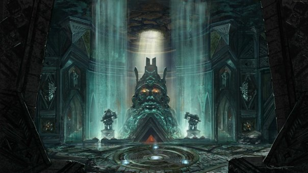
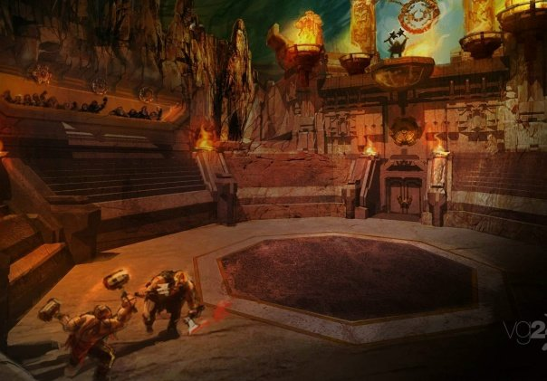
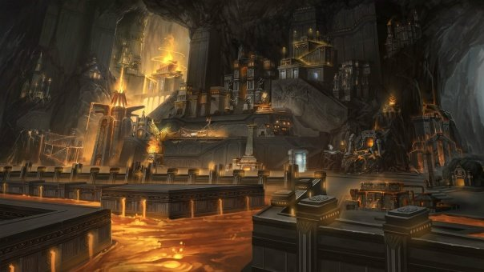
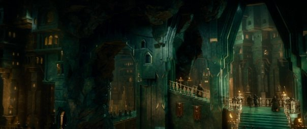
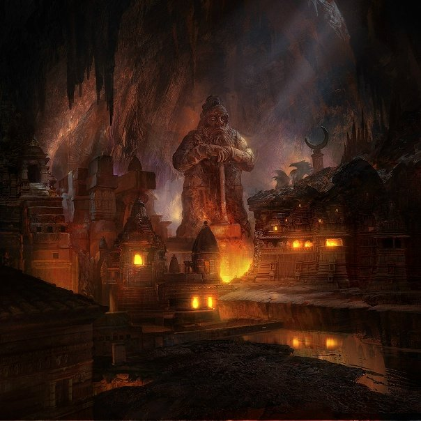
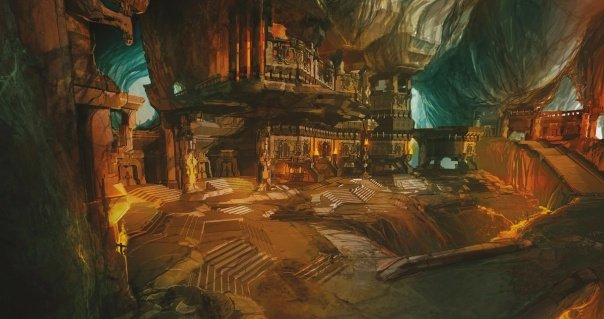
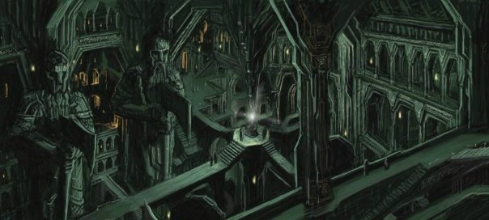
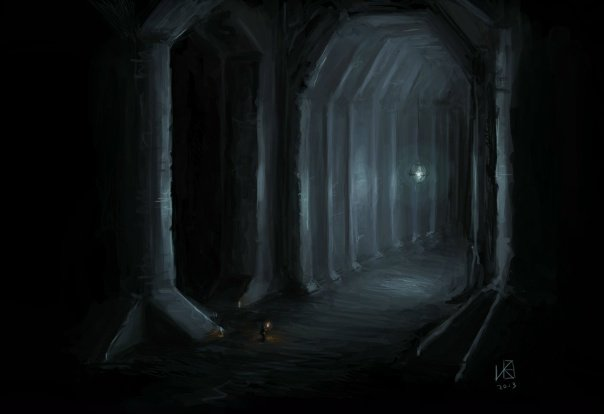
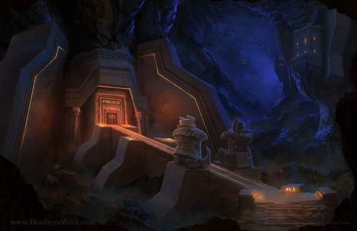
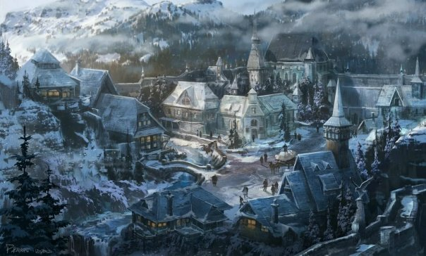

title: Гольм: культура
parent: golm
order: 10
icon: bi-bricks
summary: Общество, традиции и архитектура
image: photo/vk/533473434_457247799.jpg
vk: 55312602

## Общество гномов

У гномов несколько демократичное общество, где нет классов, а присутствуют скорее особые аристократические статусы, выделяющие определённых гномов на фоне других. Прочие же могут быть кем и где угодно, это скорее зависит от воспитания и отношения окружающих к выбранному гномом пути. Так в семье кузнецов сын вполне может стать торговцем, или вообще посвятить жизнь военному делу. Даже гному из бедной семьи не закрыты дороги, и он всегда может построить жизненный путь вплоть до титула Предка.

Имена гномов строятся следующим образом: Имя, данное родителями, + Дом. Дом, по сути своей, фамилия, присущая всей конкретно выбранной семье. Читаться Дом может по-разному. Например: Дулрин Беранол или Дулрин из Дома Беранол. Если гном сирота, не относящийся к какому-либо дому, то вместо дома будет Шир, в котором гном вырос. Произносится это будет аналогичными способами: Дулрин Зегмур или Дулрин из Шира Зегмур.

У имён могут быть различные титулы, если таковой имеется. Например, у Предков при жизни один из самых почитаемых титулов — Кан. Титулы у гномов всегда произносятся перед именем _(прим. Кан Дулрин Зегмур)_.
Ниже представлены все основные гномьи титулы, которые могут быть заработаны:

- Шагор — титул короля/королевы гномов.
- Кан — титул Предка при жизни _(Предка при жизни называть именно Предком считается дурным тоном)_.
- Акан — глава семьи Предка, представляющий собственно семью в совете и прямо влияющий на политическую жизнь.
- Шаорт — главнокомандующий гномьей армией.
- Таорт — военный титул, присущий гномам по статусу ниже главнокомандующего. Чаще всего им доверяется управление определённой части армии.
- Анорт — военный титул после Таорта. Гномы данного чина управляют определённым отрядом/отрядами.
- Оанорт — наименьший военный титул. Оанорты управляют 15 гномами в отряде и полностью за них отвечают. Также Оанорты зачастую ответственны за прочие мелочи, на которые могут назначить именно их _(Например управлять расчётом осадных орудий, а не именно частью людей в отряде)_.
- Ка-Название Шира _(прим. Ка-Зегмур)_ — управитель делами в определённом Шире. В каждом шире разное количество Ка-Шир-ов, зависит от того, сколько их нужно. Назначаются королём. Ка-Шир-ы решают местные проблемы, а также представляют закреплённые за собой Ширы и доносят их проблемы совету.
- Ка-Название Нира _(прим. Ка-Саадух)_ — аналогично Ка-Шир-ам, только отвечают за наружные города — Нир-ы.

## Традиции и уклады

Независимо от Широв, у гномов сложились в целом общие понятия о жизни и свои нормы. Гномы трудолюбивы, но только если дело гному нравится. И никакое дело не считается каким-то дурным или недостойным. Гномы ценят значимость как славного кузнеца, так и разносчицы в таверне. Да, уровень жизни, безусловно, разнится в зависимости от рода занятий, но такого понятия, как абсолютная бедность у гномов нет. Если уважаемый гном попадает в сложную ситуацию, то ему обязательно помогут. Не заведено у гномов бросать друг друга в беде.

Но многие дела порицаются гномами, заслужить грязную репутацию — всё равно что стать изгнанником, на которого не стыдно плеваться. Из осуждаемых дел можно выделить: проституцию, неуважение к собственному Дому и его членам, нарушение закона, неуважение к Предкам, дезертирство, неряшливость и разгульный образ жизни и т. д.

Гномы, опускающиеся до всевозможных грязных дел, часто изгоняются из своих Домов старшими. Именно такие и формируют трущобы, волоча существование в самой ужасной для Гольма нищете. В Ширах такие гномы формируют бедные районы-трущобы на окраинах. Вместе со всем гномы ценят своё личное достоинство, и часто горделивы. Последнее особо проявляется на уровне Домов, особенно знатных. Когда один пытается казаться лучше на фоне других. Для такого есть даже целые подкупные вестники, разносящие всеобщие принижающие сплетни под видом новостей. Подобное соперничество считается нормой.
У гномов в вероисповедании имеют место быть такие боги, как: Турн, Бисар, Эн`л, Ше`Ел, Итишия. Но особое место занимают почитаемые всеми предки, что внесли наибольший вклад в развитие гномьего общества, или прославились как храбрейшие воины.

В плане времяпрепровождения у гномов тоже сложились различные традиции. Самое лучшее, что можно сделать после работы — пойти пить в таверну. Попойка в обществе гномов не осуждаема и занимает особое место. Это отличная возможность побугуртить, пообщаться с друзьями и расслабиться. В конце концов, даже со своей выпивкой им сложно упасть в слюни под стол и уснуть. Также смежное и чуть ли не ежедневное с попойкой занятие — бани. Гномы всегда следят за своей чистотой и дурно пахнуть или выглядеть для них — нонсенс.
Гномы любят азартные карточные игры и прочие подобные, что хорошо соединяются с попойкой.
Из экстремальных видов развлечений можно выделить арены. В каждом Шире есть государственная арена, располагающаяся рядом с Ша-паран-ом. Участвовать на арене весьма престижно, и кого попало туда не берут. В конце концов, ценится именно драка насмерть. А трибуны всегда собираются полные.

Список основных празднеств гномов:

- Праздник Шира — у каждого Шира разный. В этот день гномы празднуют основание Шира, устраивая застолья семьями. Для любителей одиноких празднований или незнакомых групп все таверны всегда также устраивают застолья, готовя как можно больше еды. Работать в этот день считается дурным знаком — нужно отдыхать!
- Десятина великого камня — ровно десять дней в феврале месяце, когда гномы почитают Турна. В этот десяток дней гномы не пьют и довольствуются скромной пищей, зачастую исключая мясо. В храмах проходят общие молитвы Турну. А на 11 день все уже празднуют, что есть силы. 11 день Десятины камня — самое громкое событие среди праздников. Ширы наливаются музыкой, стоит пьяный гул и ведут себя гномы как можно громче, ведь в это время Турн должен услышать своих созданий.
- Праздник огня — празднование искоренения дриад. Это одна из немногих войн Гольма, и 20-того дня марта король объявил полную победу над дриадами. В этот день и празднуют гномы. В Нир-ах складывают большие костры и празднуют вокруг них, а молодёжь выплясывает. В Шир-ах же стараются собираться вне зданий и праздновать под бульканье лавы.

## Архитектура

В строительстве гномы, естественно, отдают предпочтение камню и металлам, украшающим камни. Очень многие дома были высечены прямо из стен пещер, а структура городов сильно отличается от привычных иному обывателю. Ширы весьма запутаны, не имеют чёткой структуры по улицам. Всё соединено массивными мостами и проходами с лестницами, а группы зданий создают кварталы в зависимости от того, кто в них проживает. Выше всего располагаются административные здания городов, часто отделённые лавовыми проливами, соединяясь с остальным Широм лестницами или мостами. Это можно считать своеобразным центром города. Из-за ограниченности места в Ширах почти нет больших площадей. Небольшие встречаются лишь внутри кварталов или перед выходами из Шира.

Сами кварталы зачастую носят похожие названия во всех Ширах для удобности. Из основных, присутствующих везде, можно выделить:

- Королевские палаты — территория Шир-Талан, где располагается королевский дворец.
- Ша-паран — часть города, в которой располагаются все административные здания от управлений Шира до судов. Легче всего находятся, так как зачастую это самая высокая точка Шира, к которой ведут все дороги. В Шир-Талан вместо Ша-паран Королевские палаты.
- Квартал Предка (прим. названия Квартал Беранолов) — часть Шира, где проживает семья Предка и где располагаются все их здания производств.
- Кварталы знатных домов — в этих частях Шира живут различные наиболее богатые Дома.
- Общинник, или общие палаты — квартал, который может занимать очень большую часть Шира. Основное место проживания всех гномов. У общих палат есть свои мини-кварталы, такие как: производственники, где располагаются кузнецы и ремесленники; Фермы; Столпники _(небольшие площади с торговцами и зеваками, а также особо широкие проходы)_.
- Пыльники — трущобы на окраинах Широв, где проживает порицаемая часть гномьего общества, а также водится вся маргинальная жизнь.

Во всех кварталах вплетены всевозможные таверны, харчевни, магазинчики и прочие, присущие любым иным городам здания. Повсеместно встречаются статуи и лики предков, а сами здания, лестницы и полы украшаются рунами и письменами. Дома зачастую весьма практичны, часто имеют очень простую форму коробки. Сложные потоки лавы используются гномами для направления их в свои цеха. Может выглядеть опасно, но у самих гномов неудобств такие реки не вызывают.

Из каждого Шира есть несколько выходов, отдалённых от основной части города. Ведут они в запутанную сеть пещер Гольма, кишащих разными тварями. Основные дороги между Ширами были отстроены камнем, представляя из себя очень длинные коридоры. Изредка по пути попадаются небольшие поселения. Такие места между Шир-ами зовутся Дуфарами. Жизнь в них весьма сурова и куда более опасна, ведь их не защищают стены пещер и ворота, как Шир-ы. Дуфары осваивались и осваиваются во время исследований сети пещер. Там в первую очередь живут фермеры и кузнецы, чтобы разведгруппам было где перекантоваться после долгих походов и пополнить запасы. Наиболее старые дуфары уже разрастаются, хоть и медленно, принимая обычных граждан.

Основной огромной длины коридор между всеми Шир-ами называется Даароком. По пути на нём часто встречаются всякие твари и бандиты, чередуясь с Дуфарами. Чтобы пройти весь Даарок пешим ходом и посетить каждый Шир, нужно потратить года 2, не меньше. Все же остальные опасные части пещер, ответвляющиеся от Даарока и ведущие в неизвестность, называются Гольмской Кишкой.

_Галерея на тему Широв_

_Городские лестницы_

_Дуфар_

_Квартал предка_

_Общие палаты_

_Кусок пути Даарока_

_Выход из Шира к Даароку_

## Ниры

Архитектура Нир-ов, естественно, отличается от подземных городов. Тут уже начинает преобладать дерево в материалах, а сами города имеют куда более привычную форму и структуру. Ниры строятся в основном на побережьях. Самый крупный Нир-Саадух построен перед вратами в сам Гольм.

