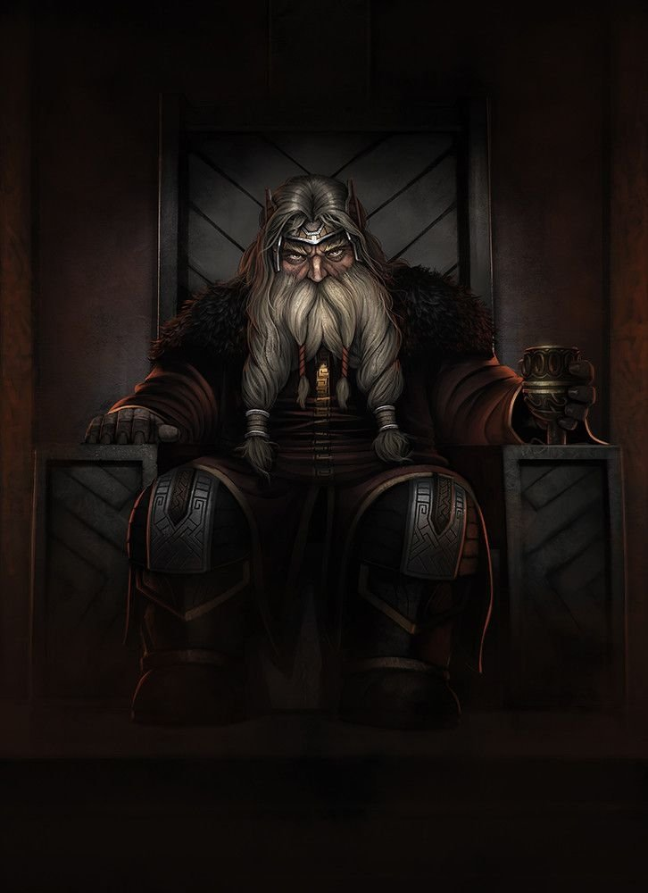
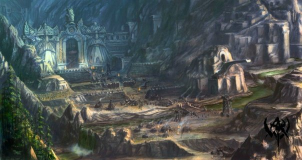
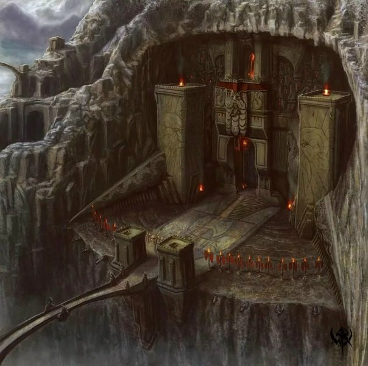
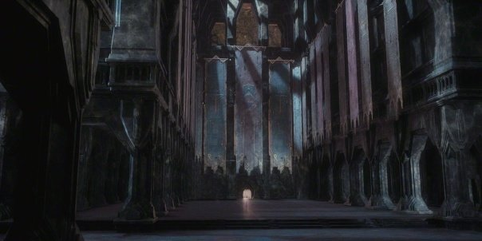
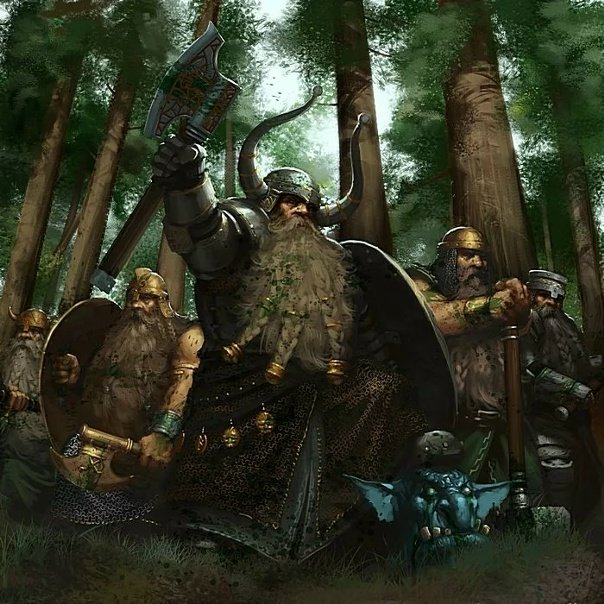

title: Гольм: устройство
parent: golm
order: 20
icon: bi-bricks
summary: Власть, законы и армия
image: photo/vk/533473434_457247811.jpg
vk: 55312610

## Власть

В Гольме правит король или королева, избираемые советом Аканов _(глав семей Предков)_. Избирается правитель также из числа Аканов путём голосования. Последние 4 правителя принадлежали одной семье Ринот, а именно: Аманара Ринот, Дукан 4 из Дома Ринот, Шакан Ринот и Дукан 7 из Дома Ринот. Последний является действующим королём Гольма.

Власть состоит, как уже понятно, из Короля и совета Аканов. Король имеет большую власть и волен делать то, что считает нужным, но особо важные решения требуют одобрения 4-х из 7 Аканов. Примером подобных решений может быть объявление войны. В остальном же совет помогает королю с управлением Гольмом, а также консультирует его в важных вопросах. На совете, например, лежит ответственность наблюдения за государственной казной, а также своевременное оказание внимания властям Широв и Ниров при различных проблемах. Аканы, как уже упоминалось, относятся к семьям великих Предков — гномов, что внесли наибольший вклад в развитие Гольма. Они прославили свои Дома, и теперь их семьи входят в совет. Всего семей предков на данный момент 7: Семья Ринотов, Беранолов, Загормов, Валенов, Кирод, Бааритов и Тилос.

## Связь Широв и Ниров

Между собой Ширы соединены длинным коридором Даарок, единственным более-менее безопасным путём меж городов. Для быстрого перемещения используются специальные животные — лумары, чем-то похожие на буффало, только покрытые шерстью и намного меньше. Они перевозят грузы меж Широв и берутся в группы, что исследуют Кишку Гольма, открывая новые территории гор. Наружу же есть несколько врат из двух Широв: Талана и Зегмура.
Из первого врата ведут сразу в Нир-Саадух, построенный перед вратами. У второго же выход находится высоко в горах и существует для исследования внешних частей гор. Перед входом внутрь Гольма всегда есть охраняемая Зала, как и у самих врат. Чужаков просто так не впускают, всех осматривают. Но в целом политика что в Ширах, что в Нирах к чужакам строится на дружелюбии, особенно для торговцев.

_Врата Талана_

_Врата Зегмура_

_Зала после врат Талана_

## Законы и наказания

Гномы ценят порядок, и законы их весьма суровы как к своим, так и к чужакам. Очень часто гномы изгоняются из своих Домов, если совершили какое-либо преступление. Ниже будет список некоторых основных проступков и возможных для них наказаний:

- Мелкая кража — Заключение под стражу на месяц, прилюдная порка стальным раскалённым хлыстом.
- Особо крупная кража — Заключение под стражу на 4 года, чужаки заключаются на 5 лет и больше, после изгоняясь из Гольма, не имея права когда-либо после посещать его. Чужаков также на время заключения чаще всего заставляют работать.
- Убийство — казнь или ссылка в Кишку Гольма, что равносильно казни, а возможно, и того хуже. Для чужаков практикуется лишь ссылка в Кишку Гольма, ибо считается более суровым наказанием. В обоих случаях ссылка допускает наличие у провинившегося оружия. Из-за этого чаще всего ссылка оканчивается самоубийством в начале пещер Кишки.
- Осквернение Предков — Изгнание из Гольма.
- Убийство родственника по крови или гнома с титулом — прилюдная казнь или пытка, на усмотрение властей. Если вместо казни была пытка, то после неё провинившийся изгоняется голышом в Кишку Гольма сразу же после пытки.

## Внешняя политика

Гномы активно ведут внешнюю политику со всевозможными государствами, в том числе с государствами Бранна: Корвасом и Империей Ящеров. Помимо различных договоров и соглашений, она по большей мере заключается в необходимой для гномов торговле. Ограниченные своим островом, им нужны всевозможные ресурсы, денег на которые с лихвой хватает благодаря уникальным продаваемым металлам, а также некоторым ценностям и диковинным животным. Активных же войн с кем-либо Гольм на данный момент не ведёт.

## Армия

Армия Гольма делится на внутреннюю и внешнюю. Внутренняя армия отвечает за общий порядок в стране. Она делится на тех, кто охраняет порядок в городах, отлавливает бандитов и разбойников, и тех, кто занимается опасными экспедициями вглубь Кишки Гольма. Внешняя же армия заботится в первую очередь о защите границ государства. Основные её силы сосредоточены в портовых городах, ибо сухопутных соседей у гномов попросту нет. По этой же причине у них очень сильно развит флот, дабы вести активную торговлю с множеством стран.

Экипировка солдата в армии гномов может быть разнообразной. Гольм может себе позволить создавать отряды полностью закованных в лучшие латы гномов, что будут вооружены не менее отменными клинками и боевыми молотами. Если подобный элитный отряд встанет мёртвой фалангой, то через неё невозможно будет пробиться ни конным, ни пешим. Разве что буквально, как и стены, разбивать строй катапультами.

Не менее страшны взводы стрелков гномов, орудующие арбалетами. Быстро стреляющие и делающие это из мощных арбалетов, они способны оказывать очень серьёзную поддержку.
Однако у всего есть свои минусы. Армия гномов весьма маломобильна, а конные взводы и маги у них вовсе отсутствуют по понятным причинам. Такие силы лучше всего подходят разве что для обороны своих же городов.
