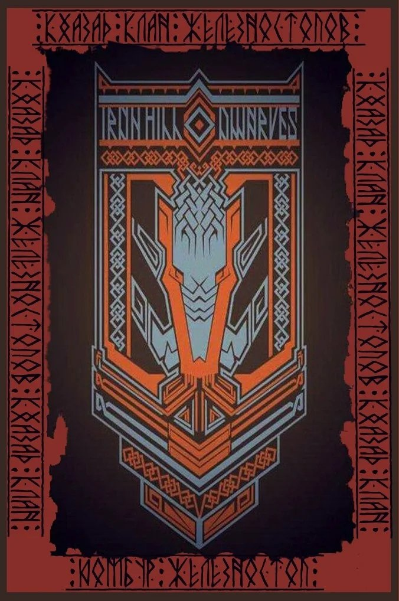
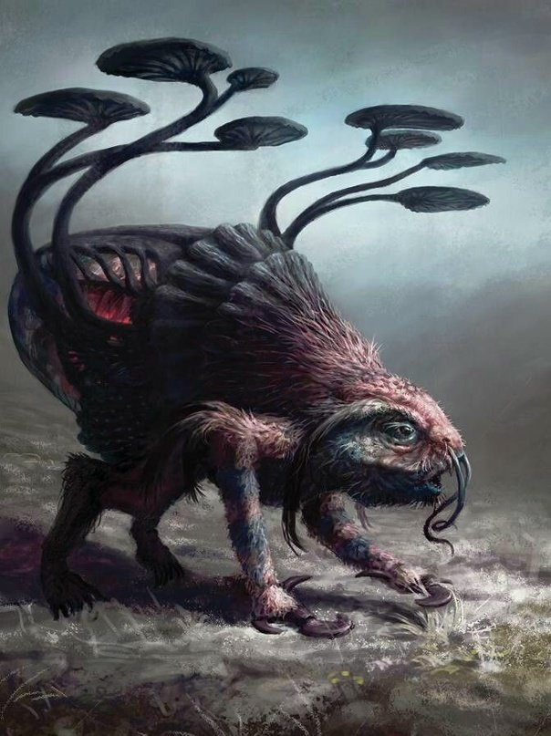
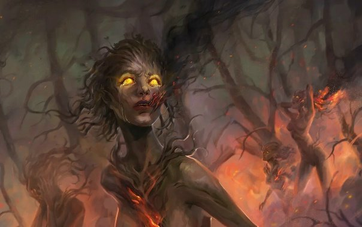

title: Гольм
parent: lokacii
order: 310
icon: bi-bricks
group: За пределами Бранна
summary: Государство гномов
image: photo/vk/533473434_457247818.jpg
art: photo/race/golm.jpg
art_position: center 30%
vk: 55312519

## История Гольма

Гольм — гномье государство, расположенное на юго-востоке от Бранна, и располагающееся на весьма крупном острове, коим гномы полностью и владеют.
Гольмом величается не только гномье государство, но и горы, в которых первое, собственно, расположено. По легендам, Турн, сотворив первых гномов, создал для них из космического булыжника отдельный остров, а самих гномов поместил внутрь новосозданной горы. У самих же гномов в летописях первые упоминания о собственной расе найдены с основания одного из крупнейших поселений внутри Гольма. Гора внутри чудно пронизана огромными пещерами, и сразу несколько семей гномов развивались параллельно друг другу в разных частях горы, долгое время оставаясь изолированными. **Такие первые поселения зовутся Ширами, а сейчас это основные Города-Волости Гольма.** Крупнейшим из первых поселений был **Шир-Талан, ныне гномья столица**. Гномы Шир-Талана удачно располагались в наиболее благополучном месте: оно было полно руд, а само место было удобно застраивать; здесь хорошо прорастали многие растения и грибы, поэтому сейчас в Шир-Талане находятся крупнейшие грибные фермы, а также **фермы руки**в (мясистые плоды каплевидной формы синего цвета, один из основных гномьих продуктов наравне с грибами. На вкус как банан, скрещённый с картошкой). Шир-Талан развивался быстрее остальных общин, и первые упоминания в летописях именно о нём.

Расширяя границы, поселения неизбежно сталкивались друг с другом. История гномов не пестрит внутренними войнами, но и первые конфликты были неизбежны. Это время объединения зовётся у гномов **Эрой Тёмного Камня**. Многие Ширы пытались прийти к единоличному правлению всем Гольмом, пока гномья раса не пришла к миру.

## Другие из первых Широв

Помимо Шир-Талана одновременно с ним самостоятельно развивались следующие Ширы, до сих пор существующие в составе одного государства: Шир-Денор, Шир-Зегмур, Шир-Йеир и Шир-Заур.

_Шир-Денор_
Один из наиболее поздно присоединившихся к единому Гольму Широв, ввиду своей отдалённости. Гномы Шир-Денора проживают куда глубже остальных и долгое время оставались в изоляции. От других Широв этот выделяется тем, что именно тут добывается в наибольших количествах _мифрил_. Сейчас это стратегический запас гномов, практически отсутствующий у других государств. Его обработка крайне сложна, и занимающиеся ей с начала своих времён гномы Денора ныне наиболее искусные кузнецы гномов, принёсшие уйму знаний при присоединении к Шир-Талану. Из-за того, что Шир-Денор находится весьма глубоко под землёй, тут меньше всего света, точнее его искусственных источников. **Гномы из Денора лучше всего видят в темноте, их кожа наиболее грубая, а также они привыкли к малому содержанию кислорода в воздухе**.

_Шир-Зегмур_
Шир, что раскинулся в самых верхних пещерах Гольма. Гномы Зегмура одни из первых нашли Таланцев, сразу же установив дружеские отношения. В дальнейшем они серьёзно помогали с дипломатией с другими Ширами, а также считаются инициаторами объединения гномьего общества в единое государство. Шир-Зегмур сейчас ещё зовётся предповерхностным городом. Сюда даже пробиваются лучи солнца извне, а сами Зегмурцы ещё в тёмные времена приступили к освоению внешнего мира, о котором остальные и не знали. Поэтому они преуспели в деревообработке и сельском хозяйстве вне пещер.

_Шир-Йеир_
Общество охотников и воинов, наиболее долго сопротивляющееся единению с остальными Ширами. Йеир расположился в средних глубинах гор, находясь между всеми остальными Ширами. Заложившаяся изначально политика войны и сопротивления весьма долго тянулась и после. Их пещеры больше всего богаты живностью, в отличие от остальных. С самого начала Йеир был обществом охотников, и первые войны им давались легче всего. Гномы Йеира обладали самой дисциплинированной и воинственной армией, после создав основу военного ремесла для всего Гольма. Сам город примечателен тем, что именно тут разводят уникальных существ — **пирэкшей**. Это небольшие создания, вступившие в симбиоз с грибами. Размерами с весьма крупную курицу. Являются основным доступным мясом в Гольме, а вкус их мяса зависит от того, чем они в основном питались при жизни, и также отдаёт грибами.

_Шир-Заур_
Соседи Денора, также преуспевшие в металлообработке. Наименьший из всех Широв, выделяющийся именно своей культурой и трепетностью к истории. Сейчас он центр гномьего образования, а также кладезь всех многовековых знаний. Историки Заура трепетно воссоздают историю гномьего общества.

## Объединение гномов

Эра Тёмного Камня сменилась **Эрой Становления**. Все Ширы объединились под названием Гольма, вместе собирая накопленные временем знания, а также начиная более активное освоение не только гор, но и внешнего мира. Шир-Зегмур с новыми орудиями Денора и солдатами Йеира начал активное расселение на поверхности, у главного выхода из Гольма основав наружный город **Нир-Саадух**. Ныне гномы из Нир-Саадуха представляют отдельное общество. Их также называют **наружниками**. Они главные торговцы Гольма, а пребывают в основном вне гор, освоившись под открытым небом.

Освоение наземных границ не было лёгким делом, ведь мешали в этом гномам воинственные дриады, расположившиеся в дремучих лесах чуть дальше от гор. О мирном решении речи быть не могло, ввиду абсолютной вражды дриад ко всему. Шир-Зегмур, не найдя точек соприкосновения в переговорах, предложил просто вырезать воинственных чужаков, что сильно теснили развитие Гольма в лесах, не давая никуда более выйти. Не особо церемонящиеся гномы, видя, что с наскока дриад не взять, а затягивать вражду лишь себе во вред, решили действовать радикально. Участок леса, где обитали дриады, был подожжён, и выжигали его под корень, что лишало дриад их преимущества в лесу, и даже частично ограничивало их магию. В конце концов, такой тактикой гномы измотали своих соперниц, без труда искоренив полностью дриадские остатки, став единоличными владельцами острова.

## Наше время

Сейчас же Гольм — крупнейший поставщик металлов и искусных изделий во всём Наире. Овладев полностью своими землями, они сделали из них неприступную крепость, которую никто даже не решался штурмовать. Гномы до сих пор осваивают подземные территории, что в разы больше тех, что сверху. Им приходится сталкиваться со всевозможными тварями, обитающими в недрах Гольма, и кто знает, на что в итоге они могут наткнуться среди родных камней.
