title: Материки Наира
parent: lokacii
order: 300
icon: bi-globe
group: За пределами Бранна
summary: Краткое описание материков и мест за пределами Бранна

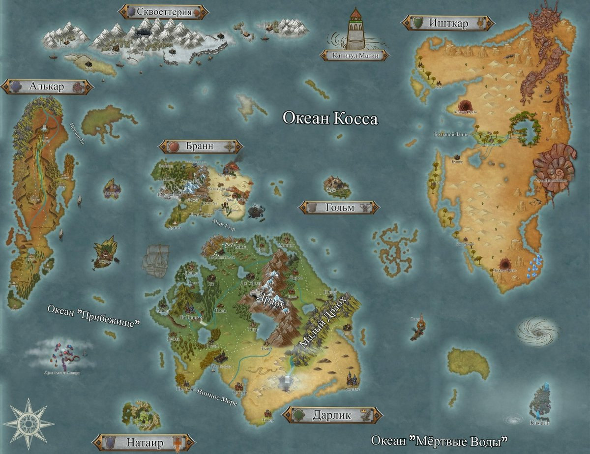

[Карта мира](karta.html)

## Бранн (основной игровой материк)

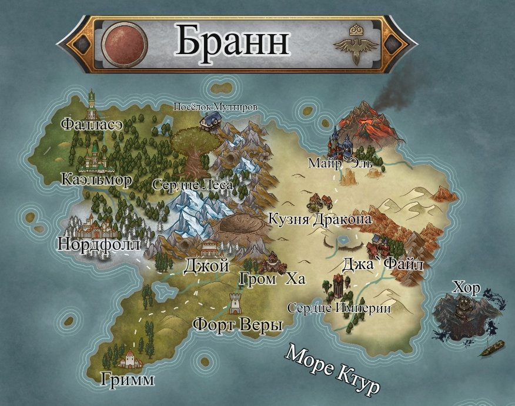

Бранн — небольшой материк, находящийся на перепутье морских путей Наира. Он делится между 3 основными государствами: Альянсом эльфов, людской империей Корвас и Великой Империей Ящеров. На долю этих земель выпало сразу несколько испытаний в виде постоянных войн и зарождения Скверны, заразы, что извращает всё живое. Бранн делится на 2 основных климатических зоны — запад, с умеренными условиями, и пустынный восток. Среди западных территорий можно выделить область Нордфолла — вечно холодные земли.

_Основные особенности:_

- На Бранне проживают в основном Эльфы Бранна, Граальды, Дриады и Ящеры. Остальные расы встречаются редко, но повсеместно.

- Основной игровой материк. Это означает, что весь основной сюжет и массив Лора связаны именно с Бранном.

## Дарлик

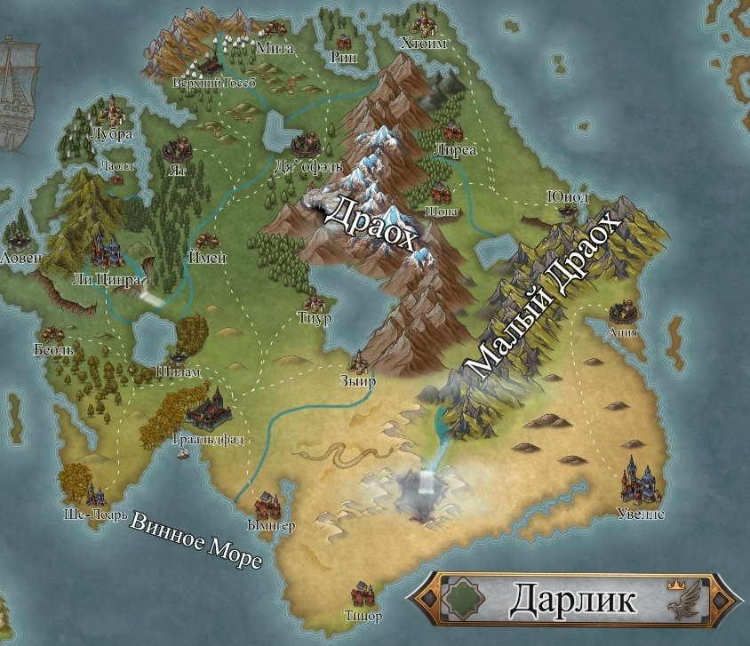

Дарлик — один из крупнейших материков Наира, расположенный на юге. Весь материк принадлежит Империи Граальдфад, которая сейчас активно воюет с эльфами Натаира. Климат материка разносторонен, выделяясь и пустынями на востоке, и субтропиками на юго-западе, и умеренными широтами на севере. Дарлик, объединённый под одним флагом, на деле весьма разнообразен своими обитателями: тут есть провинции эльфов, гномов и прочих рас. Из-за войны с Натаирцами Граальдфад почти потерял контроль над провинцией Ше-Лоарь.

## Натаир

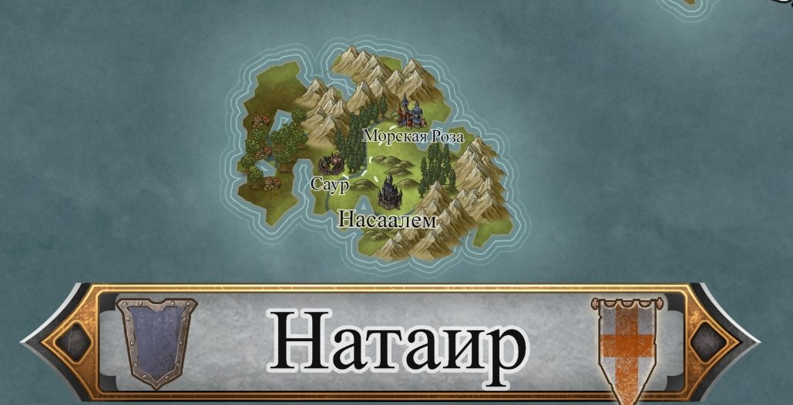

Натаир — крупный остров, полностью принадлежащий воинственному подвиду эльфов, Натаирцам. Весь остров находится в подобии субтропиков, которые по растительности, однако, ближе к умеренным широтам. Круглый год здесь тепло, однако места для расширения не так много из-за количества горных массивов. Также на западе болотистые местности, служащие дополнительным препятствием для расширения Натаирцев.

## Алькар

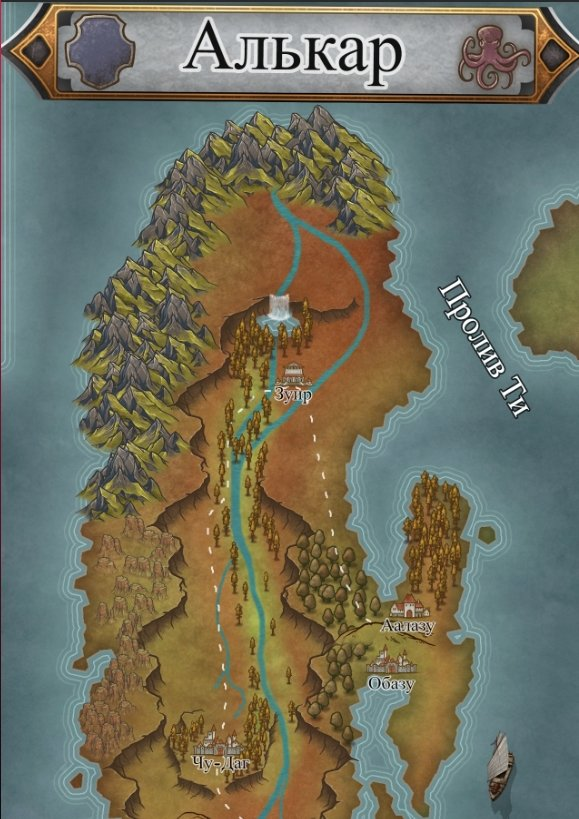

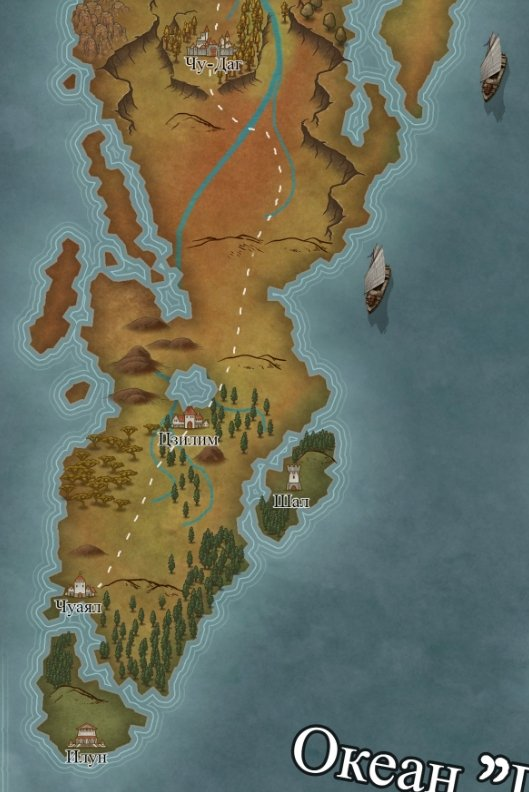

Алькар расположен на западе Наира, славясь в основном одноимённым государством Алькаром, что ведёт похожую с Граальдфадом политику, только остальные государства на территории материка в неком «принудительном» союзе с доминирующими алькарцами. В основном тут степи с редкими лесами, а также горные массивы с плоскогорьями.

## Гольм

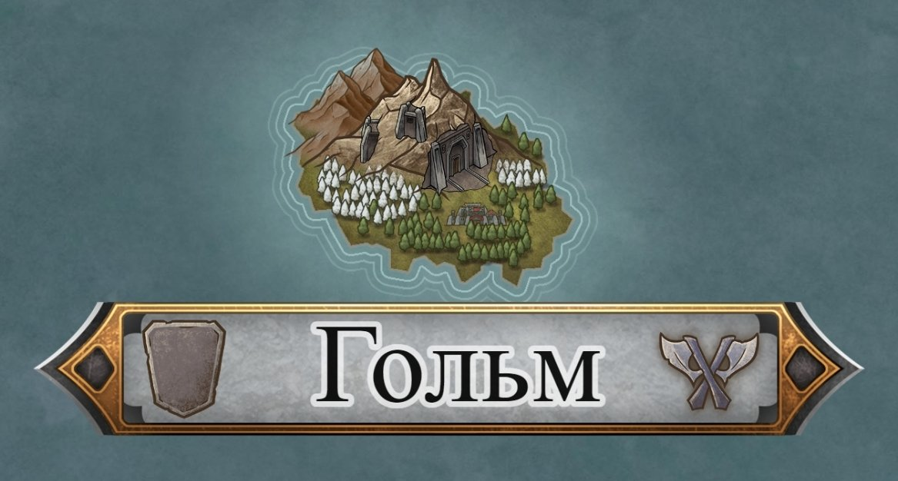

Большой остров, принадлежащий полностью гномам. Здесь суровые условия для проживания, однако гномы, уничтожив единственных своих соперников в виде дриад, превратили Гольм в личную крепость. В основном гномы проживают под толщей морозных гор. Гольм торгует множеством уникальных металлов и деревом.

## Сквоеттерия

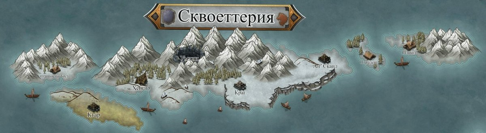

Сквоеттерия принадлежит Сквоелям, что выживают кланами в суровых морозных землях и существуют набегами и грабежами. Здешние земли скудны на земледелие, а редкие леса не могут полноценно снабжать людей продовольствием. Кланы живут каждый по своим законам и делят определённые земли, однако все они объединены в условную конфедерацию без единого лидера.

## Ишткар

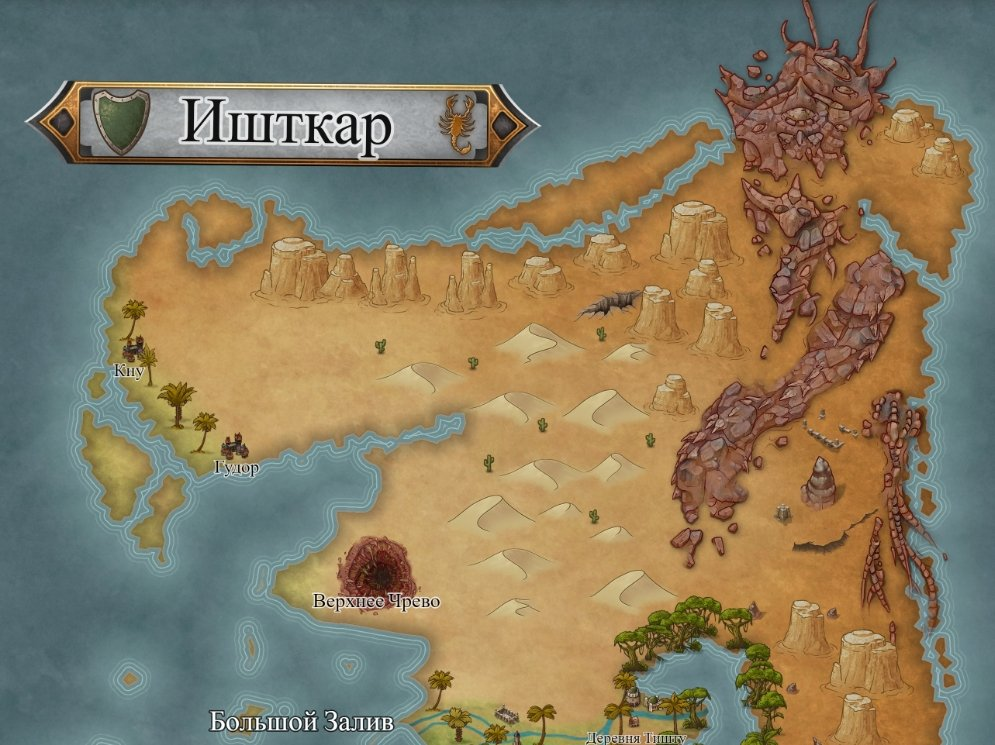

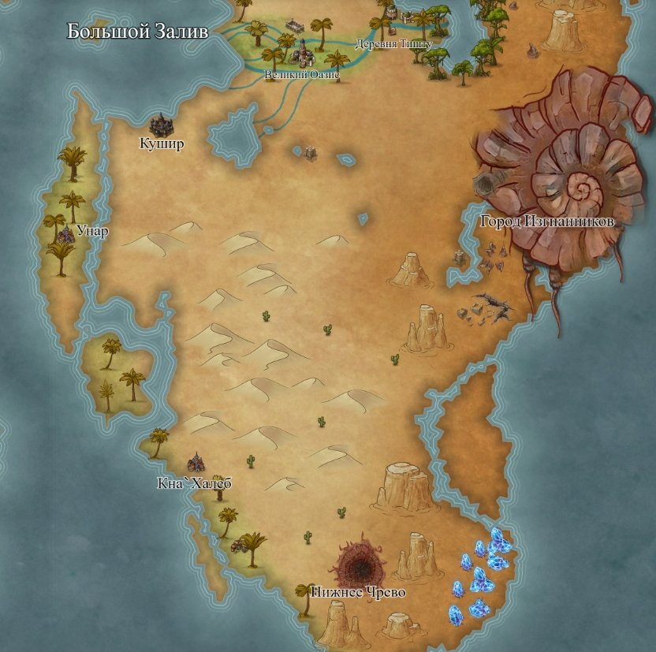

Пустынный материк, являющийся родиной для Торвеннов, многих Мултиров и ящеролюдей. Один из самых суровых краёв, где помимо природы опасность представляют чрева неизвестного происхождения, что заражают пески вокруг себя и порождают богомерзких существ. Сильных государств на Ишткаре совсем мало, и в основном тут живут различные племена.

## Архипелаги аанари

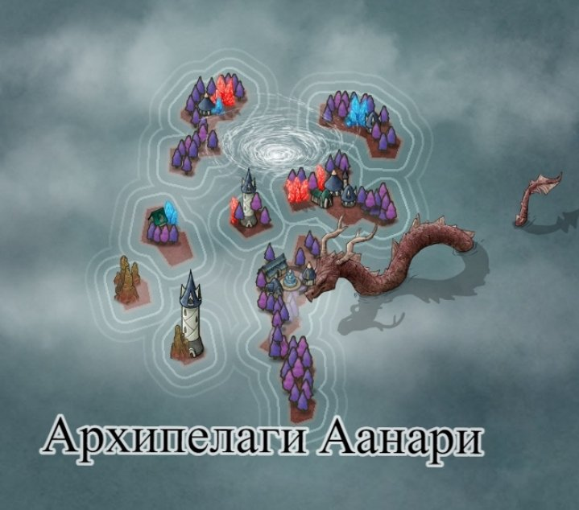

Скопление мелких островов, являющихся родиной для расы миролюбивых Аанари и разумных наг. Место это сильно пропитано магией, отчего уникально своей природой и климатическими условиями. Острова находятся в изоляции от остальных цивилизаций, не ведут ни с кем торговли или иных связей. В данный момент Аанари истребляются Натаирцами, что почти полностью захватили острова.

## Юфар

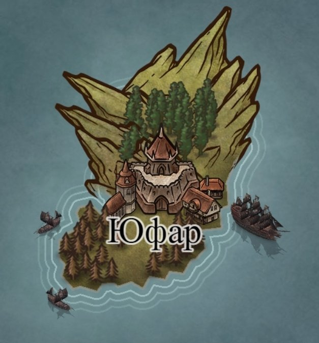

Пиратский город-государство, рай для беззакония и преступности. Один из самых опасных городов во всём Наире. Власть в Юфаре осуществляется по праву сильнейшего — кто добирается до рычагов влияния, тот и устанавливает законы. Зачастую же разные части города контролируются разными бандами, которые ведут склоки между собой. Несмотря на всё это является для остальных важным источником всевозможной информации, а сами банды — отличной наёмной силой в морях.

## Литанари

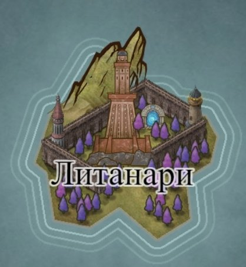

Один из двух магических институтов, которые находятся под прямым попечительством Капитула Магии. Сюда попадают самые талантливые ученики, однако Литанари из-за удалённости от Капитула и исторически в целом считается менее престижным местом из двух институтов.

## Йомен

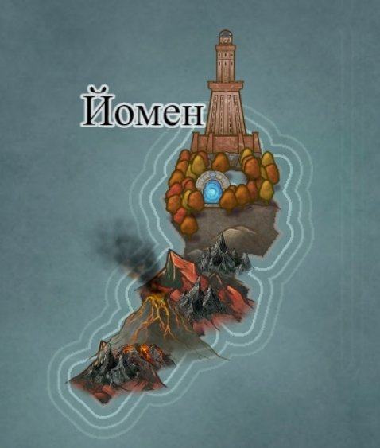

Престижнейший из всех магических институтов, куда попасть могут или самые богатые, или самые талантливые из детей. Обучение в Йомене по сути является проведением всего юношества и детства в стенах института, дабы мозг молодых дарований не имел возможности отвлекаться на что-либо иное, кроме обучения.

## Капитул магии

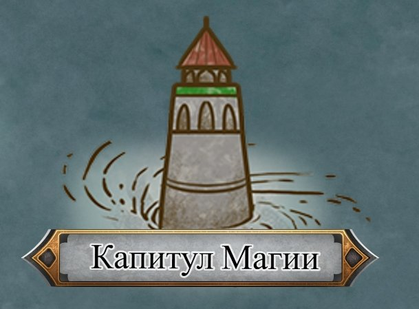

Тайное место пребывания, возможно, действительно сильнейших мира сего. Капитул Магии — это целый союз величайших из магов, которые следят за порядком в мире, когда это касается магии. А также озабочены сохранением последней. С виду обычная башня таит внутри множество секретов и новейших разработок мира магии.

## Камаль

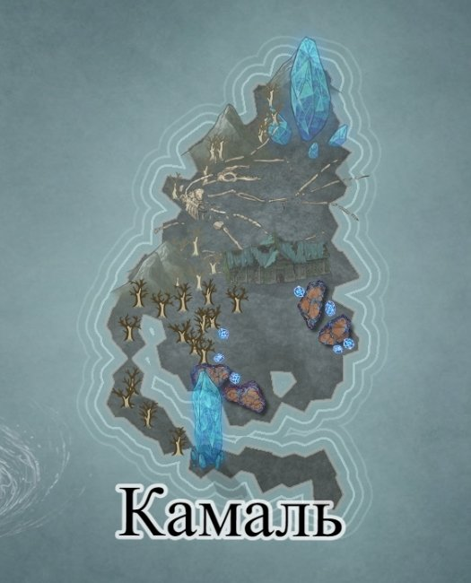

Грустное напоминание былого величия погибшего народа Камаль. Сейчас это мёртвые земли, пропитанные магией древнего ритуала, что погубил целый народ. Камаль был уничтожен тем, кто должен был его охранять. Говорят, что до сих пор совращённый силой маг ещё жив, однако попытки найти его не увенчались успехом даже у Капитула.
