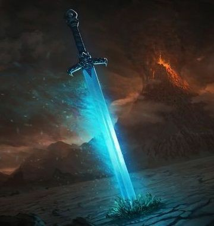
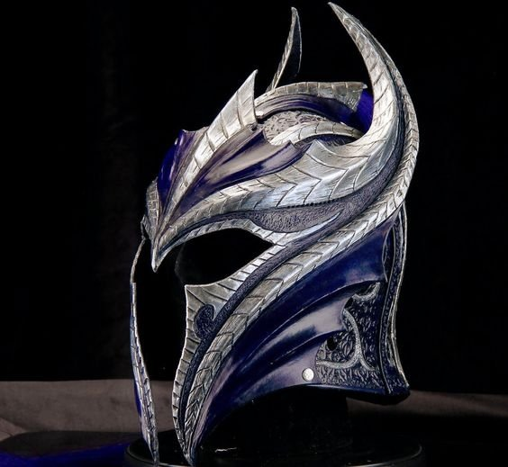
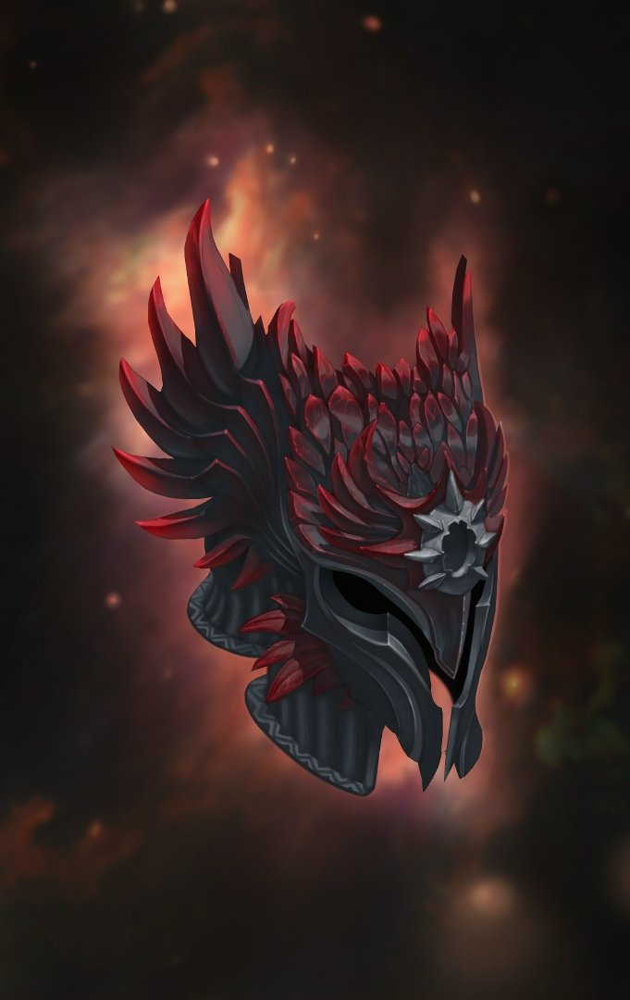
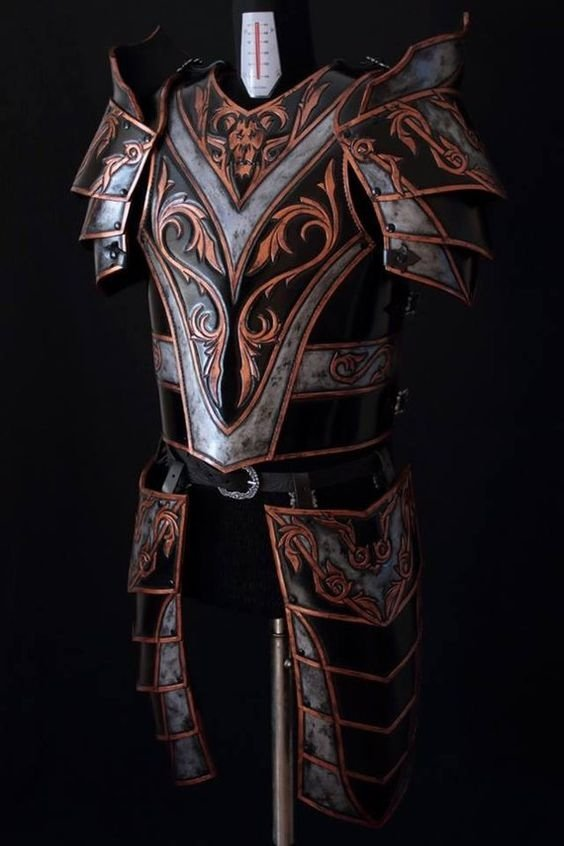
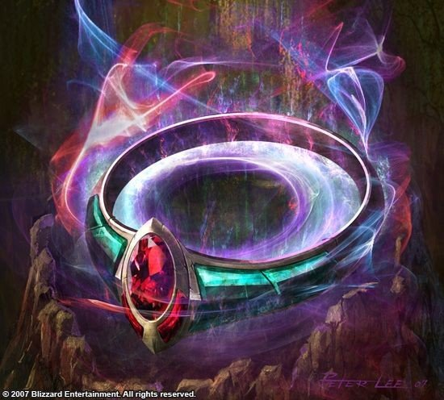
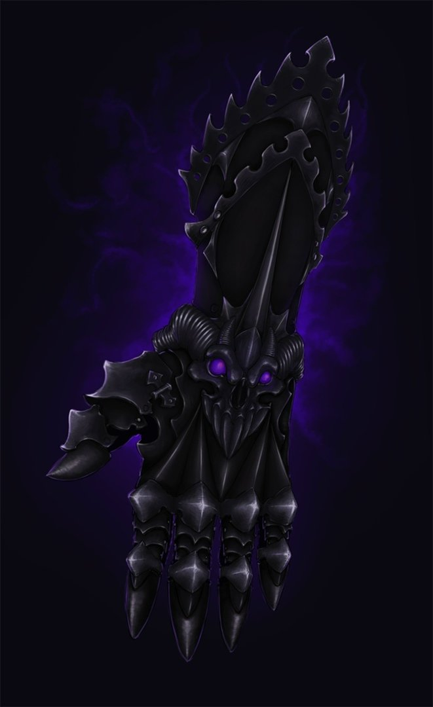
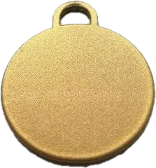
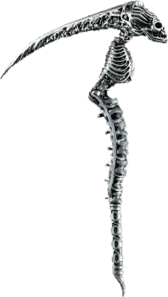
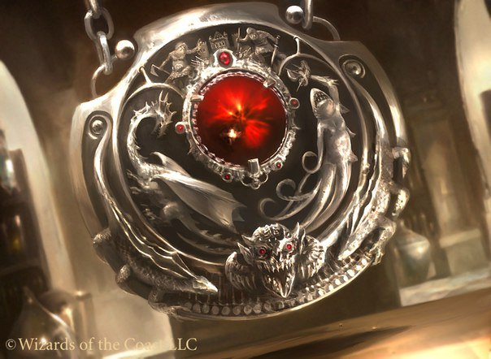

title: Артефакты
parent: lor
order: 70
icon: bi-gem
summary: Уникальные предметы и их владельцы
image: photo/menu/artefakty.jpg
art: photo/menu/artefakty.jpg
layout: artifacts
vk: 54761817

## Клинок Душ

**Владелец** — [Арайя Брей](https://vk.com/only_marmeladka)
Клинок душ имеет огромную историю и значимость для Империи людей. Этот меч переходит от императора к императору вот уже около века, ни разу не затупившись и не повредившись как-либо.
Он поглощает душу каждого убитого врага, при этом увеличивая запас маны владельца. Обладатель такого клинка может чуть ли не целый день пользоваться магией при хорошей жатве душ. Также клинок становится с каждой душой всё острее и прочнее. На данный момент не представляется возможным даже расплавить его магией.

## Шлем Душ

**Владелец:** — Награда за ивент
Шлем Душ — артефакт, раньше принадлежавший Империи людей, но после длительного хранения он попал в не самые лучшие руки — руки Евы Уйльес. Как можно судить по названию, он входит в комплект с таким артефактом, как клинок душ, и связан с ним. Он также увеличивает запас маны с каждой душой ещё больше, а также защищает от магии разума.

## Шлем роз

**Владелец** — Мориган Ла'Дайиль
Этот шлем хранился много лет в эльфийском храме посреди леса. Он наделяет владельца силой и повышает его магический потенциал. Однако храм был разрушен дриадой, которая обезумела и по сей день убивает эльфов и магией заманивает на свою сторону других дриад. Она сделала храм своим убежищем. Её имя — Мориган.
Этот артефакт чудным образом заживляет небольшие ранения, затягивая раны буквально на глазах за какие-то полчаса.

## Доспех розы

**Владелец:** Отсутствует. Охраняется боссом — Древний страж.
Древний доспех, входящий в комплект других артефактов "Розы". Говорят, если долго бродить по храмам в лесах эльфов, можно наткнуться на обитель древнего стража, который ещё до заковывания своей души в доспехи поклялся и после смерти охранять сокровищницу Розы. Доспех дарует способность "Шип". С ним владелец может управлять корнями ближайших растений, превращая их в острейшее оружие не хуже дротика, с интервалом между каждым шипом в минуту. Со шлемом роз он также усиливает регенерацию владельца.

## Кольцо жертвенника

**Владелец** — Неизвестен.
Это кольцо существует не один век, мастер кольца неизвестен, но, по легендам, он был безумцем, что был готов жертвовать жизненной силой или маной, лишь бы выиграть. По легендам, кольцо по сей день находится в какой-то пещере, охраняемой големом, в тело которого вселился дух мастера, что создал это кольцо. Жертвуя жизненными силами, владелец может наделять себя дополнительной маной.

## Перчатка жертвенника

**Владелец:** — Адам Грейс
Древняя перчатка уже не один год служит одному из высших вампиров — Адаму Грейсу. Заполучен был этот артефакт вампиром случайно — он убил одного путешественника, что, видно, купил эту вещицу у какого-то торговца. Вампир сразу почувствовал большую силу в этой вещице и присвоил её себе. Сама перчатка латная.
Если перчатка используется одновременно с кольцом, то даётся новая активная способность: перчатка может буквально вгрызаться в руку, высасывая кровь, взамен владелец сбрасывает перезарядку всех способностей.

## Посох некроманта

**Владелец:** — Сайлиенн Лирг
Посох одного из сильных некромантов, объединивший в себе свойства магии, которым владеет сам Лирг. Череп неизвестного охватывают ветви рукоятки, будто костлявая рука. Также посох излучает мягкое красное свечение, что позволяет передвигаться в темноте. Раз в минуту позволяет призвать скелет человека или иной расы. Помимо прочего, скелет владеет оружием, напоминающим клинок, по свойствам — эбонитовым. Клинок пропадает после смерти скелета. Скелеты достаточно хрупки. Живёт скелет 15 минут.
При условии, что последние 3 минуты не призывались скелеты, способен выстреливать огненным шаром 20см в диаметре, который обжигает незащищённые участки тела или нагревает металл. Выстреливает с периодичностью в 30 секунд.

## Медальон

**Владелец:** Награда за квест
Простой золотой медальон округлой формы, на котором остались кусочки грязи. На одной из сторон угловатым почерком выгравированы символы: "ДЖ. К.". Также от него исходит манящий запах, чем-то напоминающий церковные благовония. Способности магии тьмы с ним не имеют перезарядки, однако маны хватает ровно на 10 способностей, после чего владелец может полагаться лишь на своё оружие.

## Коса Стража глубин

**Владелец:** — Страж глубин
Коса из уникального материала, подстраивающегося под хозяина и имеющего характеристики стального оружия. Уникальность обусловлена тем, что один хозяин один раз способен под себя изменить размер и массу косы, у действующего владельца, к слову, коса крайне тяжела. Также оружие никак не может быть вырвано или убрано из рук хозяина.
Эта коса игнорирует броню/магические щиты, прогрызая их, как бумагу. Однако другие артефакты ей не по зубам, как и особо сильные заклинания и редкие металлы, обладающие уникальными свойствами.

## Сердце Империи

**Владелец:** — Ева Уйльес
Сердце Империи — ещё один артефакт, принадлежавший лишь империи и повторивший судьбу Шлема Душ. Но в отличие от шлема, амулет Ева Уйльес носит на себе.
Этот амулет служит магическим барьером, что способен в бою защитить владельца от первых 2-х заклинаний.

