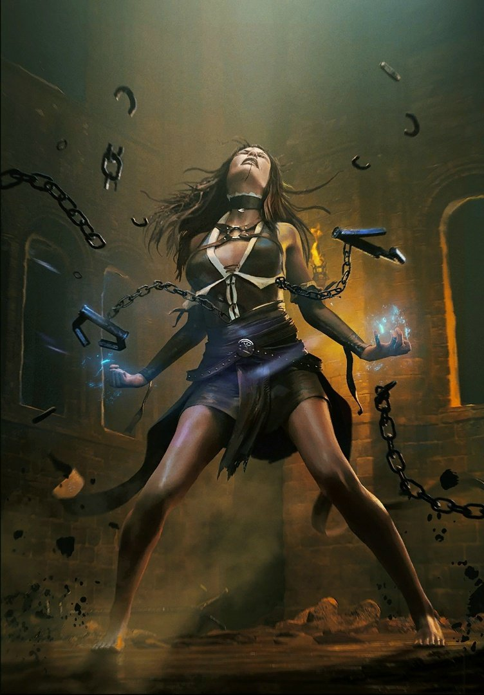
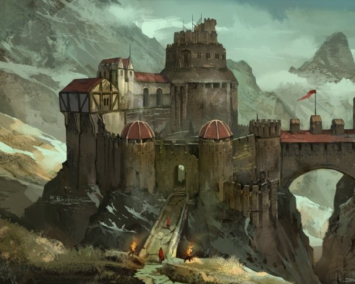

title: Аол
parent: gildii
order: 50
icon: bi-shield
image: photo/vk/533473434_457251372.jpg
vk: 54761801
art: photo/gildii-web/aol.webp
layout: guild
leader: dunkan-svetonosnyy
aliases: krug-magov

## Общее описание

Организация, занимающаяся отловом "грязных" магов. Под это определение подходят маги хаоса, тьмы, крови, смерти. Отбор в ряды Аола проходит путём добровольного вступления, а также вербовкой из армии Корваса. Также Аол в основном и устраивает облавы на культистов в Корвасе.

## История

Основоположники Аола прибыли на Бранн вместе с первыми людьми и представляли из себя священников и охотников, которые до этого также занимались поимкой грязных магов. Люди всегда боялись тёмной магии, и всегда были те, кто занимался их защитой от этого. В Громуле при поддержке властей был для таких же целей создан Аол, первыми участниками которого и стали те самые священники и охотники. После становления Корваса Аол всё так же остался, но теперь его стали несколько ограничивать в его своевольности, особенно заметно урезать возможности Аола стала пытаться императрица Арайя.

## Устройство, цели, влияние

Аол состоит из нескольких штаб-квартир, раскинувшихся по всей территории Корваса. Всего их насчитывается три.
Одна штаб-квартира находится в горах южнее Нордфолла, из-за чего попасть туда крайне тяжело. Ещё одна на южных островах Корваса. Третья же штаб-квартира находится в Нордфолле. Когда грязного мага поймали, его отводят в одну из штаб-квартир. Целью же этого является запечатывание сил данных магов. Способны на это лишь архимаги или тройка весьма сильных магов, а способы, которые они используют, мало кому известны. Аолу такие знания передали архимаги, которые научили магов Аола блокировать силы грязных магов. Известно, что такое блокирование не проходит бесследно. Некоторые остаются в здравом уме, а некоторые могут потерять эмоции, память, а порой вовсе выглядят как безвольные куклы. Говорят, что зависит это от того, сколь силён был сам маг, и какой способ запечатывания применяли на нём. Как раз безвольными куклами становятся наиболее сильные маги, личность которых просто выжгли. Такие не способны на что-либо, кроме как выполнять приказы.

Всех магов, которые прошли запечатывание сил, отправляют работать на благо Корваса. Часто они участвуют в стройках больших объектов, вспахивании полей и прочей чёрной работе. Часть магов остаётся в штаб-квартирах для их поддержания. На запечатанных магах там держится всё — от чистоты, до готовки. Пребывание в штаб-квартирах не самое приятное. За заключёнными постоянно ведётся надзор, проверяются личные вещи. Осмотр могут провести в любой момент, а об уединении можно забыть. Проживать приходится в общих бараках, под которые выделяются отдельные этажи штаб-квартир.

Теперь поговорим об устройстве самого Аола. Его основой являются охотники. Они патрулируют крупные города империи, являются основной силой Аола, а также участвуют в облавах на культистов. У каждого охотника есть специальный медальон, который подсказывает владельцу наличие рядом грязных магов.

Наставники выполняют различные задачи. Часть из них занимается подготовкой охотников в штаб-квартирах. Тренировки затрагивают и физическую подготовку, и основные принципы в охоте на грязных магов. Другая же часть наставников возглавляет патрулирующие отряды в городах, а также группы, которые занимаются поимкой культистов и организацией облав. У каждого, кто не занят делами в штаб-квартирах, имеются кандалы с примесями адамантита, способного блокировать магию. Особо грамотные наставники занимаются экономическими делами в штаб-квартирах.

В самих штаб-квартирах есть надзиратели. Им приходится следить за магами, что там проживают. Они должны производить повсеместные осмотры и обыски, пресекать большие скопления магов в какие-либо группы, дабы подавлять возможные планы по мятежам. Они же занимаются и защитой штаб-квартир изнутри и снаружи.

В каждой штаб-квартире также есть командир. Это руководитель всего и вся. Он принимает новых участников в ряды охотников и надзирателей, а также имеет право полного уничтожения всех магов, что находятся внутри штаб-квартиры, если что-то пойдёт не так, а такая угроза существует над каждым зданием Аола.

Особые роли есть даже и у самих заключённых магов. Их коротко называют старшими. Это звено между властью в Аоле и самими магами. В каждой штаб-квартире их как правило 3-4 штуки. Они организовывают самих магов, кто чем должен заниматься, а также информируют о чём-либо необходимом, что доносит Аол. Также старшие отбирают магов для полевых работ вроде строительства или работы в полях, и составленные списки передают командирам штаб-квартир.

Глава же всего Аола — гранд-коммандор. По сути человек, имеющий в Аоле полную власть и способный менять организацию как ему угодно. Наиболее близок с властью Корваса. На данный момент гранд-коммандором является Дункан Светоносный.

