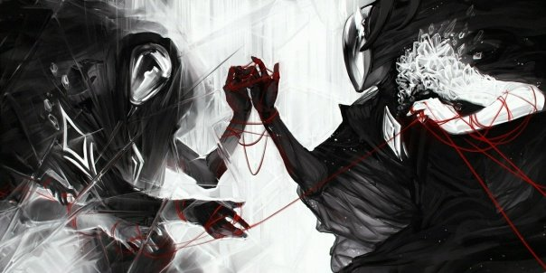
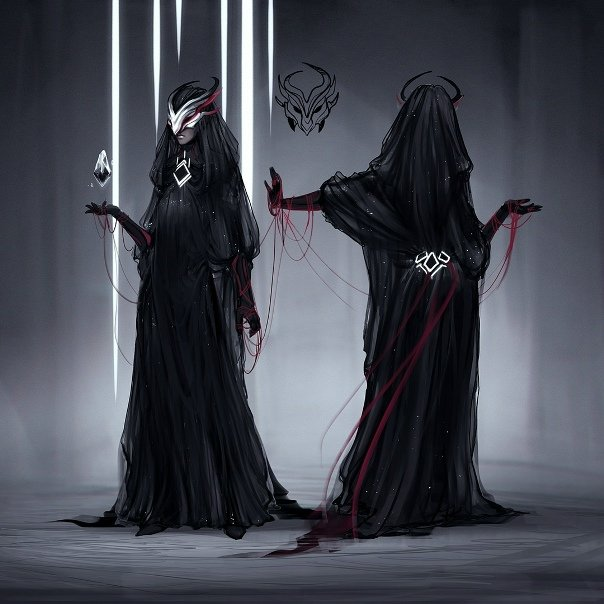
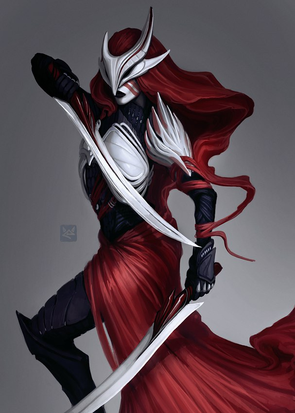
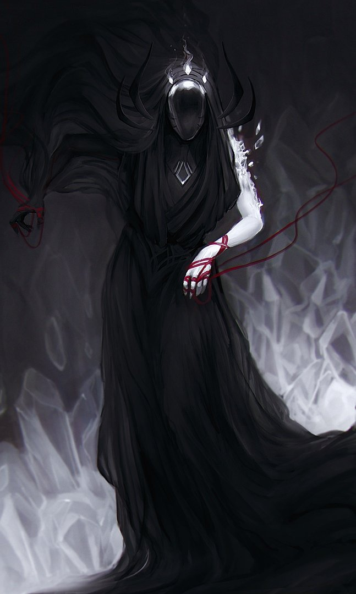
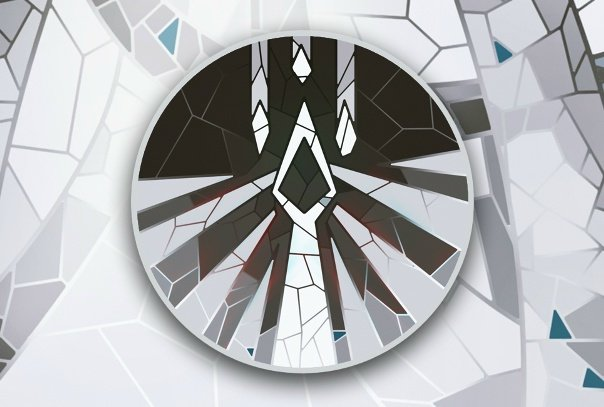
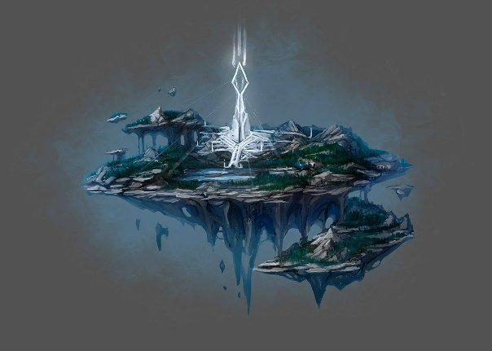
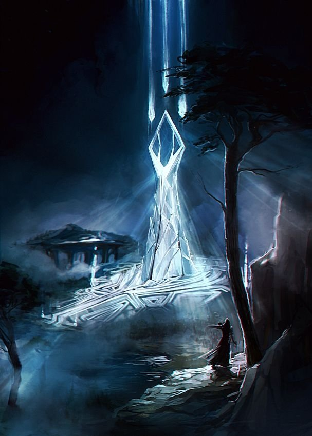

title: Белые последователи Малайи
parent: gildii
order: 10
icon: bi-shield
image: photo/vk/533473434_457251368.jpg
vk: 54761767
art: photo/gildii-web/belye-posledovateley-malayi.webp
layout: guild
leader: handa

## Общее описание

Одна из самых влиятельных гильдий на территории Бранна, прославленная своим идеальным исполнением заказов, связанных с убийствами. Они не берут заказ, если не считают жертву в чём-то грязной, отчасти преступной. Как уже понятно, связано это с их верой в богиню Малайю, вокруг которой и образована гильдия. Вступить в их ряды могут лишь женщины, не запятнавшие свою душу, или желающие её очистить. Каких-либо других критериев отбора неизвестно. Внутренняя кухня этой организации покрыта тайнами, однако по имеющейся информации всё равно можно составить общее представление о гильдии.

## История

До прихода Эрийния, что объявил Громул самостоятельным государством, после переименовав его, последователи Малайи были не более чем кучкой наёмниц, отличающихся принципами, связанными с верой. Но главное, чем они отличались — они были качественными наёмниками, ни разу за свою деятельность не провалив заказ. Известно, что Эрийний и воспользовался услугами этих наёмниц для захвата действующего в Громуле совета. Цена за помощь в захвате власти была высока, что неудивительно. Вместо отряда наёмницам нужна была гильдия, в которой они смогут передать свои цели и идеи дальше. Полное финансирование создания такой гильдии и было платой. Очень скоро появился знаменитый парящий островок рядом с Джоем, на котором располагалась башня, являющаяся одновременно резиденцией гильдии. На волне активного обсуждения того, что создатели гильдии успешно поспособствовали перевороту власти, к ним и пошли первые заказы. После этого же начались первые наборы в гильдию, которые состояли в большинстве своём из добровольцев, как и по сей день. До сих пор выявить, в каких делах участвовали последователи Малайи после всего этого, почти невозможно. Полное скрытие своей причастности и заказчика было и есть одной из основ выполнения заказов, очень привлекательной для многих.

## Устройство, цели, влияние

Как уже было сказано, гильдия состоит полностью из женщин. Все участницы делятся на определённые роли в зависимости от своих умений, последовательно приобретая всё большее влияние в гильдии за активное участие в её жизни и преданность. Пиком такого влияния является статус Экзарха, верхушки гильдии. На данный момент экзархов в гильдии четверо. Принимая такой статус, экзархи принимают и окончательную связь с гильдией до конца жизни. Если остальные участницы могут спокойно её покинуть, хоть и есть ряд нюансов и в этом, то для экзарха это уже невозможно. Он приносит ряд клятв, принимает свод определённых правил. Даже проживают они на территории резиденции гильдии, почти не появляясь на улицах города. Лица их постоянно сокрыты масками, занимающими верхнюю часть головы. Появляются они также в своих чёрных одеяниях, скрывающих почти всё тело.

Экзархи делят между собой сферы влияния в гильдии. Кто-то отвечает за оружие гильдии — убийц, и за их работу. Кто-то за послушниц, и так далее. В основном это зависит от того, в роли кого отличился сам экзарх, ведь понимать суть другой роли и управлять теми, кто на себя ту роль взял, может лишь тот, кто и раньше был таким. Помимо этого они определяют, будет ли приниматься заказ, и устанавливают за него цену.

Но для выполнения заказов должны быть те, кто это сможет сделать. Основа, проще говоря. У последователей Малайи она представлена своими Клинками. Девушки с хорошей физической подготовкой, которые при необходимости доучиваются чему-то необходимому у Клинков старше. Более старшие Клинки также являются главами групп, если таковые требуются для заданий. Ещё более старшие Клинки занимаются сугубо тренировками, управлением и распределением по заданиям других клинков. По своим одеяниям меж собой все эти Клинки не отличаются. Это хорошая броня чёрных и белых тонов, дополняемая красным одеянием, неизменна и маска. Различить, кто из Клинков старший, можно по красным полосам на лице. 1 полоса присуща рядовым, 2 — более старшим и 3 — максимально старшим Клинкам. Также они имеют магические знаки на запястьях, по которым читается их ранг. Если они покидают ряды гильдии, знак удаляется магами гильдии.

Духовную часть гильдии занимают послушницы. Те, кто не владеет искусством клинка, владеют магией. Чаще они занимаются охраной самой башни, поддерживают работоспособность её отдельных частей, например, ромбовидного кристалла на самой её выси, что изредка озаряет уголки города вспышками. Говорят, что это доселе не достигнутый кем-либо постоянный камень телепортации, поддерживаемый молитвами и магией. Такая функция этого кристалла во многом объясняет очень быстрое исполнение заказов. Предполагается, что у последовательниц есть быстрый доступ к основным крупным городам и значимым местам по всему Бранну. В составе групп на заданиях послушницы — ещё более редкое явление. Обычно их наличие означает лишь повышенную сложность задания, которая требует наличия именно специализированного мага. Внешне они всегда предстают в чёрных одеяниях, сравнимых с одеждами Экзархов, и сплошных масках, скрывающих всё лицо.

И всё же выше всех стоит глава гильдии. На данный момент это Ханда. Лидер контролирует Экзархов, ведёт дела уже более высокие, граничащие с политикой. Преемника выбирают себе сами, в основном это также кто-то из Экзархов.

Можно заметить, что у всех активно встречается главная символика гильдии даже в одеждах — белый ромб, что изображён в том числе и на главном символе гильдии. Он олицетворяет саму их башню. Такой знак активно встречается и внутри резиденции, наравне с фресками Малайи. Основные цвета гильдии: белый, чёрный и красный. Они встречаются везде. А послушницы и клинки всегда покрывают открытые участки тела белой краской, за что их и называют, собственно, белыми последователями.

Оплот последовательниц, как говорилось, находится в Джое, на целом отдельном парящем острове. Это целый комплекс зданий, посреди которых возвышается большая башня с кристаллом на своей вершине. Среди всех зданий, окружающих башню, есть и места для проживания всех участников, если у них нет домов в самом Джое, и здания чисто для переговоров. Там обсуждаются заказы, и только туда пускается кто-то извне. Поэтому эти здания и находятся на самом краю островка, встречая всех сразу после подъёма по лестнице. Она, к слову, начинается в горах рядом с Джоем. Город даже задевает и сами горы, например, замком. Следят за всем вроде внешнего порядка, поставки продовольствия и прочего также отдельные участники гильдии.

Что же касается влияния гильдии, то тут и говорить почти нечего. Это самая проверенная и надёжная по своим услугам гильдия, по крайней мере, на территории Корваса. Люди и обращаются к ним чаще всего. Заказы у них крайне дорогие, цена выше, чем в любой другой гильдии. Зато взамен быстрота, анонимность и отсутствие своих следов. Помимо убийств, они могут осуществлять и скрытую охрану, и шпионаж, и многое другое. Главное же, чтобы заказ подходил под их нормы. Они не будут убивать ни в чём не повинного, но разделение людей по этим категориям — отдельная сложная тема.

