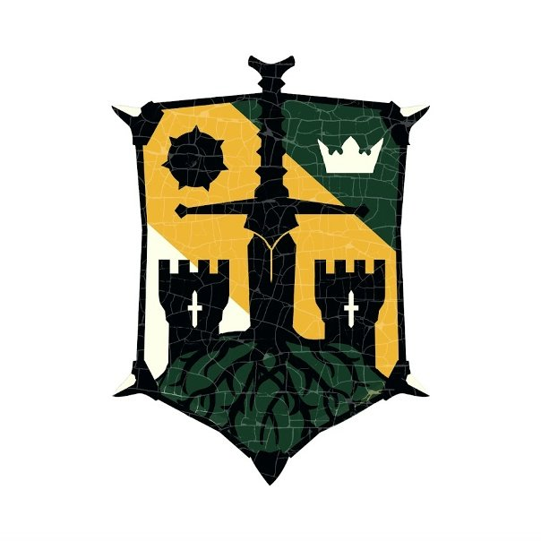
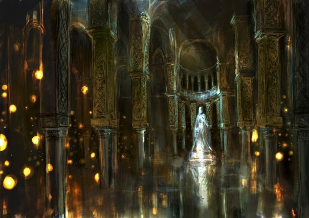

title: Орден Веры
parent: gildii
order: 20
icon: bi-shield
image: photo/vk/533473434_457251369.jpg
vk: 54761782
art: photo/gildii-web/orden-very.webp
layout: guild
leader: borkanog

## Общее описание

Самые необычные, самые верные, самые древние. Этими тремя определениями можно описать всех участников данного ордена. Входят сюда лишь представители насекомоподобных, да и в выделенных им землях вокруг форта Веры живут в основном лишь их семьи. Отличается орден своей набожностью, в частности богам Итишии и Палотариосу. Так, форт Веры основан был вокруг храма Итишии, являющегося его сердцем.

## История

Ящеры были не единственными, кого люди встретили при заселении Бранна первыми. На юге, возле одной из рек жило скопление самых разных насекомоподобных. В отличие от ящеров они сразу же решили, что влиться к людям было бы выгодно для них. Главой этой общины был Борканог, который и ныне является главой Ордена Веры. Общине было выгодно влиться в страну людей, ведь те обещали помочь им отстроить собственное поселение. Людям же были выгодны сами насекомоподобные. Создания мощнее людей, способные к более разнообразным задачам. С того момента община сначала присягнула Громулу, а после уже и Корвасу.

## Устройство, цели, влияние

Орден Веры — военизированная часть до сих пор существующей в Форте Веры общины насекомоподобных. Можно сказать, что орден также и представляет власть в этом обществе. До сих пор главой его является Борканог, отвечающий за принятие основных решений в ордене. Помимо него власть в обществе имеют управленцы — лидеры отдельных частей ордена, которые также помогают решать различные вопросы в обществе. Орден веры связан с Корвасом обязательством отвечать на всевозможные запросы Императора, взамен на существование и помощь в развитии с обратной стороны. Орден помимо задач, которые порой перед ним ставят, также занимается охраной восточных границ государства, которые пересекаются с Великой Империей.

Орден делится на различные части, способные выполнять различные задачи. Основная часть — рядовые участники ордена. Наиболее сильные и склонные к военному ремеслу насекомоподобные, которые добровольно идут в орден. На них лежат базовые задачи в Форте — охрана границ, а также по возможности уничтожение различных появляющихся банд или хищников, которые представляют опасность на дорогах. В случае войны эта основная часть может мобилизоваться в Имперскую армию согласно договору с Корвасом.

Отдельную часть ордена составляют насекомоподобные, которые способны от природы летать. Это мобильные части, которые быстро могут оказаться там, где нужно. Они часто являются участниками облав на культистов, быстро настигая их временные убежища, дабы те не успели уйти. Также они могут совершать быстрые диверсии.

Символом ордена является изображение меча, воткнутого в землю и закреплённого в ней корнями. Также по обе стороны изображены две башни и корона в углу. Всё это значит, что орден навсегда укоренится в Империи и будет являться её оружием.

