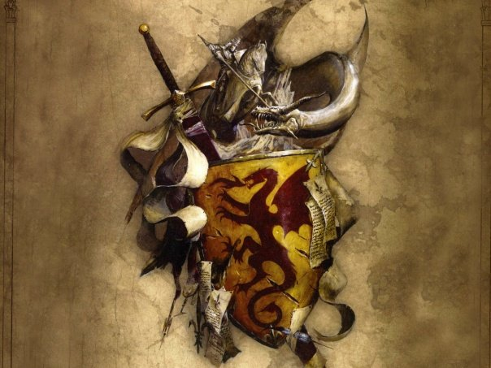
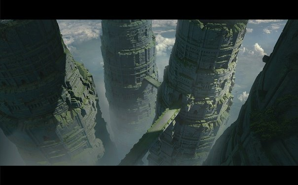
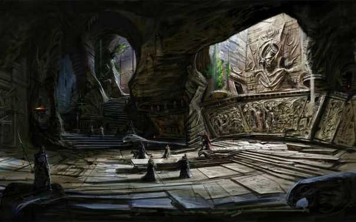

title: Орден золотого дракона
parent: gildii
order: 30
icon: bi-shield
image: photo/vk/533473434_457251370.jpg
vk: 54761793
art: photo/gildii-web/orden-zolotogo-drakona.webp
layout: guild
leader: nibb

## Общее описание

Этот орден является продолжением почти утерянной культуры камальцев. История создания этого ордена уходит в годы, когда до падения Громула было еще очень далеко. Камальцы также внесли свой небольшой вклад в культуру континента. Доспехи, оружие, храмы, догматы и уникальный стиль боя, коим может овладеть лишь член Ордена золотого дракона, ибо истинные сведения хранятся в их библиотеках.

## История

За полвека до падения Громула на востоке высадился флот неизвестного государства. Поначалу их экспансии никто не препятствовал, но, добравшись до Джа‘Файла, иноземцы столкнулись с ожесточенным сопротивлением, которое, впрочем, не доставило вторгшимся войскам хлопот из-за эффекта неожиданности. Возглавляли вторжение Сорак и Чорак Шин. Они говорили, что знают о пророчестве, которое знаменует гибель всего их народа камальцев и затопление острова, где они проживают. Причиной этого должен был стать один из магов крови, который входит в круг старейших острова, которые всем руководили. Один из старейшин выбирался хранителем, который во время специального ритуала связывал с помощью магии крови свою душу с жизнями всех жителей. Это давало просто огромную силу, и пророчество говорило, что последний из хранителей не сможет удержаться от такого соблазна и уничтожит собственный народ в обмен на силу. Братья хотели сохранить свою нацию и покинули остров с огромной частью армии в надежде отвоевать себе новые земли. Планам было не суждено исполниться, ведь Империя людей была ведущим государством и захватить их город было плохой идеей. На пятый день, проходя горы близ осажденного Джа‘Файла, захватчики внезапно были атакованы войсками тогдашнего Императора и были разбиты из-за элемента неожиданности, коим воспользовались имперские войска. Хронология дальнейших событий утеряна, но сохранился старый императорский указ о создании ордена золотого дракона, что был сформирован из уцелевших камальцев и представителей других рас. Что стало после этого с островом, неизвестно, вероятнее всего, пророчеству было суждено сбыться. Их задачей была охрана императора и его рода.
Долго камальцы служили императору и его потомкам, даже когда в живых оставались лишь братья Сорак и Чорак Шин, ставшие учителями новых поколений ордена. Но вскоре и те умерли от старости. После падения Громула орден продолжал свою деятельность, но их задачи были дополнены шпионажем. Но с приходом к власти Урия Брея, второго императора из династии Брей, дела ордена стремительно пошли на спад. Император отстранил членов ордена от обязанности защищать правителей и шпионить, а также изгнал орден из состава Империи.

С приходом к власти Арайи Брей Орден вернули в состав Империи, но к охране императоров более не допускали — этим уже занималась другая организация. Таким образом, в задачи ордена отныне входит лишь шпионаж и редкая поддержка войск Империи. Штаб-квартира ордена находится в храме золотого дракона. Храм находится в горах, чуть восточнее города Джой, столицы Империи. В нём также проживает Великий Мастер, глава рыцарей золотого дракона. Храм находится высоко в горах, из-за чего неподготовленный человек с малой вероятностью доберется до Храма. Но рыцари знают секретный проход, представляющий собой отлично замаскированную лестницу из каменных ступеней.

В Ордене золотого дракона царит порядок и дисциплина, за что стоит благодарить пять заповедей Сорака Шина.

- I — храни верность Ордену с момента вступления и до самой смерти.
- II — храни верность Империи и ее Императору.
- III — Не очерняй честь Ордена и своих братьев по оружию.
- IV — Не подставляй своих братьев: трижды подумай, прежде чем сделать что-либо.
- V — Соблюдай все эти догматы, ибо веками им подчинялись рыцари Ордена, и ты не исключение.

Каждый член ордена носит доспехи, создающиеся по старинным камальским традициям и вооружён камальским оружием. Комплект снаряжения каждого рыцаря представляет собой набор доспехов и оружие:

- Камальский шлем с изображённым на нём золотым драконом.
- Камальская пластинчатая кираса с защитой суставов, наплечниками и высоким, шитым золотом воротником.
- Камальские перчатки.
- Камальские поножи с защитой суставов и бедер.
- Камальские сапоги.

Оружие может быть разным. Зависит от стиля боя рыцаря:

- Камальская катана, гарда которой выполнена в виде золотой змеи, обвивающей рукоять клинка.
- Полуторный клинок, являющийся по большей части основным вооружением у ордена. Использование его практикуется у ордена без щитов. Рукоять также выполнена с украшениями в форме дракона.
- Танто. Личное оружие старших рыцарей Ордена или отличившихся в своей службе обычных рыцарей.

Стоит сказать, что шпионы в других государствах не носят с собой ни доспехов, ни оружия ордена золотого дракона. Сделано это для того, чтобы они не выбивались из общей массы.

Кандидатами в орден могут стать лишь солдаты имперской армии, но чаще всего старшие рыцари лично выбирают кандидатов. Кандидаты — это, по сути своей, новички, которые лишь проходят тренировки и выучивают догматы ордена. Они не несут какой-либо особенной функции. Пребывание же кандидатом в основном недолгое.
После достаточного обучения кандидат становится уже рыцарем — основной единицей ордена. Рыцари участвуют во всех основных делах ордена, главное из которых — шпионаж. Ещё будучи кандидатом, участник ордена учится правильно сливаться с толпой и выуживать информацию из окружения. Во время войны же рыцари также могут вступить в ряды армии Империи.

Наиболее проявившие себя рыцари становятся старшими рыцарями. Старшие занимаются тренировками кандидатов, являются главенствующими в отдельных отрядах рыцарей. Также именно старшим рыцарям доверяют особые миссии по шпионажу ввиду их большей опытности. После же, достойно проявив себя, старшие рыцари могут стать капитанами. На данный момент в ордене лишь три капитана. Они уже также отбирают людей в кандидаты, занимаются их проверкой. При необходимости они заменяют мастеров ордена.
Мастера занимаются уже организационными вопросами в ордене. На их плечах лежит забота обо всём, что связано с экономикой ордена, поставками вооружения и установлением связей. Также через них проходят все задачи, которые поставляет Император.

Главой же ордена является гранд-мастер. Как правило, это человек, уже затронутый старостью. Основные функции в ордене он не выполняет по причине почтенного возраста. Он наставляет мастеров, а также отвечает за духовную жизнь ордена. К слову, самый почитаемый бог ордена — Палотариос. Действующий гранд-мастер ордена — Нибб.

Символом Ордена золотого дракона является дракон, что неудивительно. Смысл этого символа уходит в Камаль, где, судя по легендам, был дракон, которого истребили воины, вторгшиеся на континент во времена до падения Громула. Но сейчас уже не узнать, правда это или нет, ибо, скорее всего, остров канул в небытие, как и народ, населяющий его.

