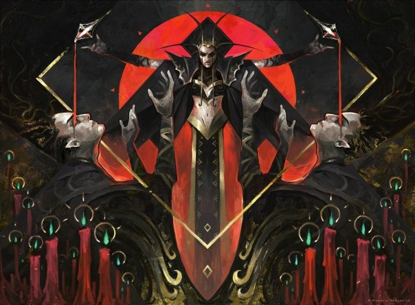
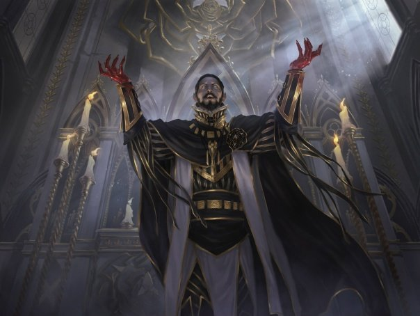
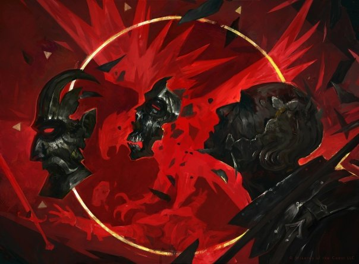

title: Паства Кхелы
parent: gildii
order: 70
icon: bi-shield
image: photo/vk/533473434_457251374.jpg
vk: 55305476
art: photo/gildii-web/pastva.webp
layout: guild

## Общее описание

Паства — обобщённое название скоплений всевозможных культов и обществ, которые поклоняются Кхеле. В отличие от послушников, которые спокойно возносят молитвы своей богине в крупных городах, Паства делает это кровавыми и аморальными методами. Есть теории, говорящие о том, что в Пастве есть главенствующий культ, который и направляет более мелкие, а также ассимилирует их со своим. Во всех государствах участники культов вне закона, а на убежища культистов и их самих совершаются облавы.

## История

С самого появления образа Кхелы в головах её последователей уже были те, кто превозносил богиню крови этой же кровью. Появлялись мелкие культы, целые деревеньки, что оказывались на отшибе цивилизации, возносящие Кхелу и задабривающие её ритуальными жертвами. Уже позже возникали целые организации, что также напоминали культы, разве что с более чёткой иерархией, а также способные направлять большие массы последователей. Такие крупные культы и стали главенствующими в Пастве. Паства же — образное обозначение принадлежности к определённому течению почитателей Кхелы. Даже одиночка, никогда не участвовавший в каких-либо культах, может называть себя частью Паствы. Самый крупный культ, о котором знают остальные, находится на южных материках вне Бранна. Это одна из зараз Граальдфада, с которой ему приходится бороться. Культисты Граальдфада пустили свои корни даже далеко за моря и являются наиболее значимыми в Пастве.

## Устройство, цели, влияние

Единого устройства у Паствы, как понятно, нету. Она представляет собой большое сообщество культистов, часто действующих разрозненно. Большую их часть берут под крыло более крупные культы, вроде тех же культистов Граальдфада. Какая-либо иерархия и правила присущи также лишь крупным культам. Паства стремится обратить взгляд своей богини на своих последователей, участники паствы часто повёрнуты лишь на одной богине — Кхеле, и стремятся сделать её имя ведущим по всему Наиру. Один из основных способов взывания к богине — ритуалы жертвоприношения. Какой должна быть сама жертва и как её следует преподнести богине, разнится от культа к культу. Крупные собрания культистов иногда даже вырезали целые деревни, если могли себе это позволить. В такой резне не щадили никого, будь перед ними младенец или старик.

Существование культистов вынуждает государства тратить на них часть своих военных сил, ведь бесследными их выходки не остаются. Если культ разрастается, его наличие повергает в страх окрестные деревеньки, люди не выходят из домов и куда-либо дальше собственных улиц. В города перестаёт поступать зерно, а дороги пустеют. Поэтому приходится совершать облавы на крупные собрания Паствы. Мелких же культистов вычищать куда сложнее, ведь они зачастую скрываются в обществе.

Раскрывая отдельные крупные культы, не получится не упомянуть наиболее известное за всё время собрание вампиров, что само по себе редкость. Несущие слово, так себя называли эти вампиры, появились в Граальде и представляли из себя собрание религиозно повёрнутых вампиров, в открытую заявивших о себе после разорения пары крупных деревень. Вампиры хоть и были быстро уничтожены армией Граальда после вычисления их логов, всё равно оставили след в истории. Они значатся как самые кровожадные культисты своего времени, а также самые потенциально сильные. Но крупные дома и сходки Несущих были быстро вычислены и, следовательно, уничтожены. Сейчас остались лишь очень малочисленные группировки, особо не показывающиеся как-либо и действующие из тени. Очень редко становится известно о разрастании Несущих где-либо, а после они быстро уничтожаются без возможности набрать силы.

Сейчас наибольшее влияние имеют культисты Граальдфада, которых зачастую так и называют. Они первые, кто смог распространить своё влияние дальше одного материка, а также проникнуть даже в аристократию Граальдфада, что является известным фактом. Многие знатные особы были уличены в участии в данном культе. Имея власть и деньги, они помогают своим последователям представлять значимую угрозу. Считается, что именно знать Граальда, которую до сих пор не смогли вычислить, и является главенствующей в данном культе, занимая самые высокие места в иерархии. Государство всячески пытается вычислить предателей, но полностью искоренить упоминания культа так и не может.
В Бранне также имеют место быть культисты Граальдфада. Они представляют собой наиболее крупные собрания рядом с мелкими городами и крупными деревнями и сёлами. Они основывают свои убежища как раз между несколькими крупными поселениями, а также представляют наиболее серьёзную вооружённую угрозу за счёт наличия средств от культистов в знати Граальдфада.
