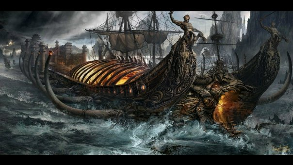

title: Залив теней
parent: gildii
order: 40
icon: bi-shield
image: photo/vk/533473434_457251371.jpg
vk: 54817957
art: photo/gildii-web/zaliv-teney.webp
layout: guild
leader: iskra

## Общее описание

Какими вы представляете себе пиратов? Неважно, эти ребята явно довольно неординарны для того, чтобы называть себя пиратами. Прибывшие из Алькара, они остались у берегов Бранна. Их огромный корабль, который одновременно является и их резиденцией, наводит на вопрос: "А стоит ли на них нападать?". Во главе их стоит эльфийка с прозвищем Искра, которая и утверждает, что они пираты, захватившие корабль одной империи и приплывшие из тёмного залива, однако знают истину самой Искры очень мало людей.

## История

Залив теней — крайне молодая гильдия, существующая от силы 5 лет. Хоть они сами и утверждают, что являются лишь пиратами, на деле всё несколько глубже. Верхушка залива теней на деле состоит из бывшей аристократии Алькара, которая бежала после неудачной попытки захвата власти. Главой всего этого сборища была Искра. Она собирала людей, готовила планы по захвату власти. Когда последнее с треском провалилось, единственное, что оставалось группе бывших аристократов — бежать из страны. Ещё имея какие-никакие связи, они смогли угнать строящийся Алькаром огромный корабль-базу, позже ставший резиденцией образовавшейся гильдии. На данный момент они причалили к берегам Бранна.

## Устройство, цели, влияние

Главой гильдии является Искра — молодая алькарка, благодаря которой всю сбежавшую знать не перерезали за предательство. Ниже по иерархии уже сама эта аристократия, преимущественно также состоящая из алькарцев. Они берут на себя разные задачи, управляя гильдией, по сути, как страной, в которой император непосредственно Искра. Кто-то отвечает за экономические дела, кто-то за военный флот Залива и так далее.
Основной же промысел Залива — пиратство, а также торговля с различными странами всем, что только можно награбить или найти в море. Стоит отметить, что нападением на корабли под флагами иных стран они не занимаются. Под горячую руку попадают лишь иные пираты, а также одинокие суда. Когда флотилия Залива оседает где-то, то иные пираты резко пропадают, просто не имея какого-либо шанса соперничать в этих водах.
Помимо награбленного добра Залив сохраняет и чужие корабли, становящиеся частью флотилии.

Резиденция, как уже можно догадаться, всегда меняет своё местоположение на воде, а сам корабль просто огромных размеров: достаточно представить, что на нём размещается добрый десяток домов, защитные башни и есть ещё куча места под прочие постройки, а передвигаться эта посудина может лишь при помощи магов ветра и воды, благо двигаться этой штуке надо редко, и основные отправки к материкам осуществляются при помощи обычных кораблей, записавшись в состав которых можно и попробовать вступить в гильдию. Для защиты от штормов и прочих бедствий с моря также помогают маги Искры, которые способны создавать защитные купола на весь корабль.

В Алькаре же залив вне закона, а за голову Искры и её приспешников там назначена приличная награда. Однако ради этих денег штурмовать собравшуюся флотилию и саму плавучую крепость никто пока рисковать не пробовал.
