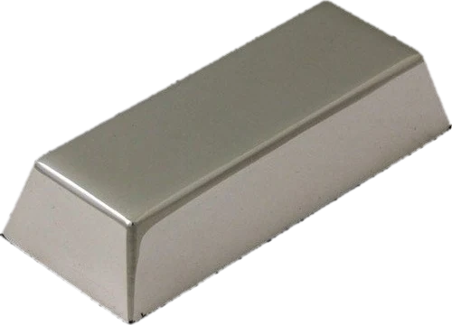
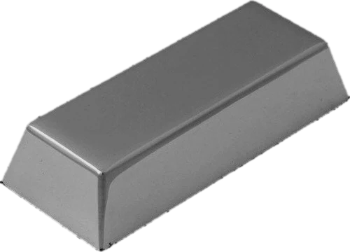
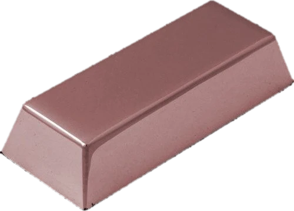
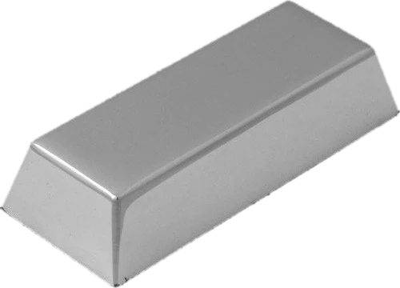
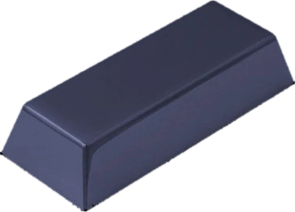
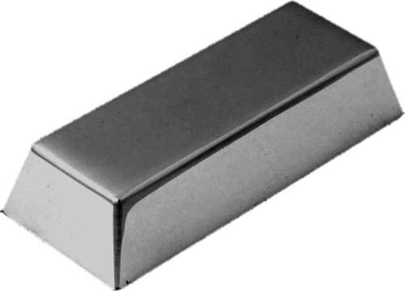
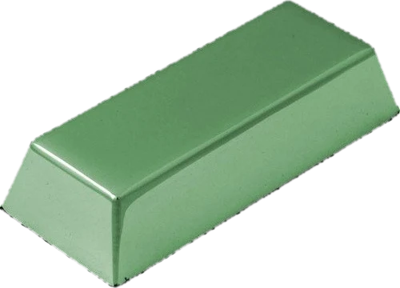
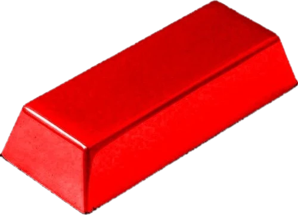
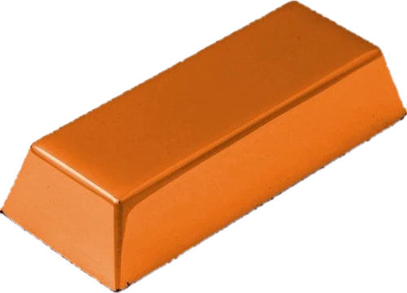
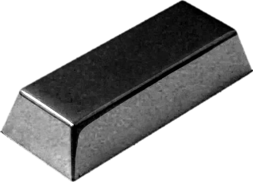

title: Характеристики оружия
parent: lor
order: 60
icon: bi-hammer
summary: Металлы и их свойства
image: photo/menu/materialy.jpg
art: photo/menu/materialy.jpg
layout: materials
vk: 54766865

Любое оружие и броня сделаны из различных материалов. Броня и вовсе может быть составной из разных материалов, и основные металлы и материалы представлены в обсуждении ниже. В начале же лучше стальных материалов у вас быть не может.
При покупке оружия у торговцев можно приобрести и что-то из более высокого материала, чем указано в ассортименте, но придётся поторговаться.

## Железо

- Стандартный феррум, рядовой металл. Очень распространён и его добыча не представляет собой чего-то сверхъестественного, что видно по очень высокой дешевизне. Характеристики этого металла самые низкие среди тех, которые используются для создания оружия. В основном местами добычи служат шахты Империи людей, оттуда же и развозится всеми возможными путями по всему Бранну, некоторые поставки Империя совершает также и за моря.

**Характеристики:** Каких-либо особых бонусов у металла нет, и оружие, сделанное из железа, имеет свои стандартные показатели — довольно непрочное, в сравнении с остальным, имеет свойство быстро тупиться.

## Сталь

- Представляет собой более высокоуглеродистое железо. Она прочнее железа, но и несложно догадаться, что дороже. Изготовить сталь весьма просто, и она даже ещё более распространена, чем железо, хоть и дороже. Масштабы ввозов/вывозов стали ещё больше, нежели у железа.

**Характеристики:** Такое оружие уже более прочное и обладает большей пробивной способностью, нежели железное.

## Звёздный Металл

- Вольфрам, добываемый из упавших на земли Бранна метеоритов. Так уж распорядилась судьба, что большая часть этого металла добывается на землях эльфов, ими же. Также есть поставки из-за моря, и только благодаря им этот металл распространён не только у эльфов, которые торговлю им не ведут, не считая нечестных добытчиков, ведущих продажу в тайне от государства. Весьма дорог, но если посетить ушастых для создания оружия из этой руды, то вы значительно сэкономите.

**Характеристики:** Металл знаменит и своими необычными свойствами, даже магическими, из-за которых при свете луны это оружие будто становится острее и смертоноснее, а само по себе оно на порядок прочнее стального.

## Серебро

- Серебро — всем знакомый металл, который чаще используется для украшений, нежели для оружия. Сам по себе он слишком мягок, чтобы делать из него оружие целиком, поэтому лезвия зачастую имеют крайне тонкий слой серебра, совмещённый с чем-либо ещё, что позволяет совмещать бонусы серебра и ещё какого-либо металла.

**Характеристики:** Используется же серебро лишь из-за того, что ядовито для многих существ, например, вампиров и оборотней.

## Эбонит

- Уже довольно редкий металл, обработкой которого занимаются сугубо гномы, как и добычей, так как металл требует определённой техники в обработке и добыче. Вследствие этого цена оружия из этого металла в разы дешевле именно у гномов, хотя они и заламывают цену чужеземцам. В Бранне мест добычи этого металла всего два, и оба на территории Великой Империи ящеров, где укоренились гномы лучше всего. Однако поставки совершаются другими государствами гномов из-за морей. Один из основных поставщиков, государство гномов — Гольм.

**Характеристики:** Этот металл невероятно прочен, из-за чего часто используется при создании именно хороших лат, на кольчугу переводить такой металл считается кощунством, так как он довольно редок. В таких доспехах вы намного лучше будете переносить даже удары палицами. Оружие тоже выходит прекрасным из этого металла, даже кость ему становится меньшей проблемой.

## Титанит

- Сплав эбонита с титаном. Изготавливается такой металл лишь гномами, и в крайне малых количествах. Если вы захотите себе клинок из титанита, готовьтесь выложить немалую сумму, ведь они между собой его крайне редко распространяют, а любому чужеземцу это обойдётся втридорога, если ему вообще захотят продавать этот металл. Любые партии из-за моря также крайне малы, и закупаются лично странами, на что тратятся приличные деньги. В основном таким поставщиком служит опять же Гольм. Как раз во время таких поставок нечистые на руку гномы и продают этот металл в портах Империи людей и ящеров.

**Характеристики:** Схож по свойствам с эбонитом, просто намного лучше его. В таких доспехах вы можете чувствовать себя ещё спокойнее, что касается и оружия.

## Мифрил

- Очередная гномья поделка. Прочен, крайне прочен. Характерная особенность — увеличивает свою плотность и структурную прочность при сжатии и особой обработке. За счёт этого лезвия мифрилового оружия не тупятся, а наоборот — затачиваются со временем. Вдобавок ко всему — ещё и невероятно лёгок. Полнотельная мифриловая броня весит как кожаная, но защищает не в пример лучше, а оружие вообще по весу как пёрышко. Есть только у гномов. Считается их стратегическим ресурсом, продажа незаконна. Хотя ходят слухи, что несколько нечистых на руку гномов из Гольма организовали мелкую подпольную торговлю этим металлом — естественно, заламывая за него заоблачные цены. Учитывая также тот факт, что обрабатывать его кроме гномов также никто не умеет — готовьтесь потратиться ещё и на услуги мифрилового кузнеца.

**Характеристики:** Что оружие, что броня из этого материала — сказка. Невероятно лёгкое, при этом прочное, ещё и становящееся лишь острее с каждым ударом в случае оружия. Стрелы с таким наконечником вообще можно собирать после битвы и пользоваться снова, они станут лишь лучше, главное чтобы древко не сломалось.

## Адамантит

- Один из редчайших металлов, что можно найти в мире. За пару слитков ваш кошелёк минимум полегчает на десяток тысяч золотых монет. Несмотря на то, что по свойствам примерно равен гномьему Титаниту, обладает одним весьма важным свойством — Адамантит вымещает из своего объема магию и не даёт ей проникать внутрь — что выливается в мощнейший антимагический эффект. Щиты из Адамантита неуязвимы для воздействия магии, а клинки из него с лёгкостью прорезают любые магические щиты и барьеры, наносят урон магическим существам, таким как призраки или элементали. В отличие от мифрила, не является чисто гномьей монополией, а добывается крайне мелкими партиями во всех государствах. Часто из адамантита создают кандалы и элементы камер для магов-преступников.

**Характеристики:** Обговариваются в лс с админами, так как есть вариации бонусов от этого металла.

## Орихалк

- Один из немногих металлов, который является легендарным — такие металлы никто не видел, они нигде не добываются, а те, кто их найдут, — огромные, огромные счастливчики. Король металлов. По прочности превосходит всё, что известно в мире. Лёгок, как мифрил. Но самым главным его свойством является усиление магии, проходящей сквозь него. Чем выше чистота Орихалка и чем выше его плотность и объем — тем выше усиление. Никто не знает точных объемов. Однако, присутствует и обратный эффект. При контакте Орихалка с Адамантитом происходит магическая реакция, выливающаяся в практически мгновенное разрушение обоих металлов в пропорции один к одному и превращение их обоих в малопонятную инертную чёрную пыль. Легендарный металл — никто из живущих им не располагает, и уж тем более не продаёт. Однако, тот счастливчик, что найдет его — по праву сможет считаться одним из сильнейших мира сего.

**Характеристики:** Усиливает магический потенциал владельца, что также обговаривается с админами.

## Арконор

- Ещё один легендарный металл. Согласно легендам, Арконор практически неразрушим, а его свойства во многом определяются тем, кто владеет им. Если пользователь захочет видеть Арконоровый меч сверхлёгким и никогда не тупящимся — он таким и будет. Если захочет, чтобы Арконоровое лезвие было смертельно ядовито и никогда не тупилось — так и случится. Если пожелает, чтобы Арконоровые доспехи были неуязвимы для вредоносной магии и усиливали магию самого носителя — будет именно так. Свойства Арконора определяются владельцем. Однако у всего есть цена. Смертным не дозволено владеть Богом Металлов. По легенде, тот, кто хотя бы дотронется до Арконора и будет сочтён недостойным — будет мгновенно испепелён, а его душа и жизненная сила будет поглощена объемом Арконора. Но если случится так, что Арконор признает владельца — то последний вполне сможет сравниться силой с практически чем угодно.

**Характеристики:** Индивидуальны и обговариваются лично с админом.

_Аффтор многих металлов — Юрий Ребане_
