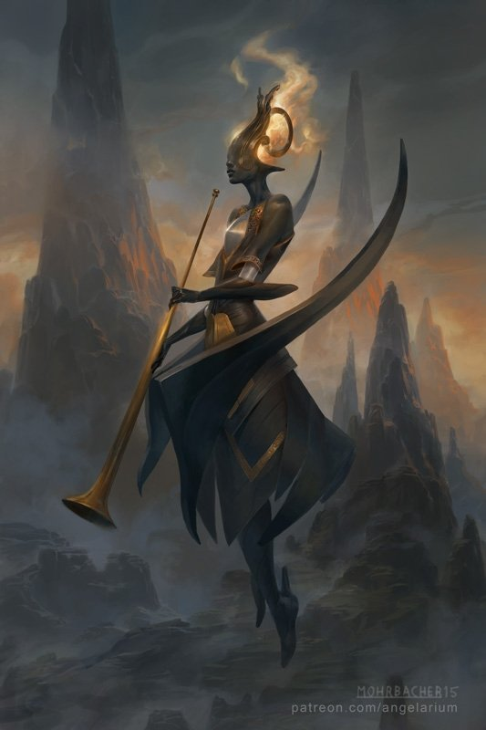

title: Дуала
parent: bozhestva
order: 190
icon: bi-brightness-high
group: Меньшие божества
summary: Богиня глифов, литературы, писцов, художников, поэзии, песен, ораторского искусства
image: photo/bogi-web/duala.webp
vk: 54763185
art: photo/bogi-web/duala.webp
layout: god
portrait: photo/vk/533473434_457247052.jpg

## Дуала: Богиня глифов, литературы, писцов, художников, поэзии, песен, ораторского искусства

_Меньшее божество._

Дуала — одно из божеств, созданное эмоциями и потребностями смертных. Искусство зародилось у смертных довольно быстро, хоть ранние его подобия и сложно назвать таковым. И всевозможные деятели музыки, литературы или живописи придавали своим трудам особый смысл, а также верили, что за ними стоит нечто или кто-то большее. В этом потоке мыслей и потребностей и формировалась Дуала. Она становилась всё чаще музой для многих авторов. В своём благословении она даровала многим вдохновение, а под её началом часто рождались известные таланты различных стран.

Каждый изображает Дуалу по-разному, в зависимости от того, каким ремеслом занимается сам. У богини есть усреднённый общий образ, представляющий из себя каменную статую женщины с какими-либо музыкальными инструментами, или стоящую за холстом. Но так как Дуала — плод мыслеформ и желаний смертных, то и детали её образа непостоянны.

