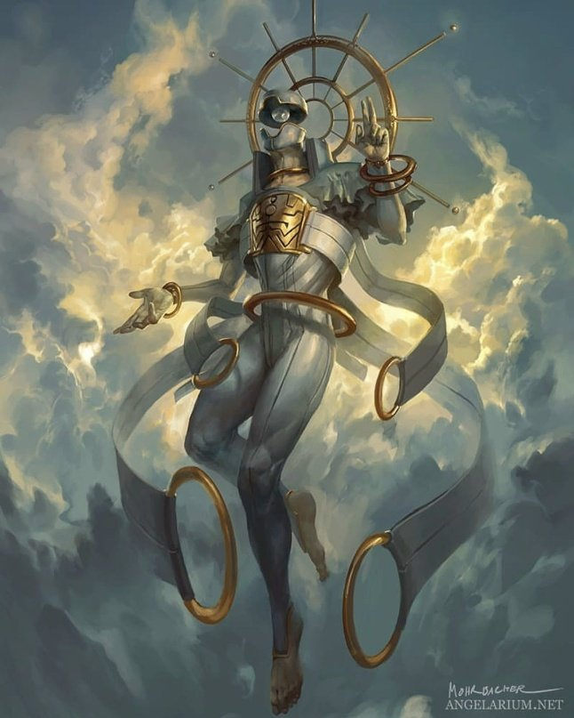

title: Эн`л
parent: bozhestva
order: 10
icon: bi-brightness-high
group: Абсолютное божество
summary: Верховное божество
image: photo/bogi-web/en-l.webp
vk: 55342016 54763090
art: photo/bogi-web/en-l.webp
layout: god
portrait: photo/vk/533473434_457245059.jpg

## Эн`л: верховное божество

Первый, кто нашёл девственный мир Наира, не имевший существ мыслящих, рас и городов, что сейчас высятся и занимают собой пригодные и не очень земли. Это Эн`л. Являясь первым, кто стал преобразовывать это место, он до сих пор удерживается как абсолютное, верховное божество. Исходя из видений жрецов и иных проявлений Верховного, Эн`л представляют в человекоподобном образе с округлой конструкцией над головой. Именно эта конструкция — частый символ Эн`л в храмах и иных местах. Она позволяет поддерживать хрупкий баланс во всех уголках Наира, является сосредоточением добра и зла, света и тьмы, которые не существуют друг без друга. Ходит слух, что тот, кто сможет совместить все эти аспекты, непременно будет одарён Высшим и станет одним из его избранных, но никто до сих пор не смог найти в себе сосуществования столь разных стихий. Каждый ведает, что имеет Эн`л верную супругу, брата и двоих детей: Ше`Ела и Хирика.

> За собой он привёл иных: благоверную супругу Исти и кровника Ор`Эла. И ведали они то, что считали нужным, делая этот мир своим, и не только домом
_О богах и мире сем, рукопись неизвестного_

Об Эн`л знают все, каждый слышал хотя бы просто отрывки из рассказов, искажённых годами со слов провидцев. Мощь Высшего велика, сравнима с совокупным могуществом иных богов, разве что Исти близка по силе с супругом. Множество существ питает его силу, они принадлежат к абсолютно разным расам, последователи находятся на всех планетах Наира, и, конечно же, в Бранне. Хоть божество и перестало проявлять себя столь же открыто, как тысячи лет назад, до сих пор находятся одарённые ничтожной крупицей его силы существа, герои, чьи имена также переносятся сотнями лет из уст в уста, крепя и имя Эн`л. И всё же образующаяся среди богов теснота сказывается на имени божества. Всё больше тех, кто считает, что Высший бросил своих созданий, никак не проявляя себя, всё больше считают, что путь Эн`л не приведёт его созданий к чему-либо лучшему. Пусть это и капля в море воспевателей его доброго имени, но это начало соперничества с другими за мир, который он открыл.

## Дополнительная информация
