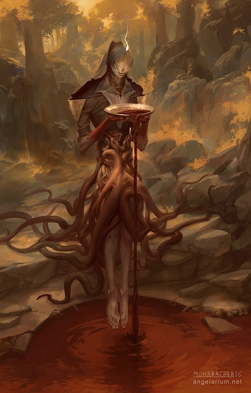

title: Фарида
parent: bozhestva
order: 110
icon: bi-brightness-high
group: Средние божества
summary: Богиня лесов, лесных существ, следопытов, дриад
image: photo/bogi-web/farida.webp
vk: 54763122
art: photo/bogi-web/farida.webp
layout: god
portrait: photo/vk/552910068_457239418.jpg
aliases: miel

## Фарида: богиня лесов, лесных существ, следопытов, дриад

_Среднее божество._

Фарида — космическая странница, множество веков озеленяющая бесчисленное число планет. В дремучих лесах, кипящих жизнью, она видела своё нечто прекрасное. Но некто сильнее всегда гнался за Фаридой по пятам, уничтожая каждую озеленённую ею планету. Это превратилось в ужасную игру, в которой богиня лесов лишь пыталась укрыться, надеясь, что наконец обрела покой, когда очередную планету, очередную систему в Великой пустоте просто растаптывали, заставляя странницу бежать дальше. Длилось это, пока укрытие Фарида не нашла у формирующегося Наира. Взамен на защиту от Эн`л и Исти, а также обещанные новые силы, Фарида стала покровительницей лесов. Нечто неизвестное отступило, возможно, лишь на время, дабы тоже набраться сил, но главное, что больше не беспокоило созидательницу. Фарида быстро озеленила пустоши Наира пышными лесами, часть своих ветвей она сорвала с собственного тела, россыпью раскидав на различные планеты. Из них вырастали наиболее мощные деревья, способные рождать жизнь, известную смертным как дриады. Защитницы лесов считают себя воплощением воли Фариды, желающей защитить свои зелёные владения, чем нимфы и занимаются.

Помимо дриад поклоняться богине лесов стали, в большинстве своём, и эльфы. Эльфы Бранна вовсе считают, что богиня контактирует с ними через Сердце леса. В самом огромном дереве леса поселились первые эльфы Бранна, позже нашедшие в его корнях нечто, похожее только на саму богиню. Помимо зелёных лесов Фарида привела с собой и их защитницу — Римару.

Изображается же Фарида как деревянный исполин, покрытый зеленью и пышными ветвями. У эльфов больше распространён образ, колеблющийся между привычным видом многих богов и представлением дриад. Женская фигура, сплетённая из корней, не имеющая глаз. Часто изображают её с Римарой, которая является защитницей покоя лесов Фариды.
