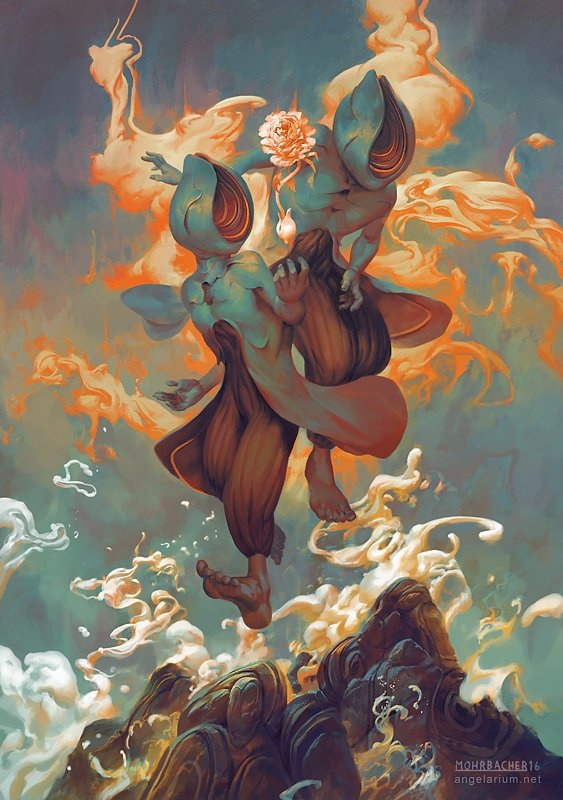

title: Фирмунг
parent: en-l
order: 10
icon: bi-book
summary: Последний путь душ почитателей Эн`л
image: photo/vk/533473434_457245395.jpg
banner: photo/vk/533473434_457245398.jpg
vk: 55284897

## Фирмунг: последний путь

Первые упоминания Фирмунга в молитвах и песнопениях появились ещё далеко до Громула, в Граальдфаде. Множество жрецов Верховного в видениях зрели необъятные врата, что являлись последним испытанием для множества душ. Путь большинства из них долог: внутренние думы и битвы отягощают его. Смертные взвешивают все свои деяния, преодолевают битву добра и зла внутри. И чем эта битва тяжелее, тем дольше становится путь, пока не придёт победа одной из сторон души, или пока не придёт осознание того, что не может быть плохого или хорошего. Особо долог путь тех, кто не может простить сам себя за свершённые грехи, принять их и пообещать перенести эту ношу с собой в новый мир своего божества. Ещё сложнее путь тех, кто истово верил в Эн`л, но не мог разглядеть своих грехов, ужасного содержимого своей души. Их дорога длится, пока они не смогут понять всего этого, видя моменты своего существования среди других смертных, раскаявшись после в молитвах.

На всех фресках и картинах этот путь оканчивается величественными вратами, за которыми виднеется яркий новый мир, охваченный тёплым золотым солнцем. Плотный туман простирается бесконечно вниз, среди которого возвышаются души почитателей Верховного. В этом тумане они видят фрагменты своей жизни, свою сущность, которую сами же порой не способны постичь. Очень часто в сопровождении душ изображаются Триалы — вестники новой жизни, вестники Верховного божества. Они не дают душам потеряться в их последнем пути, подталкивая продолжать путь к новой вехе своего существования.

