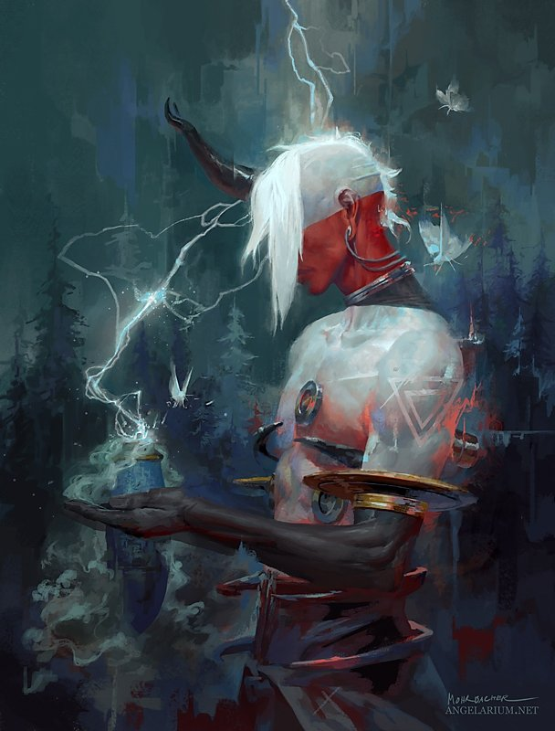

title: Ховар
parent: bozhestva
order: 220
icon: bi-brightness-high
group: Меньшие божества
summary: Бог болезней, яда
image: photo/bogi-web/hovar.webp
vk: 54763194
art: photo/bogi-web/hovar.webp
layout: god
portrait: photo/vk/533473434_457247057.jpg
aliases: talon

## Ховар: Бог болезней, яда

_Меньшее божество._

Ховар — образ в головах смертных, ответственный за болезни, преследующие их с самого начала. Хоть в самих болезнях ничего хорошего и нет, но самого бога отрицательным его сторонники не считают. Болезни Ховара для них — испытания, которые делают тела и души крепче перед грядущими испытаниями. Если же где-то разверзаются эпидемии чумы или ещё чего страшнее — то Ховар разгневан и насылает своё наказание на смертных. Своих же поборников от такого бог оберегает, и город, где есть храм Ховару, реже будет подвергаться различным хворям.
В последнее время имя бога Ховара чаще на слуху из-за скверны, так как многие считают, что это высшее проявление недовольства божества на сегодняшний день.

Изображают его как мужчину, часто покрытого незначительными язвами и окружённого зловониями. Его последователи описывают это тем, что бог, уберегая их от болезней, сам переносит тысячи всевозможных хворей, легко переживая их.

