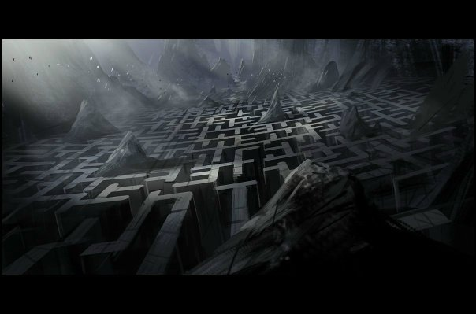
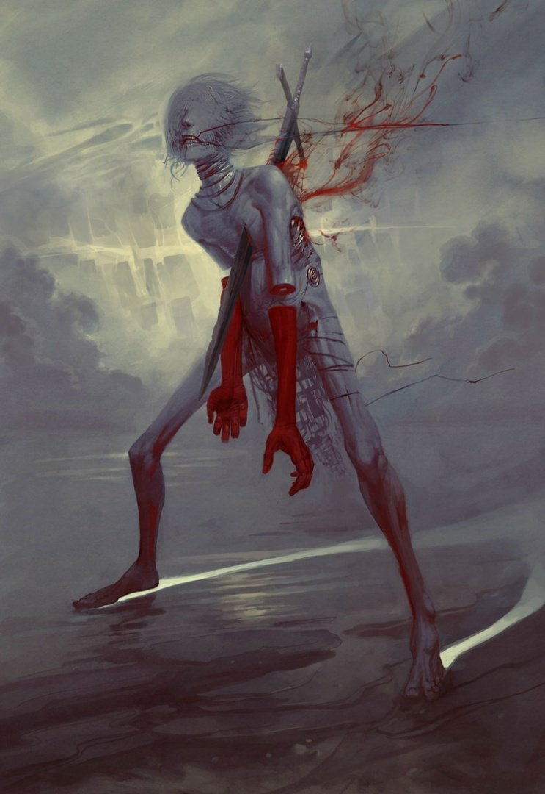

title: Иштам
parent: bozhestva
order: 30
icon: bi-brightness-high
group: Семёрка
summary: Бог мёртвых, смерти и страха
image: photo/bogi-web/ishtam.webp
vk: 55342018 54763100
art: photo/bogi-web/ishtam.webp
layout: god
portrait: photo/vk/533473434_457245401.jpg

## Иштам: бог мёртвых, смерти и страха

_Второй по значимости член семёрки._

Найденный Исти в одном из темнейших и дальних уголков пустоты вселенной, Иштам был призван блюсти один из ключевых этапов жизни всех смертных — смерть. Основа царства бога мёртвых — лабиринт душ. Место, куда попадает каждый после гибели. Тут решается судьба душ — куда они попадут после гибели. Поклоняющиеся определённым божествам попадают в царство тех, в кого верили наиболее истово. Поклоняющиеся же самому Иштаму скитаются по лабиринту, борясь со своими величайшими страхами. Эта борьба — показатель того, сколь сильно смертный познал сущность страха, чтобы перестать относиться к нему с опаской. Борьба некоторых может занимать время, граничащее со столетиями. Когда душа справляется с этим испытанием, её частичка нитью устремляется в бесконечную высь. Когда таких душ набирается достаточно много, Иштам срезает их своим серпом, отправляя тем самым в заслуженное царство смертельного покоя и тишины. Есть и те, кто при жизни не верил в каких-либо богов вовсе. Их ждёт бесконечное блуждание по лабиринтам бога мёртвых, до момента обретения своей веры.

Лабиринт Иштама представляет собой бесконечно идущие вверх каменные стены. Души тут ведомы неизвестной силой, находя выходы в царства своих божеств самостоятельно. Лабиринт имеет и своих защитников. Аналоны — существа, пришедшие вместе с Иштамом в Наир. Изначально не имеющие формы, ныне они походят на человека с отсечёнными кистями, иногда пронзённого клинком. Они считаются также воплощением страха и боли, одним из проявлений Иштама. Последователи бога смерти говорят, что если слабый духом смеет обращаться рьяно или без дела к Иштаму, то Аналоны непременно заберут его в бесконечный лабиринт. Именно поэтому среди всех последователей произносить вне молитвы или литаний имя Иштама нельзя. Так, чаще распространены расплывчатые обозначения их бога в речи: "Он", "Страх", "Проводник".
Самого бога представляют как бесформенную фигуру в тёмных одеждах, часто с чем-то, напоминающим серп — ещё одним символом бога страха. Серп этот называют жатвой. С его помощью Иштам отправляет своих последователей в царство покоя и тишины. Руки Иштама, сдерживающие жатву, изображают иссохшими, имеющими серую мёртвую кожу. Иные части тела никогда не изображаются. В том числе и ноги и лицо, даже если фигура изображена в полный рост.

## Дополнительная информация
