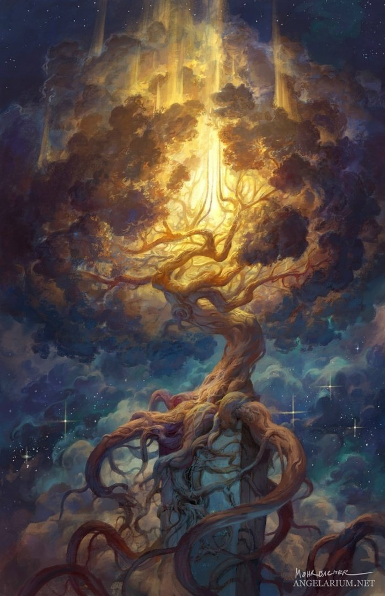

title: Кайяс
parent: bozhestva
order: 270
icon: bi-brightness-high
group: Полубожества
summary: Бог преобразований
image: photo/bogi-web/kayyas.webp
vk: 55342022
art: photo/bogi-web/kayyas.webp
layout: god
portrait: photo/vk/533473434_457245393.jpg

## Кайяс: Бог преобразований

_Полубожество._

Слухи о Кайясе идут лишь от некоторых особо старых элафаков, дриад и эльфов. Могучее древо, созданное Фаридой и прорастающее где-то далеко за пределами Бранна на этой планете. Самые старые элафаки уверяют, что духи, подобные им, рождаются именно в его корнях, после разлетаясь по всей планете, и, собственно, самому Бранну. Дриады говорят, что Кайяс необходим Фариде как раз для их рождения, и что он сам по себе — самая первая древнейшая дриада, вместо смерти переросшая в могучее дерево. Эльфы же утверждают, что Кайяс ответственен за смену времён в лесах. Что от его ветвей по всем материкам разлетаются семена деревьев, и что Сердце леса, возможно, и одно из его проявлений, а не самой Фариды.

Изображается как огромных размеров дерево, из глубины своей кроны излучающее жёлтый свет ввысь. Оно растёт на каменном сооружении, которое обвил корнями, что уходят сквозь облака вниз. Многие из последователей Кайяса считают, что сам он находится где-то на планете, возможно, в недосягаемых водах, а возможно, в ещё не открытых землях.

