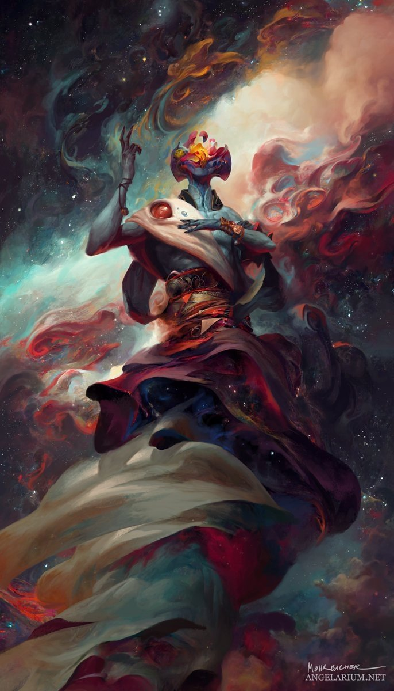
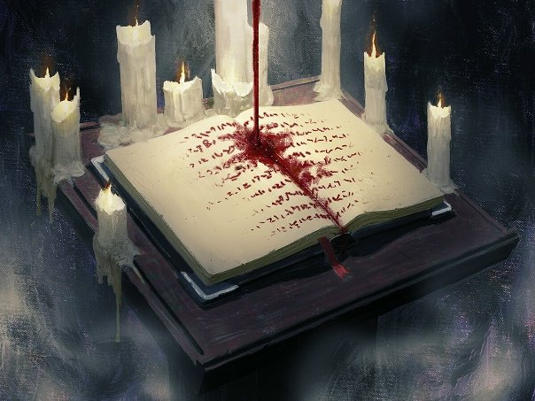

title: Кхела
parent: bozhestva
order: 40
icon: bi-brightness-high
group: Семёрка
summary: Богиня тьмы, крови, судьбы и хаоса
image: photo/bogi-web/khela.webp
vk: 54763127
art: photo/bogi-web/khela.webp
layout: god
portrait: photo/vk/533473434_457245478.jpg

## Кхела: богиня тьмы, крови, судьбы и хаоса

_Третий по значимости член Семёрки._

Кхела, богиня тьмы и крови, судьбы и хаоса, до всех этих титулов была кровницей её брата Кхора. Кхор — изначальное божество всех перечисленных аспектов, который был приглашён также Исти из не столь отдалённых уголков пустоты. Кхор боялся за свою семью, всегда хотел быть сильнее и могущественнее, чтобы защищать её. Когда от семьи у него осталась лишь сестра Кхела, у него не было сомнений в предложении Исти. Получаемая сила от последователей среди смертных стала питать его уверенностью, а также расширять амбиции. Это сразу заметил Иштам, бог смерти и страха, ведь именно ещё и на его полномочия давно зарился Кхор, причём особо это и не скрывая. Бог страха, несомненно, чувствовал, что с пришедшей силой страхи и кошмары Кхора, связанные с теми,, кто лишил его почти всей семьи, только усиливались. Они могли бы привести к необратимым последствиям, пока бог тьмы пытался бы любыми способами получить больше силы. Иштам решил проверить, сколь сильны страхи Кхора на деле. И, как оказалось, они были сильнее даже его самого. Из страхов Кхора родился Палотариос, воплощение его страхов и при этом мечтаний, связанных с ними. Страхи и мечты были столь сильны, что становились уже отдельны от самого бога тьмы, в результате чего он и погиб.

Кхела знала, что Иштам был причастен к печальной участи её брата. Но ни у Эн`л, ни у кого-либо ещё она не нашла отклика, дабы призвать Иштама к ответу. Видящая гибель всей своей семьи и мучения брата, она преодолела свои собственные страхи. Гибель столь значимого бога была катастрофична, его последователи видели ужасные видения и кошмары с гибелью их бога, герои теряли дарованные им силы, многое, что держалось им, стало рушиться. Только Кхела вовремя смогла остановить всё это и дать всем последователям Кхора новую надежду. За это её и оставили преемницей дел своего брата. И до сих пор мало кто даже из богов знает, что затевает Кхела. Но все точно знают, что если погибнет или уйдёт и она, то среди смертных случится очередной кошмар, и неизвестно, сможет ли его кто-то остановить ещё раз.

Жрецы и послушники богини тьмы на основе своих видений изображают её как соединённые вместе три тела, обладающие множеством рук, одинаково оголёнными черепами вместо голов со спадающими вниз седыми волнами волос. Одно из тел удерживает посох Кхора двумя руками, в нём сконцентрирована вся тьма Наира, без которой невозможен свет. Второе контролирует огненный крест судьбы, в котором в хаосе решаются пути многих смертных. И третье, сжимающее худыми пальцами кровоточащее сердце, наполняющее каждого послушника силами. Всё это атрибуты богини, являющиеся символикой алтарей и храмов, посвящённых ей.

Хоть и сама вера в богиню тьмы нигде не порицается, многие опасаются её последователей. Многие из них организовали секты, после видений с гибелью их бога. В честь Кхелы они приносят жертвы, часто тех, кто верует в иных богов, причастных по их мнению к смерти Кхора. Благодаря им Кхела обладает одними из самых истово верующих смертных, хоть и не самых многочисленных. Но храмы ей можно найти также и в крупных городах, где более разумные последователи почитают баланс, осознавая, что без тьмы нет света, отчего вера в неё часто перекликается с верой в Малайю, как бы парадоксально это ни было.

