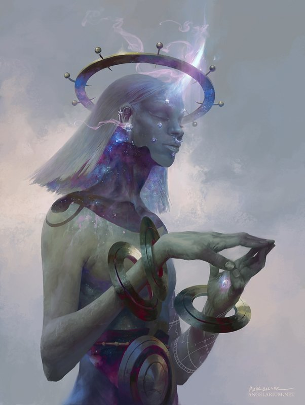

title: Лиаонос
parent: bozhestva
order: 140
icon: bi-brightness-high
group: Средние божества
summary: Богиня луны, звёзд, навигации, пророчеств, оборотней
image: photo/bogi-web/liaonos.webp
vk: 54763172
art: photo/bogi-web/liaonos.webp
layout: god
portrait: photo/vk/533473434_457247048.jpg
aliases: seula

## Лиаонос: Богиня луны, звёзд, навигации, пророчеств, оборотней

_Среднее божество._

> Если идя в ночи по лесу ты видишь звёзд парад, что выстилают путь домой, то знай, дитя, Лиаонос смотрит за тобой.
_Отрывок из песни эльфов_

Лиаонос — первая звезда миров Наира, что принесла за собой остальные. Она была тут даже до прихода Эн`л, но только формировалась в нечто большее, чем просто кусок космической породы, подобно Турну. Своим воздействием на планеты Наира Эн`л заставил этот процесс ускориться. Когда воплощение богини закончилось, множество осколков-звёзд посыпались на планеты. Эльфы считают, что один из таких осколков послужил материалом Эн`л и Ор`Элу для их создания. Лиаонос стала хранительницей звёзд и лун, а с её существованием в изначальном пантеоне богов просто пришлось смириться как с фактом. Первые разумные создания планет Наира всегда обращали взгляды в звёздное небо. По ярким огням на тёмном полотне ориентировались, пытались предсказать собственную судьбу. Из-за этого Лиаонос довольно быстро стала не только хранительницей звёзд.

Особые знаки внимания звёздной хранительнице стал оказывать Мор. Специально для неё он решил создать самых верных последователей, которые всегда бы обращали свой взгляд к луне. Так появились первые оборотни, перешедшие от покровительства Мора к Лиаонос. Правда, именно из-за этого дар Мора, данный оборотням, превратился больше в проклятие.

Саму Лиаонос представляют как женщину, вытесанную из камня и металла. Голову её обрамляет обруч, округлая часть которого изображает количество планет в Наире. Поклоняются же Лиаонос в основном эльфы и оборотни, хотя, как это водится, последователи встречаются в каждой из рас Бранна.
