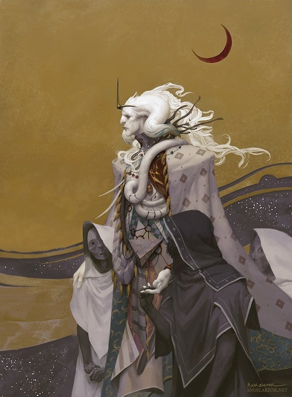

title: Мор
parent: bozhestva
order: 200
icon: bi-brightness-high
group: Меньшие божества
summary: Бог охотников, охоты
image: photo/bogi-web/mor.webp
vk: 54763187
art: photo/bogi-web/mor.webp
layout: god
portrait: photo/vk/533473434_457247055.jpg

## Мор: Бог охотников, охоты

_Меньшее божество._

Охота была основным способом добычи пропитания первых смертных. Более того, охота дарила не только необходимое мясо, но и шкуры, кости, используемые в материалах. Ценность данного деяния было сложно переоценить, ведь от него зависела жизнь смертных. Естественно, что уходить на очередную охоту было спокойнее, когда ты думал, что тебе в этом способствует что-то или кто-то. В порыве этого рождался покровитель всех охотников Мор, второй после Асиры. Ныне охота менее популярна и силы самого Мора стали значительно меньше, но про него всё ещё не забывают. Его знают и как создателя оборотней. Взяв человеческую сущность, Мор дал им возможность по собственному желанию обращаться в зверей, а также сделал оборотней сильнее обычных людей и более верными в определённых смыслах. Однако цель была не в наличии верных последователей, ибо это был подарок первородной звезде Лиаонос, к которой бог охоты совсем не холоден и пытается оказывать различные знаки внимания. Так как покровитель оборотней сменился, а сам Мор со временем становился слабее, его дар слабел и сильно видоизменился, ныне причиняя оборотням больше неудобств.

Мор изображается как мощная фигура, напоминающая отдалённо человека. Кожа его белоснежна и груба. Голову его украшают подобия рогов, растущих к затылку по краям головы. Когда охота стала популярна у аристократии, образ Мора в глазах определённых последователей изменился и стал менее грубым и диким. Его стали чаще изображать в дорогих одеждах, с золотым посохом в руках. Всегда неотъемлемой частью образа был спутник Мора — лев Ки`Ин. Он фигурирует в различных легендах и сказках смертных как верный спутник и искусный охотник.

